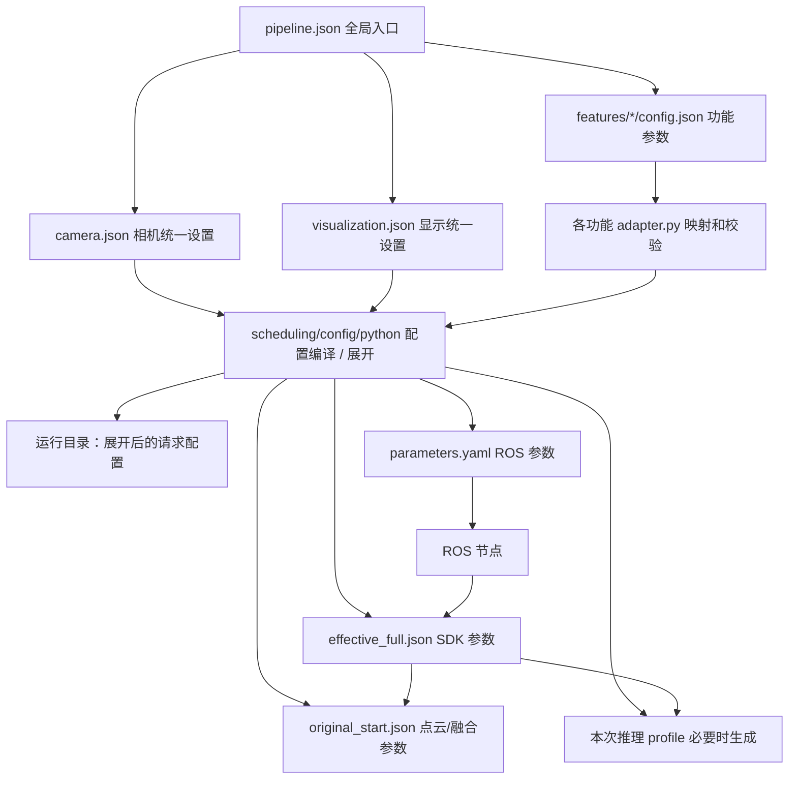
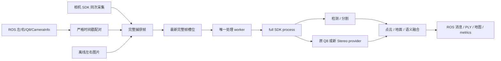

> **历史材料（v1/v2）**：本文保留用于理解原算法与历史验证。v3 的配置、路径、构建及运行入口已经改为纯 C++；本文旧命令和旧 DAG 配置不能直接用于本版。请以 [09_纯CPP输入与Graph迁移](09_纯CPP输入与Graph迁移.md) 为准。

# 架构与目录：从配置找到真正执行的代码

## 1. 这套程序解决什么问题

系统把一帧相机图像转换成检测框、分割掩码、视差、点云和融合地图。图像可以来自相机 SDK、ROS 话题或离线文件；录制模式用于把同一批数据分别交给原视差和新 Stereo 算法。

v1 把“输入、模型、融合、输出”按功能分类；v2 继续把原 SDK 主要实现移出，新增独立调度层 `scheduling/`，管理配置解析、DAG 构建验证、任务执行和产品编排。公开 C 接口集中到 `sdk/`，具体数值算法归 `features/`。ROS 包仍为 `perception_ros_so_demo`，兼容 `colcon`、`ament` 和既有命令；`src/perception_ros_so_demo/` 是构建入口。

## 2. 顶层目录怎么读

```text
perception-stereo-modular-v2/
├── pipeline.json                 # 全局：选输入、选视差方法、SDK、输出、引用各模块配置
├── camera.json                   # 全局：相机 SDK 路径、厂商配置、超时、相机模式
├── visualization.json            # 全局：ROS 显示输出、坐标系、RViz 相关设置
├── core/                         # 共有的数据契约和小型基础工具
│   ├── include/perception_ros_so_demo/
│   │   ├── capture_types.hpp      # 一次捕获、图像平面、拥有内存的数据类型
│   │   ├── source_info.hpp        # 数据来源、原图尺寸、路径等说明
│   │   ├── latest_frame.hpp       # 严格时间戳配对 + 最新完整帧队列
│   │   └── json_text.hpp          # JSON 字符串/有限数值输出工具
│   └── src/json_text.cpp
├── features/                     # 主要开发入口：按功能找文件
│   ├── camera/                   # 相机 SDK 加载、采集、释放、参数读取
│   ├── ros/                      # ROS 节点、消息、订阅配对、发布
│   ├── offline/                  # 图片/原始 YUV 读取和转换
│   ├── stereo/                   # 新 Stereo provider、模型 runner、张量编解码
│   ├── detection/                # 检测配置、映射和 IoU/NMS 真实头/源
│   ├── segmentation/             # 分割配置、双线性后处理及 CHW argmax 真实头/源
│   ├── inference/                # 共用 profile/DAG 设置、真实检测和分割实现
│   ├── sdk_bridge/               # full SDK C ABI 的生命周期封装
│   ├── pointcloud/               # 点云输出 + 可重编译的真实几何/地面算法
│   ├── fusion/                   # 语义/网格融合配置 + 可重编译的真实算法
│   └── metrics/                  # CPU/RSS、性能输出配置和采样
├── scheduling/                   # 独立调度层：配置、图、执行、业务编排
│   ├── config/                   # 用户配置编译、C++ parser、SDK 模板/profile
│   ├── dag/                      # TaskGraph、full graph、前端选择图校验
│   ├── runtime/                  # 运行接口、资源关闭、原兼容执行包装
│   ├── pipeline/                 # full 会话和产品业务绑定、内置 Feature 包装
│   ├── inference/                # 精确检测/分割内层图及会话
│   ├── product/                  # 原产品命令/流程/身份策略
│   └── launch/                   # Python 启动实现与 DAG worker
├── sdk/                          # 公开 C ABI 头文件、薄转发、SDK 构建安装
├── third_party/                  # 厂商及第三方源码
├── archive/r36_sdk/              # 原 SDK 历史说明、参考和来源材料
├── src/perception_ros_so_demo/    # ROS package.xml、CMakeLists.txt
├── compare/                      # 录制、相同输入对比、统计和可视化报告
├── stereo/                       # 兼容的离线 Python 工具和点云查看器
├── tools/                        # 配置展开、构建、启动、打包、校验
├── config/                       # 老格式示例/兼容入口、RViz 资源
├── validation/                   # 测试、证据、发版校验说明
└── docs/                         # 阅读、合理性分析、验证方案、分享资料
```

有用户参数的功能把 `config.json` 放在对应 `features/<功能>/` 下；相机和可视化统一文件在根目录。通常按“配置 → `adapter.py` 参数映射 → `include/` 数据/接口 → `src/` 实现”阅读。有真实 SDK 算法的模块还包含 `backend/`。sdk_bridge、core 等技术模块没有独立用户参数，不创建没有实际用途的空 JSON。

检测的 IoU/NMS、分割的基础 CHW argmax，以及当前真正使用的双线性分割工作空间与参考实现，在各自 `backend/include/`、`backend/src/`。公共模型执行和张量读取在 `features/inference/backend/`；CPU 模型阶段在 `features/inference/cpu/`，输入校准/打包在 `features/inference/preprocess/`。推理任务编排在 `scheduling/inference/`，与数值计算分开。融合的 `MappingAlgorithms` 仍持有地面分类状态，尚未解除点云/融合的全部耦合。模块目录表达责任边界，不创建空 C++ 类。

SDK 的另一套相机适配在 `features/camera/backend/`，应用在线采集在 `features/camera/src/`。两套生命周期都已按功能可见，本轮没有强行合并。新增 `features/visualization/backend/`、`features/metrics/backend/`、`features/temporal/backend/`、`features/recharge/backend/` 收纳旧 SDK 的对应实现；默认产品配置并不启用所有历史功能，也没有为未开放功能制造空的用户 JSON。

## 3. 三条配置边界



根配置只决定选项和统一资源；模块配置描述各功能自身参数；运行目录里的生成配置记录“这次实际用到了什么”。长期修改应发生在源配置，生成文件用于审计和复现。

模块配置里设为 `null` 的可继承参数，含义是**保留当前 SDK/profile 的既有值**，不是数值零，也不是关闭功能。具体可继承项和允许范围见模块配置说明。这样能防止目录重排时无意引入另一套阈值。

配置文件可以引用环境变量。路径解析、字段校验和合成由前端完成；C++ 节点不直接解释所有模块 JSON。参数位置和代码符号见 [新手阅读与开发](03_新手阅读与开发.md) 和配置文档。

## 4. 一帧数据怎样流动



相机与 ROS 在线模式的目标是保持输入新鲜。正在处理的帧继续处理，等待槽位只保存最新的完整帧；如果输入快于计算，旧的等待帧被替换并计数。离线输入通过背压保留文件顺序，不采用同样的主动丢文件策略。

严格配对发生在提交 worker 之前：新 Stereo 需要同时间戳的左右图；原方法需要左图和 Q8.8；使用 CameraInfo 时还要求本帧的左右 CameraInfo。消息接收时间不应冒充相机捕获时间。

## 5. ROS 通信与线程

默认节点是 `/perception_ros_so_demo`。相机 ROS 发布节点是 `/perception_raw_camera`；相机直取模式不需要这个独立发布节点。

| 角色 | 默认话题/接口 | 消费方式 |
|---|---|---|
| 左图 | `/camera/rgbd_left_nv12` | `sensor_msgs/Image`，NV12/I420，640×544 |
| 右图 | `/camera/rgbd_right_nv12` | 新 Stereo 使用，同次捕获 |
| 原视差 | `/camera/disparity_q8` | 原方法使用，小端 `16UC1`，数值为 Q8.8 视差 |
| 左/右内参 | `/stereo/left/camera_info`、`/stereo/right/camera_info` | 校正后的 `P`，与本帧图像时间戳一致 |
| 结果 | `~/result` | `std_msgs/String`，JSON 检测、计时和应用结果 |
| 性能 | `~/metrics` | JSON，帧计数、耗时、CPU、RSS、FPS |
| 点云 | `~/clouds/camera`、`robot`、`ground`、`obstacle`、`semantic` | `sensor_msgs/PointCloud2` |
| 图像输出 | `~/mask`、`~/input_image`、`~/pcl_map`、`~/ai_map`、`~/fusion_map` | 按输出开关发布 |
| 错误 | `~/errors`、`~/error_code` | 结构化错误和数值码 |

`~` 在默认节点名下展开，例如 `~/result` 是 `/perception_ros_so_demo/result`。

线程分工如下：

- ROS executor 执行订阅与定时器回调，尽快完成校验和配对。
- 相机直取额外有一个 capture 线程，负责调用厂商 SDK 和复制捕获数据。
- 一个 inference worker 从 `LatestFrame` 取完整帧，同步调用 SDK。
- SDK 内部任务图可以并行执行检测/分割、视差等任务；应用层没有同时调用同一 engine 处理多帧。

ROS 输入默认采用 sensor data 风格 QoS 和有界缓存，可配置 reliability；发布端和订阅端的 QoS 要兼容。ROS 里“有 topic”不等于“有订阅匹配”，还应核对 node、endpoint、类型、domain 和 QoS。

实现入口：`features/ros/src/node_input.cpp`、`core/.../latest_frame.hpp`、`features/ros/src/node_process.cpp`。

## 6. 外层 DAG 与内层 DAG 不是同一个概念

外层配置表达四段固定责任：

```text
input → disparity 选择 → perception SDK → report
```

这里的“disparity 选择”是注册哪种视差来源，不代表启动一个先独立计算视差的进程。新 Stereo provider 在 **full SDK 的 disparity task 内部**被调用，因此可以与检测/分割同时调度。

full SDK 实际图定义在 `scheduling/dag/src/full_graph.cpp::steps`。省略本产品关闭的回充/历史功能后，主要链路是：

```text
检测/分割 ─→ RGB ───────────────┐
                               ↓
视差 ───────────────────────→ cloud
                               ↓
                       calibration（当前关闭自动校准）
                               ↓
                         labels / transform
                               ↓
                       ground → maps → output
```

精确的依赖扩展由 SDK 任务图实现，不能仅凭这张简图改删依赖。检测/分割内部还有 `input.exact.pack → det/seg 前处理/推理/后处理` 的任务图，源码在 `scheduling/inference/src/dag_pipeline.cpp`。

## 7. 原视差与新 Stereo 如何进入同一条融合链路

原方法把相机/录制的 Q8.8 传入 `psdk_full_frame.disparity`。

新方法先给 `StereoProvider` 注册左右图，**将 `frame.disparity` 设为空**，让 SDK 调用 `hooks.disparity_provider`。如果同时传入原 Q8.8，SDK 会优先使用它，导致新模型被绕过；目前代码有明确处理和 provider 调用检查。

两条方法之后都进入同一 Q8.8→点云→地面→融合实现。当前模型尺寸变化只发生在 Stereo 分支中，检测/分割和融合仍使用源 640×544 图像几何。

关键接口：

| 要看什么 | 文件与符号 |
|---|---|
| 提交完整帧 | `features/ros/src/node_process.cpp::PerceptionNode::processFrame` |
| SDK 生命周期 | `features/sdk_bridge/include/.../sdk_caller.hpp::Caller/Result` 与 `src/sdk_caller.cpp` |
| 新视差 callback | `features/stereo/src/stereo_provider.cpp::StereoProvider::Impl::invoke` |
| 模型契约/推理 | `features/stereo/runner/src/horizon_stereo.cpp::HorizonStereoModel` |
| 张量格式 | `features/stereo/runner/src/tensor_codec.cpp` |
| provider 优先级 | `scheduling/pipeline/src/full_pipeline.cpp::perception::sdk_internal::impl_psdk_full_process` |
| 原几何点云 | `features/pointcloud/backend/src/mapping.cpp::MappingPipeline::cloud` |
| 地面分类 | `features/pointcloud/backend/src/ground_segmentation.cpp` |
| 语义和地图融合 | `features/fusion/backend/src/label_fusion.cpp`、`map_render.cpp` |
| 融合算法状态与接口 | `features/fusion/backend/include/mapping_algorithms.hpp::MappingAlgorithms` |
| 检测 IoU/NMS | `features/detection/backend/include/percep_demo/detection_post.hpp`、`src/detection_post.cpp` |
| 分割 CHW 分类辅助 | `features/segmentation/backend/include/percep_demo/segmentation_post.hpp`、`src/segmentation_post.cpp` |
| 当前双线性分割实现 | `features/segmentation/backend/include/seg_post.hpp::SegPostWorkspace`、`src/seg_post.cpp`、`src/seg_post_reference.inc` |
| 检测/分割数值后端 | `features/inference/backend/src/runner.cpp`、`features/inference/cpu/src/cpu_stages.cpp` |
| 检测/分割内层编排 | `scheduling/inference/src/dag_pipeline.cpp`、`inference_session.cpp` |
| 推理 worker 工具 | `scheduling/launch/src/dag_flow_worker.cpp` |

当前 shared SDK 在 X5 和 CPU 上都固定分割 `align_corners=true`、`argmax_mode=bilinear`。模块配置允许 `null` 继承或写入该固定契约作检查，不支持单靠 JSON 切换为其他后处理；修改需要重编 SDK 并做数值回归。

## 8. backend 与默认链接 SDK 的边界

项目带有可阅读、可重新构建的真实 SDK 源码。v2 主构建入口为 `sdk/CMakeLists.txt`；原 `backend/r36_sdk/` 的主实现已经按调度、功能、公共数据和第三方依赖归位，历史材料放 `archive/r36_sdk/`。

**默认 ROS 构建仍链接 `sdk.root` 指向的已安装 full SDK。**这保留已验证运行时作为基线。只修改 `features/*/backend/` 的 C++ 源文件，不会让板端已经存在的 `.so` 自动改变。修改算法时要：

1. 构建本项目 backend SDK 并安装到一个新目录。
2. 构建/运行 ROS 前端时指向该 SDK 安装目录。
3. 核对 `LD_LIBRARY_PATH`、实际 `.so` 路径和哈希。
4. 用相同录制数据做同方法回归，再评估新算法差异。

`archive/` 中仍能看到旧 SDK 路径和旧测试命令，它们反映历史版本，不作为 v2 活动入口。完整搬迁映射为 `validation/evidence/v2_source_layout.json`。迁移记录中的 SHA 是搬迁前身份，不能替代最终包的 `SHA256SUMS`。

## 9. 基类是否需要单独一个文件夹

本次采用 `core/`，但没有增加 `BaseCamera`、`BaseFeature`、`BasePipeline` 等空基类。

当前真正共享的是数据身份、拥有内存的图像平面、队列和序列化工具；把它们集中比引入未使用的继承树更有帮助。ROS 节点继承 `rclcpp::Node`，任务图已有 `perception::runtime::Feature`，位于 `scheduling/dag/include/perception/task_graph.hpp`。它是已有且真实使用的调度接口，无须在应用层再复制同名基类。

当确实要支持第二家相机 SDK、第二种模型后端，并且两套实现已经形成相同生命周期时，再考虑 `IFrameSource` 或 `IDisparityProvider`。新增接口应明确：内存所有权、线程安全、取消方式、错误契约、时间戳和标定，而不是只提供一个空 `run()`。

## 10. 推荐阅读顺序

1. 根 `pipeline.json`，先确定运行的输入和方法。
2. 对应功能的 `config.json` 和配置字段映射。
3. `features/ros/src/main.cpp` → `perception_node.cpp`。
4. `node_input.cpp` → `core/.../latest_frame.hpp`。
5. `node_process.cpp` → `sdk_bridge` → `stereo_provider.cpp`。
6. `sdk/src/` → `scheduling/pipeline/src/full_pipeline.cpp` → `scheduling/dag/src/full_graph.cpp` → 实际算法模块。
7. `node_output.cpp`、`cloud_output.cpp`、`node_metrics.cpp`。
8. `compare/` 与 [同数据验证方案](04_同数据验证方案.md)。

不要一开始就读整个 vendor 或 archive 历史目录；沿着一帧调用链读，最容易建立正确模型。配置、DAG、线程和新功能注册的详细解释见 [调度层设计](07_调度层设计.md)。
