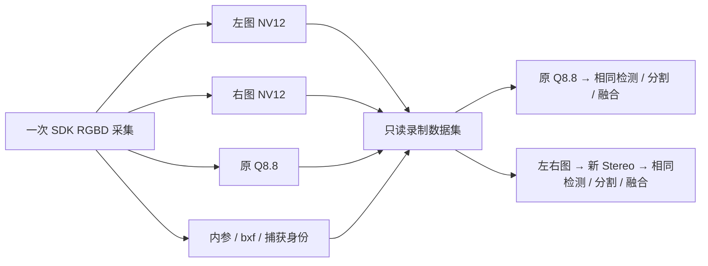

> **历史材料（v1/v2）**：本文保留用于理解原算法与历史验证。v3 的配置、路径、构建及运行入口已经改为纯 C++；本文旧命令和旧 DAG 配置不能直接用于本版。请以 [09_纯CPP输入与Graph迁移](09_纯CPP输入与Graph迁移.md) 为准。

# 同一批数据验证新逻辑：从结构重排到算法 A/B

本文回答两个不同问题：**“移动目录后有没有改坏行为？”**和**“换成新算法后行为怎样变化？”**。这两个问题应分别验证。前者期待同输入产生相同结果；后者允许结果不同，但必须把差异定位到视差、点云或融合中的具体环节。

## 1. 先固定比较对象

建议给每次测试写一张清单，至少记录：

| 项目 | 必须固定或记录的内容 |
|---|---|
| 输入 | 左图、右图、原 Q8.8、原始帧 ID、原始时间戳、每个文件 SHA256 |
| 几何 | 左右图是否已校正、640×544 内参、基线、`bxf`、外参 |
| 模型 | 检测、分割、Stereo 文件路径、SHA256、实际张量契约 |
| 软件 | 代码版本、实际加载的 SDK `.so` 哈希、HBRT/DNN 版本 |
| 配置 | 请求配置、展开后的生效配置、SDK profile、模型输入适配方式 |
| 设备状态 | X5 系统版本、频率设置、温度、其他进程、输入模式 |
| 比较目的 | 结构回归、视差算法 A/B、参数 A/B，三者只选一个主变量 |

模型文件名相同不能说明是同一个模型；修改源文件也不能说明板端加载了新 SDK。比较前必须核对文件身份。

## 2. 推荐的数据录制方式

当前最可靠的基准是相机 SDK **一次采集**得到的左图、右图和原 Q8.8，而不是分别启动两次相机程序。



录制脚本：

```bash
# 在项目根目录运行，其他占用相机的程序先停止。
bash tools/capture_stereo.sh \
  --output /userdata/stereo_recordings/scene_$(date +%Y%m%d_%H%M%S) \
  --frames 100
```

`tools/capture_stereo.sh` 调用真实 `r36_stereo_capture`。实现位于 `compare/capture/main.cpp`，相机读取及一致性校验位于 `features/camera/`。录制器会查询相机 SDK 的校正内参，不应拿原始镜头内参替代它。

录制启动器使用根 `pipeline.json` 所引用的 `camera.json`；也可用 `--pipeline /path/to/pipeline.json` 选择主配置。相机库与厂商配置的优先级为显式 CLI > `CAMERA_SDK` / `CAMERA_CONFIG` > JSON，采集超时默认读取 `acquire_timeout_ms`。为同时获取原 Q8.8，录制器固定使用 RGBD 模式 2、`need_q8=true`，重试间隔固定为 `min(5, timeout_ms)`；不会套用 JSON 中的 `disparity_mode`、`retry_interval_ms` 或 `frame_id`。这些是录制契约，不能用在线新 Stereo 的无原视差模式替代。

录完后保留原始文件和清单；测试程序只在新的输出目录里生成准备数据、结果与报告。建议把录制目录设为只读或保留一份离线备份，避免“修输入”污染后续回归。

## 3. 第一层：结构调整前后等价性

本次目录重排首先做 v1→v2 结构回归。先使用**相同方法、相同已安装 SDK、相同模型、相同配置、相同数据**验证前端兼容；再分别重编 v1 SDK 与 v2 SDK，用同一模型/配置/数据验证本轮调度层、C ABI 和后端真正生效后的结果。

第二步 SDK 二进制必然改变，应保存两份 `.so` 身份，并仅对明确变化的 SDK 使用 `--allow-sdk-change`；它不会豁免结果差异检查。不要只跑第一步就宣布本轮内部重构正确。

本轮已用重编 v2 SDK 对照保留的 immutable v10/schema1 基线完成两帧真实 CPU ONNX 回放。只允许 `sdk_binaries` 身份变化，模型、配置和输入保持一致；检测、mask、map 相同，每帧五类 PLY 的最大 xyz 误差为 0 m，总计 26 个二进制结果文件逐字节一致。实际范围见 [最终验证](../validation/evidence/v2_final_validation.json) 和 [差异报告](../validation/evidence/v2_version_report.html)。这证明所测数据的结构回归通过，不构成 X5 新模型精度或性能结论。

建议顺序：

1. 先用原 Q8.8 回放比较，避开新 Stereo 的 BPU 运行时变量。
2. 比较检测框和分割掩码，再比较相机坐标点云。
3. 比较机器人坐标、地面、障碍物和语义点云。
4. 再用同一 Stereo 模型验证输入适配、Q8.8 和后续融合。
5. 最后验证 ROS 与相机在线模式的帧匹配、丢帧和退出行为。

结构等价性建议采用以下门槛；它们是工程回归门槛，不是算法精度标准：

| 对象 | 结构回归建议 |
|---|---|
| 输入身份 | 帧 ID、时间戳、文件哈希、尺寸、格式、步长必须一致 |
| 检测 | 类别、框数、顺序规范化后逐框比；同平台同后端优先要求完全相同 |
| 分割 | 同平台同后端要求掩码逐字节一致；另算像素一致率帮助定位 |
| 原 Q8.8 | 应逐字节一致，差异说明输入或通路改变 |
| 点云 | 点数、坐标系、字段、单位先一致，再按数值容差比 XYZ/RGB |
| 地面/障碍物 | 类别与点的归属一致；顺序改变时按像素索引或空间匹配比较 |
| 失败行为 | 缺右图、错时间戳、错内参、短缓冲必须显式报错 |
| 在线压力 | 内存有界、丢帧可计数、Ctrl+C 正常退出、相机模式恢复 |

如果后端在浮点计算顺序或并行调度上存在非确定性，先连续运行旧版本两次，得到“旧对旧”的自然误差范围，再为新旧回归设置容差。不要看到不一致就直接把容差放大。

### 新增的版本比较工具

`tools/compare_versions.py` 专门解决结构回归：两份回放完成后按原始捕获键和 repeat 对齐，核对输入、标定、模型、SDK/配置身份，比较检测、mask 和保存的全部 PLY 顶点，同时分别汇总性能。

每次执行保留不可变的 `comparison_identity.json` 身份快照，避免重编 SDK 或替换模型后重新解释旧输出。工具还逐字节检查已保存的栅格、Q8 与原始点云二进制；身份不同、失败帧或覆盖不全都不能默认通过。

```bash
python3 tools/compare_versions.py check \
  --baseline /userdata/stereo_results/modular_v1_original \
  --candidate /userdata/stereo_results/modular_v2_original \
  --method original \
  --output /userdata/stereo_results/version_check_$(date +%Y%m%d_%H%M%S)
```

它也有 `run` 子命令，可指定 `--baseline-project/--baseline-config` 和 `--candidate-project/--candidate-config`，先调用各版本真实回放前端，再执行检查。运行前把两个配置都设为同方法，并令保存间隔为 1，以覆盖全部测量帧。

默认检查很严格：输入/模型不同、缺帧、未保存帧或输出不一致均不能判定通过。`--allow-sdk-change` / `--allow-config-change` 只在确实要改变对应变量时显式使用；差异仍进入报告。`--allow-sampled` 允许只检查已保存子集，但报告仍声明覆盖不完整。不要用这些开关掩盖结构重排中未知的变化。

当前工具按已有检测/点云输出顺序比较，适合保留行为的重构。它不是自动做点云配准的精度评估器；如果算法改变点顺序或采样策略，应增加语义明确的空间匹配比较，不能只放宽坐标容差。

v1 历史上用真实 native CPU SDK 和 ROS 同帧输入完成一组 v10→v1 基线回归：稳定结果字段一致，27 个导出文件 SHA 相同，证据见 `validation/evidence/modular_v10_same_frame.json`。它只说明对应历史版本的 CPU 通路。v2 本轮结果见 `validation/evidence/v2_*` 与 [交付与验证](00_交付与验证.md)，不代替 X5 模型输出回归。

### 为什么不能直接比较 PLY 文件哈希

PLY 文本表示、点顺序、注释或浮点输出格式改变，都可能改变哈希而不改变几何。反过来，两张看起来差不多的截图也可能掩盖坐标缩放错误。

建议按这条顺序比较：**读取成功 → 元数据和坐标系 → 点数/无效值 → 有对应关系的 XYZ → 无对应关系的空间距离 → 固定视角可视化**。相机点云与机器人点云不能混比。

## 4. 第二层：原 Q8.8 与新 Stereo 的算法差异

两条分支只改变视差来源，检测模型、分割模型、内外参、采样步长、地面和融合参数保持一致。

现有比较入口为 `compare/run_compare.py`，原/新分支在 `compare/runner/src/main.cpp` 中进入同一 full SDK。`compare/report.py` 用 `(stem, repeat)` 对齐性能行；不得拿两个目录里的第 N 行当成同一帧。

推荐使用录制模式的主配置。把 `pipeline.json` 中 `input_mode` 改成 `recording`，保留 `sdk_root` 等已有字段，加入：

```json
"recording": {
  "directory": "/userdata/stereo_recordings/scene_时间",
  "warmup_frames": 5,
  "repeat": 3,
  "save_every_n": 1
}
```

这是主文件的一段字段，不是完整 JSON 文件；录制目录替换为真实目录。随后运行：

```bash
python3 compare/run_compare.py pipeline.json \
  --output /userdata/stereo_results/ab_$(date +%Y%m%d_%H%M%S) \
  --both --order original,stereo
```

原来的 `config/examples/compare_stereo.dag.json` 仍是兼容入口。两种配置使用同一真实 runner；录制准备需要 Python 的 NumPy 和 OpenCV。在线启动前端只依赖 Python 标准库，二者不是同一依赖范围。C++ 的模型推理本身不依赖 Python 虚拟环境。

### 从最早出现差异的位置向后排查

| 层次 | 建议观察项 | 能回答什么 |
|---|---|---|
| 左右输入 | 文件哈希、左右顺序、极线、NV12 解码、模型实际张量 | 有没有把错误图像送给模型 |
| 模型视差 | 有效像素率、分位数、边界、极值平台、左右一致性（如果另有反向结果） | 视差异常在哪里 |
| Q8.8 | `raw/256` 后的差异、无效值、量化/饱和比例 | 异常来自输出转换还是模型预测 |
| 相机点云 | 相同像素的 Z/X/Y、ROI 平面残差、深度分层 | 是几何问题还是后续融合问题 |
| 地面/障碍物 | ROI 内各类比例、地面缺口、低矮障碍、边缘噪声 | 哪类任务受到影响 |
| 最终融合 | 语义、地面和障碍边界、最近障碍距离 | 应用层行为怎样变化 |

无真值时，可以判断一致性、稳定性、平面噪声和应用行为差异，**不能仅凭原算法当参照就声称新算法“精度低了多少”**。原算法也可能在反光、弱纹理、细边缘处出错。

## 5. 几何核查：避免“看上去有点云就算对”

当前源几何为 640×544。新模型输入为 640×352，模型张量布局为 NCHW，实际图像类型仍需由 Horizon 元数据确认。

在当前输入适配里：

```text
源左/右图 640×544
   ↓ 仅 Stereo 分支 resize
模型左/右输入 640×352
   ↓ 模型预测视差
插值恢复 640×544
   ↓ 视差乘 source_width / model_width
Q8.8 = disparity_px × 256
```

当前宽度没有变化，因此视差倍率为 `640/640 = 1`。**高度从 352 恢复到 544，不应额外乘 `544/352`。**检测和分割仍读取原始 640×544 左图；源相机内参及 `bxf` 不应跟着模型高度变换。

深度关系为：

```text
d_px = q8 / 256
Z_mm = bxf_px_mm / d_px
X_mm = (u - cx) * Z_mm / fx
Y_mm = (v - cy) * Z_mm / fy
```

后续输出的米制点云还会经过单位和外参变换。修改模型尺寸后先检查整幅深度比例和已知距离平面，再检查边缘细节。

代码入口：`features/stereo/src/stereo_provider.cpp::StereoProvider::setPair/invoke`，以及共享的 `compare_util.hpp::normalizeQ8` 和 `r36_stereo::HorizonStereoModel`。最终文件位置见 [架构与目录](01_架构与目录.md)。

## 6. 可视化怎样做才公平

同一帧的两份 PLY 使用同一相机视角、同一单位、同一坐标轴、同一颜色策略、同一裁剪 ROI 和点大小。推荐至少保存四组视图：

1. 相机点云侧视：观察地面厚度、倾斜、近远深度。
2. 机器人坐标俯视：观察障碍边界和空间范围。
3. 地面/障碍物分类图：观察同一个地面是否被切碎或误判。
4. 固定 ROI 放大：地毯、草地、台阶、围栏、细杆各取代表区域。

完整 PLY 用于定量分析；浏览器为了速度抽样显示时，两份数据应采用相同抽样策略。不要把“显示点少”误判为“算法点少”。报告里应同时写完整点数和显示点数。

## 7. 性能比较的口径

| 指标 | 本项目含义/限制 |
|---|---|
| `compute_ms` / `compute_wall_ms` | 调用 full SDK 的墙钟耗时；新 Stereo provider 位于这个调用内部 |
| `stereo_ms` | 包含 YUV→BGR、resize、模型打包/推理/解码、恢复 Q8.8；不是纯 BPU 耗时 |
| `graph_ms` | SDK 任务图墙钟时间；并行子任务耗时不能直接相加作为整帧时间 |
| 检测/分割各阶段 | 看前处理、推理、后处理是否意外变化 |
| CPU ms/frame | 进程 CPU 时间增量，多线程累计可大于墙钟时间 |
| CPU % | 必须同时写分母和采样窗口；CPU % 下降不代表每帧 CPU 工作量下降 |
| RSS | 进程驻留内存，峰值和平均值分别记录；不是 BPU 总内存 |
| compute FPS | `1000 / 平均 compute_ms`，只表示计算吞吐近似 |
| 回放/在线 FPS | 包含输入等待、处理、保存等，应按各自脚本实际口径解释 |

**原 Q8.8 在录制时已经生成，回放无法获得相机 SDK 内部计算原视差的时间。**所以当前回放公平比较的是“相同输入上的后续链路效果”和“消费原 Q8.8 与运行新 Stereo 的增量代价”；它不是完整的两种相机系统端到端算力对比。

做在线性能时，原/新方法使用同一种输入模式。相机直取的 CPU 包含相机 SDK 线程；ROS 模式的算法进程 CPU 不包含另一个相机发布进程。应同时监控两个进程，或明确只报告算法节点。

## 8. 一组能快速执行的回归流程

**开发时的短回归：**选 5～10 帧，包含平地、近障碍、远景、弱纹理、边界；每次改动先跑同方法回归。门槛为输入/检测/分割不变、Q8.8 符合预期、没有失败或缺帧，再查看 PLY。

**提交前的标准回归：**至少 100 个唯一捕获帧，warmup 5 帧，完整重复 3 次；比较成功覆盖率、逐帧差异、p50/p95 性能和峰值 RSS。真实测试集应覆盖多个场景，不能只把 1 张图重复 100 次当成 100 个场景。

**发版前的板端回归：**按 A→B→B→A 顺序独立运行，避免热状态和先后顺序偏差；再做持续相机/ROS 输入、丢帧压力、错误输入和反复启动退出测试。记录温度与频率，避免把降频当作代码退化。

每轮失败后保留首个差异帧及其左右图、原 Q8.8、内外参、三份模型哈希、全部生效配置、日志和两份中间结果。开发者应能只用这一个案例复现问题。

## 9. 下一步值得补齐的自动化

现有比较工具已经具有不可覆盖输出目录、输入清单、配置/模型哈希、warmup/repeat、性能报告和点云预览；新增版本比较工具能检查同方法行为和覆盖率。下一步最有价值的是：

- 为结构回归保存“金样本”：同方法同平台的检测、mask、Q8.8 和点云；先做旧对旧确定性测试。
- 给每个结果保留稳定的原始捕获键，在线/离线都能映射回同一录制帧。
- 自动输出首个差异帧、mask 差异图、视差差异图、固定 ROI 点云统计。
- 为失败/缺帧单独统计，防止只比较成功帧而掩盖覆盖率下降。
- 把单次对比工具接入 CI；X5 模型精度和性能仍需在真实板端验证。

自动阈值是回归报警线，不应代替人工复核或有真值的精度评估。
