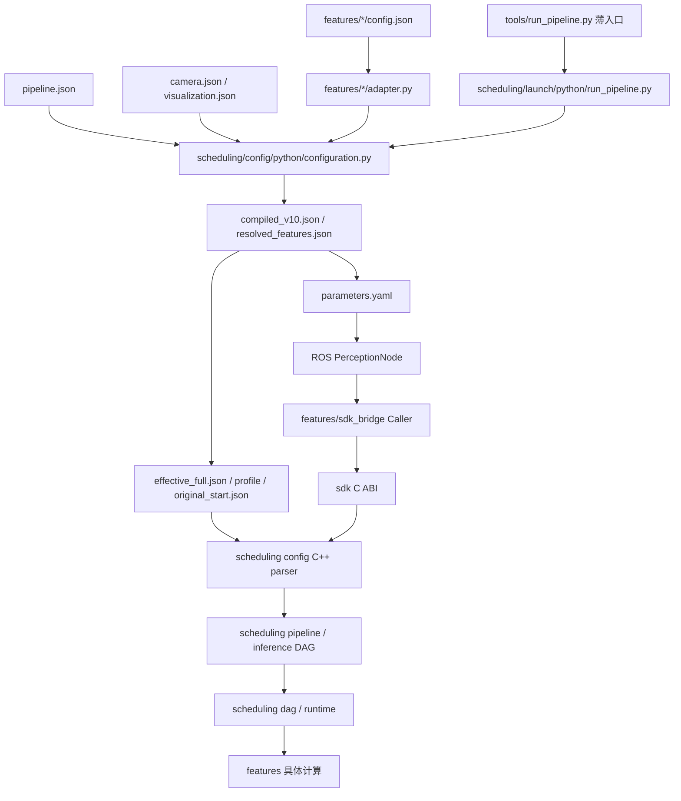

> **历史材料（v1/v2）**：本文保留用于理解原算法与历史验证。v3 的配置、路径、构建及运行入口已经改为纯 C++；本文旧命令和旧 DAG 配置不能直接用于本版。请以 [09_纯CPP输入与Graph迁移](09_纯CPP输入与Graph迁移.md) 为准。

# 调度层设计：配置如何变成一帧任务

本文说明模块化 v2 的代码边界。v2 在 v1 功能分类基础上，把配置解析、DAG 构建、运行时执行和具体业务编排集中到 `scheduling/`；把对外 C 接口集中到 `sdk/`。本轮目标是保持原行为并让责任更容易查找，不引入另一套并发语义，也不把已有固定图变成任意插件系统。

## 1. 先区分四种责任

| 层 | 负责什么 | 不应承担什么 |
|---|---|---|
| 调度层 `scheduling/` | 解析和展开配置、注册任务、验证依赖、建立运行会话、执行 DAG、汇总错误与任务计时 | 直接实现检测 NMS、分割插值、点云几何等数值算法 |
| 功能层 `features/` | 相机、图片、模型、预处理、检测、分割、Stereo、点云、融合、输出与指标的具体实现 | 自己重新解释全局输入模式，或另建与主图无关的一套全局生命周期 |
| 公共层 `core/` | 共用数据类型、帧身份、小工具、错误与日志基础设施 | 产品固定处理顺序、某个模型的私有阈值 |
| SDK 层 `sdk/` | 公开头文件、C ABI 转发、构建和安装；保持现有程序调用兼容 | 再把完整业务实现藏回接口文件 |

`scheduling/pipeline/` 放“把哪些功能组合成产品”的代码。这与 `features/` 的区别是：前者决定先调用谁、依赖什么和怎样持有结果；后者完成一次具体计算。已有部分内置 Feature 包装仍集中在一个文件，属于本轮保留的边界，详见后面的待改问题。

## 2. 调度目录图

```text
perception-stereo-modular-v2/
├── pipeline.json                 日常全局入口；格式仍为 schema_version 2
├── camera.json                   统一相机设置
├── visualization.json            统一保存/发布设置
├── scheduling/
│   ├── config/
│   │   ├── python/               用户 JSON → 校验/适配 → 生效配置
│   │   ├── include/              SDK 与内部任务图配置接口
│   │   ├── src/                  full/CPU/profile/任务图 JSON 解析
│   │   └── sdk_templates/        SDK 安装模板；profile 另放 profiles/
│   ├── dag/                      TaskSpec、依赖校验、任务图与事务型产物
│   ├── runtime/                  通用运行会话、执行与关闭
│   ├── pipeline/                 full 产品编排和内置 Feature 绑定
│   ├── inference/                精确检测/分割的内层任务编排
│   ├── product/                  原产品流程/命令策略的兼容实现
│   └── launch/python/            在线、相机发布、录制启动实现
├── features/<功能>/              算法头源、adapter.py、config.json
├── sdk/                          对外 C ABI、CMake 构建与安装
├── core/                         共用数据与运行基础设施
├── third_party/                  厂商/第三方依赖源码
├── archive/r36_sdk/              旧 SDK 参考、历史说明与证据
└── tools/                        保持旧命令可用的薄入口与构建/校验工具
```

内部目录中接口和实现的完整文件路径，以 [架构与目录](01_架构与目录.md) 及 `validation/evidence/v2_source_layout.json` 为准。后者保留旧路径、新路径和原始文件 SHA256，便于从旧版本定位到本轮实现。目录重排不修改对外 ROS 包名、SDK C ABI 名称或用户 JSON 字段。

常用的真实阅读位置如下，路径相对于项目根：

| 责任 | 接口 / 实现 |
|---|---|
| Python 用户配置编译 | `scheduling/config/python/configuration.py`、`module_config_common.py` |
| 在线与录制前端选择图 | `scheduling/dag/python/pipeline_dag.py`、`recording_dag.py` |
| full 配置 | `scheduling/config/include/config.hpp`、`src/full_config.cpp` |
| 内部 JSON/CFG 任务配置 | `scheduling/config/src/runtime_config_json.cpp`、`runtime_config_v2.cpp` |
| 通用任务定义/注册/产物/调度 | `scheduling/dag/include/perception/task_graph.hpp`、`src/task_graph.cpp` |
| full 产品图 | `scheduling/dag/include/full_graph.hpp`、`src/full_graph.cpp` |
| full 产品会话与业务 | `scheduling/pipeline/src/full_pipeline.cpp` |
| 内层精确推理图 | `scheduling/inference/include/dag_pipeline.hpp`、`src/dag_pipeline.cpp` |
| 推理会话 | `scheduling/inference/src/inference_session.cpp` |
| 内置 Feature 与通用 Engine 的兼容实现 | `scheduling/pipeline/builtin/runtime_features.cpp` |
| SDK 主构建 | `sdk/CMakeLists.txt` |

公开 C ABI 文件为 `sdk/src/perception_sdk.cpp`（8 个基础推理入口）和 `sdk/src/perception_full_sdk.cpp`（11 个 full/时序入口）。内部声明在 `sdk/internal/inference_session_api.hpp`、`full_pipeline_api.hpp`；统一转发到 `perception::sdk_internal::impl_原公共函数名`，避免让产品业务继续留在 C ABI 文件内。

表中未重复完整前缀的 `src/`、`.py` 是同一责任模块下的文件，不是项目根 `src/`。

## 3. 启动时的配置链



Python 和 C++ 解析的不是同一份用户文件。Python 层负责简单的用户配置、环境变量、路径根、继承规则和模块适配；它生成 ROS 参数与 SDK 生效文件。C++ 层读取这些有效文件和内部 profile，创建实际会话和任务图。不能在功能 JSON 随意添加一个字段，就期待 C++ 自动认识它。

运行目录仍可能出现 `compiled_v10.json`，这是兼容中间格式的名字，不表示实际运行的是 v10 二进制；版本身份应看请求配置、可执行文件、模型与实际 SDK 哈希。主文件 `schema_version:2`、full SDK 的 `schema_version:1`、内部任务图的 `config_version:3` 也属于不同配置契约，不能为了统一版本号把它们一起改成 2。

配置规则继续保持：

1. 日常只改根配置和相应功能配置，启动产生的文件用于审计和复现。
2. 用户配置中的相对路径以主 `pipeline.json` 所在目录为根；不要套用 SDK 内部 profile 自己的路径规则。
3. 可继承字段的 `null` 表示继承 SDK 原值。固定输入/后处理契约仍受检查，不能靠 `null` 解除限制。
4. 当前配置在启动时读取；没有运行中热加载。修改后重新启动会话。

公开基础 C ABI 的默认值语义也保留：`original_profile=NULL` 时读取当前工作目录下的 `profiles/original.cfg`，`dag_profile=NULL` 时读取 `profiles/dag_exact.json`。SDK 安装仍保留这些 `profiles/` 路径，而源码已经位于 `scheduling/config/profiles/`。直接从源码目录调用 demo/C API 时应显式传入真实 profile/配置路径，不能因为目录移动就假定默认路径也改变了。正常前端会生成并传入生效路径。

例如从一个检测阈值定位到真正执行处：

```text
features/detection/config.json : score_threshold
  → features/detection/adapter.py
  → 运行目录的 BPU inference_original.cfg / CPU inference_cpu.json
  → BPU runner 的 DetectEngine / CPU stages 的配置读取
  → 解码阶段按置信度过滤；随后各后端执行 NMS
```

不要把“阈值由哪里读取”和“阈值在哪里影响计算”混成一个位置：profile parser 负责把值变成配置，解码器用 score threshold 筛候选，NMS 使用自己的 IoU threshold。BPU 的共用 NMS 辅助在 `features/detection/backend/src/detection_post.cpp`，CPU 阶段保留其原通路。点云/融合也类似：功能 adapter 生成 `original_start.json`，对应功能源码读取具体数值；full config 只引用该文件并决定组合。完整逐字段锚点以 `parameter_map.json` 为准。

## 4. 三种 DAG，不能混为一谈

### 用户前端的四段选择图

用户的 `input_mode` 和 `disparity_source` 会被展开为固定的 input → disparity → perception → report 责任链。它负责选择输入和视差来源、准备配置和运行工具，不是一个能在 JSON 中随意加任意算法的通用运行图。

### full SDK 的产品图

产品图把检测/分割、视差、RGB、点云、地面和融合串起来。完整代码还兼容回充、历史窗口、时序差分、匹配、扩展、发布和录制；当前默认产品配置不代表这些功能全部开启。

图的候选节点和直接父节点在 `steps()` 中固定。每帧提交有效的业务 binding；停用某个可选节点时，构图代码递归保留其已启用的祖先依赖。以启用节点组成的签名缓存 `TaskGraph`，避免每帧重新创建线程池。

```text
dnn ──→ rgb ───────────┐
  │                   ↓
  │     disparity ──→ cloud ─→ calibration
  │                   │          │
  └──────────────────→ labels ←───┘
                        ↓
                     transform → ground → maps → publish → record
```

这是省略可选时序和回充分支的阅读简图。实际 dependency 以源码为准，不能从图中省略一条线就直接删除代码依赖。当前 full 图使用 2 个 worker 的设置仍来自原实现，没有新增用户可改的全局线程字段。

### 检测/分割的内层图

推理层还包含一次输入打包、检测 pre/backend/post、分割 pre/backend/post 和按需深度等任务。内层 profile 决定已注册 Feature 的任务顺序或并行关系。检测和分割可以在同一帧内并行，但共享工作空间受到资源声明和已有整帧锁约束。

**任务图能调度已注册功能，不会实现未注册功能。**要增加一个新任务，必须同时有可执行代码、注册名、参数 schema、产物键和明确依赖。

## 5. 从配置到执行的验证

通用任务图已有以下检查，目录移动后保留：

| 阶段 | 典型检查 | 为什么需要 |
|---|---|---|
| JSON 解析 | 未知字段、重复字段、类型、文件/嵌套/任务数量限制 | 拼写错误应尽早失败，不能静默用默认值 |
| 结构展开 | `sequence` / `parallel`、任务引用、显式边 | 嵌套形式转成明确的依赖关系 |
| 构图 | 重复 ID、未知依赖、自依赖、环、启用任务依赖停用任务 | 保证能够按合法拓扑执行 |
| Feature 校验 | 注册名、参数名/类型、每 Feature 参数覆盖 | 防止配置指定不存在的实现或错误参数 |
| 共享资源校验 | 使用同一独占资源的任务必须由依赖关系排序 | 调度器不能任由复用的模型工作空间相互覆盖 |
| 运行中 | Artifact 类型、存在性、重复写入、帧身份 | 正确的 DAG 仍可能拿到错误的数据 |
| 失败处理 | Failed / Skipped、stage status、结构化错误 | 一段失败后，不把下游未执行误报为成功 |

同一 Task 中的 Feature 按顺序执行，它们的写入先保存在任务私有事务中；全部成功才提交到 `ArtifactStore`。依赖任务只能看到已提交的产物。产物是带 C++ 类型的不可变共享值；字符串 key 相同但类型不符会报错。

目前参数最终常转为 `map<string,string>`，schema 做类型检查。这兼容原框架，但不等于已经建立每种功能专属的强类型 C++ 参数对象。

## 6. 一帧调用次序与生命周期

```text
启动：
  展开用户配置 → 创建 ROS 节点 → Caller::open
  → SDK C ABI → 创建 full 会话、加载模型/点云配置
  → 注册功能和内层图 → 启动采集/worker

逐帧：
  同帧输入校验/配对 → LatestFrame → 唯一应用 worker
  → Caller::process → psdk_full_process 薄转发
  → perception::sdk_internal::impl_psdk_full_process 绑定当帧工作
  → Graph::runContext → TaskGraph::run
  → dnn / disparity → pointcloud / fusion → 完整结果
  → C ABI 借用 view → ROS 复制发布 / 可选保存 → Result 释放

退出：
  停采集 → 关闭等待队列 → join worker
  → 关相机 → 关闭 SDK 会话和任务图/注册资源 → 释放模型
```

原 Q8.8 分支把视差直接填进 `psdk_full_frame.disparity`；新 Stereo 分支先向 provider 注册左右图，并让该字段为空，再由 full 图的 disparity task 调用 provider。若新分支又附上原 Q8.8，后端的优先级会绕过新模型；现有前端保留明确处理与调用检查。

`Result` 拥有 SDK 结果对象，C view 内部指针只在该对象未释放时有效。当前 ROS 发布复制数据；新增异步保存时必须复制或显式拥有结果，不能把 view 裸指针交给下一帧线程。provider 和相机相关对象的寿命必须覆盖所有可能回调它们的任务。

## 7. 线程与锁的真实边界

| 层次 | 当前行为 |
|---|---|
| 输入 | ROS executor 负责消息回调；直取模式增加采集线程；离线按顺序背压 |
| 应用计算 | 一个 worker 一次同步处理一帧，在线等待槽只留最新完整帧 |
| full 产品图 | 同一帧内按依赖执行，可并行检测/分割与视差；本轮保留原线程数 |
| 通用 Engine | `run_mutex` 序列化同一个 Engine 的 run/close，关闭后不能继续 run |
| full 会话 | 原全局 `full_gate` 仍限制跨会话并发；本轮没有删除 |
| 精确推理 | 原全局 `exact_frame_mutex` 仍跨 Pipeline 实例串行，以保护共享数值工作空间 |
| 结果/产物 | 任务成功提交，导出只保留允许的结果，避免长期持有输入借用指针 |

因此，“有 DAG”和“有多个线程”不表示支持多相机多帧任意并发。当前合理的优化方向是先拆私有状态、明确资源和内存所有权，再移除全局锁；直接删锁可能产生偶发的跨帧错误。

## 8. 新功能开发怎样落位

以增加一个“点云质量统计”功能为例：

1. 在 `features/pointcloud/` 或独立功能目录实现算法，先定义输入坐标系、单位、结果类型与无效值规则。
2. 需要用户参数时，在功能 `config.json` 中加字段，在 `adapter.py` 校验和映射。同步更新参数索引，确认 `--prepare-only` 生成的实际值。
3. 如果只在现有 stage 内调用，不必增加新 Task；如果需要独立依赖和计时，在 `scheduling/pipeline/` 增加绑定/注册，并声明产物键和依赖。
4. 使用复用工作空间时声明独占资源。不能用增加线程数来回避并发资源问题。
5. 仅内部使用的 C++ 结果优先保留在内部；确需对外 SDK 输出时，才增加版本化 C ABI view，并维护 `struct_size` / `abi_version` 契约。
6. 更新 SDK/应用 CMake，重编 SDK 到新安装目录；应用使用新的 `SDK_ROOT`。
7. 先做 v1→v2 同方法回归，再做新增功能测试。已有输出不该变化的部分要求一致，新字段单独验证。

若要改 full 产品候选节点，除了 `steps()`，还必须修改会话的业务 bindings、启用条件、结果生命周期、错误处理和测试。单在用户 JSON 添节点无法完成这些工作。

### 调度代码的短回归

先按 docs/00 用真实依赖配置过 native CPU SDK 构建目录。随后可只构建通用图和配置测试；以下假定该目录为 `build/sdk_cpu`，若使用其他目录应同步替换：

```bash
cmake -S sdk -B build/sdk_cpu -DBUILD_TESTING=ON
cmake --build build/sdk_cpu \
  --target framework_task_graph_tests framework_runtime_json_config_tests \
  --parallel 4
ctest --test-dir build/sdk_cpu -R '^original_framework_' --output-on-failure
```

这些检查关注图依赖、配置、资源与失败语义，不需要把新模型跑在 BPU 上，但也不证明完整算法输出一致。改完产品 binding 或会话生命周期，还要继续运行 SDK 契约和固定录制的 v1→v2 回归；不能以这两项通用测试代替集成验证。交叉构建出的 AArch64 测试程序应在匹配目标或明确的运行环境中执行，不能直接当作 x86 CTest 跑。

## 9. 本轮保留的不足与下一步

| 已明确的不足 | 本轮处理 | 建议下一步 |
|---|---|---|
| `task_graph.cpp` 内同时实现 registry、artifact、校验和线程调度 | 归入独立调度层，保留行为 | 再拆 registry/artifact/validation/executor 四个文件，小步回归 |
| 内置 runtime Feature 包装涉及模型与点云融合 | 作为 pipeline 内置绑定，避免宣称纯通用 runtime | 按功能提供注册器，通用 Engine 只负责生命周期与结果导出 |
| full 会话仍持有多个业务状态 | 从 C ABI 文件移出，责任可见 | 拆 PipelineSession、FrameResultBuilder、OutputWriter |
| 固定候选图和线程设置 | 保持原契约 | 先定义合法组合与回归集，再开放少量受约束的图配置 |
| 同步保存仍占处理路径 | 未改变输出时序 | 有界异步输出队列，并明确丢保存帧、错误和内存上限 |
| 全局锁阻止跨会话吞吐 | 保留数值安全边界 | 消除共享工作空间后再做真实板端收益评估 |
| Python/C++ 都有配置规则，少量推理 profile parser 仍随 inference session | 主解析器已归 config，`loadOriginal` 保持原契约 | 将纯 profile parser 抽到 config，整理 schema/version 与错误格式，避免复制同一规则 |

这次整理的价值是让上述问题有明确的位置和责任人。它不表示这些问题都已经解决，更不表示算法效果或 X5 FPS 已提高。

## 10. 给原 42 页分享的补充讲稿

原 PPT 与 `05_分享讲稿.md` 讲的是 v1，当时部分核心代码仍在 `backend/r36_sdk/`。本轮没有重做 PPT；分享时在目录页之后补充以下四段：

1. **为什么再整理：** v1 功能目录已有算法，但 full SDK 的配置、graph 和主要业务仍混在旧目录。v2 把“怎么组织执行”和“具体怎么计算”分开。
2. **两层图：** full 产品图负责检测/视差/融合，内部精确推理图负责 det/seg 分支。用户简单 JSON 是选择入口，不等同于任意图编辑器。
3. **一条调用链：** 用户 JSON → 调度配置编译 → 生效文件 → SDK 薄 C 接口 → full 会话 → TaskGraph → features。修改算法要重编 SDK 并核实实际加载库。
4. **诚实的边界：** 本轮保留全局锁、固定图及部分大文件，先用同数据验证等价，再逐项解耦。继承的 v1 测试证据与 v2 本轮结果分开报告。

当前版本的实际编译与回归结论，以 [交付与验证](00_交付与验证.md) 中 v2 一节和对应证据为准。
