> **历史材料（v1/v2）**：本文保留用于理解原算法与历史验证。v3 的配置、路径、构建及运行入口已经改为纯 C++；本文旧命令和旧 DAG 配置不能直接用于本版。请以 [09_纯CPP输入与Graph迁移](09_纯CPP输入与Graph迁移.md) 为准。

# Perception Stereo v2：完整运行、配置与开发指南

> 对象：`perception-stereo-modular-v2` 的当前源码。编写日期：2026-10-11。  
> 面向第一次接触项目的同伴，也供修改模型、扩展算法和定位问题时查阅。  
> 本文根据实际配置编译器、ROS 节点、C ABI、DAG 与功能代码整理；历史 `v8/v9/v10` 文档和旧 PPT 可能使用旧路径，以本文和当前源码为准。

本文附带 PNG 图，普通 Markdown 阅读器即可显示；关键依赖另附 Mermaid 源码，便于继续编辑。图片相对路径为 `assets/manual_v2/`，移动本文时应一起移动这个目录。源码链接按本文位于项目 `docs/` 内组织。

## 阅读导航

| 想解决的问题 | 从哪里开始 |
|---|---|
| 第一次看项目，先建立整体认识 | [1. 项目做什么](#overview)、[2. 目录地图](#layout) |
| 想知道程序怎样启动、一帧怎样运行 | [3. 启动与调用链](#startup)、[4. 三层 DAG](#dag) |
| 想知道配置放哪、改了怎样生效 | [5. 配置机制](#configuration)、[6. 功能参数](#parameters) |
| 相机、ROS、离线图片分别怎样输入 | [7. 输入模式](#inputs)、[8. ROS 通信](#ros) |
| 新 Stereo 怎样接入，模型怎样替换 | [9. Stereo 与几何](#stereo) |
| 想看线程、丢帧和内存寿命 | [10. 并发与所有权](#threads) |
| 结果存哪，怎样用 RViz/PLY/HTML 看 | [11. 保存与可视化](#outputs) |
| 检测、分割、CPU、RSS、FPS 怎样统计 | [12. 性能口径](#metrics) |
| 需要编译和 X5/WSL 运行命令 | [13. 构建与部署](#build) |
| 想加参数、改算法、加 DAG 功能 | [14. 扩展功能](#extension) |
| 想用同一份数据比较旧版、新版和新算法 | [15. 验证与比较](#comparison) |
| 当前报错，想知道从哪里查 | [16. 排障](#troubleshooting) |
| 想带新人按顺序读代码 | [17. 阅读路线](#reading)、[18. 设计评价](#design) |
| 查具体字段或术语 | [附录 A. 配置原文件](#appendix-config)、[附录 B. 术语](#glossary) |

<a id="overview"></a>

## 1. 项目做什么

### 1.1 先把它看成一条感知流水线

系统读取一帧左目图像，完成目标检测和语义分割；同时获得这帧的视差，把视差转换为三维点云，再结合检测、分割、地面分类和外参，输出点云、地图和结构化结果。

视差有两种来源：

| 配置值 | 来源 | 需要什么输入 |
|---|---|---|
| `original_q8` | 相机 SDK 已产生的原始 Q8.8 视差，或之前录制的同帧视差 | 左图、原 Q8.8、真实校正内参 |
| `raft_stereo` | 项目中的新双目模型 runner | 同帧校正左图、右图、真实校正内参 |

`raft_stereo` 是当前实现的配置名称；文件名换成新的双目模型后，这个配置枚举不会跟着模型文件名自动改变。

两种方法后面接的是共同的点云、地面和融合链路。因此能把差异尽量限定到“视差来源”，而不必维护两套完全不同的感知程序。

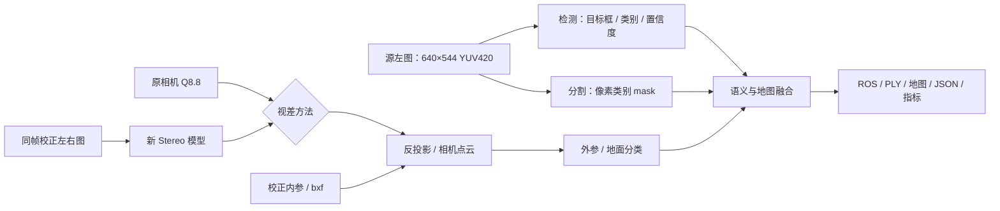

### 1.2 现在具备什么能力

- X5 相机直取：应用直接调用相机 SDK 获取图像。
- ROS 输入：订阅相机图像、视差和内参，按同帧条件配对。
- 离线输入：读取编码图片或原始 YUV 文件，整理为算法需要的格式。
- 录制回放：用同一组左图、右图和原视差比较两种方法。
- X5 BIN 检测/分割以及 x86 ONNX Runtime CPU 检测/分割。
- 新 Stereo 模型产生视差，并复用原点云融合链。
- ROS 输出、逐帧文件保存、PLY、性能记录和对比报告。

这里的“支持”分为代码通路和实测范围两件事。当前 v2 已完成真实 Linux x86 CPU SDK、ROS 应用构建及固定输入回归；本轮证据不包含真实 X5 新 BIN 或真实相机的完整板端验证。详见[验证记录](../validation/evidence/v2_final_validation.json)。

### 1.3 认识三个经常叫作 SDK 的东西

| 名称 | 在本项目中的作用 | 常见位置 |
|---|---|---|
| 相机 SDK | 打开设备、采图、拿原视差和内参 | `libMoGeneralSDK.so`，由 `camera.json` 指定 |
| 感知 full SDK | 提供检测、分割、点云、融合的项目 C ABI | `SDK_ROOT/lib/` 与 `SDK_ROOT/config/` |
| Horizon/BPU 运行库 | 加载和执行 X5 BIN 模型 | 目标板/交叉环境的 Horizon 头文件、库 |

“找到相机 SDK”不等于“找到感知 SDK”；“项目可在 x86 编译”也不等于“X5 BIN 可以在普通 x86 CPU 上执行”。

<a id="layout"></a>

## 2. 目录地图：每一层负责什么

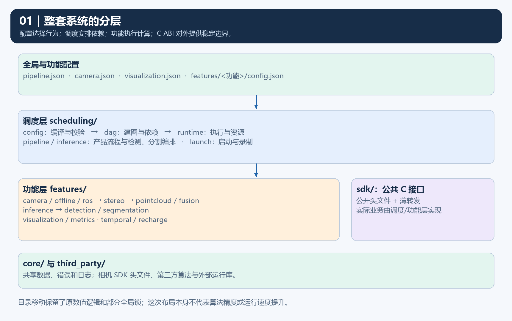

```text
perception-stereo-modular-v2/
├── pipeline.json                    全局输入、视差方法、SDK 和模块引用
├── camera.json                      统一相机设置
├── visualization.json               统一保存、发布与坐标系设置
├── parameter_map.json               参数到 adapter 和 C++ 读取处的索引
├── core/                            共用数据、队列、错误与日志
├── features/                        各种具体功能
│   ├── camera/                      相机应用适配与 SDK 侧输入
│   ├── offline/                     文件解码、YUV 转换与离线输入
│   ├── ros/                         ROS 节点、配对、处理与消息输出
│   ├── stereo/                      provider、模型 runner、张量编解码
│   ├── inference/                   BPU/CPU 推理与共享前处理
│   ├── detection/                   检测参数、IoU / NMS 后处理
│   ├── segmentation/                分割参数与双线性后处理
│   ├── pointcloud/                  投影、变换、地面分类、ROS 点云与 PLY
│   ├── fusion/                      标签、语义与栅格融合
│   ├── visualization/               SDK 渲染、保存与输出 Feature
│   ├── metrics/                     CPU / RSS / 时间统计
│   ├── temporal/ recharge/          SDK 原有时序、回充能力
│   └── sdk_bridge/                  Caller / Result 所有权包装
├── scheduling/                      调度层
│   ├── config/                      Python 配置编译和 C++ 解析
│   ├── dag/                         外层选择图、通用 TaskGraph、full 图
│   ├── runtime/                     Engine、执行与资源管理
│   ├── pipeline/                    full 会话、当帧功能绑定
│   ├── inference/                   检测/分割内层 DAG 与推理会话
│   ├── product/                     原产品命令、状态兼容策略
│   └── launch/                      启动、相机发布与录制入口实现
├── sdk/                             公共 C 头文件、薄转发、构建与安装
├── src/perception_ros_so_demo/       ament 构建入口，ROS package 名保持
├── compare/                         录制与双算法比较工具
├── tools/                           构建、打包、检查、薄启动脚本
├── validation/                      测试和验证证据
├── third_party/                     第三方/厂商材料
├── archive/r36_sdk/                 原 SDK 历史与兼容材料
└── docs/                            当前与历史说明
```

### 2.1 功能层与调度层怎样区分

**功能层回答“具体怎样算”。**例如 NMS 怎样筛框、视差怎样反投影、怎样做地面分类、怎样写 PLY。

**调度层回答“何时调用谁、数据怎样交接”。**例如先等待左右图配对、把用户配置变成 SDK 配置、检测和分割能否并行、点云必须等哪几个任务结束。

**SDK 接口层回答“应用怎样稳定地调用”。**公开头文件定义 C 结构和句柄，薄转发调用调度层中的实现。当前 `sdk/src/` 不再承载完整算法主体。

### 2.2 `include`、`src`、`backend`、`framework` 的区别

| 子目录 | 阅读时怎样理解 |
|---|---|
| `include/` | 对其他文件提供的声明和数据契约 |
| `src/` | 对应功能的实现 |
| `backend/` | 编进感知 SDK 的后端实现，修改后通常要重编 SDK |
| `framework/` | 原通用框架中的功能实现，不代表另一个后台服务 |
| `cpu/` | ONNX Runtime CPU 实现 |
| `preprocess/` | 原数值前处理、校准、打包与工作空间 |
| `vendor/` | 保留来源的算法和第三方配套实现 |
| `config.json` + `adapter.py` | 给用户看的功能参数，以及转成真实生效字段的逻辑 |

不是每个技术目录都需要一个空 JSON。当前主配置编译器加载九种功能设置，再读取根相机和可视化配置；`temporal`、`recharge` 等后端能力没有因此自动成为普通可开关模块。

### 2.3 基类放在哪里

当前主要调度基类是 [`Feature`](../scheduling/dag/include/perception/task_graph.hpp)，位于调度层。共享图像、检测结果等类型位于 [`core/runtime/include/perception/types.hpp`](../core/runtime/include/perception/types.hpp)。

没有必要为了一个抽象类再建用途不清的 `base/` 文件夹。若以后提取真正跨功能的数据契约，应放 `core/`；若属于任务执行协议，应放 `scheduling/`。避免把所有工具、状态和业务对象都塞到一个“公共基类”。

<a id="startup"></a>

## 3. 程序如何启动，一帧如何运行

### 3.1 从用户命令到真正的 C++ 进程

以 X5 在线运行命令为例：

```bash
bash tools/run_pipeline.sh --run-dir /userdata/stereo_results/run_001
```

执行链为：

```text
tools/run_pipeline.sh
  ├─ x5_env.sh：检查并加载 ROS、应用、SDK 环境
  └─ tools/run_pipeline.py：薄 Python 入口
       └─ scheduling/launch/python/run_pipeline.py
            ├─ configuration.compile_pipeline：编译模块配置
            ├─ validate / sdk_configs / apply_features：生成实际配置
            ├─ 写 parameters.yaml、effective_full.json 等
            └─ os.execve：替换成安装的 demo 可执行程序
                 └─ features/ros/src/main.cpp
                      ├─ rclcpp::init
                      ├─ 创建 PerceptionNode
                      ├─ SingleThreadedExecutor.spin
                      └─ close / shutdown
```

Python 在线启动器使用标准库，配置和启动完成后通过 `execve` 变为 C++ 程序，没有持续运行的 Python 推理循环。Ctrl+C/SIGTERM 会直接交给实际程序处理。

`recording` 会进入比较工具通路，见后文。不要用“录制也在 C++ ROS 节点中跑”来理解它。

### 3.2 初始化阶段做哪些事

算法节点的主要入口是 [`PerceptionNode`](../features/ros/src/perception_node.cpp)。初始化大致分为：

1. 读取 ROS 参数，确认 `input_mode`、视差方法、话题、保存和指标设置。
2. 新 Stereo 方法创建 provider/runner，并注册给 full SDK 的视差回调。
3. 创建结果、错误码、指标、mask、地图、点云等发布端。
4. `Caller::open` 调用 `psdk_full_create`，加载 SDK 配置、推理 profiles、模型和映射资源。
5. 根据输入模式订阅 ROS、打开相机或准备离线文件列表。
6. 启动计算 worker；相机直取还有采集线程。
7. executor 处理回调、定时器和输入诊断。

模型和工作空间通常在初始化时准备，跨帧复用。不是每收到一帧就重新加载 BIN/ONNX。

### 3.3 一帧沿着哪些函数走

核心处理入口为 [`PerceptionNode::processFrame`](../features/ros/src/node_process.cpp)：

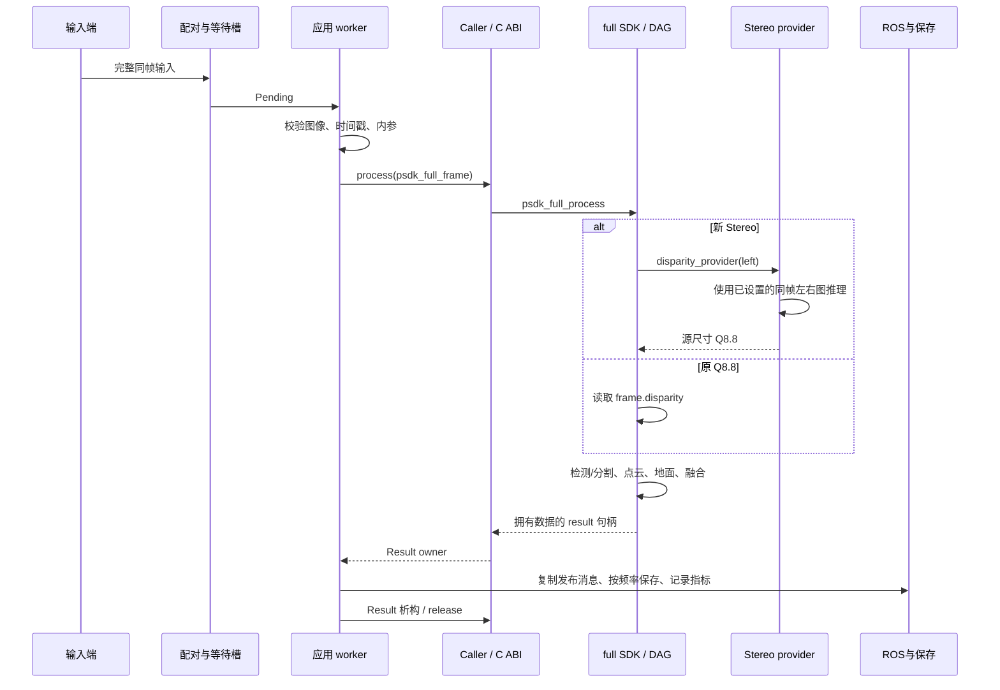

其中值得逐项理解：

- 左图通过 `imageView` 变成 `psdk_frame`，带格式、尺寸、stride、字节数和帧身份。
- 原方法填写 `psdk_full_frame.disparity`。
- 新方法先 `stereo_->setPair(left,right)`，随后显式令 `frame.disparity=nullptr`，让 SDK 调用 provider。
- `Caller::process` 是同步调用，full SDK 完成本帧后才返回。
- 返回 view 的 `frame_id`、`timestamp_ns` 必须与提交帧一致。
- 发布端复制消息内容，保存端在 Result 仍有效时读取 view。
- 最后 Result 析构释放数据，不把借用指针缓存到下一帧。

### 3.4 C ABI 的作用和实际位置

[`Caller`](../features/sdk_bridge/src/sdk_caller.cpp) 调用链接的 `psdk_full_create/process/destroy` 等 C 函数。它没有自行 `dlopen` full SDK；动态链接器按照程序链接信息及 `LD_LIBRARY_PATH` 等规则寻找 `.so`。

```text
应用 Caller
  → sdk/src/perception_full_sdk.cpp                 C ABI 薄转发
  → scheduling/pipeline/src/full_pipeline.cpp       impl_psdk_full_*
  → scheduling/dag/src/full_graph.cpp               full 产品图
  → 各 features 的具体数值实现

检测/分割分支
  → sdk/src/perception_sdk.cpp
  → scheduling/inference/src/inference_session.cpp
  → scheduling/inference/src/dag_pipeline.cpp
  → features/inference、detection、segmentation
```

公开结构体带 `struct_size`、`abi_version`。扩展 API 时不能只在一端悄悄增加字段，必须同时考虑头文件、实现、调用方与版本兼容。

<a id="dag"></a>

## 4. 三层 DAG：各自配置什么

### 4.1 第一层：前端输入/方法选择图

主配置中的 `input_mode`、`disparity_source` 被编译成固定的外层流程：

```text
input → disparity → perception → report
```

入口位于 [`pipeline_dag.py`](../scheduling/dag/python/pipeline_dag.py)。这是把用户容易理解的选项转成执行配置的桥梁，不是在 JSON 中声明任意 C++ 插件的系统。

例如把 `disparity_source` 从 `original_q8` 改为 `raft_stereo`，会改变所需输入和视差产生路径；不会自动把点云算法也换成另一套实现。

### 4.2 第二层：full SDK 产品任务图

候选任务在 [`full_graph.cpp::steps`](../scheduling/dag/src/full_graph.cpp) 中定义，共 16 个。每帧按实际启用的工作绑定构图，关闭的可选节点会被展开为其仍启用的祖先依赖。

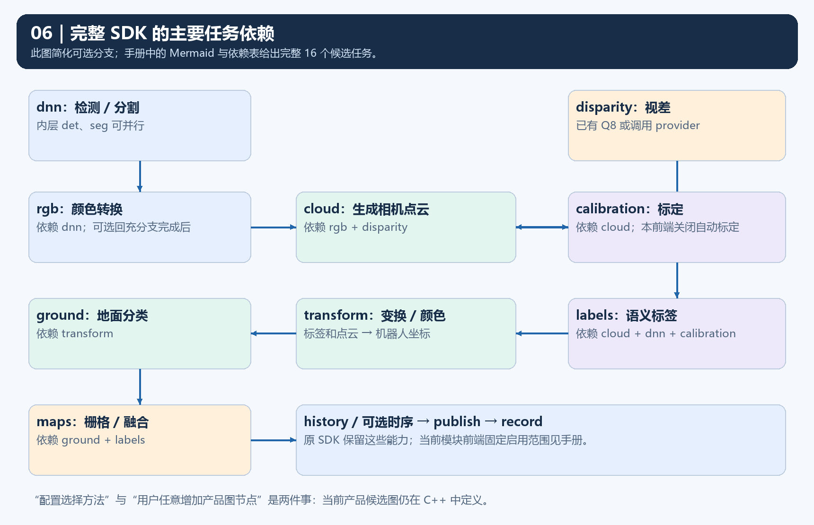

下面给出完整候选依赖；可选任务并不表示当前模块前端全部启用。

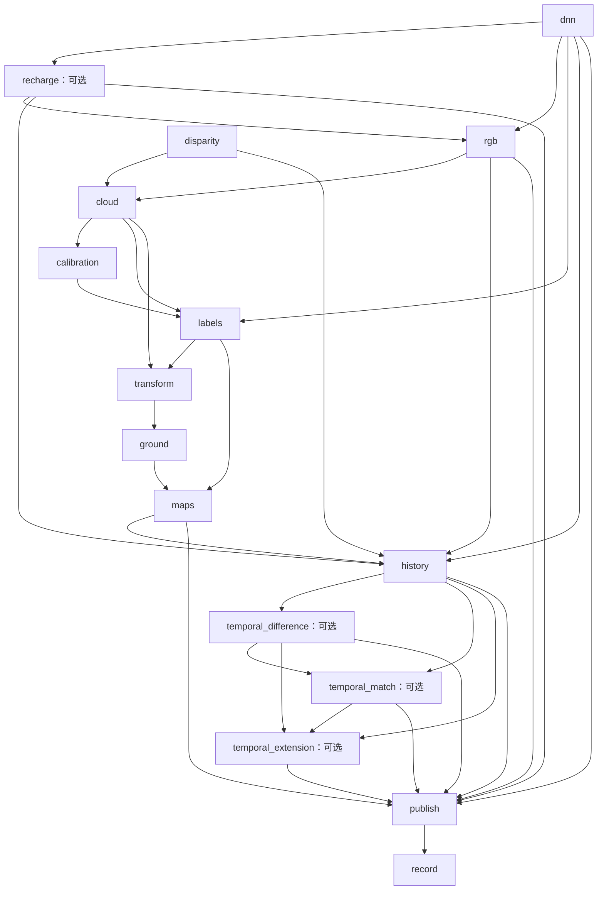

| 任务 | 注册名 | 主要作用 |
|---|---|---|
| `dnn` | `product.ai.exact` | 调用检测/分割子流程 |
| `recharge` | `product.recharge_mark` | 原回充能力，当前模块前端关闭 |
| `disparity` | `product.stereo.disparity` | 拿原 Q8 或回调产生新 Q8 |
| `rgb` | `product.image.rgb` | YUV 转 RGB，供颜色与输出使用 |
| `cloud` | `product.pointcloud.from_disparity` | 生成点云并准备映射输入 |
| `calibration` | `product.calibration.auto` | 原自动标定步骤；前端设置关闭自动标定 |
| `labels` | `product.fusion.semantic_labels` | 结合检测/分割和点云标签 |
| `transform` | `product.pointcloud.transform_color` | 机器人坐标变换与颜色 |
| `ground` | `product.pointcloud.patchwork` | 地面/障碍分类 |
| `maps` | `product.fusion.ai_fusion` | 生成几何、AI、融合地图 |
| `history` | `product.temporal.history` | 完成本帧历史产物 |
| `temporal_difference` | `product.temporal.difference` | 可选时序差分 |
| `temporal_match` | `product.temporal.match` | 可选时序匹配 |
| `temporal_extension` | `product.temporal.extension` | 可选扩展时序功能 |
| `publish` | `product.output.application` | SDK 应用回调；与 ROS 发布不是同一函数 |
| `record` | `product.output.record` | SDK 内部按配置保存；当前前端逐帧保存主要在应用层 |

full 图的 worker 数当前在代码中设为 2，不是根配置里随便增加一个 `worker_threads` 就能改变。

### 4.3 第三层：检测/分割内层任务图

默认 profile 位于 [`scheduling/config/profiles/dag_exact.json`](../scheduling/config/profiles/dag_exact.json)：

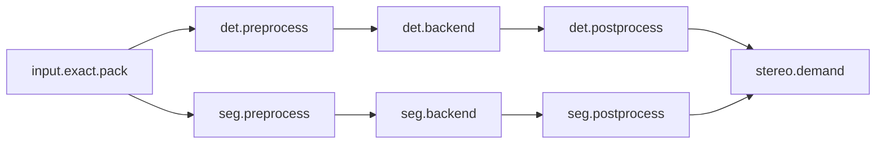

检测 Task 内的三个 Feature 顺序执行；分割 Task 同样如此。两个 Task 在资源和 worker 条件允许时并行。默认末尾的 `stereo.demand` 是内层接口，不应和 full 图中真正调用新 Stereo provider 的 `product.stereo.disparity` 混为一谈。

同目录还保留 serial、det-only、seg-only、depth-parallel 等 SDK profiles，但当前模块前端固定检测、分割都开启，并受 shared SDK 契约校验。不能只把文件名改成 det-only 就认为主应用支持关闭分割。

### 4.4 Task、Feature、Artifact 各是什么

| 概念 | 本项目实际含义 |
|---|---|
| Task | 有 ID 和前驱依赖，内含一串顺序执行的 Feature |
| Feature | 已注册的执行对象，实现 `execute(FeatureContext&)` |
| Registry | 注册名 → 工厂函数、参数 schema 和独占资源声明 |
| Artifact | 按字符串键取用、带 C++ 类型和共享所有权的不可变产物 |
| GraphReport | 本帧任务状态、错误、每任务耗时和整图耗时 |
| Session | 跨帧持有模型、配置、工作区、功能状态的对象 |

调度器会检查缺失依赖、重名任务、循环、未知 Feature、参数拼写/类型、无序访问同一独占资源等问题。Feature 的写入先进入 Task 局部事务，整个 Task 成功后才提交给后继 Task。失败时不应让消费者读到只写了一半的产物。

不过事务保护的是 Artifact 提交，不会自动回滚第三方算法已经修改的外部对象、硬件或会话状态；这些资源仍需实现自己的失败清理。

<a id="configuration"></a>

## 5. 配置机制：改什么文件、如何确认生效

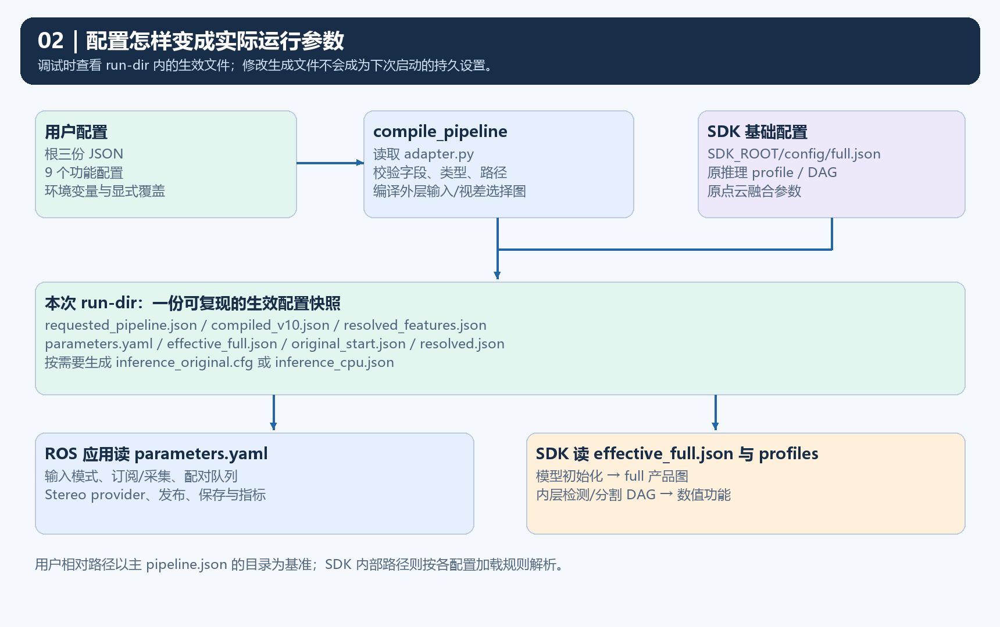

### 5.1 日常只从三份根文件和所属功能配置入手

默认 [`pipeline.json`](../pipeline.json)：

```json
{
  "schema_version": 2,
  "input_mode": "camera",
  "disparity_source": "raft_stereo",
  "sdk_root": "${SDK_ROOT}",
  "sdk_base_config": null
}
```

实际文件中的 `_help` 是说明字段，可保留。上面是去掉说明后的完整最小入口。

| 文件 | 修改它解决什么问题 |
|---|---|
| `pipeline.json` | 选择输入、原/新视差、SDK 和引用的功能配置 |
| `camera.json` | 相机库、厂商配置、采集超时、模式和 frame |
| `visualization.json` | 结果保存频率、PLY、ROS 输出与 frame |
| `features/ros/config.json` | 订阅话题、QoS、精确配对缓存、内参来源 |
| `features/offline/config.json` | 图片列表、格式、左右文件、内参和回放节奏 |
| `features/stereo/config.json` | 新双目模型、显式图像变换和模型输入尺寸 |
| `features/inference/config.json` | 完整推理 profile / CPU profile / 内层 DAG |
| `features/detection/config.json` | 检测模型、阈值和 NMS |
| `features/segmentation/config.json` | 分割模型和固定后处理契约 |
| `features/pointcloud/config.json` | 采样、外参、地面参数 |
| `features/fusion/config.json` | 标签融合、聚类与地图参数 |
| `features/metrics/config.json` | 指标采样、JSONL 文件开关 |

### 5.2 五条关键规则

1. **可继承字段的 `null` 表示继承安装 SDK 原值。**它不是 0、false、空字符串，也不是所有字段都接受 null。
2. **用户配置中的相对路径统一相对主 `pipeline.json` 所在目录。**例如 `features/stereo/config.json` 里写 `models/stereo.bin`，也是相对项目入口目录，不是相对 `features/stereo/`。
3. **`${VAR}` 必须有对应环境变量。**路径存在不等于模型契约正确；后者还会在初始化模型时校验。
4. **不认识的字段会报错。**不要随意加入 `enabled`、`workers` 等未支持字段；应该先查看 adapter。
5. **配置启动时读取，当前没有热更新机制。**修改 JSON 后通常需要重启相应进程。

SDK 自己的 full/profile 中，内部相对路径按其加载规则解析，不能把“所有用户路径相对主文件”扩张为“SDK 里的每个路径也相对主文件”。直接调用基础 C API且不传 profile 时，还有相对工作目录的默认 profiles；嵌入项目时应显式传完整路径。

### 5.3 四种格式版本，为什么不能互相替换

| 文件角色 | 字段/当前值 | 谁读取 |
|---|---|---|
| 模块化主配置 | `schema_version: 2` | `compile_pipeline` |
| 编译后的旧前端兼容配置 | `schema_version: 1` | 启动/比较前端 |
| full SDK 配置 | `schema_version: 1` | full C++ 配置解析器 |
| 内部嵌套任务图 | `config_version: 3` | TaskGraph 配置加载器 |

两个 `schema_version:1` 的文件结构不同，不能互相替换。`compiled_v10.json` 是兼容中间文件名称，不表示这次实际运行了 v10 二进制。把所有版本数字改成 2 或 3 不会升级程序，只会破坏解析。

### 5.4 保留多套实验参数的方法

不要每次手工覆盖 SDK 安装目录中的文件。主文件可以引用另一组配置，例如放在**同一项目根目录**的 `pipeline_lab.json`：

```json
{
  "schema_version": 2,
  "input_mode": "ros",
  "disparity_source": "raft_stereo",
  "sdk_root": "${SDK_ROOT}",
  "camera_config": "camera.json",
  "visualization_config": "experiments/visualization_lab.json",
  "features": {
    "stereo": "experiments/stereo_lab.json",
    "detection": "experiments/detection_lab.json"
  }
}
```

未指定的功能仍使用 `features/<功能>/config.json`。这个例子假设相应实验文件已经存在。

如果把主文件放进 `experiments/` 子目录，默认 `features/...` 也会相对这个子目录，必须补齐正确引用；最省事的是把多份主文件留在项目根目录，仅把功能变体放到实验目录。

### 5.5 `--prepare-only` 是最直接的配置检查

```bash
python3 tools/run_pipeline.py pipeline.json \
  --prepare-only \
  --run-dir /userdata/stereo_results/prepare_001
```

`run-dir` 必须是新的目录，避免覆盖旧实验。在线 prepare-only 会生成配置，不开相机、不订阅 ROS、不跑模型、不产生性能结论；路径校验所需 SDK、模型和相关文件仍要存在。

| 本次输出文件 | 用来确认什么 |
|---|---|
| `requested_pipeline.json` | 原始模块化请求 |
| `compiled_v10.json` | 编译后的兼容前端结构 |
| `resolved_features.json` | 功能配置来源、SHA、设置和显式覆盖 |
| `requested_dag.json` | 展开的外层输入/视差配置 |
| `parameters.yaml` | 真正交给 ROS 节点的参数 |
| `effective_full.json` | 真正交给 full SDK 的配置 |
| `original_start.json` | 本次点云、地面、标签、地图等原配置 |
| `inference_original.cfg` | 需要覆盖 BPU 推理参数时生成 |
| `inference_cpu.json` | 需要覆盖 CPU 推理参数时生成 |
| `resolved.json` | 可执行路径、命令、模型参数、库路径和输出位置 |

录制 prepare-only 会由比较工具准备图像和比较配置，输出集合不同，还依赖 NumPy/OpenCV；不要因为它也叫 prepare-only 就推断只用了标准库或不会读取/转换图片。

### 5.6 用一个参数走通“配置 → 代码”

以检测阈值为例：

```text
features/detection/config.json：score_threshold
  → features/detection/adapter.py::configure
  → compiled profile overrides
  → 本次 inference_original.cfg 或 inference_cpu.json
  → SDK 初始化时读取检测配置
  → 检测输出筛选
  → 检测框与后续融合结果变化
```

融合中另有 `fusion.labels.det_score_min`，是融合阶段再次筛选框的阈值。修改它不能替代检测器自己的 `score_threshold`。

根 [`parameter_map.json`](../parameter_map.json) 保存 `config_file / json_path / adapter / effective_target / implementation`。它帮助定位字段，而不是另一份必须同步填写的运行配置。

### 5.7 当前模块前端固定的行为

准备代码明确设置：完整链以 map 模式运行；检测、分割、mapping、标签融合启用，`run_every_n=1`；保留点云；recharge 关闭；自动标定关闭；历史容量 1、差分/匹配关闭；SDK 内部按帧录制关闭，主要由应用显式保存。

因此后端存在某项能力，不等于主配置已经开放了它。要做“只跑检测”或“开启时序/回充”，需补充前端参数、约束、图选择和验证，不能自行添加一个未经支持的 `enabled` 字段。

<a id="parameters"></a>

## 6. 功能参数：完整字段表与约束

下表“随包 JSON 值”来自文件本身；不是所有键缺省时的 fallback。根 `parameter_map.json` 覆盖当前 86 个随包字段到真实读取位置的映射，下面按同一批配置逐项解释。

### 6.1 `pipeline.json`

| 字段 | 随包 JSON 值 | 含义 | 约束 / 影响 |
|---|---|---|---|
| `schema_version` | `2` | 主配置格式 | 必须整数 2；不能写 3 选择内部 DAG |
| `input_mode` | `"camera"` | 输入选择 | camera / ros / offline / recording；后三种是不同入口，recording 为公平比较附加模式 |
| `disparity_source` | `"raft_stereo"` | 进入共同检测/分割/点云链的视差来源 | original_q8 / raft_stereo |
| `sdk_root` | `"${SDK_ROOT}"` | 安装好的同架构 SDK 前缀 | 目录必须存在；默认展开 SDK_ROOT |
| `sdk_base_config` | `null` | 完整 SDK 基础配置 | 有值时文件必须存在；null 使用 sdk_root/config/full.json |

### 6.2 `camera.json`

| 字段 | 随包 JSON 值 | 含义 | 约束 / 影响 |
|---|---|---|---|
| `sdk_library` | `"/app/data/metoak/lib/libMoGeneralSDK.so"` | 厂商相机动态库 | 选 camera 时要求实际文件；相机发布/录制也使用本文件 |
| `vendor_config` | `"/app/data/metoak/demo/config/x5_camera.cfg"` | 厂商相机 cfg | 选 camera 时要求实际文件 |
| `disparity_mode` | `"auto"` | 厂商相机采集模式 | auto 或整数 1/2；auto 新 Stereo=1、原 Q8=2；原 Q8 必须模式 2 |
| `acquire_timeout_ms` | `3000` | 取帧超时毫秒 | 整数 1..60000 |
| `retry_interval_ms` | `5` | 取帧重试间隔毫秒 | 整数 1..1000，且不能大于超时 |
| `frame_id` | `"camera_optical_frame"` | 图像/点云来源坐标名 | 非空单行字符串；命名不执行坐标变换 |

### 6.3 `visualization.json`

| 字段 | 随包 JSON 值 | 含义 | 约束 / 影响 |
|---|---|---|---|
| `save_root` | `""` | 逐帧 SDK 结果/PLY 根目录 | 空字符串明确关闭结果保存；非空时解析为主配置旁路径 |
| `save_every_n` | `10` | 在线保存间隔 | 整数 0..1000000；0 关闭；第一个成功帧即保存，此后每 N 帧 |
| `save_ply` | `true` | 额外写 PLY | 布尔；仅 save_root 非空且 save_every_n>0 生效 |
| `publish_every_n` | `1` | 在线结果 ROS 发布间隔 | 整数 1..1000000；按成功处理帧计数 |
| `publish_clouds` | `true` | 发布点云话题 | 布尔；不等于停止点云算法 |
| `publish_maps` | `true` | 发布地图话题 | 布尔；不等于停止融合算法 |
| `publish_mask` | `true` | 发布分割 mask | 布尔；不等于停止分割 |
| `publish_input` | `false` | 发布输入图像 | 布尔；不是离线输入选择 |
| `render_maps` | `true` | SDK 生成地图渲染结果 | 布尔，映射到 full.mapping.render_maps |
| `robot_frame_id` | `"base_link"` | 机器人坐标结果使用的 frame 名 | 非空单行字符串；实际几何变换仍由外参决定 |

### 6.4 `features/ros/config.json`

| 字段 | 随包 JSON 值 | 含义 | 约束 / 影响 |
|---|---|---|---|
| `left_topic` | `"/camera/rgbd_left_nv12"` | 左目图像话题 | 绝对 ROS 话题：以 / 开头、无 //、末尾不为 /，段名允许字母数字下划线 |
| `right_topic` | `"/camera/rgbd_right_nv12"` | 新 Stereo 的右目话题 | 同上；必须和左目不同；原 Q8 模式不订阅它 |
| `q8_topic` | `"/camera/disparity_q8"` | 原 Q8.8 视差话题 | 同上；新 Stereo 模式不订阅它 |
| `left_camera_info_topic` | `"/stereo/left/camera_info"` | 左目标定话题 | intrinsics=camera_info 时启用，消息 stamp 必须精确匹配图像 |
| `right_camera_info_topic` | `"/stereo/right/camera_info"` | 右目标定话题 | 同上；原 Q8 路径使用 CameraInfo 仍需要成对标定 |
| `reliability` | `"best_effort"` | 订阅/统一相机发布的 QoS reliability | best_effort / reliable；两端必须兼容 |
| `queue_capacity` | `4` | 精确配对缓存容量 | 整数 1..16；扩大不能解决时间戳不匹配 |
| `intrinsics` | `"camera_info"` | 在线标定来源 | camera_info 或显式内参对象；不能写 null 代替标定 |
| `rectified` | `true` | 确认图像已矫正 | 布尔断言，不执行矫正；新 Stereo 必须 true |
| `calibration_confirmed` | `true` | 确认标定真实有效 | 布尔断言；新 Stereo 必须 true，外部相机不能盲目照抄默认值 |
| `frame_id` | `"camera_optical_frame"` | 输入 frame 名 | 非空单行字符串 |

适配入口：[features/ros/adapter.py::configure](../features/ros/adapter.py)。

### 6.5 `features/offline/config.json`

| 字段 | 随包 JSON 值 | 含义 | 约束 / 影响 |
|---|---|---|---|
| `left_files` | `[]` | 离线左图文件序列 | 数组；选 offline 时非空且每个文件存在 |
| `right_files` | `[]` | 离线右图文件序列 | 数组；长度与左图相同，按顺序逐帧对应，左右不能同一文件 |
| `format` | `"nv12"` | 转换后源图格式 | 单个 nv12 或 i420；PNG/JPEG 的目标格式；不是写 nv12/i420 |
| `fps` | `2` | 离线投喂频率 | 有限数值 0.001..120；不是模型推理 FPS |
| `loop` | `false` | 结束后循环 | 布尔 |
| `max_frames` | `0` | 最多投喂帧数 | 整数 0..1000000；0 不额外限制 |
| `wait_for_subscribers` | `false` | 等待结果订阅者 | 布尔；没有订阅者时可导致等待 |
| `intrinsics` | `null` | 640x544 源图的矫正内参 | 默认 null 是未配置，选 offline 后会报错；必须填完整对象 |
| `rectified` | `false` | 确认输入已矫正 | 默认 false；新 Stereo 必须改 true，代码不替你矫正 |
| `calibration_confirmed` | `false` | 确认源图几何与内参匹配 | 默认 false；新 Stereo 必须改 true |
| `frame_id` | `"camera_optical_frame"` | 离线图坐标名 | 非空单行字符串 |

适配入口：[features/offline/adapter.py::configure](../features/offline/adapter.py)。

### 6.6 `features/stereo/config.json`

| 字段 | 随包 JSON 值 | 含义 | 约束 / 影响 |
|---|---|---|---|
| `model` | `"${STEREO_MODEL}"` | 新 Stereo BIN 路径 | raft_stereo 时实际文件必须存在；original_q8 时不要求该环境变量 |
| `image_transform` | `"resize"` | 源图到模型输入的变换 | resize / strict；严格模式不允许尺寸不同 |
| `input_width` | `640` | 模型宽度声明 | 与高度同时 null 或同时为偶数整数 2..4096；null 查询 BIN 元数据 |
| `input_height` | `352` | 模型高度声明 | 同上；是实际元数据断言，不会把任意模型改成这个尺寸 |

适配入口：[features/stereo/adapter.py::configure](../features/stereo/adapter.py)。

### 6.7 `features/inference/config.json`

| 字段 | 随包 JSON 值 | 含义 | 约束 / 影响 |
|---|---|---|---|
| `original_profile` | `null` | 原检测/分割完整推理 cfg | null 继承 full.inference.original_profile；非空文件需存在 |
| `cpu_profile` | `null` | CPU ONNX 输入输出完整契约 | null 继承；仅 backend=cpu 可设置；非空文件需存在 |
| `dag` | `null` | 内部推理任务图 JSON | null 继承 full.inference.dag；非空文件需存在；是 config_version=3 图而非根 pipeline.json |

适配入口：[features/inference/adapter.py::configure](../features/inference/adapter.py)。

### 6.8 `features/detection/config.json`

| 字段 | 随包 JSON 值 | 含义 | 约束 / 影响 |
|---|---|---|---|
| `model` | `"${DET_MODEL}"` | 检测模型覆盖路径 | 默认展开 DET_MODEL；null 继承 SDK/profile 模型；BIN/ONNX 随所选 SDK 后端 |
| `score_threshold` | `null` | 检测输出第一次分数过滤 | null 继承；显式有限数值 0<值<1 |
| `nms_threshold` | `null` | 同类 NMS IoU 阈值 | null 继承；显式有限数值 0..1 |
| `nms_top_k` | `null` | NMS 后保留检测框数上限 | null 继承；显式整数 1..10000 |

适配入口：[features/detection/adapter.py::configure](../features/detection/adapter.py)。

### 6.9 `features/segmentation/config.json`

| 字段 | 随包 JSON 值 | 含义 | 约束 / 影响 |
|---|---|---|---|
| `model` | `"${SEG_MODEL}"` | 分割模型覆盖路径 | 默认展开 SEG_MODEL；null 继承 SDK/profile 模型 |
| `align_corners` | `null` | 固定后处理契约的断言 | null 或 true；false 拒绝，不能靠 JSON 切换 |
| `argmax_mode` | `null` | 固定后处理契约的断言 | null 或 bilinear；其他模式拒绝 |

适配入口：[features/segmentation/adapter.py::configure](../features/segmentation/adapter.py)。

当前 adapter 对 true/bilinear 只作契约校验，不把它们写成新的 profile 覆盖；BPU 与 CPU 都沿用固定行为。null 保持继承，不表示可自由选择其他后处理方式。

### 6.10 `features/pointcloud/config.json`

| 字段 | 随包 JSON 值 | 含义 | 约束 / 影响 |
|---|---|---|---|
| `sample_step` | `null` | 视差回投采样步长 | null 继承 full.mapping.sample_step（SDK 未给则 4）；显式整数 1..32 |
| `original_config` | `null` | 原几何/融合完整 JSON | null 继承 mapping.original_config；非空文件需存在 |
| `extrinsics` | `null` | 真实相机到机器人外参 | null 继承 mapping.extrinsics；非空文件需存在 |
| `ground.enabled` | `null` | Patchwork 地面分类开关 | null 继承；显式布尔；关闭后 ground/obstacle 云语义要按现有实现理解 |
| `ground.sensor_height` | `null` | 地面算法相机高度，米 | null 继承；显式有限正数 |
| `ground.min_range` | `null` | 地面处理最近范围，米 | null 继承；显式有限正数；解析合并后必须小于 max_range |
| `ground.max_range` | `null` | 地面处理最远范围，米 | null 继承；显式有限正数 |
| `ground.th_dist` | `null` | 地面平面距离阈值，米 | null 继承；显式有限正数 |
| `ground.th_seeds` | `null` | 初始地面种子阈值，米 | null 继承；显式有限正数 |

适配入口：[features/pointcloud/adapter.py::configure](../features/pointcloud/adapter.py)。

### 6.11 `features/fusion/config.json`

| 字段 | 随包 JSON 值 | 含义 | 约束 / 影响 |
|---|---|---|---|
| `labels.passable_classes` | `null` | 可通行分割类别名列表 | null 继承；非空单行字符串，如 grass；应对应实际类名 |
| `labels.det_score_min` | `null` | 检测目标进入语义点云的二次分数筛选 | null 继承；显式有限数值 0..1；不是 detection.score_threshold |
| `labels.max_range_m` | `null` | 语义融合距离上限，米 | null 继承；显式 0.1..100 |
| `labels.max_height_m` | `null` | 语义融合高度上限，米 | null 继承；显式 0..20 |
| `labels.det_depth_span_m` | `null` | 检测框深度窗口，米 | null 继承；显式 0..100 |
| `labels.det_depth_gap_m` | `null` | 检测深度连贯间隔，米 | null 继承；显式 0..100 |
| `labels.det_depth_min_pts` | `null` | 检测深度最少点数 | null 继承；显式整数 1..1000000 |
| `labels.cluster_filter` | `null` | 检测语义云聚类过滤 | null 继承；显式布尔 |
| `labels.cluster_voxel_m` | `null` | 聚类体素尺寸，米 | null 继承；显式 0.001..10 |
| `labels.cluster_min_component_pts` | `null` | 检测聚类最小连通点数 | null 继承；显式整数 1..1000000 |
| `labels.seg_cluster_filter` | `null` | 分割语义云聚类过滤 | null 继承；显式布尔 |
| `labels.seg_mask_erode_px` | `null` | 分割 mask 腐蚀像素半径 | null 继承；显式整数 0..8 |
| `labels.seg_depth_gap_m` | `null` | 分割深度间隔，米 | null 继承；显式 0..100 |
| `labels.seg_min_component_pts` | `null` | 分割聚类最小连通点数 | null 继承；显式整数 1..1000000 |
| `labels.fuse_into_grid` | `null` | 语义结果合入网格 | null 继承；显式布尔；不控制检测/分割是否执行 |
| `map.resolution_m` | `null` | 地图单元尺寸，米 | null 继承；显式有限正数，对应 MapResolution |
| `map.width_m` | `null` | 地图宽度，米 | null 继承；显式有限正数，对应 MapWidth |
| `map.height_m` | `null` | 地图高度，米 | null 继承；显式有限正数，对应 MapHeight |

适配入口：[features/fusion/adapter.py::configure](../features/fusion/adapter.py)。

### 6.12 `features/metrics/config.json`

| 字段 | 随包 JSON 值 | 含义 | 约束 / 影响 |
|---|---|---|---|
| `write_jsonl` | `true` | 在线指标落盘 | null 不适用；必须布尔；false 仅关 JSONL，不关 ~/metrics 话题 |
| `every_n` | `1` | 在线记录/发布指标间隔 | 整数 1..1000000；不控制录制 benchmark 报告 |

适配入口：[features/metrics/adapter.py::configure](../features/metrics/adapter.py)。


### 6.13 根配置可选字段（默认文件为了简单而省略）

| 字段 | 省略时 | 约束 |
|---|---|---|
| camera_config | camera.json | 非空文件路径；不能为 null |
| visualization_config | visualization.json | 非空文件路径 |
| features | 各 features/名字/config.json | 只允许 ros/offline/stereo/inference/detection/segmentation/pointcloud/fusion/metrics 的路径覆盖 |
| runtime.executable | 工程根/install/perception_ros_so_demo/lib/perception_ros_so_demo/demo | online 时有效；null 继承；非默认安装位置须显式指定 |
| recording.directory | `${CAPTURE_ROOT}` | recording 时必须为实际录制目录 |
| recording.limit | 100 | 1..1000000，最多使用录制帧数 |
| recording.intrinsics | recording | 从 metadata.json 读取；也可显式内参对象 |
| recording.warmup_frames | 5 | 0..1000000，热身不计正式统计 |
| recording.repeat | 3 | 1..1000000，重复回放次数 |
| recording.save_every_n | 10 | 0..1000000；0 不保存逐帧结果，严格内容回归建议 1 |
| recording.viewer_max_points | 20000 | 1..200000，仅查看器抽样上限，不是算法点数限制 |
| recording.runner | 工程根/install/perception_ros_so_demo/lib/perception_ros_so_demo/r36_compare_runner | null 继承；显式文件需存在 |

recording 模式不能同时使用非空 runtime 对象；应使用 recording.runner。在线模式可以保留已知 recording 设置以便来回切换，但不会启动回放。recording 的每帧保存由 recording.save_every_n 管，在线 visualization.save_root/save_every_n 不控制 benchmark。

### 6.14 Fusion adapter 已支持、简化 JSON 未列出的附加字段

以下可按需放入 fusion.labels，省略/null 均继承 SDK：`nongrass_seg_as_obstacle`（布尔）、`keep_below_cam_m`（0..20m）、`seg_mask_postprocess`（布尔）、`seg_mask_majority_radius`（整数0..4）、`seg_mask_close_radius`（整数0..4）、`seg_mask_close_iterations`（整数1..3）、`seg_ray_bin_px`（整数1..4096）。不是任意新增键均支持；具体允许集以 adapter 为准。

### 6.15 显式内参对象

ROS 和离线对象允许且要求的键为 width/height/fx/fy/cx/cy/bxf。在线源图固定 width=640、height=544；fx/fy/bxf 为正的有限数，cx∈[0,640)、cy∈[0,544)。bxf=focal_px×baseline_mm，**不是以米为单位的 baseline 单值**。指定对象时还必须确认 rectified=true、calibration_confirmed=true。录制模式允许偶数宽高 2..4096，并核对每帧录制尺寸、文件大小及真实元数据。

<a id="inputs"></a>

## 7. 输入怎样设置：camera、offline 与录制入口

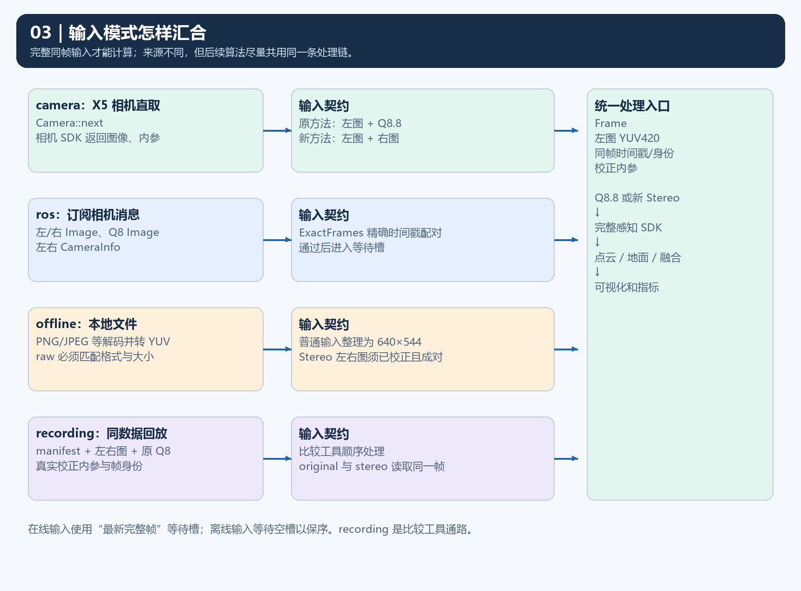

### 7.1 四种入口与两种视差来源

主配置 `pipeline.json` 的 `input_mode` 支持 `camera`、`ros`、`offline`、`recording`；`disparity_source` 支持 `original_q8`、`raft_stereo`。这两个开关分别回答“帧从哪里来”和“视差由谁计算”。

| 主配置入口 | 帧来源 | `original_q8` | `raft_stereo` | 内参来源 | 是否依赖 ROS 输入话题 |
|---|---|---|---|---|---|
| `camera` | 算法节点在本进程调用 Mo 相机 SDK | 相机同次采集的 Q8.8 | 同次采集的左右目，由新模型计算 | SDK 矫正参考参数，缩放到 640×544 | 否；节点仍可发布 ROS 结果 |
| `ros` | 算法节点订阅 `sensor_msgs/msg/Image` | 左图 + Q8.8，必要时加双目 CameraInfo | 左图 + 右图，必要时加双目 CameraInfo | 默认逐帧 CameraInfo，也可显式填写已核实内参 | 是 |
| `offline` | 算法节点按列表读取本地成对文件 | 标准入口拒绝；必须使用真实录制 Q8 的 `recording` | 成对、已矫正的 640×544 左右图 | 配置中的 640×544 矫正内参 | 否；节点发布结果 |
| `recording` | 回放原生录制器的同帧左图、右图、Q8 | 直接读录制 Q8 | 读取同组左右图计算新视差 | 默认录制目录 `metadata.json` | 否；原生比较 runner 不创建这个 ROS 算法节点 |

关键边界：`recording` 是 Python 前端转交 `compare/run_compare.py`、再启动原生 `r36_compare_runner` 的路径。`PerceptionNode` 本身只接受 `camera/ros/offline`，没有第四个 `recording` ROS 订阅分支。

标准 schema 2 启动器固定运行包含检测、分割、点云融合的 `mode=map`，并关闭回充。底层原生节点仍保留 `infer/map/both/recharge` 参数，但不是当前简明主配置对外暴露的四种“输入模式”。不能把输入 `camera/ros/offline` 和算法执行 `infer/map` 混为一谈。

证据：[compile_pipeline](../scheduling/config/python/configuration.py)、[前端 validate 固定 map](../scheduling/launch/python/run_pipeline.py)、[recording 分派](../scheduling/launch/python/run_pipeline.py)、[原生节点输入枚举](../features/ros/src/perception_node.cpp)。

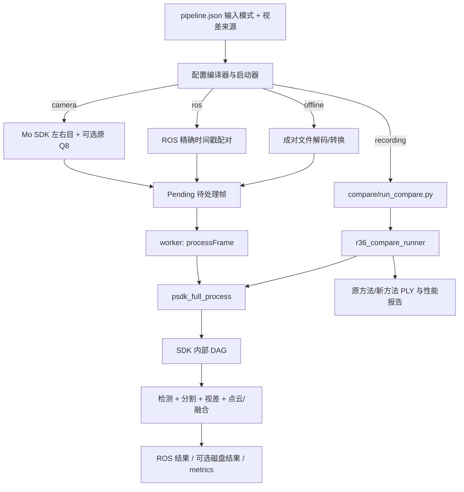

### 7.2 一帧包含什么：格式、帧号与时间戳

这里存在三个容易混淆的 ID：

- SDK 的 `MoFrame.FrameId`：相机采集序号。直取与录制保留该序号。
- `sensor_msgs/Image.header.frame_id`：坐标系名字，如 `camera_optical_frame`，不是相机序号。
- 送入 SDK 的 `psdk_frame.frame_id`：本次处理身份。ROS 模式用成功配对后的递增序号，结果标注 `frame_id_source=ros_pair_sequence`；不能从中反推出厂商 FrameId。

帧统一携带原左图、可选右图、可选 Q8、可选回充高分辨率左图、采集身份、时间戳、内参和来源元信息。`processFrame()` 才组装 `psdk_full_frame`，调用同步 SDK 接口。右图由 `StereoProvider::setPair()` 暂借；本次处理结束由 `PairGuard` 清掉，不跨帧缓存图像指针。

| 对象 | 几何与存储 | 含义 |
|---|---|---|
| RGBD 左/右图 | 640×544，紧密 YUV420 为 522240 字节 | 原检测、分割和点云彩色输入 |
| 原 Q8 | 640×544，紧密 uint16 为 696320 字节 | Q8.8 水平视差，`disparity_px=raw/256` |
| 回充 GDC 左图 | 1280×1088 NV12，紧密为 2088960 字节 | 仅底层回充执行模式需要 |
| Stereo 模型图 | 当前默认每目 640×352 | 单独用于新 Stereo，不能替换原左图几何 |
| 矫正内参 | `width=640,height=544,fx,fy,cx,cy,bxf` | `bxf=焦距像素×基线毫米`，不是米 |

相机 SDK 路径同时核对左右目的 FrameId 和 TimeStamp；原 Q8 还必须与左目同次采集。先把厂商缓冲复制成 owned vector，再调用厂商 release，后续算法不持有已归还的 SDK 缓冲。这段不是零拷贝实现。

ROS 输入支持 NV12/I420 的有效 stride；原生相机和 raw 离线文件的契约更严格，为上述紧密布局。ROS 的 YUV Image 应填 `height=544`，而不是把 Y+UV 存储行数 816 填为 height；紧密情况下 `width=640,step=640,data.size=522240`。

证据：[Pending 结构](../features/ros/include/perception_ros_so_demo/perception_node.hpp)、[raw 布局与同帧验证](../features/camera/include/perception_ros_so_demo/raw_capture.hpp)、[SDK copy/release](../features/camera/src/mo_camera.cpp)、[组装 SDK 帧和 PairGuard](../features/ros/src/node_process.cpp)。

### 7.3 camera：算法节点直接取相机

主配置设置：

```json
{
  "schema_version": 2,
  "input_mode": "camera",
  "disparity_source": "raft_stereo",
  "sdk_root": "${SDK_ROOT}",
  "sdk_base_config": null
}
```

根目录 `camera.json`：

```json
{
  "sdk_library": "/app/data/metoak/lib/libMoGeneralSDK.so",
  "vendor_config": "/app/data/metoak/demo/config/x5_camera.cfg",
  "disparity_mode": "auto",
  "acquire_timeout_ms": 3000,
  "retry_interval_ms": 5,
  "frame_id": "camera_optical_frame"
}
```

`auto` 随视差来源选择相机模式：新 Stereo 默认模式 1，读取左右图且不要求厂商 Q8；原方法模式 2，要求同帧真实 Q8。新 Stereo 并不使用厂商 Q8 来代替新推理。SDK 参数通过 `moGetCameraParams` 获取：返回码 0 为相机模块参数，1 为 X5 配置回退参数，其他返回值拒绝。参考内参只接受 640×544 或 1280×1088，并按比例缩放 `fx/cx/bxf` 与 `fy/cy` 到 640×544；参考畸变非零时拒绝，不在该入口偷偷做去畸变。

这个模式只启动算法节点，**不要同时启动 `raw_camera` 或旧 `ai_node` 抢占相机**。若要从 ROS 图像入手，则使用下一节的两个进程。

相机 `TimeStamp` 非零、严格前进，并随所有平面传递；不改为算法接收时刻。此实现不另外声明厂商时间戳与系统 wall clock 有同步关系，不能直接拿它减当前系统时间测网络延迟。

证据：[camera adapter 自动模式](../features/camera/adapter.py)、[参数校验与比例](../features/ros/src/perception_node.cpp)、[SDK 参数来源和畸变检查](../features/camera/src/mo_camera.cpp)、[sourceStep 相机分支](../features/ros/src/node_input.cpp)。

### 7.4 offline：文件解码、格式转换与真实双目几何

`features/offline/config.json` 中 `format` 必须取 **`"nv12"` 或 `"i420"` 一个值**，字符串 `"nv12/i420"` 只是文档候选写法，不能作为真实值。

编码图片支持 JPG/JPEG/PNG/BMP/PPM/PNM/PGM。由内置 stb 解码为 RGB，双线性适配到 640×544，再转换成 BT.601 limited 风格的 YUV420：NV12 为 Y + UV 交错；I420 为 Y + U + V。PNG 输入时 `format=nv12` 描述的是**转换后的算法输入格式**，不是声称 PNG 文件本身是 NV12，所以是合法设置。

`.nv12/.i420/.yuv` 走 raw 分支：无头、无 stride 推断、无任意尺寸自动缩放，必须恰好 522240 字节。`.nv12` 必须配 `format=nv12`，`.i420` 必须配 `format=i420`；raw 数据不会转换两种布局。相同字节数也不能证明文件真的为指定布局或双目已矫正。

底层离线转换函数提供 letterbox/stretch，原生 infer-only 模式可用于普通单图检测分割。当前标准 schema2 全流程 offline 专门要求成对、已矫正的 640×544 左右图，前端指定 stretch；节点还会检查**原解码尺寸**为 640×544，避免将任意双目照片先随意拉伸/补黑后误认为符合标定。新手应直接准备同帧、同标定的真实双目文件，单张普通 PNG 不能替代右目。

以下离线 JSON 用于说明结构。数值内参只是示例，执行前必须用对应相机的真实 640×544 矫正参数替换，确认后再填写两个 true：

```json
{
  "left_files": ["/userdata/pairs/000001_left.png", "/userdata/pairs/000002_left.png"],
  "right_files": ["/userdata/pairs/000001_right.png", "/userdata/pairs/000002_right.png"],
  "format": "nv12",
  "fps": 2,
  "loop": false,
  "max_frames": 0,
  "wait_for_subscribers": false,
  "intrinsics": {"width": 640, "height": 544, "fx": 300.0, "fy": 300.0, "cx": 320.0, "cy": 272.0, "bxf": 18000.0},
  "rectified": true,
  "calibration_confirmed": true,
  "frame_id": "camera_optical_frame"
}
```

左/右两个列表按同一索引配对，不按文件名猜配；长度必须相同且非空，同一 pair 不能两侧都指向同一个文件。标准 feature JSON 不暴露底层 `offline_path` 的目录自动扫描参数，需写明确成对列表。

离线帧使用本地递增序号、当前 host wall clock 纳秒，并确保严格递增；来源字段 `offline_sequence/offline_host_wall_clock` 会注明。它们不是照片原始采集时间。`loop=false` 播放结束后节点继续存活至 Ctrl+C，但不再次发布最后一帧；结束提示也不能证明最后一个 pending 已经成功处理，应看 result/metrics。

`wait_for_subscribers=true` 会等待 result 订阅者，以及启用时的 mask 和 input_image 订阅者；**不等待点云/maps 订阅者**。只打开 RViz 点云而无人订阅 result，程序会一直等待。无交互批处理通常用 false，并开启磁盘保存。

证据：[offline::load](../features/offline/src/offline_image.cpp)、[RGB resize/YUV420 转换](../features/offline/src/offline_image.cpp)、[schema2 成对列表和强制 stretch](../scheduling/launch/python/run_pipeline.py)、[原尺寸限制/播放/等待](../features/ros/src/node_input.cpp)。

<a id="ros"></a>

## 8. ROS 通信：话题、精确配对、QoS 与观察命令

### 8.1 生产者、订阅者与完整同帧输入

#### 8.1.1 真正订阅哪些话题

主配置改为 `input_mode=ros`，其他功能文件保持清晰分工。当前默认 `features/ros/config.json` 为：

```json
{
  "left_topic": "/camera/rgbd_left_nv12",
  "right_topic": "/camera/rgbd_right_nv12",
  "q8_topic": "/camera/disparity_q8",
  "left_camera_info_topic": "/stereo/left/camera_info",
  "right_camera_info_topic": "/stereo/right/camera_info",
  "reliability": "best_effort",
  "queue_capacity": 4,
  "intrinsics": "camera_info",
  "rectified": true,
  "calibration_confirmed": true,
  "frame_id": "camera_optical_frame"
}
```

这些默认标定确认值对应本项目 `raw_camera` 生产者；换外部相机必须先确认输入已做双目矫正、内参描述实际输出图，不能只把两个布尔量设为 true 当作完成矫正。

| 默认话题 | 消息类型 | 新 Stereo | 原方法 | 重要要求 |
|---|---|---|---|---|
| `/camera/rgbd_left_nv12` | `sensor_msgs/msg/Image` | 必须 | 必须 | NV12/I420、640×544、显式光学坐标系 |
| `/camera/rgbd_right_nv12` | `sensor_msgs/msg/Image` | 必须 | 不订阅 | 与左图同时间戳、同格式同尺寸；右目 frame 名非空 |
| `/camera/disparity_q8` | `sensor_msgs/msg/Image` | 不订阅 | 必须 | 小端 `16UC1` Q8.8；与左图同时间戳和 frame 名 |
| `/stereo/left/camera_info` | `sensor_msgs/msg/CameraInfo` | 默认必须 | 默认必须 | 逐帧同时间戳，frame 名对应左图 |
| `/stereo/right/camera_info` | `sensor_msgs/msg/CameraInfo` | 默认必须 | 默认必须 | 逐帧同时间戳；新路径 frame 名还对应右图 |

如果 `intrinsics` 改成已核实的显式对象，则不订阅 CameraInfo。标准 schema2 不启用回充；底层 `recharge/both` 还会订阅 `/camera/gdc_left_nv12`，要求同时间戳、同左目 frame 名的 1280×1088 NV12。

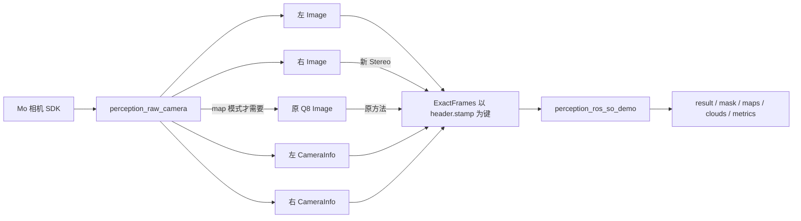

证据：[实际创建订阅与 required mask](../features/ros/src/perception_node.cpp)、[adapter 过滤未使用话题](../features/ros/adapter.py)、[raw_camera 实际发布者](../features/ros/src/raw_camera_node.cpp)。

#### 8.1.2 时间戳不是“差不多就行”

`ExactFrames` 按纳秒键精确汇总必需消息，没有 ApproximateTime 容差。左图、右图或 Q8、左右 CameraInfo 必须携带同一个采集时间戳。各回调收到后分别调用 `now()` 会产生不同时间戳，永远凑不齐一组。零时间戳、非法纳秒拒绝；完成过的时间戳及更旧消息标记 stale，不再次处理。

缓存容量默认 4，最大 16，表示尚未凑齐的**时间戳组数**；超过容量淘汰最旧组。某个较新完整帧先到，会完成它并淘汰该时刻以前仍不完整的组。不是各话题任意拿最新帧拼接，也不是按数组序号配对。

SDK FrameId 可额外验证厂商直取同帧；普通 ROS Image 不包含厂商 FrameId 字段，所以 ROS 配对依据严格时间戳，随后生成本地配对序号。结果不会声称这个序号是厂商帧号。

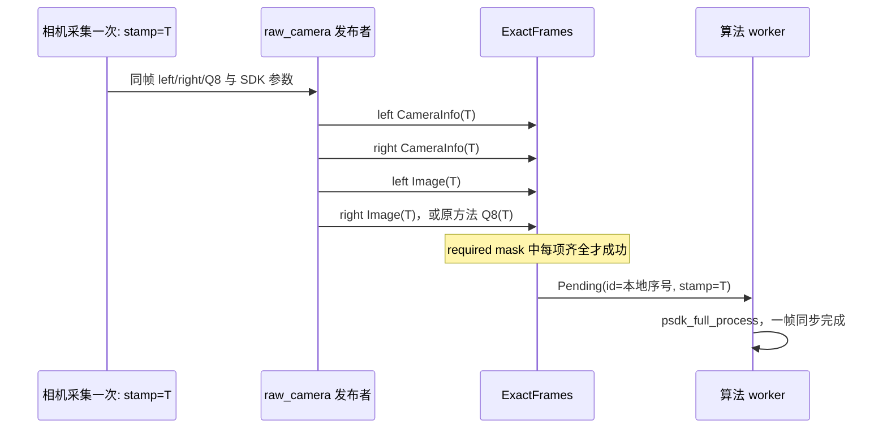

#### 8.1.3 CameraInfo 用的是矫正后的 P

`stereoIntrinsics()` 读取矫正图的投影矩阵 P，而不是直接把原始畸变相机 K 当成矫正内参。左右图和 CameraInfo 都必须为 640×544；左右 P 的 fx/fy/cx/cy 匹配，水平双目形式合法，left Tx=0、right Tx<0，binning 必须已合入实际输出几何。

换算为：`baseline_m=-P_right[3]/P_right[0]`，`bxf=-P_right[3]*1000`，单位 px·mm。发布者使用 `P_right[3]=-bxf/1000`。SDK 内三维恢复因此保持原 640×544 像素坐标及标定单位。

检查还包括 K/P/R/D 的有限性，但代码没有全面验证 ROI，也没有仅靠 CameraInfo 内容自动完成双目矫正。`rectified` 声明是调用方真实输入契约，不能替代校准数据和图像几何核对。

即使标定参数不变，当前节点默认要求两份 CameraInfo **每个采集帧都发布且时间戳与图像相同**；发布一次静态 CameraInfo、stamp=0、或只改变图像 stamp，均不能满足此精确 join。

证据：[ExactFrames](../core/include/perception_ros_so_demo/latest_frame.hpp)、[ROS synchronize](../features/ros/src/node_input.cpp)、[timestamp/imageView](../features/ros/src/image_messages.cpp)、[stereoIntrinsics 校验与单位](../features/stereo/include/perception_ros_so_demo/stereo_calibration.hpp)、[raw 发布 CameraInfo](../features/ros/src/raw_camera_node.cpp)。

#### 8.1.4 QoS 与队列不要混淆

算法输入使用 SensorDataQoS，默认 best_effort、volatile、keep_last=`queue_capacity`。`raw_camera` 默认同为 best_effort/volatile，但它的 DDS depth 在 C++ 中固定为 4；JSON 中的 `queue_capacity` 配的是算法输入 DDS depth 与精确配对缓存，当前不会同步改变发布者 depth。

可靠性兼容关系：best_effort 订阅者可接可靠发布者；reliable 订阅者不能接 best_effort 发布者。两个进程需要相同话题、消息类型、ROS_DOMAIN_ID、可互相发现的 RMW/网络环境；看到发布者并不等于订阅匹配成功。

主算法节点和 raw_camera 的图像/点云输出默认 volatile，不保证迟到订阅者拿到已经发布的旧帧。旧独立 stereo_source 的最后点云使用另一种持久性，见 8.4。调试一次性离线序列时，应先启动订阅者，或循环离线播放，而不是等程序 finished 再订阅。

### 8.2 X5 两终端 ROS 输入与观察命令

以下在**已经完成 v2 AArch64 构建与部署**的项目根目录执行。SDK_ROOT 必须包含匹配本次部署的 full shared SDK 配置和动态库；用户先前目录可作为布局参考，但不要将 Windows 源码路径或已经搬迁的旧 install 路径填给板端。

```bash
cd /userdata/perception-stereo-modular-v2
export ROS_SETUP=/app/humble/setup.bash
export SDK_ROOT=/userdata/ai_infer_r12_v36/perception-core-x5-r12-v36/install/perception_full_shared_sdk
export DET_MODEL=/userdata/ai_infer/data/mmyolo0828.bin
export SEG_MODEL=/userdata/ai_infer/data/pidnet_0825_3classes.bin
export STEREO_MODEL=/userdata/models/r34_tail_pointwise_shuffle2_grouped_grid_352x640_nv12_mixed.bin
```

这些是布局示例；SDK_ROOT/STEREO_MODEL 需改为实际本次构建 SDK 和板端模型路径。显式 DET_MODEL 可避免“Found 2 candidates for det”式的自动候选歧义。缺少模型或路径错误时先修配置，不把不相干候选文件软链接过去凑路径。

可先只生成、检查配置（不会进行相机采集和推理）：

```bash
bash tools/run_pipeline.sh pipeline.json \
  --run-dir /userdata/perception_runs/prepare_01 --prepare-only
cat /userdata/perception_runs/prepare_01/parameters.yaml
cat /userdata/perception_runs/prepare_01/resolved.json
```

真正运行请换一个未存在的目录，例如：

```bash
bash tools/run_pipeline.sh pipeline.json \
  --run-dir /userdata/perception_runs/live_01
```

`--run-dir` 要求新目录；刚才 prepare-only 创建的同名目录不能原样再用于正式启动。run-dir 包含解析后的实际参数、SDK 配置、来源配置快照和独立 metrics，便于复现。

ROS 新 Stereo 用两个终端，两个终端先设置相同 ROS_SETUP、SDK_ROOT、模型路径和 ROS_DOMAIN_ID；主配置设置 `input_mode=ros,disparity_source=raft_stereo`：

```bash
# 终端一：算法订阅者先启动。
bash tools/run_pipeline.sh pipeline.ros.json \
  --run-dir /userdata/perception_runs/ros_new_01
```

```bash
# 终端二：同一项目根目录。infer 在这里表示原始相机生产模式，不是执行检测。
bash tools/run_camera_x5.sh infer --pipeline pipeline.ros.json
```

原方法 ROS 比较则将 `disparity_source=original_q8`，算法仍用 run_pipeline，raw 发布者改用：

```bash
bash tools/run_camera_x5.sh map --pipeline pipeline.ros.json
```

`map` 使 raw 发布者要求并发布真实 Q8，默认选择 SDK mode 2；`infer` 发布双目原图和 CameraInfo，默认 SDK mode 1，适合新 Stereo。`run_camera` 的这个模式参数不会自动从主配置视差来源推导，启动时需对应选择。两种模式都发布右目 Image。

第三终端观察前先 source 相同环境：

```bash
cd /userdata/perception-stereo-modular-v2
source /app/humble/setup.bash
source install/local_setup.bash
ros2 node list
ros2 node info /perception_ros_so_demo
ros2 node info /perception_raw_camera
ros2 topic list -t
ros2 topic info /camera/rgbd_left_nv12 --verbose
ros2 topic info /camera/rgbd_right_nv12 --verbose
ros2 topic info /stereo/left/camera_info --verbose
ros2 topic echo /camera/rgbd_left_nv12 --once --field header --qos-reliability best_effort
ros2 topic echo /camera/rgbd_right_nv12 --once --field header --qos-reliability best_effort
ros2 topic echo /stereo/left/camera_info --once --field header --qos-reliability best_effort
ros2 topic echo /perception_ros_so_demo/result --once --field data
ros2 topic echo /perception_ros_so_demo/metrics --once --field data
ros2 topic echo /perception_ros_so_demo/errors --field data
```

比较 header 时要捕获同一个采集时刻；连续独立执行三次 `--once` 往往看到不同帧，不能据此判定发布者没有共享 stamp。可用 rosbag 记录这几个输入话题后按 stamp 分组核对，或观察 raw_camera 的 `~/capture`。

脚本会 source ROS 和本项目 install，并检查板端为 aarch64。`run_camera_x5.sh` 在发现旧 ai_node/raw_camera 时拒绝启动，需先在对应终端 Ctrl+C 正常释放相机。直接相机模式、录制器与 ROS 原始相机发布者应单一拥有设备；不要互相同时运行。普通停止首选 Ctrl+C，让 close 恢复原相机模式并 release；本次文档不建议用杀光所有进程或清共享内存的命令处理。

raw 相机启动器支持 CAMERA_SDK/CAMERA_CONFIG 环境覆盖（显式 ROS -p 优先）；主 run_pipeline 相机设置按 camera.json 编译，不额外自动采用这两个环境覆盖。想两套入口统一，可在 camera.json 的路径字段写 `${CAMERA_SDK}`/`${CAMERA_CONFIG}` 并显式 export。

证据：[run_pipeline exec 与 prepare](../scheduling/launch/python/run_pipeline.py)、[run_camera 模式/参数/环境优先级](../scheduling/launch/python/run_camera.py)、[raw_camera 脚本占用检查](../tools/run_camera_x5.sh)、[X5 环境脚本](../tools/x5_env.sh)。

### 8.3 按计数判断接收、配对与处理问题

当前 v2 每五秒检查自最后成功处理以来是否超时（offline 阈值为 max(5秒,3/fps)，等待订阅者或播放完成时抑制该提示），错误码 1001 文本包含 received_images、paired_frames、processed_frames、dropped_pending、last_stamp。旧版本的 left_cache/q8_cache/... 字段不再是当前日志格式。

| 现象 | 可定位到哪里 | 下一步 |
|---|---|---|
| ROS received_images=0 | Image 回调尚未执行 | 先看两个节点是否存在、topic 订阅数、名字/类型/QoS/domain；不要先怀疑 Stereo 质量 |
| received>0、paired=0 | 缺 required topic 或 stamp 不一致 | 检查新算法右图、原方法 Q8、两份逐帧 CameraInfo；检查非零 exact stamp |
| paired>0、processed=0 | 图像/标定或 SDK 处理失败 | 看 errors 中具体 1002/SDK task/feature，不只看超时提示 |
| processed 增长但 PLY 没有 | 保存配置或保存失败 | 检查 resolved 参数、非空 save_root、save_every_n/PLY、输出根尾部 run-dir 名、2002 文件错误 |
| processed 增长、dropped_pending 增长 | 实时生产快于 worker | 分开看 compute/save/queue；降低输入频率或保存量；这不代表左右配对错乱 |
| dropped_unmatched/stale 增长 | 配对缓存淘汰/迟到或倒退消息 | 检查源 stamp、缺 topic、DDS 丢包、排队和缓存；不是 worker 槽覆盖计数 |
| offline 等待一直不动 | wait_for_subscribers 的订阅条件不齐 | 订阅 result 与开启的 mask/input，或关闭该等待；仅开 RViz cloud 不够 |

计数口径也不同：ROS received 统计 Image 消息数、不含 CameraInfo；一组新双目通常涉及两条 Image。camera received 统计成功采集组数。offline 分支增加 paired 而不增加 received，所以 offline 的 received=0 本身不代表无输入，应看 paired/processed 和 finished/waiting 状态。

在线 metrics 中包含 load_or_acquire_ms、queue、compute_ms、graph_ms、stereo_ms、save_ms、worker_frame_ms、进程 CPU、RSS KiB 和 since_ready FPS。CPU 是**整个算法进程**，包含其中 SDK/camera/DDS 线程；100% 表示约一个核，可超过 100%。ROS 模式的独立 raw_camera 进程不在算法进程 CPU/RSS 中；camera 直取时相机 SDK 线程在进程内。不能不说明范围就比较两者 CPU。FPS 为 node ready 以来成功帧/墙钟时长，包含等待和保存，不是单纯 1000/模型耗时。

用户之前 `ros2 node list` 只有 `/stereo_source`，left 话题 Publisher=1、Subscription=0：在该终端的 ROS 图发现视角下没有算法订阅者。应先确认算法进程仍在、环境一致、节点能被发现，再分析帧配对；独立立体源已经生成 PLY 仅证明它自己的处理成功，不证明检测/分割/融合节点工作。

还应检查环境：

```bash
printf 'ROS_DOMAIN_ID=%s\nRMW_IMPLEMENTATION=%s\nROS_LOCALHOST_ONLY=%s\n' \
  "${ROS_DOMAIN_ID-}" "${RMW_IMPLEMENTATION-}" "${ROS_LOCALHOST_ONLY-}"
ros2 node list
ros2 topic info /camera/rgbd_left_nv12 --verbose
```

分别在两个运行终端和观察终端比较输出。原问题里的 `--verbos` 少了 e，文档应使用 `--verbose`。

证据：[无输入诊断触发](../features/ros/src/perception_node.cpp)、[接收/配对计数](../features/ros/src/node_input.cpp)、[实际 metrics 字段与统计口径](../features/ros/src/node_metrics.cpp)、[只有成功后 processed++](../features/ros/src/node_process.cpp)。

### 8.4 旧 stereo_source 的兼容边界

`stereo/stereo_source.py` 是保留的独立测试工具，用其自身 YAML 输入、独立推理/重建路径生成 PLY。它创建节点 `/stereo_source`，发布左图、Q8、左右 CameraInfo、自己的 `/stereo/points` 和 `/stereo/pair`。**它没有右目 Image 发布者**，因此不能直接作为当前在线 `raft_stereo` 模式的输入生产者；有右目 CameraInfo 不等于有右图。

其左 Image/Q8/CameraInfo 为 volatile，只发布每个输入 pair 一次。`Stereo input complete; retaining last point cloud until Ctrl+C.` 之后，只 spin 维持保留的 PointCloud2/pair 发布者，**不循环重播左图/Q8**。算法节点此时才启动就可能永远 received=0，尽管 RViz 仍能看到 transient_local 的最后点云。

如要继续用旧源喂原 Q8 路径，先启动算法订阅者再启动源，并正确设置其 wait_for_subscribers/required_subscribers，原格式/内参也必须符合当前节点。新在线算法应优先使用本项目 `raw_camera`（同时发布左右图）或标准 offline 成对输入；A/B 推荐新 recorder 的 recording 路径。

旧工具默认 required_subscribers 只列 left/left_info/right_info，没有默认要求 disparity 订阅者；不能把其“有订阅者再播”误认为所有算法必需话题都已经匹配。旧 YAML 中的 v10 executable/model 路径也不能当作 v2 当前统一入口。

证据：[RosPublisher 发布者字典](../stereo/stereo_source.py)、[仅 points/pair 持久化 QoS](../stereo/stereo_source.py)、[只发布左图/Q8/Info](../stereo/stereo_source.py)、[finish 只维持最后点云](../stereo/stereo_source.py)。


<a id="stereo"></a>

## 9. 新 Stereo、模型格式和点云几何

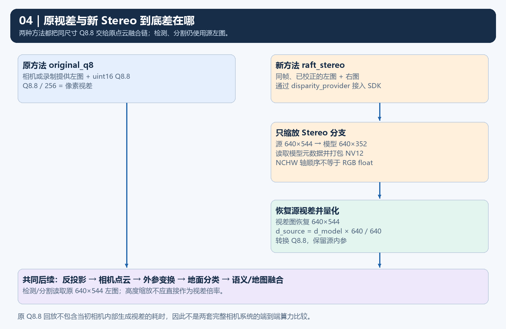

### 9.1 新 Stereo 怎样接进原 full SDK

当前 full C ABI 的 `psdk_full_frame` 没有右图字段。新算法没有为此给整个 ABI 偷加一个 C++ 双目对象，而是利用 `psdk_disparity_provider`：

1. 应用拿到同帧左图和右图。
2. `StereoProvider::setPair` 保存本次调用所需的图像并准备模型尺寸。
3. 应用让 full frame 的 `disparity` 为空。
4. full 图运行 `product.stereo.disparity` 时调用注册的 provider。
5. provider 使用本次左右图，输出与源图同尺寸、同身份的 Q8.8。
6. 原点云链拿到 Q8.8，继续执行。
7. 当帧结束清除 provider 的 pair，不让下一帧借用旧图。

关键代码：[`StereoProvider`](../features/stereo/src/stereo_provider.cpp)、[`full_pipeline.cpp`](../scheduling/pipeline/src/full_pipeline.cpp)、[`perception_full_sdk.h`](../sdk/include/perception_full_sdk.h)。

**输入里已有 Q8.8 时 full SDK 会优先读取它，provider 不会被用到。**所以新方法的应用明确清空 `frame.disparity`，并在返回后检查 provider 是否真的被调用，避免“以为测试新模型，实际又用了旧视差”。

### 9.2 当前源尺寸和模型尺寸是两回事

```text
源左图 640×544 ───────────────→ 检测与分割
        │
        └─ 与同帧右图 → 仅 Stereo 分支 resize 到 640×352
                              ↓
                       模型预测视差
                              ↓
                 插值恢复到源 640×544 + 水平倍率修正
                              ↓
                     uint16 Q8.8 → 原点云链
```

当前新模型的张量布局是 NCHW `[1,3,352,640]`，对应 Horizon 图像类型 NV12。**布局、形状、数据类型、图像编码是不同信息。**不能看见 `C=3` 就用 RGB float 填充；runner 根据真实元数据、有效/对齐维度、字节大小和量化等信息打包。

实际 runner 在 [`features/stereo/runner/`](../features/stereo/runner/)，模型加载和张量处理应从这里读。项目目录中的模型文件名并不能证明本次真的加载了它，应结合本次配置、runner 日志及模型 SHA 确认。

### 9.3 视差恢复为什么乘宽度比例

视差衡量的是**水平像素位移**。若源宽为 `Ws`，模型宽为 `Wm`，输出恢复到源网格时需要：

```text
d_source_px = resize(d_model_px) × Ws / Wm
q8 = quantize(d_source_px × 256)
```

当前 `Ws=Wm=640`，所以倍率为 1。高度由 352 恢复到 544，不能额外把视差乘 `544/352`。

源检测/分割和最终点云保持 640×544，所以最终投影仍用源图对应的校正内参。不要把只属于模型输入的高度 resize 当成必须修改源内参的理由。

### 9.4 Q8.8、bxf 和米制点云

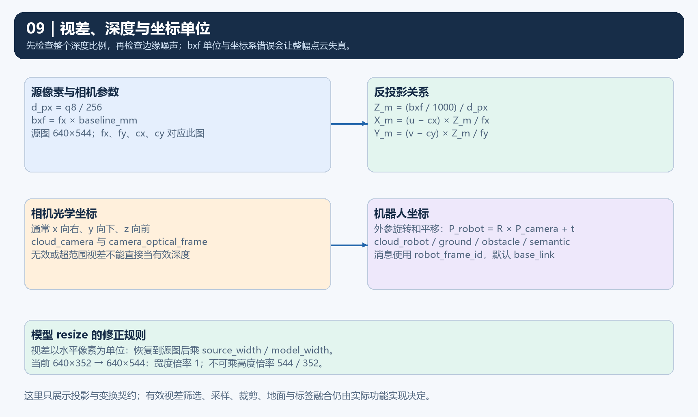

Q8.8 的每个像素是 `uint16`，实际视差：

```text
d_px = q8 / 256
bxf_px_mm = fx_px × baseline_mm
Z_m = (bxf_px_mm / 1000) / d_px
X_m = (u - cx) × Z_m / fx
Y_m = (v - cy) × Z_m / fy
```

这是投影契约；实际实现还会按有效视差、采样、范围和其他规则筛选点。内参中的 `bxf` 使用像素×毫米，SDK 转米一次。若把 baseline 的米、毫米混用，点云整体深度可能相差 1000 倍。

相机光学坐标通常 x 右、y 下、z 前；机器人点云通过外参变换。`frame_id` 只是消息标记，真正坐标变换由外参算法完成。把一个点云的 frame 字符串改成 `base_link`，不会自动旋转它。

### 9.5 替换 Stereo 模型时检查什么

先修改 `STEREO_MODEL` 环境变量或 `features/stereo/config.json` 的 `model` 路径，再核对：

- 是否仍为支持的左右双输入、视差输出模型。
- 左右顺序、输入名称、shape、layout、图像类型和量化方式。
- 输出是否表示水平视差，输出布局与尺度是否被 codec 支持。
- 模型期望的图像校正、归一化、有效视差范围。
- 运行库与模型构建版本是否匹配。

宽高配置可约束/匹配模型元数据，不能把输出语义不同的模型“改个尺寸就强行兼容”。HBRT/模型 builder 版本不一致的警告也不能由 JSON resize 修复。

当前枚举只有 `original_q8`、`raft_stereo`；想增加第三种新算法，需要实现 provider/runner 路由及对应参数校验。

### 9.6 检测和分割怎样处理源左图

源图是 640×544 YUV420，模型输入尺寸分别为：

| 分支 | 原共享 SDK 固定契约 | 主要步骤 |
|---|---|---|
| 检测 | 864×480，letterbox | YUV 前处理 → BPU/ORT → 头解码 → 分数过滤 → 类内 NMS → 框映回源图 |
| 分割 | 832×480，stretch | YUV 前处理 → BPU/ORT → logits → 原 align-corners 双线性类别后处理 → 源尺寸 mask |

检测使用 letterbox，是缩放后保留比例并补边。后处理必须用本次缩放和偏移把模型坐标映回原图，不能把模型坐标直接拿去投影源点云。

分割输入使用 stretch，与检测不同。当前常见输出为三类、104×60 logits，原算法采用固定的 `align_corners=true` / `bilinear` 后处理契约。不能把它随意换成“先在低分辨率 argmax，再最近邻放大”并认为数值等价。

X5 BPU stages 和 CPU ORT stages 复用同一调度接口，但模型输入归一化和运行后端不同。CPU 实现明确使用 CPUExecutionProvider，float32 NCHW；不会因为 Windows 有显卡就自动走 CUDA/DirectML。CPU profile 声明颜色、scale/mean/std、输入输出名字、输出布局和格式，并在加载时检查。

CPU 检测可按真实契约读取 `raw_dfl` 多头或 `decoded_xyxy` 输出；后者要求行内容为模型像素坐标 xyxy、概率分数和 class_id。不能把任意 YOLO ONNX 导出直接套入已有 profile。类别数、类别名、head 数量、DFL reg 和上下游标签映射都应一致。

关键实现：[`cpu_stages.cpp`](../features/inference/cpu/src/cpu_stages.cpp)、[`runner.cpp`](../features/inference/backend/src/runner.cpp)、[`seg_post.cpp`](../features/segmentation/backend/src/seg_post.cpp)、[`detection_post.cpp`](../features/detection/backend/src/detection_post.cpp)。

### 9.7 点云不是“一行公式算完就直接输出”

[`MappingPipeline`](../features/pointcloud/backend/src/mapping.cpp) 按固定阶段运行：

1. **cloud：**按 `sample_step` 扫源视差。把 Q8 除以 256，跳过零/无效视差，反投影为米制 XYZ，再按三维范围和最大点数限制筛选。该阶段保存相机点云副本，初始颜色为黑色。
2. **calibration：**构造外参矩阵。后端也有原自动标定分支，但当前模块前端关闭自动标定，使用已配置外参。
3. **labels：**在源相机几何下结合检测框和分割 mask，做标签融合；语义云实现内部会使用外参。
4. **transform：**给主点云投影 RGB，应用外参，保存机器人点云。
5. **ground：**用 Patchwork 类地面算法分类，再做原有后处理，得到地面和障碍云。
6. **maps：**将地面、障碍和可选语义云交给 AiFusion，生成 `pcl`、`ai`、`fusion` 三类栅格及高度/类型数据，按配置渲染 RGB 预览。

例如 `sample_step=4` 表示行列都每隔 4 个像素采样，候选点数量大致降为密集输入的 1/16，最终还有范围等筛选。因此点少不一定是 Stereo 无效，也可能只是采样设置不同。

### 9.8 标签融合和地面分类怎样影响视觉效果

融合不只是“在点上贴一个分割颜色”。实现会把点投影到图像，结合可通行分割类、检测框、检测分数、深度连续性、近远范围、体素连通域和最小簇点数等规则进行筛选和降级，再生成语义标签和颜色。

所以同一份 Stereo 视差，如果修改融合深度 gap 或连通域阈值，`semantic.ply` 也可能明显变化。想判断双目模型本身，先看 Q8 和 `camera.ply`；想判断应用行为，再看 ground、obstacle、semantic 和地图。

地面实现 [`ground_segmentation.cpp`](../features/pointcloud/backend/src/ground_segmentation.cpp) 在 Patchwork 后还保留平面距离补点、非地面下采样和离群点处理。内部存在 `ground_dist=0.05`、0.04 下采样、半径/统计滤波等常量，它们并未全部暴露到根功能 JSON，也不等于 Patchwork 的 `th_dist`。

地图保存的高度数组使用厘米，XYZ 点云使用米，外参角度等字段按原配置契约读取。改变参数前先查单位，不要凭字段名称猜测。

最近障碍距离由融合栅格中满足条件的单元计算，不是所有原始点里直接取最近的 Z。当前实现保留了原网格计算公式；修改该规则属于算法行为变化，应单独做回归。

<a id="threads"></a>

## 10. 并发、丢帧与数据所有权

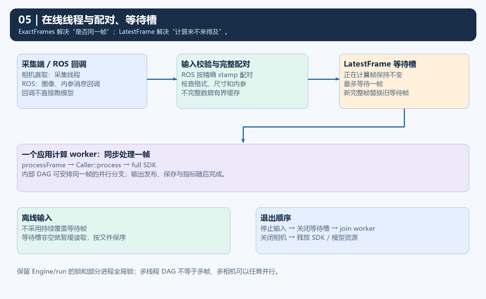

### 10.1 在线流程中有哪些线程

| 执行位置 | 主要工作 |
|---|---|
| ROS SingleThreadedExecutor | 回调、配对、定时诊断和离线触发 |
| 相机采集线程 | 直取模式读取 SDK 并组织完整帧 |
| 应用 worker | 同步调用 full SDK，随后发布、保存和记录指标 |
| full/内层 DAG 线程池 | 同一帧内按依赖并行计算 |
| 库内部线程 | CPU ORT、相机 SDK、驱动等可能还有内部线程 |

“单线程 executor”不代表整个进程只有一个线程；“DAG 两个 worker”也不代表两个独立视频帧同时处理。

### 10.2 两个容易混淆的缓存

**ExactFrames：**缓存不同话题的消息，寻找同一个精确时间戳的完整组合。调大配对缓存可以容忍消息到达顺序差异，不能把不相等的时间戳变成同帧。

**LatestFrame：**已经完整配对的帧交给计算 worker，等待槽最多保留一帧。在线新输入会替换还没开始处理的旧等待帧，避免计算落后后越积越长；当前正在计算的帧不会被覆盖。

离线输入采用等待/背压：等待槽非空时暂不读取下一个文件，最多一个帧正在处理、一个帧等待。因此离线保序与在线追求新鲜帧的策略不同。

### 10.3 为什么不能随便加 worker 提升 FPS

原实现仍含跨会话或跨 Pipeline 的状态与锁：Engine 的 run 锁、full 的全局门锁、exact inference 的全局帧锁等。

它们保护复用工作区和原有数值状态。直接开启多个帧线程可能无法加速，也可能破坏生命周期。要支持真正多帧并行，应先把模型工作区、校准策略、第三方状态拆成实例资源，再定义多帧有序输出和停止策略。

### 10.4 view 和 owner 的关系

```text
输入图像 owner ──借用──→ psdk_frame / provider
                          │ 同步 full_process 期间有效
                          ↓
SDK result 句柄 ──拥有──→ 检测 / mask / Q8 / map / clouds
                          ↑
result_view ──只引用───────┘
                          │
应用发布复制数据 / 同步保存
                          ↓
Result::reset / 析构 → 释放 result → view 指针失效
```

结果在 result 释放前拥有数据，即使 engine 已经销毁也不能据此继续使用已释放的 result。不要保存 `view.clouds[i].points` 指针给下一帧或后台写盘线程；异步输出应复制数据，或把 Result 所有权移动给线程并保证完整寿命。

Provider 的借用 Q8 需要至少活到 full_process 返回；回调在 SDK Feature 内执行，不能重入调用同一类 full SDK 接口。

### 10.5 如何停止

正常停止优先用运行终端 Ctrl+C。程序停止输入、关闭等待槽、join worker，再释放相机与 SDK。

若失去原终端，先用 `pgrep -af`/`ps` 找到**本次程序的准确 PID 和命令行**，向这个 PID 发 SIGTERM，等待退出；确认异常卡死后才考虑 SIGKILL。不要对所有叫 `python3`、`demo` 的进程批量强杀，也不要把清共享内存当成正常关闭方式。

<a id="outputs"></a>

## 11. 结果保存和可视化：ROS、RViz、PLY 与文件

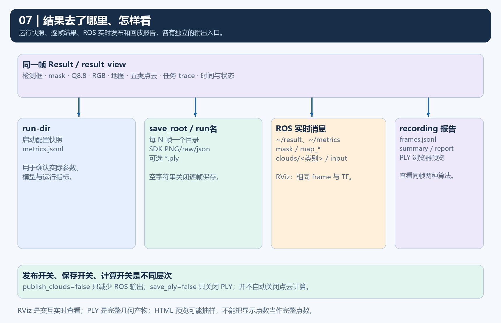

### 11.1 三种输出位置

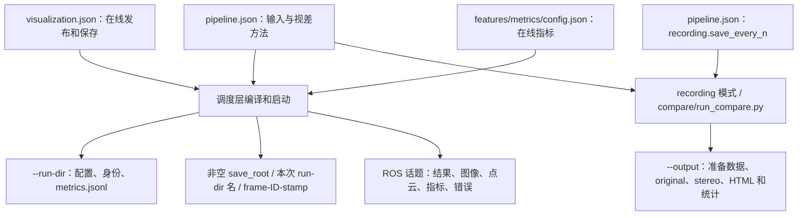

**运行目录、逐帧保存目录、录制比较目录是三种概念。** `save_root=""` 关闭在线逐帧结果与 PLY；只要 `write_jsonl=true`，在线 `metrics.jsonl` 仍写入运行目录。录制比较不用 `save_root` 决定是否保存，读取主配置的 `recording.save_every_n`。

证据：[配置编译 compile_pipeline](../scheduling/config/python/configuration.py)、[启动 prepare](../scheduling/launch/python/run_pipeline.py)。

### 11.2 可视化参数与计算开关的区别

根配置 [visualization.json](../visualization.json) 当前为：

```json
{
  "save_root": "",
  "save_every_n": 10,
  "save_ply": true,
  "publish_every_n": 1,
  "publish_clouds": true,
  "publish_maps": true,
  "publish_mask": true,
  "publish_input": false,
  "render_maps": true,
  "robot_frame_id": "base_link"
}
```

| 参数 | 实际行为 | 容易误解的地方 |
|---|---|---|
| `save_root` | 在线逐帧保存的上级目录；相对路径以主 `pipeline.json` 所在目录为根 | 程序实际追加本次 `run-dir` 的目录名；不会只写到 `save_root` 本身 |
| `save_every_n` | 在线每 N 个成功处理帧保存一次，首个成功帧也保存；0 禁用 | 使用成功处理计数，不是相机原始帧 ID 的取模 |
| `save_ply` | 在线保存结果时，额外写五类 ASCII PLY 和 `clouds.json` | `save_root` 为空或保存频率为 0 时不会生成 PLY |
| `publish_every_n` | 每 N 个成功处理帧调用结果发布，首帧发布 | `input_image` 在 SDK 处理前单独发布，不随此项抽样；metrics 也有自己的频率 |
| `publish_clouds` | 创建并发布五类 `PointCloud2` | 发布与保存互相独立；关闭发布不会自动关闭 PLY |
| `publish_maps` | 发布 `pcl_map` / `ai_map` / `fusion_map` 的 RGB 栅格预览图 | 类型是 `sensor_msgs/Image`，不是 `nav_msgs/OccupancyGrid` |
| `publish_mask` | 有推理结果时发布 `mono8` 类别 ID 图 | 不是已着色的 RGB 分割图；数值 0/1/2 的显示可能接近黑色 |
| `publish_input` | 发布输入左图消息的副本 | 可能为 NV12/I420；通用 ROS 图像查看器未必直接支持此编码 |
| `render_maps` | 请求 SDK 生成地图 RGB 预览 | 不等于关闭地图融合计算；它控制渲染内容 |
| `robot_frame_id` | 给 robot/ground/obstacle/semantic 点云写 ROS `header.frame_id` | 只改标签不会改变坐标，坐标变换由 SDK 外参完成；节点不会因此自动发布 TF |

在线启动器会强制 SDK 自身的自动保存 `output.every_n=0`，由 ROS 工作线程在成功处理后显式调用保存，避免两套录制同时生效。当前可读配置入口还固定 `save_overlay=false`、`save_inputs=false`，因此不要承诺在线默认一定有 `overlay.png` 或 `source.yuv`。SDK 保存接口具备这两项能力，但根 `visualization.json` 没有对应开关。

证据：[sdk_configs](../scheduling/launch/python/run_pipeline.py)、[processFrame](../features/ros/src/node_process.cpp)、[节点发布与保存参数](../features/ros/src/perception_node.cpp)。

### 11.3 相机直取结果的实际目录

示例：设置 `visualization.json` 的 `save_root` 为 `/userdata/perception_saved`，用下面的命令启动：

```bash
bash tools/run_pipeline.sh \
  --run-dir /userdata/stereo_results/camera_20261010_01
```

运行配置和指标写到：

```text
/userdata/stereo_results/camera_20261010_01/
├── requested_pipeline.json       schema2 请求配置的留档
├── requested_dag.json            编译后的兼容输入/DAG配置
├── compiled_v10.json             同一兼容配置的功能编译留档
├── resolved_features.json        功能参数及来源
├── effective_full.json           实际交给 SDK 的 full 配置
├── original_start.json           本次地图/融合的原始后端配置
├── parameters.yaml              实际传给 ROS 节点的参数
├── resolved.json                 命令、库路径、参数、运行目录
├── metrics.jsonl                 write_jsonl=true 才有；每行一条性能记录
└── inference_cpu.json 或 inference_original.cfg
                                  仅生成了推理 profile 覆盖时出现
```

逐帧结果另存：

```text
/userdata/perception_saved/camera_20261010_01/
└── frame-<处理提交ID>-<时间戳ns>/
    ├── result.json
    ├── task_trace.json
    ├── effective_config.json
    ├── temporal.json
    ├── complete.json
    ├── source.json                ROS 前端额外写入的输入/标定/方法信息
    ├── mask.bin                   有推理时，640×544 的逐像素类别 ID
    ├── disparity_q8.u16           有视差时，640×544 little-endian uint16 Q8.8
    ├── disparity.png              有灰度视差缓存时，显示预览，不是原始数值
    ├── rgb.png                    有 RGB 缓存时
    ├── pcl.cells.bin / pcl.png     地图数据 / 可选渲染
    ├── ai.cells.bin / ai.png
    ├── fusion.cells.bin / fusion.png
    ├── grid_type.u8
    ├── grid_avg_h_cm.i16
    ├── grid_min_h_cm.i16
    ├── grid_max_h_cm.i16
    ├── camera.cloud.bin           仅该点云非空才有二进制文件
    ├── robot.cloud.bin
    ├── ground.cloud.bin
    ├── obstacle.cloud.bin
    ├── semantic.cloud.bin
    ├── camera.ply                 save_ply=true 时；允许零点文件
    ├── robot.ply
    ├── ground.ply
    ├── obstacle.ply
    ├── semantic.ply
    └── clouds.json                在线额外保存的坐标/点数说明
```

文件出现与 SDK 输出有关，上图是条件性集合，不是每帧一定齐全。`recharge.png`、`source.yuv`、`overlay.png` 是 SDK 保存器的其他可选产物；当前可读主配置启动的地图通路关闭回充，且不启用后两项。

`save_root=""` 时只有第一棵运行目录树，没有第二棵逐帧树。**不传 `--run-dir`** 的在线启动会创建系统临时目录 `perception-modular-*`，并打印 `Run directory:`；推荐固定传一个新目录，便于查找和归档。传入目录必须尚不存在，程序拒绝覆盖旧运行。相同运行目录的 basename 也会成为保存目录名，建议每次用唯一名称。

`complete.json` 由 SDK 结果保存器写完其文件后生成；ROS 随后才写 `source.json` 和 PLY。若随后 PLY 保存失败，SDK 的 `complete.json` 仍可能存在，必须同时检查 `~/errors` / 错误日志与 PLY 文件，不能仅凭它认定在线全部附加产物写盘成功。成功处理帧计数在保存之前增加，保存错误不回退这一计数。

证据：[prepare 中目录追加与 metrics_path](../scheduling/launch/python/run_pipeline.py)、[SDK saveResult](../scheduling/pipeline/src/full_pipeline.cpp)、[在线保存顺序](../features/ros/src/node_process.cpp)、[PLY 保存器](../features/pointcloud/src/cloud_output.cpp)。

### 11.4 ROS 输出话题、五类点云与 RViz

节点默认名 `/perception_ros_so_demo`，源码使用私有名称 `~/...`。改节点名/命名空间或 remap 后，完整话题名也随之改变。以下列出默认名称。

| 话题后缀（前缀 `/perception_ros_so_demo`） | 消息类型 | 内容 / QoS |
|---|---|---|
| `/result` | `std_msgs/msg/String` | JSON：帧身份、标定、检测框、六项推理耗时、地图数、最近障碍、回充状态；Reliable，Volatile，深度 1 |
| `/history` | `std_msgs/msg/String` | 时序分析 JSON，未开启分析时可为 `{}`；Reliable，Volatile，深度 1 |
| `/metrics` | `std_msgs/msg/String` | 在线性能与丢帧 JSON；Reliable，Volatile，深度 1 |
| `/errors` | `std_msgs/msg/String` | 错误 JSON：code/native_code/feature/task/detail；Reliable，Volatile，深度 10 |
| `/error_code` | `std_msgs/msg/UInt32` | 成功帧为 0；失败时发布错误码；Reliable，Volatile，深度 10 |
| `/mask` | `sensor_msgs/msg/Image` | `mono8` 类别图，与左图 header；SensorDataQoS，Best Effort，Volatile，深度 1 |
| `/input_image` | `sensor_msgs/msg/Image` | 原左图消息副本，仅开启时发布；Reliable，Volatile，深度 4 |
| `/pcl_map`、`/ai_map`、`/fusion_map` | `sensor_msgs/msg/Image` | `rgb8` 地图预览，使用左图 header；SensorDataQoS，深度 1 |
| `/clouds/camera` | `sensor_msgs/msg/PointCloud2` | 相机光学坐标，header.frame_id 沿用输入左图 |
| `/clouds/robot`、`/clouds/ground`、`/clouds/obstacle`、`/clouds/semantic` | `sensor_msgs/msg/PointCloud2` | 已由 SDK 外参转换的坐标，header.frame_id=`robot_frame_id`；全部 SensorDataQoS，深度 1 |

五类点云的单位都是米。`camera` 的轴为 X 向右、Y 向下、Z 向前。其余点云使用配置的机器人外参，不能仅凭标签 `base_link` 就断言实际安装外参正确。ROS `PointCloud2` 为非组织点云：height=1，point_step=24 字节，依次含 `x/y/z` float32、PCL 形式打包 `rgb` float32、`confidence` float32、`label` int32；无穷或 NaN 坐标会把 `is_dense` 置为 false。

当前 `node_output.cpp` 没有单独发布新视差或深度图的话题。输入 `/camera/disparity_q8` 是 original 模式的输入，不等于新 Stereo 的输出话题；观察新视差可启用保存后读取 `disparity_q8.u16` / `disparity.png`。

证据：[发布器声明](../features/ros/src/perception_node.cpp)、[消息类型别名](../features/ros/include/perception_ros_so_demo/perception_node.hpp)、[publish](../features/ros/src/node_output.cpp)、[PointCloud2 格式及坐标标签](../features/pointcloud/src/cloud_output.cpp)。

#### 五类 PLY 应怎样看

| PLY | 适合看什么 | 颜色和注意事项 |
|---|---|---|
| `camera.ply` | 只看视差到几何的形状、平面、空洞、离群点 | 这是生成后、着色前的副本，当前实现初始 RGB 为 0，黑色是可预期行为 |
| `robot.ply` | 按共同外参比较整体场景和真实图像纹理 | 在线/比较启动器启用原 SDK 的 RGB 投影路径，保存实际 SDK RGB；建议作为默认预览 |
| `ground.ply` | 地面分类覆盖、断裂、误分类 | 来自已变换点云的地面子集；为空可能是功能配置或地面分类结果，不等于模型没运行 |
| `obstacle.ply` | 伪障碍、物体边界、地面漏分后进入障碍的点 | 不是完整场景，必须与 ground/robot 对照 |
| `semantic.ply` | 检测/分割和几何融合后的类别 | 使用类别色；confidence 含融合规则赋值，不能统一当作 Stereo 匹配置信度 |

SDK 在 `cloud()` 用 Q8/256 得到像素视差，使用 `z=bxf_m/disparity_px`，再由内参投影 X/Y；有采样步长、范围框与点数上限。`camera` 在 RGB 投影前拷贝。`labels()` 生成语义点云且语义实现内部应用外参；`transform()` 对主点云投影 RGB 后应用外参，形成 robot；`ground()` 再分地面和障碍。因此改变 `sample_step`、范围、外参、地面参数、融合参数都会改变点云外观，做视差方法比较时应保持这些设置一致。

证据：[cloud / labels / transform / ground](../features/pointcloud/backend/src/mapping.cpp)、[语义云外参](../features/fusion/backend/src/label_fusion.cpp)。

#### 主节点 RViz 操作

1. 在可访问同一 ROS 网络的机器上运行 `rviz2`。
2. 首先只看 `/perception_ros_so_demo/clouds/robot`：把 Fixed Frame 设为实际 `robot_frame_id`（默认 `base_link`），添加 PointCloud2，选择该话题，Reliability 设 Best Effort，Durability 设 Volatile，Color Transformer 选 RGB8。
3. 查看 camera 时，把 Fixed Frame 改为输入左图实际 header.frame_id；camera 和 robot 同屏必须已有真实标定对应的 TF，不能靠改 header 冒充变换。
4. 添加 Image 看 `mask` / `pcl_map` / `ai_map` / `fusion_map`。mask 是类别 ID 灰度；彩色语义效果可看 semantic 点云。

仓库 [config/rviz/stereo.rviz](../config/rviz/stereo.rviz) 是**独立 `stereo_source`** 的 `/stereo/points` 示例，Fixed Frame=`stereo_left_optical_frame`，Reliable + Transient Local；不能直接照搬给上表主节点。

检查命令：

```bash
ros2 node list
ros2 topic info /perception_ros_so_demo/clouds/robot --verbose
ros2 topic echo /perception_ros_so_demo/metrics --once
ros2 topic echo /perception_ros_so_demo/result --once
ros2 topic hz /perception_ros_so_demo/clouds/robot
```

`ros2 topic hz` 测到的是该话题观察到的消息到达频率，受 `publish_every_n`、QoS、网络和订阅端影响；不能直接替代节点 `completed_fps_since_ready`。

<a id="metrics"></a>

## 12. 耗时、CPU、RSS 与 FPS：怎样读指标


[features/metrics/config.json](../features/metrics/config.json) 的 `write_jsonl` 只控制文件，`every_n` 同时控制 `~/metrics` 发布和文件写入的抽样频率。`write_jsonl=false` 时话题仍按 every_n 发布。

| 字段 | 真实测量区间 / 含义 |
|---|---|
| `load_or_acquire_ms` | 离线转换/读取或相机 `next()` 获取区间；ROS 输入没有在此重建 DDS 网络延迟 |
| `queue_wait_ms` | 工作线程开始处理到输入被加入 Pending 的间隔；不等价于相机曝光到结果的端到端延迟 |
| `compute_ms` | `algorithm_.process(...)` 外围墙钟，包含 full SDK 与其内 Stereo 回调；不包含工作线程此前的输入验证/转换及后续发布保存 |
| `graph_ms` | SDK DAG 执行墙钟 |
| `stereo_ms` | 在线 Stereo provider 的整个回调，含 YUV→BGR、resize、打包、推理、解码、恢复 Q8；original 路线是 null |
| `save_ms` | 本帧显式 SDK 保存 + source.json + PLY 的墙钟；没选中保存为 0 |
| `worker_frame_ms` | 工作线程整帧：输入检查/准备、SDK、结果读取、ROS 发布、显式保存，至 metrics 调用参数求值之前；不含本次 metrics JSON 序列化、发布/flush 和结果释放 |
| `process_cpu_ms` | 同一个 worker_frame 区间里整个进程 CPU 时间增量；会包含并行采集、DDS 和 SDK 工作线程 |
| `process_cpu_percent_over_worker_frame` | `100 × process_cpu_ms / worker_frame_ms`；单核满载 100%，多核可超过 100% |
| `rss_kib` | 写指标时读 `/proc/self/status` 的 VmRSS，KiB；是本进程驻留内存采样 |
| `completed_fps_since_ready` | `processed_frames / 从 ready 起的墙钟秒数`；包含等待输入、运行与保存，并非纯推理 FPS |
| `process_cpu_percent_since_ready` | ready 起本进程累计 CPU / 同范围墙钟；同样可超过 100% |
| `det_pre_ms` / `det_infer_ms` / `det_post_ms` | SDK 检测预处理 / 推理 / 后处理 |
| `seg_pre_ms` / `seg_infer_ms` / `seg_post_ms` | SDK 分割预处理 / 推理 / 后处理 |
| `task_trace` | 各 SDK task 的执行记录和耗时，用于定位阶段 |
| `received_images_or_captures` | ROS 收到图像消息的数量或直取捕获数量，跨输入模式不能一概理解为同一帧率计数 |
| `paired_frames` / `processed_frames` | 配对提交帧数 / SDK 成功返回且身份检查通过的处理数 |
| `dropped_pending_frames` | latest-frame 工作队列中被新帧替换的待处理帧 |
| `dropped_unmatched_captures` / `stale_messages` / `sync_pending_captures` | 精确配对缓存淘汰、过期消息和当前等待配对数量 |

CPU 来自 `CLOCK_PROCESS_CPUTIME_ID`，RSS 来自 Linux procfs；主节点没有在本接口里测 BPU 利用率，也没有逐帧峰值 RSS。相机直取把相机 SDK 线程算在同进程内；ROS 输入的独立相机发布进程 CPU 不在算法节点 CPU 中。两个模式不能仅比较主节点百分比就宣布哪种整体开销低。线程并行时，不能把 det/seg 六项耗时、Stereo 和 graph 的时间全部相加；Stereo 已包含在 SDK disparity task 内，与 compute/graph 重叠。

ready 起 FPS 包含首次等待输入；离线文件读完后若进程还活着，最后一条指标只对应当时的累计区间，后续空等不会自动产生新记录。算法处理失败会提前返回或抛错，通常没有这一帧的正常指标行；必须结合 errors、接收/配对/处理计数判断覆盖率。当前在线统计不是独立完整的失败率报告。

证据：[metrics](../features/ros/src/node_metrics.cpp)、[processFrame 的计时边界](../features/ros/src/node_process.cpp)、[进程 CPU/RSS](../features/metrics/src/process_metrics.cpp)、[ready 时钟起点](../features/ros/src/perception_node.cpp)、[Stereo 回调范围](../features/stereo/src/stereo_provider.cpp)。


<a id="build"></a>

## 13. 构建、部署与真正运行修改后的代码

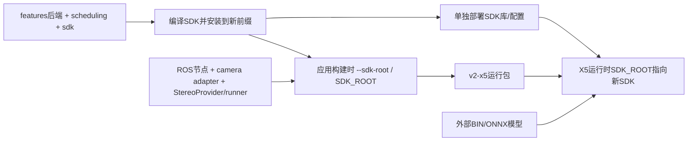

| 改动 | 应重建什么 |
|---|---|
| 已开放JSON阈值、话题、输入路径、保存频率 | 无需C++重建；重新prepare/启动 |
| 兼容模型文件/已支持尺寸 | 通常无须重建；重新加载并验证metadata |
| features/*/backend、CPU stages、预处理、调度层C++、SDK C接口 | 重建SDK安装到新目录；运行切到新SDK，公开接口变化时同时重建应用 |
| ROS节点、sdk_bridge调用方式、mo_camera应用采集、StereoProvider、features/stereo/runner | 重建应用/对应runner；不能只重建SDK |
| Python配置翻译/launcher | 源代码入口直接使用新文件；发布运行包需重新打包，已安装副本需重新安装/恢复 |
| SDK根模板full/profile | 直接改实际使用的安装配置或用sdk_base_config/profile引用；只改源码模板不会自动改旧SDK安装目录 |

### 13.1 Ubuntu主机：构建应用（沿用既有环境）

```bash
cd /home/st/ini_code
tar -xzf perception-stereo-modular-v2.tar.gz
cd perception-stereo-modular-v2
python3 tools/verify_files.py .

bash tools/build_in_container.sh \
  --container obs-v004-x5-build \
  --sysroot /work/obs_v004_x5/sysroot_docker \
  --sdk-root /tmp/r12-v36-20261008-215622-3654808/install/perception_full_shared_sdk \
  --stereo-horizon-root /work/obs_v004_x5/sysroot_docker/usr_x5 \
  --out /home/st/ini_code/perception_stereo_modular_v2_release
```

这是实际支持的脚本参数。sysroot/sdk-root/stereo-horizon-root 是**容器内部**路径，out是主机路径。默认使用现有旧SDK仅验证前端兼容；验证v2后端必须先构建下列新SDK，并将这里的--sdk-root换成新SDK的容器安装前缀。运行包名为 perception-stereo-modular-v2-x5.tar.gz；构建脚本严格要求真实AArch64 ROS/SDK、匹配Horizon头文件与libdnn。缺库时不会退化成伪实现。

### 13.2 容器内部：重建v2 SDK

先确保完整v2源码已复制到容器中的工作目录，在该目录运行：

```bash
bash tools/build_backend_sdk.sh \
  --backend bpu \
  --horizon-root /work/obs_v004_x5/sysroot_docker/usr_x5 \
  --toolchain "$PWD/sdk/cmake/x5-toolchain.cmake" \
  --build-dir "$PWD/build/backend_x5" \
  --install-dir /tmp/perception_modular_v2_sdk/install/perception_full_shared_sdk \
  -- -DX5_SYSROOT=/work/obs_v004_x5/sysroot_docker \
     -DX5_CXX_COMPILER=/usr/bin/aarch64-linux-gnu-g++
```

该命令要求sysroot中真实可找到目标PCL>=1.10、Eigen3、OpenCV core/imgproc、RapidJSON，以及Horizon DNN/HBRT/VPF/HBMEM。若库位于额外前缀，用 `--` 后的 `-DCMAKE_PREFIX_PATH=/实际/目标依赖前缀`、`-DPCL_DIR=...`、`-DOpenCV_DIR=...` 等指定；这些路径必须指向**目标AArch64**依赖。示例是与工具对照后的构建调用，不声称本环境已完成整套生产AArch64链接。

SDK构建入口已是 sdk/CMakeLists.txt，旧 backend/r36_sdk 路径不再有效。工具默认 R33_WITH_MAPPING=ON、R33_WITH_RECHARGE=OFF、BUILD_TESTING=OFF，构建并安装SharedSDK组件。之后在主机调用13.1时用 `--sdk-root /tmp/perception_modular_v2_sdk/install/perception_full_shared_sdk`。将这份SDK安装目录另行复制到X5，不要只传ROS运行包。

### 13.3 Ubuntu/WSL：CPU SDK与应用

```bash
# 原生Linux/WSL，依赖位置须换成已有真实x86前缀
bash tools/build_backend_sdk.sh \
  --backend cpu --ort-root /path/to/x86/onnxruntime \
  --build-dir "$PWD/build/backend_cpu" \
  --install-dir "$PWD/install/backend_cpu" \
  -- -DCMAKE_PREFIX_PATH=/path/to/x86/dependencies

export SDK_ROOT="$PWD/install/backend_cpu"
export ROS_SETUP=/opt/ros/humble/setup.bash
export NATIVE_BUILD_DIR="$PWD/build/native"
export INSTALL_ROOT="$PWD/install/perception_ros_so_demo"
export BUILD_JOBS=4
bash tools/build_native.sh
```

native脚本接受这些**环境变量**，不是--sdk-root参数。默认Horizon runner关闭；需要实际匹配x86 Horizon头库时才设置STEREO_HORIZON_ROOT，构建成功不代表CPU能跑X5 BIN。CPU SDK编译完成也不会自动把随包full.json模板的backend=bpu改为cpu：应在实际SDK/config下复制full配置为full_cpu.json，改inference.backend=cpu并补真实cpu_profile，然后用主配置sdk_base_config指向它；保持该配置中其他相对路径的正确基准。

x86运行使用 `python3 tools/run_pipeline.py ...` 或比较Python入口，提前source ROS/安装环境；不要用拒绝x86的run_pipeline.sh。非默认INSTALL_ROOT须配runtime.executable或recording.runner；直接Python前端不会自动source shell环境。

### 13.4 X5相机直取启动

```bash
cd /userdata
tar -xzf perception-stereo-modular-v2-x5.tar.gz
cd perception-stereo-modular-v2-x5

export SDK_ROOT=/userdata/perception_modular_v2_sdk/install/perception_full_shared_sdk
export DET_MODEL=/userdata/ai_infer/data/mmyolo0828.bin
export SEG_MODEL=/userdata/ai_infer/data/pidnet_0825_3classes.bin
export STEREO_MODEL=/userdata/stereo_pro/r34_tail_pointwise_shuffle2_grouped_grid_352x640_nv12_mixed.bin
export LD_LIBRARY_PATH="$SDK_ROOT/lib:/app/deps:/usr/hobot/lib:${LD_LIBRARY_PATH:-}"

python3 tools/verify_files.py .
bash tools/run_pipeline.sh \
  --run-dir /userdata/stereo_results/modular_$(date +%Y%m%d_%H%M%S)
```

此SDK_ROOT是假定将13.2新SDK部署到该目录，必须核对它真实存在。原来可用的旧路径是 /userdata/ai_infer_r12_v36/perception-core-x5-r12-v36/install/perception_full_shared_sdk；继续用旧路径即继续用旧后端。ROS_SETUP可显式指定；否则wrapper按 /app/humble、/opt/tros/humble、/opt/ros/humble 查找，并source运行包install/local_setup.bash。启动前后可 `ldd install/perception_ros_so_demo/lib/perception_ros_so_demo/demo` 检查 libperception_sdk.so 实际位置。

### 13.5 结果路径与停止

在线运行目录始终存有效配置；实际指标按metrics开关写metrics.jsonl。默认visualization.save_root=""，所以不会生成每帧结果/PLY。设save_root=/userdata/perception_results后，run-dir basename会拼到其下，再按 `frame-<frame_id>-<timestamp_ns>/` 存SDK结果/source.json/可选PLY；不要在--run-dir里找未开启的PLY。recording则结果位于--output/original或stereo及其逐帧目录和报告。

前端用execve替换为真正节点，正常Ctrl+C可直接交给ROS进程并关闭资源。必要时确认PID后 `kill -INT <PID>`，再考虑TERM；不要默认用killall/-9清理一切。相机发布wrapper只检查可能的旧ai_node/raw_camera并拒绝启动，不会自动杀进程或清共享内存。


### 13.6 在 WSL 使用现有 CPU ONNX 通路

建议 WSL/Linux 承担 ROS 与 C++ 运行，Windows 用于编辑配置、浏览报告和查看产物。当前工具与相机/BPU 动态库主要面向 Linux，不把 Windows 原生完整 ROS/相机链当成已验证环境。

CPU 构建、CPU 配置与模型是三个步骤。`R29_WITH_ORT=ON` 只是编进 CPU 后端；`features/inference/config.json` 的 profile 路径也不负责切换 backend。需要在实际使用的 full 配置中选择 `inference.backend="cpu"` 并引用已经填好真实输入输出契约的 CPU profile。

可在 SDK 的原 `config/` 目录内复制 `full.json` 为 `full_cpu.json`，保留其中其他相对引用，修改 inference 的 backend/cpu_profile，然后让主 `sdk_base_config` 指向这份文件。模型改为匹配该 profile 的真实 ONNX，`DET_MODEL`/`SEG_MODEL` 同步指向 ONNX。

```bash
# 以下路径填成真实 x86 安装目录和模型；不是 X5 的 BIN。
export SDK_ROOT=/absolute/path/to/cpu_sdk
export DET_MODEL=/absolute/path/to/detection.onnx
export SEG_MODEL=/absolute/path/to/segmentation.onnx
source /opt/ros/humble/setup.bash
source install/local_setup.bash
export LD_LIBRARY_PATH="$SDK_ROOT/lib:/absolute/path/to/onnxruntime/lib:${LD_LIBRARY_PATH:-}"

python3 tools/run_pipeline.py pipeline.cpu.json \
  --run-dir /absolute/path/to/new_cpu_run
```

`pipeline.cpu.json` 应位于项目根目录，引用实际 `full_cpu.json`，并选择可提供真实原视差的 ROS 输入，或使用 `recording + original_q8` 做单方法回归。普通图片离线全流程需要当前新的 X5 Stereo，不能因为检测/分割换成 ONNX 就自动在 CPU 上运行这份 BIN。

录制原方法回放可直接使用比较入口，且不加 `--both`：

```bash
python3 compare/run_compare.py pipeline.cpu.recording.json \
  --output /absolute/path/to/new_cpu_recording_run
```

项目没有实现 CPU Stereo ONNX 通路的自动替代。如果希望新 Stereo 也在 x86 上测试，需要新增兼容 provider/backend，并明确模型输入、输出单位和与 X5 路径的数值差异。CPU profile 示例中的 `REPLACE_*` 或个人 Windows 模型路径是模板/历史记录，应按实际模型修改，不能直接当成通用可运行配置。


<a id="extension"></a>

## 14. 如何扩展功能

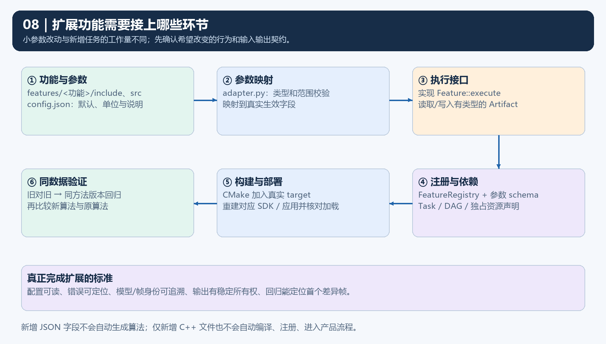

### 14.1 先判断改动属于哪一类

| 需求 | 通常修改哪些地方 | 是否编译 |
|---|---|---|
| 改已开放阈值、保存频率 | 对应 JSON，重启并确认生效文件 | 不需要 |
| 换契约一致的模型 | 模型路径、必要 profile，检查模型元数据 | 通常不需要 |
| 暴露后端已经支持的参数 | config、adapter、参数索引和校验 | 仅 Python 翻译变化时不必重编 C++ |
| 修改 NMS、点云、地面算法 | 对应 features 后端，重建 SDK | 需要 |
| 修改 ROS 消息/队列/应用输出 | features/ros 或应用功能源，重建应用 | 需要 |
| 新增独立可执行任务 | Feature、注册、参数 schema、DAG、构建和输出契约 | 需要 |
| 增加新的输入/视差方法枚举 | 配置编译、校验、输入契约、路由与实现 | 需要相应组件 |

### 14.2 示例一：调整已支持的检测阈值

1. 修改 `features/detection/config.json` 的 `score_threshold`，例如从继承改为 `0.35`。
2. 用新的 run-dir 执行 prepare-only。
3. 查看 `resolved_features.json` 和生成的 inference profile，确认实际值。
4. 运行 5～10 个固定输入帧，检查检测框和下游融合变化。
5. 保留原图、模型、视差、其他配置身份，避免把多个变量同时改变。

不要直接修改安装 SDK 的稳定 profile 后忘记记录来源；也不要只改 `parameter_map.json`，它是索引而非实际参数入口。

### 14.3 示例二：开放一个现有后端参数

假设某地面参数后端已经读取，但用户配置尚未开放，步骤为：

1. 找到真实 C++ 读取字段，确认单位、范围、默认值、读取时机。
2. 在所属 config 加字段，若支持继承则用 `null`，补 `_help`。
3. 在 adapter 的允许键集合中加入字段，并校验类型/范围。
4. 将显式值写入真实的 `mapping`/profile 等生效目标。
5. 更新 `python3 tools/generate_parameter_map.py` 的映射规则/输出，不能假设生成器自动认识任何新增字段。
6. 检查 prepare-only 的目标文件，再用能触发该参数行为的输入验证。

至少检查“默认继承”“显式覆盖”“错误值拒绝”，以及改值确实到达目标算法。配置层若没有读取和映射，再漂亮的 JSON 也不会改变输出。

### 14.4 示例三：新增一个读取检测结果的 Feature

下面展示与当前 `TaskGraph` API 一致的实现骨架。它不是已经接入主产品的功能；目的是说明注册、类型产物和依赖怎样连接。

例如新增 `features/detection_summary/include/detection_summary.hpp` 和 `src/detection_summary.cpp`：

```cpp
#include "perception/task_graph.hpp"
#include "perception/types.hpp"
#include <memory>

namespace example {
struct Summary {
    int count = 0;
    bool enough = false;
};

class DetectionSummary final : public perception::runtime::Feature {
public:
    void execute(perception::runtime::FeatureContext& ctx) override {
        const auto det = ctx.get<perception::DetectionResult>("ai.detection");
        const int minimum = ctx.parameterInt("min_count", 1);
        Summary result;
        result.count = static_cast<int>(det->detections.size());
        result.enough = result.count >= minimum;
        ctx.set("custom.detection_summary", result);
    }
};

void registerDetectionSummary(perception::runtime::FeatureRegistry& registry) {
    using namespace perception::runtime;
    registry.add(
        "custom.detection_summary",
        [](const Parameters&) { return std::make_unique<DetectionSummary>(); },
        {{"min_count", FeatureParameterType::Integer}});
}
} // namespace example
```

这里的几个名字属于不同命名空间：

- `custom.detection_summary` 注册名：配置通过它找到执行工厂。
- Task ID：可以叫 `summary`，用于依赖和报告。
- Artifact 键：这里同样叫 `custom.detection_summary`，用来取计算结果；即使字符串相同，也不等于同一个概念。
- `example::Summary`：产物的 C++ 类型，消费者必须用相同类型取。

#### 注册放在哪

必须注册到实际创建该 Engine 的同一个 Registry。若扩展当前 exact 内层图，可在 [`Pipeline` 构造](../scheduling/inference/src/dag_pipeline.cpp) 中注册 exact/builtin Features 后、创建 Engine 前调用 `example::registerDetectionSummary(registry)`。不要只建立一个无人调用的注册函数。

#### DAG 怎样加入任务

下面是示意完整内层图：原检测、分割完成后执行 summary 和 disparity。它仍保留原 Feature 链：

```json
{
  "config_version": 3,
  "engine": {
    "worker_threads": 2,
    "result_artifacts": [
      "ai.detection", "ai.segmentation", "exact.detections",
      "stereo.demand.result", "custom.detection_summary"
    ]
  },
  "tasks": {
    "input": {"features": ["input.exact.pack"]},
    "detection": {"features": [
      "ai.exact.det.preprocess", "ai.exact.det.backend", "ai.exact.det.postprocess"
    ]},
    "segmentation": {"features": [
      "ai.exact.seg.preprocess", "ai.exact.seg.backend", "ai.exact.seg.postprocess"
    ]},
    "summary": {
      "features": ["custom.detection_summary"],
      "params": {"min_count": 1}
    },
    "disparity": {"features": ["stereo.demand"]}
  },
  "dag": {
    "sequence": [
      "input", {"parallel": ["detection", "segmentation"]},
      "summary", "disparity"
    ]
  }
}
```

配置解析器的具体字段以 [`runtime_config_json.cpp`](../scheduling/config/src/runtime_config_json.cpp) 为准。新增图还需满足 shared SDK 对 exact 内层图的固定契约检查；扩展不能删除必需阶段、破坏原资源顺序或伪造 Feature 名称。

#### CMake 怎样编进来

如果接在 exact 内层图，可以在创建真实 target 之后加入：

```cmake
target_sources(dag_exact_features PRIVATE
  "${PERCEPTION_PROJECT_ROOT}/features/detection_summary/src/detection_summary.cpp")
target_include_directories(dag_exact_features PRIVATE
  "${PERCEPTION_PROJECT_ROOT}/features/detection_summary/include")
```

并在实际调用注册函数的文件中包含声明。随后重建 SDK，安装到新前缀，让应用与运行环境加载这份 SDK。

#### 结果怎样传给应用

注册 Feature 不会自动给 C ABI 增加字段，也不会自动出现一个 ROS topic。内部 Engine 的 `FrameResult.artifacts` 可以保留配置导出的产物；如果需要穿过基础/full C ABI、落盘或 ROS 发布，还要设计相应的稳定输出接口与所有权。

若只增加一个已有结果的统计/可视化，直接在应用读 `result_view` 后计算通常更简单。只有确实需要参与算法依赖、复用中间产物或并行调度时，才应新增内部 Task。

### 14.5 示例四：替换点云或地面算法

1. 从 `features/pointcloud/backend/` 的 Mapping 调用点和实际算法实现读起。
2. 固定输入输出契约：坐标系、单位、采样规则、无效点、标签和点顺序。
3. 保留旧实现或可切换路径，先让新旧实现吃同一个 Q8.8。
4. 先验证输入、检测、分割和 Q8 完全一致，再定位点云/地面首个差异。
5. 重编 SDK到新安装目录，记录二进制哈希和生效配置。
6. 做固定录制回归后，再验证在线帧丢弃、时延、资源和退出。

当前 full 产品候选任务固定在 C++ `steps()`。新增一个真正的产品阶段，必须同时加 Step、依赖、绑定和数据状态；只往根 JSON 填一个节点名字不会生效。

### 14.6 新功能设计前的五个问题

- 输入究竟是哪一帧、哪种格式、哪一个坐标系？
- 结果是借用数据还是自己拥有，活到什么时候？
- 需要哪个前驱产物，能否与其他任务安全并行？
- 失败时怎样报告、清理，后继应该跳过还是输出降级结果？
- 用哪一组固定输入，怎样证明行为符合预期并定位差异？

<a id="comparison"></a>

## 15. 同数据比较：先验证重构，再评价新 Stereo

不要把两个问题混在一起：**同方法版本回归要求行为保持；原视差与新 Stereo 的算法比较允许输出不同，重点解释效果和代价。**

### 15.1 同一次捕获：录左图、右图和原 Q8

#### 第一步：相机一次录制左右图与原 Q8

```bash
export SDK_ROOT=/userdata/your_new_v2_sdk_install
export DET_MODEL=/userdata/ai_infer/data/mmyolo0828.bin
export SEG_MODEL=/userdata/ai_infer/data/pidnet_0825_3classes.bin
export STEREO_MODEL=/userdata/stereo_pro/r34_tail_pointwise_shuffle2_grouped_grid_352x640_nv12_mixed.bin
export CAPTURE_ROOT=/userdata/stereo_recordings/scene_20261010_01
export LD_LIBRARY_PATH="$SDK_ROOT/lib:/app/deps:/usr/hobot/lib:${LD_LIBRARY_PATH:-}"

bash tools/capture_stereo.sh --output "$CAPTURE_ROOT" --frames 100
```

`SDK_ROOT` 必须替换为实际安装前缀；所有模型路径必须存在。相机库/厂商配置来自主配置引用的 `camera.json`，也可用 `CAMERA_SDK` / `CAMERA_CONFIG` 覆盖。采集程序固定 RGBD 模式 2 + need_q8=true，以同一次捕获的左图、右图和原 Q8 为一组，严格核对捕获 ID/时间戳。不能分别采两遍相机来做逐帧 A/B。

```text
scene_20261010_01/
├── metadata.json       640×544 校正参考内参、bxf、来源、格式
├── manifest.jsonl      每组捕获 ID/时间戳/路径、acquire CPU/时间、RSS
├── complete.json       完整采集汇总；失败则 failed.json
├── frame-000001/
│   ├── left.nv12        tight 640×544 NV12，522240 字节
│   ├── right.nv12       tight 640×544 NV12，522240 字节
│   └── q8.bin           uint16 LE Q8.8，696320 字节
└── frame-000002/... 
```

采集 `capture_acquire_ms` 包含 SDK 等待、拥有数据的复制、释放；CPU 是采集进程在这个区间里的总 CPU。它不提供旧 Stereo 算法内核的独立耗时。录制 `capture_fps` 包含初始化、写盘与关闭；`capture_acquire_fps` 排除写盘，二者也不要混用。

证据：[录制采集循环](../compare/capture/main.cpp)、[录制元数据/资源说明](../compare/capture/main.cpp)。

#### 第二步：生成清晰的 schema2 录制配置

将下面文件放在**项目根目录**，例如 `pipeline.recording.json`，这样默认 feature/camera/visualization 的相对路径指向同一项目：

```json
{
  "schema_version": 2,
  "input_mode": "recording",
  "disparity_source": "raft_stereo",
  "sdk_root": "${SDK_ROOT}",
  "sdk_base_config": null,
  "recording": {
    "directory": "${CAPTURE_ROOT}",
    "intrinsics": "recording",
    "limit": 100,
    "warmup_frames": 5,
    "repeat": 3,
    "save_every_n": 1,
    "viewer_max_points": 20000
  }
}
```

`raft_stereo` 参数读取 `features/stereo/config.json`，当前为显式 `resize`、640×352；真正原图仍保持 640×544 用于检测/分割/融合，模型输出恢复到 640×544，水平视差按宽度比缩放。宽度没变时倍率为 1；垂直压缩依然会影响模型行为，比较结论属于这个具体适配链路。

`save_every_n=1` 是效果与正确性比较建议，每帧均保存；性能测量可另开一轮设为 0 或同一抽样频率，但 0 会没有可比较 PLY。抽样保存时只能对保存子集作视觉结论。`repeat=3` 是整套选中数据重复三遍，不等于三倍独立场景；warmup 是前 N 帧循环预热，预热不保存、不进正式性能汇总。

**当前 schema2 下 `--both` 请使用 `disparity_source="raft_stereo"` 的配置。** 调度层只在这个选择下生成 stereo 配置段，比较启动器才能同时取到 Stereo 模型/适配参数。`original_q8` 主配置只适合单独 original 运行；直接对它加 `--both` 会缺少所需的 stereo 段。这是现有实现限制。

#### 第三步：一次准备、顺序运行两个方法

```bash
bash tools/run_compare.sh pipeline.recording.json \
  --both --order original,stereo \
  --output /userdata/stereo_results/ab_scene_01
```

还可反转顺序，使用另一个新目录：

```bash
bash tools/run_compare.sh pipeline.recording.json \
  --both --order stereo,original \
  --output /userdata/stereo_results/ab_scene_01_reverse
```

`--both` 两路线使用相同准备清单、同一个 full SDK 配置、相同检测/分割模型、内外参与融合设置。original 从已录制 Q8 输入 SDK；stereo 将同帧左右图交给 provider，由 SDK disparity task 内回调生成新 Q8，随后共用原点云/融合。程序为两路线分别启动 runner 进程，按指定顺序执行，避免同时抢算力。

主入口 `tools/run_pipeline.py pipeline.recording.json --run-dir ...` 可以跑该配置选中的单方法；**它不转发 `--both`**，A/B 应用上面的 `run_compare.sh` 或直接 `python3 compare/run_compare.py ...`。

运行前只准备可用：

```bash
bash tools/run_compare.sh pipeline.recording.json \
  --both --prepare-only \
  --output /userdata/stereo_results/ab_scene_prepare
```

prepare-only 验证输入/配置并生成 PNG/清单，不执行模型，也不生成实测性能；正式运行必须另选新目录。

依赖区别：在线主配置编译/启动 Python 只用标准库；录制比较前端导入 `cv2`、`numpy`，报告中的 PLY 读取器也用 NumPy。可用系统 `/usr/bin/python3`，无须新建虚拟环境，但须确实安装这些模块。`STEREO_PYTHON` 只是 `run_compare.sh` 可选解释器覆盖，默认 `python3`；它不会安装依赖。原 BIN Stereo 路线还需带真实 Horizon 支持的 `r36_compare_runner` 与 X5 运行库，普通 x86 不能凭 CPU ONNX 检测/分割环境执行这个 X5 BIN。

证据：[execute](../compare/run_compare.py)、[prepare_manifest](../compare/run_compare.py)、[schema2 stereo 段生成条件](../scheduling/config/python/configuration.py)、[run_compare.sh](../tools/run_compare.sh)。

### 15.2 比较产物、HTML 操作和回放指标

```text
ab_scene_01/
├── requested_pipeline.json / resolved_features.json
├── compiled_v10.json
├── requested_dag.json / original_dag.json / stereo_dag.json
├── run.json                      平台、输入/模型/profile身份、标定、方法顺序
├── full.json / original_start.json
├── input_inventory.json          每组原始文件 SHA256、捕获身份
├── prepared/
│   ├── pairs.tsv
│   └── capture-序号-原捕获ID-原时间戳/left.png,right.png
├── original.log / stereo.log
├── executions.json
├── original/
│   ├── run.json / frames.jsonl / complete.json
│   └── repeat-000-frame-000000-capture-.../
│       └── SDK结果文件及五类 PLY
├── stereo/
│   └── 与 original 同结构
├── index.html                    双侧同视角点云 + 性能表
├── report_zh.md
├── summary.json / summary.csv
└── complete.json                 两路线、报告均完成后生成；失败为 failed.json
```

录制 runner 自己写 PLY，当前不会像 ROS 在线保存器那样额外生成 `source.json` / `clouds.json`。原捕获身份在 `stem=capture-序号-ID-stamp` 和 input_inventory 中，runner 的 `frame_id` / `timestamp_ns` 则是新生成的回放身份。两路线必须用 `(stem, repeat)` 配对，不能按新时间戳或行号盲配。

`index.html` 内嵌两侧抽样的 XYZ/RGB，不需要在线 CDN，可以离线打开；中文报告/CSV/JSON 链接仍需同目录文件。页面可切帧、切点云种类、调点大小，两侧共用视角和完整点云联合范围。默认预览 robot。每类每侧默认上限 20000 个有效顶点，按有效顶点序号等距抽样；不是体素采样，也不代表左右顶点一一对应。完整 PLY 保持不变。浏览器优先 WebGL，失败时 Canvas 2D 回退，其显示上限另有 20000 点限制。

报告重生成：

```bash
python3 compare/report.py /userdata/stereo_results/ab_scene_01 --max-points 20000
```

此命令重新写报告、摘要和 HTML，不运行算法。`--evidence` 只是展示来源标识，不能把软件样例改标成 X5 实测；通常保留 `run.json` 中的实际来源即可。Windows 生成报告只需 Python + NumPy，HTML 浏览不要求 ROS / Horizon / Open3D；打开完整 PLY 可使用已有点云查看器，未安装时也可先用本项目 HTML。

#### A/B 指标与在线指标的区别

| A/B 字段 | 定义与限制 |
|---|---|
| `load_ms` | original 读原 NV12 + Q8；stereo 读 NV12 + 解码两张准备 PNG，因此两者 I/O 路径不同 |
| `compute_wall_ms` | 输入加载结束后，到 SDK 处理与 result view 读取完成；包含 Stereo provider，但不含前面的 PNG 读取 |
| `sdk_call_ms` | 仅 `psdk_full_process` 的外层墙钟 |
| `graph_ms` / `process_ms` | SDK 自报 DAG / full process 墙钟，与外层区间重叠 |
| `stereo_ms` | resize、模型打包/推理/输出解码/恢复 Q8 的 provider 区间；不是纯 BPU 内核耗时，original 为 null |
| `cpu_ms` / `cpu_wall_ms` | compute 区间进程用户+系统 CPU 时间增量 / 同范围墙钟 |
| `cpu_percent` | 汇总时用 `100×sum(cpu_ms)/sum(cpu_wall_ms)`，不是每帧百分比算术平均 |
| `cpu_machine_percent` | 先按在线 CPU 核数归一化 CPU 时间，再按同范围墙钟汇总 |
| `rss_kib` | compute 完成后的 VmRSS；逐帧采样可能漏掉区间瞬时峰值 |
| `peak_rss_kib` | `getrusage` 的进程生命周期高水位，包含模型初始化与预热，不是某帧新增内存 |
| `save_ms` | SDK 保存与完整 PLY 写盘；未抽样保存为 0 |
| `total_wall_ms` | 单帧 load + compute + 检查 + 保存至写测量 JSON 之前，排除该行日志和结果释放 |
| `compute_fps` | 有效 compute 帧数 × 1000 / 累计 compute_wall_ms |
| `total_fps` | 有效 total 帧数 × 1000 / 累计 total_wall_ms；仍是分阶段吞吐 |
| `observed_replay_fps` | 完整测量循环有效帧数 × 1000 / measured_wall_ms；含日志、结果释放、load/save，排除初始化和 warmup |
| `observed_replay_cpu_percent` | 整个正式循环进程 CPU / 同范围墙钟，不等同 compute CPU |
| `mapping_work_ms` | trace 中 disparity/cloud/calibration/labels/transform/ground/maps 成功 task 的工作耗时之和；可有并行重叠，不是融合的独立非重叠墙钟 |

报告只统计非 warmup 且成功的测量帧；无效/缺失值保持空，并记录样本数。方法间性能表优先使用相同 `(stem,repeat)` 的共同有效帧，未配对数量单列。只有完整循环计数与当前统计样本完全相同时，才显示对应的 observed replay 指标，不能把整轮墙钟分摊到随意子集。

**original 的旧视差已经在录制阶段生成，回放只读 Q8；新 Stereo 在回放中执行新视差模型。** 因此 A/B 能回答“复用原 Q8 与重新生成新 Q8 时，检测/分割/点云/融合和新模型额外开销是多少”，但不能用两边 replay FPS 排名完整旧/新相机实时链路速度。相机采集时间单列也不能当作旧视差内核时间，采集进程 CPU 与另一次回放 CPU 更不能直接相加。

证据：[runner 计时与文件保存](../compare/runner/src/main.cpp)、[汇总 summarize](../compare/report.py)、[完整循环计数限制](../compare/report.py)、[HTML 抽样与联合范围](../compare/compare_viewer.py)。

### 15.3 重构一致性与算法效果的不同验证标准

结构重构时，先保持输入、模型、profile、方法和融合参数完全相同，要求检测、mask、视差、地图与点云一致。现成工具：

```bash
python3 tools/compare_versions.py check \
  --baseline /absolute/path/to/old_completed_output \
  --candidate /absolute/path/to/new_completed_output \
  --method original \
  --allow-sdk-change \
  --output /absolute/path/to/new_version_check
```

这个工具比较两个独立完成的版本输出，`--allow-sdk-change` 只适用于明确重编了 SDK；不允许改变输入/模型身份，也不跳过结果检查。二进制视差/地图/原始云文件严格逐字节比较；tolerance 用于检测/PLY 数字字段。默认未保存帧使完整覆盖检查不能通过，`--allow-sampled` 只能得到显式声明的抽样结论。`--allow-config-change` 允许实验改配置，但结果差异仍报告，不代表得到等价性证明。

`compare_versions.py` 针对行为保持重构，检测/点云按顺序比较；不适合直接把 original 的云与新 Stereo 云判成必须相等。新方法效果应使用上述 `run_compare --both` 和 HTML 观察差异，再补：

- 固定同一种 PLY、相同完整范围、同视角；先看 camera 几何，再看 robot，再看 ground/obstacle/semantic，区分误差在哪一阶段引入。
- 看地面平整度、边缘粗糙/重影、空洞、飞点、远近一致性。点数多、颜色鲜艳、预览更满都不是精度更好的充分证据。
- 有距离真值/平面标定/人工标签时，再算深度误差、平面残差、有效像素率与边界、地面/障碍分类。把真值范围和无效像素规则写清楚。
- 没有真值时写“相对原方法的差异”，不要把旧 Q8 当作精度真值，也不要以逐点不相等认定新模型错误。
- 性能结论另跑多轮正反顺序，记录频率、温度、其他负载和完整输出覆盖；保持保存开关/频率一致。展示 p50/p95、RSS、丢帧和错误，不能只展示平均 FPS。

本轮 v2 实际软件回归已有新 SDK 31 项 CTest、ROS 6 项 CTest、两帧真实 CPU ONNX 回放，对比 immutable v10 的检测/mask/map 一致，五类 PLY 最大 xyz 误差为 0，26 个二进制文件一致。这是软件行为保持证据，不是新 Stereo 模型板端效果或真实相机精度证据。

证据：[版本检查 check](../tools/compare_versions.py)、[本轮验证范围](../validation/evidence/v2_final_validation.json)。


### 15.4 用已有真实结果说明怎样观察

下列两图复制自此前用户提供的 `E:/pro/python_pro/ab_20261010_103206` 的 X5 A/B 分析。它们属于当时的项目版本、模型与适配方式，**不是本次 v2 新跑的板端结果**，仅用于演示读图方法。

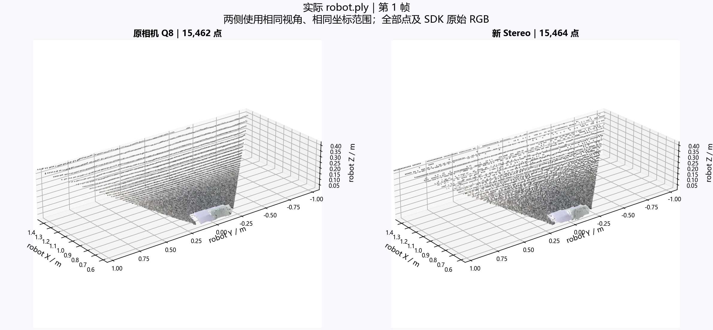

这张图使用同一帧、同一个 `robot.ply` 类型、相同视角和坐标范围，保留全部点和 SDK 原 RGB。先看平面厚度、局部飞点、边界形状，再联系下图的原始数值。点数相近不意味着几何效果相同，也不能仅看点数给算法排精度名次。

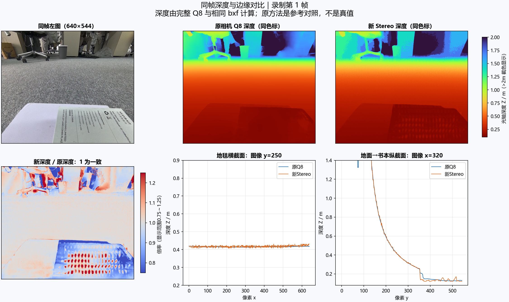

深度图使用同色标、同 bxf，并把旧方法明确作为参考而非真值。Q8/深度、相机点云、机器人点云、地面/障碍和最终融合应逐层看，才能区分模型误差、恢复比例、外参和后处理的影响。

这批旧实验的原 Q8 在采集时已经产生，新 Stereo 在回放中计算；两边还存在文件解码路径差异，且没有温度/频率遥测。它能展示具体适配后的相对差异，不能单凭回放 FPS 判断两套完整实时相机系统速度，或声称相对物理真值的精度提升。

### 15.5 建议固定成团队回归流程

| 阶段 | 数据和设置 | 通过标准/目的 |
|---|---|---|
| 旧对旧 | 同方法、同平台、同模型，多次运行 | 先确认本身是否确定性，建立合理误差范围 |
| 开发短回归 | 5～10个独立帧，覆盖平面、边缘、近障碍、弱纹理 | 定位首个差异，保证输入和不相关分支不变 |
| 版本结构回归 | 新旧版本、同输入、同方法、保存每帧 | 身份和覆盖完整，检测/mask/Q8/地图/点云符合等价目标 |
| 算法效果比较 | 同录制左右图/Q8/标定，只切视差方法 | 固定视角和ROI，解释几何、地面与应用行为差异 |
| 性能比较 | 相同保存/发布设置，多轮正反顺序 | 报告p50/p95、CPU/RSS、成功率、丢帧和温度/频率范围 |
| 在线验收 | 真实camera和ROS、持续运行、反复启停 | 检查采集/配对/尾延迟/资源/退出，不只看平均FPS |

发现差异后保留最小复现包：原始左右图、原 Q8、真实标定、三份模型 SHA、配置快照、实际加载 SDK 身份、日志和两侧结果。优先修首个出现差异的阶段，避免用下游阈值掩盖上游格式或几何错误。


<a id="troubleshooting"></a>

## 16. 常见问题：按证据定位

| 现象 | 最先核对 | 解释和处理 |
|---|---|---|
| `Invalid sdk path` | `SDK_ROOT`、实际安装前缀 | 源码目录、SDK 包目录、安装目录不等价；应指向含 config/lib/头文件/CMake package 的安装前缀 |
| 找到两个检测模型，要求显式指定 | `DET_MODEL` | 不让程序猜模型；显式选择目标文件并记录 SHA |
| 初始化后终端一直没新输出 | 输入是否到达 | 模型 ready 只说明初始化；查看 node/topic/metrics，不一定是模型卡住 |
| `received_images=0` | 当前算法进程、订阅数量、topic/domain | 算法节点未收到图像；先解决通信，不应调整模型或点云阈值 |
| 图像计数增长但无成功帧 | 同帧 stamp、缓存计数、格式、CameraInfo | 配对或输入契约失败，查看具体 error JSON |
| raw 文件要求 `522240 bytes` | 是否真为 tight 640×544 YUV420 | 原始 NV12/I420 是 `640×544×1.5`；PNG 不能按 raw 字节读 |
| 新模型提示输入尺寸不同 | 当前模型、Stereo宽高/元数据、实际输入 | 只在 Stereo 分支显式缩放；不能偷偷缩放源检测/分割图 |
| `SDK did not request Stereo disparity` | mapping、实际SDK、输入Q8是否清空 | provider 未调用，不能把该次结果当作新算法输出 |
| PLY 没保存 | `save_root`、`save_every_n`、`save_ply` | 根为空不保存；有 PLY 开关但没有保存目录和频率仍不会输出 |
| ROS 点云有 topic 但 RViz 不显示 | Fixed Frame、消息frame、QoS、点数、TF | 类型/坐标/QoS问题优先；不要仅凭topic存在认定已显示 |
| 点云距离整体不对 | bxf单位、视差缩放、源内参 | 先排整体尺度，再看局部模型效果 |
| 关闭地面分类后 obstacle 也空 | 当前 ground 语义 | 关闭不会自动退化成“全部点都是障碍”，须按代码定义处理 |
| 修改算法后结果完全不变 | 实际加载 `.so` 路径和SHA | 可能只重编了ROS应用，仍使用旧SDK |
| HTML有点，但点数少于PLY | viewer抽样上限 | 显示抽样不等于完整点云减少 |
| `--both` 用原方法配置失败 | schema2方法选择 | 使用 `raft_stereo` 主配置再加 `--both`，确保编译中含 stereo 设置 |

### 16.1 推荐排查顺序

```text
进程是否运行
 → 实际加载哪个二进制 / SDK / 模型
 → 有无输入、topic 与 QoS 是否匹配
 → 能否组成完整同帧数据
 → 图像格式、尺寸、内参和单位
 → Stereo输出 / Q8.8
 → 相机点云
 → 外参 / 地面 / 标签 / 地图
 → 发布 / 保存 / 可视化
 → 最后才判断精度和性能
```

不要先同时改模型、内参、采样和融合阈值。一次只改变一个可解释变量，并保留首个差异帧。

<a id="reading"></a>

## 17. 给新同伴的源码阅读路线

### 17.1 第一天：跑通并看见一帧

1. 读根三份 JSON，明确当前输入和方法。
2. 读 `tools/run_pipeline.py` 到真实 launcher，执行 prepare-only。
3. 打开生效 `parameters.yaml`、`effective_full.json`。
4. 用已知固定输入运行，查看 result、metrics 和一个保存目录。
5. 比较 mask、原 RGB、Q8 预览、PLY 和地图，先理解每种输出的含义。

### 17.2 第二天：沿一帧读代码

| 顺序 | 文件/入口 | 要回答的问题 |
|---|---|---|
| 1 | [`main.cpp`](../features/ros/src/main.cpp) | 进程、executor、退出在哪里 |
| 2 | [`perception_node.cpp`](../features/ros/src/perception_node.cpp) | 参数、资源、订阅发布、线程如何初始化 |
| 3 | [`node_input.cpp`](../features/ros/src/node_input.cpp) | 当前输入如何变成 Pending |
| 4 | [`node_process.cpp`](../features/ros/src/node_process.cpp) | 一帧怎样填ABI、调用模型、保存 |
| 5 | [`sdk_caller.cpp`](../features/sdk_bridge/src/sdk_caller.cpp) | engine/result所有权怎样管理 |
| 6 | [`full_pipeline.cpp`](../scheduling/pipeline/src/full_pipeline.cpp) | 本帧启用哪些工作、怎样绑定 |
| 7 | [`full_graph.cpp`](../scheduling/dag/src/full_graph.cpp) | full依赖怎样形成 |
| 8 | [`dag_pipeline.cpp`](../scheduling/inference/src/dag_pipeline.cpp) | det/seg前后处理与调度怎样连接 |
| 9 | 对应 `features/` 数值实现 | 这个具体功能怎样计算 |
| 10 | [`node_output.cpp`](../features/ros/src/node_output.cpp) 与 metrics | 最终输出怎样解释 |

### 17.3 第三天：完成一个小改动

先改一个已支持的检测阈值，确认生效和行为变化；再选择一个边界清楚的小功能，例如输出检测框计数或增加结果字段。不要把多帧并行、换坐标系、换模型和改地面算法作为第一次联合改动。

阅读时区分“算法正确性”“配置正确性”“通信正确性”“可视化正确性”。相机采到图不代表配对成功，配对成功不代表内参正确，PLY 能打开也不代表点云尺度正确。

<a id="design"></a>

## 18. 当前设计评价与后续改进方向

### 18.1 适合保留的设计

| 设计 | 为什么有价值 |
|---|---|
| 功能目录与调度目录分离 | 查数值实现和查执行依赖有明确入口 |
| 用户配置短、功能配置就近 | 日常改动集中，参数到源码可追踪 |
| null继承与显式覆盖 | 减少整理目录时意外改变原数值参数 |
| 精确时间戳、明确frame和几何 | 避免左右图/视差/内参跨帧混用 |
| 新Stereo统一输出Q8.8 | 复用原点云融合，便于控制比较变量 |
| 同步C ABI + Result RAII | 生命周期边界明确，跨动态库不传C++业务对象 |
| Task注册、产物类型和资源声明 | 依赖与错误在构图阶段可检查 |
| 新run-dir、输入/模型/配置身份 | 便于追溯实际测试内容，避免覆盖证据 |

### 18.2 目前仍不够合理的地方

| 问题 | 影响 | 建议的下一步验证/改进 |
|---|---|---|
| full会话仍持有多类业务状态 | 修改一处可能影响其他流程 | 先提取输入、推理、映射、输出状态，保持同数据回归 |
| 通用TaskGraph源码仍较集中 | 注册、校验、产物、执行不易独立阅读 | 分文件保留接口，先验证错误和事务语义 |
| 部分全局锁与原全局工作区 | 多实例无法任意并行 | 先实例化资源，再做并发生命周期和数值测试 |
| full候选图、worker和部分行为固定 | 用户以为有DAG就能任意组装 | 明确开放边界，再逐步提供受校验的产品图选择 |
| Python与C++有重复校验 | 规则可能漂移 | 统一契约/生成索引，保留两端防御校验 |
| 写盘在处理路径同步完成 | FPS和CPU包含I/O干扰 | 先明确计时，再设计有界异步输出与Result所有权 |
| 地面内部还有未暴露常量 | 看似相近的参数并不控制同一行为 | 逐项命名、映射、单位和触发案例验证 |
| 关闭ground后的输出语义不直观 | ground与obstacle可能都空 | 明确“关闭分类”的降级策略并写回归 |
| 默认RViz配置对应独立Stereo节点 | 主感知节点点云不直接匹配 | 使用手册中的主节点配置步骤或以后补专用RViz文件 |
| recording的两方法入口有配置前提 | 原方法主配置加--both会缺Stereo设置 | 当前按规定用新方法主配置；以后让比较编译显式补齐两分支 |
| 统计偏向成功帧 | 只看成功帧FPS会掩盖错误/丢帧 | 增加输入、成功、失败、覆盖率的统一报告 |

更多分析在 [02_代码逻辑合理性分析](02_代码逻辑合理性分析.md) 和 [07_调度层设计](07_调度层设计.md)。这些是待改进方向，不是已经完成的性能优化。

<a id="appendix-config"></a>

## 附录 A. 当前用户配置原文件

以下内容按编写时实际文件收录，用来查默认值和字段名。`_help` 是说明；模型、SDK和录制路径需要替换为实际环境。

### A.1 `pipeline.json`

```json
{
  "schema_version": 2,
  "input_mode": "camera",
  "disparity_source": "raft_stereo",
  "sdk_root": "${SDK_ROOT}",
  "sdk_base_config": null,
  "_help": "日常先改 input_mode 和 disparity_source；算法参数在 features/功能名/config.json。null 表示继承 SDK 原值。"
}
```

### A.2 `camera.json`

```json
{
  "sdk_library": "/app/data/metoak/lib/libMoGeneralSDK.so",
  "vendor_config": "/app/data/metoak/demo/config/x5_camera.cfg",
  "disparity_mode": "auto",
  "acquire_timeout_ms": 3000,
  "retry_interval_ms": 5,
  "frame_id": "camera_optical_frame",
  "_help": "auto：新 Stereo 读取左右图用模式 1；原 Q8.8 用模式 2。内参直接读取 SDK 的矫正后相机参数。"
}
```

### A.3 `visualization.json`

```json
{
  "save_root": "",
  "save_every_n": 10,
  "save_ply": true,
  "publish_every_n": 1,
  "publish_clouds": true,
  "publish_maps": true,
  "publish_mask": true,
  "publish_input": false,
  "render_maps": true,
  "robot_frame_id": "base_link",
  "_help": "save_root 为空时不保存逐帧结果/PLY；指标文件仍写在 --run-dir 下。录制回放的保存频率由 pipeline.json 的 recording.save_every_n 控制。"
}
```

### A.4 `features/ros/config.json`

```json
{
  "left_topic": "/camera/rgbd_left_nv12",
  "right_topic": "/camera/rgbd_right_nv12",
  "q8_topic": "/camera/disparity_q8",
  "left_camera_info_topic": "/stereo/left/camera_info",
  "right_camera_info_topic": "/stereo/right/camera_info",
  "reliability": "best_effort",
  "queue_capacity": 4,
  "intrinsics": "camera_info",
  "rectified": true,
  "calibration_confirmed": true,
  "frame_id": "camera_optical_frame",
  "_help": "默认对应本项目 raw_camera 节点。左右图/视差/CameraInfo 必须使用同一次采集的精确时间戳。外部相机必须确认矫正与内参，不能照抄 confirmed=true。"
}
```

### A.5 `features/offline/config.json`

```json
{
  "left_files": [],
  "right_files": [],
  "format": "nv12",
  "fps": 2,
  "loop": false,
  "max_frames": 0,
  "wait_for_subscribers": false,
  "intrinsics": null,
  "rectified": false,
  "calibration_confirmed": false,
  "frame_id": "camera_optical_frame",
  "_help": "离线模式须填写一一对应的矫正后 640x544 左右图，以及 width/height/fx/fy/cx/cy/bxf 内参；bxf=焦距像素*基线毫米。PNG/JPEG 会转成 format 指定的 YUV420。原视差必须用 recording，不能从单图编造。"
}
```

### A.6 `features/stereo/config.json`

```json
{
  "model": "${STEREO_MODEL}",
  "image_transform": "resize",
  "input_width": 640,
  "input_height": 352,
  "_help": "当前模型元数据 NCHW [1,3,352,640]、图像类型 NV12。显式缩放左右图，推理后恢复到 640x544；视差仅乘横向比例。两项尺寸同时 null 时按模型元数据获取。"
}
```

### A.7 `features/inference/config.json`

```json
{
  "original_profile": null,
  "cpu_profile": null,
  "dag": null,
  "_help": "三个路径 null 时继承 sdk_root/config/full.json；需要自定义类别、模型输出契约或内部 DAG 时指向自己的完整 profile。常用阈值优先修改 detection/segmentation/config.json。"
}
```

### A.8 `features/detection/config.json`

```json
{
  "model": "${DET_MODEL}",
  "score_threshold": null,
  "nms_threshold": null,
  "nms_top_k": null,
  "_help": "阈值 null 继承 SDK；示例 score_threshold=0.25、nms_threshold=0.7、nms_top_k=300。映射到真正推理 profile，不修改 mapping.dnn 中的同名副本。model=null 也继承 SDK 模型。"
}
```

### A.9 `features/segmentation/config.json`

```json
{
  "model": "${SEG_MODEL}",
  "align_corners": null,
  "argmax_mode": null,
  "_help": "model=null 继承 SDK 模型。当前共享 SDK 在 X5/CPU 均固定 align_corners=true、argmax_mode=bilinear；这两项只允许 null 或该固定值，其他值会立即报错。修改后处理需下一步修改并重编 SDK，不能只改 JSON。"
}
```

### A.10 `features/pointcloud/config.json`

```json
{
  "sample_step": null,
  "original_config": null,
  "extrinsics": null,
  "ground": {
    "enabled": null,
    "sensor_height": null,
    "min_range": null,
    "max_range": null,
    "th_dist": null,
    "th_seeds": null
  },
  "_help": "null 保留 SDK 原点云采样、外参、Patchwork 地面参数。距离单位米；sample_step 越大采样越稀疏。ground.enabled 是原 SDK 支持的开关，其他检测/分割开关暂不暴露。"
}
```

### A.11 `features/fusion/config.json`

```json
{
  "labels": {
    "passable_classes": null,
    "det_score_min": null,
    "max_range_m": null,
    "max_height_m": null,
    "det_depth_span_m": null,
    "det_depth_gap_m": null,
    "det_depth_min_pts": null,
    "cluster_filter": null,
    "cluster_voxel_m": null,
    "cluster_min_component_pts": null,
    "seg_cluster_filter": null,
    "seg_mask_erode_px": null,
    "seg_depth_gap_m": null,
    "seg_min_component_pts": null,
    "fuse_into_grid": null
  },
  "map": {
    "resolution_m": null,
    "width_m": null,
    "height_m": null
  },
  "_help": "null 继承 SDK。det_score_min 是点云融合的二次筛选阈值，和 detection.score_threshold 的模型输出筛选不是同一个阶段。"
}
```

### A.12 `features/metrics/config.json`

```json
{
  "write_jsonl": true,
  "every_n": 1,
  "_help": "write_jsonl 控制 --run-dir/metrics.jsonl；~/metrics 话题始终发布。every_n 是每处理多少帧发布/记录一次。进程 CPU 可超过 100%；ROS 模式不包含独立相机发布进程的 CPU。录制回放始终生成独立的 benchmark 性能报告，不受此处控制。"
}
```


<a id="glossary"></a>

## 附录 B. 常用术语

| 名称 | 解释 |
|---|---|
| 编码图片 | PNG/JPEG等，先解码才能得到像素 |
| raw YUV | 没有图片文件头的像素字节，尺寸和格式需另行约定 |
| NV12 | Y平面后跟交错UV的YUV420格式 |
| I420 | Y、U、V三个平面的YUV420格式 |
| stride / step | 一行实际占用字节数，不一定等于宽度 |
| 矫正/校正图 | 用标定参数重映射后的双目图，满足对应极线关系 |
| Q8.8 | 视差的定点表示，raw/256得到像素视差 |
| bxf | 焦距×基线；本项目ABI使用像素×毫米 |
| NCHW | batch、channel、height、width的张量轴顺序 |
| QoS | ROS消息可靠性、历史、持久性等通信策略 |
| VOLATILE | 不为晚加入订阅者提供先前已经发完的消息 |
| RSS | 进程常驻物理内存指标，不是所有硬件总显存 |
| FPS | 每秒帧数，必须说明是计算吞吐还是实际输入/输出吞吐 |
| C ABI | C函数、结构体、句柄的二进制调用边界 |
| RAII | 用C++对象寿命管理资源，例如Result析构释放句柄 |
| DAG | 有向无环依赖图 |
| Feature | 已注册的功能执行器 |
| Task | 依赖图中的执行任务，可含多个顺序Feature |
| Artifact | Task之间传递的有类型、受所有权管理的产物 |
| Provider | SDK按需调用的生产者接口，本项目用它接新Stereo视差 |
| Profile | 模型或推理细节配置 |
| Manifest | 捕获/回放文件和身份的清单 |
| Warmup | 预热帧，用于让初始化后的资源和缓存进入稳定状态 |

## 文档依据与使用边界

本文主要对照当前根配置、九个功能 adapter、`scheduling/config/python/configuration.py`、启动器、ROS输入/输出、full/inner DAG和公开SDK头文件编写。插图是代码流程说明，不是新的模型效果测评。

文中的v2验证范围见[最终验证记录](../validation/evidence/v2_final_validation.json)。历史CPU回放产物若用于说明可视化，会在图旁单独标注；不把软件夹具、旧日志或配置准备当作真实X5新模型测试。
