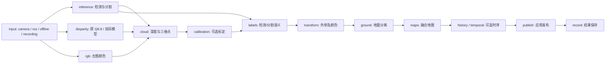

# 纯 C++ v3：输入、功能 Graph、编译与运行

本版的日常入口是根 `pipeline.json`（`schema_version=3`）和 `perception_config` 原生可执行程序。当前交付没有项目 Python 程序，也不需要 `STEREO_PYTHON`。ROS/ament 的构建和环境脚本属于第三方依赖，仍可能使用系统 Python。

## 1. 两件事分开配置

`input` 回答“数据从哪里来、使用哪种视差”；`graph` 回答“这一帧执行什么功能、功能之间如何依赖”。图中的节点会改变 SDK 实际执行计划，不是只生成一份展示图。

```json
{
  "schema_version": 3,
  "input": {
    "mode": "camera",
    "disparity_source": "raft_stereo"
  },
  "sdk": { "root": "${SDK_ROOT}" },
  "graph": {
    "worker_threads": 2,
    "nodes": [
      { "id": "ai", "feature": "inference" },
      { "id": "publish", "feature": "publish", "depends_on": ["ai"] }
    ]
  }
}
```

上例是仅检测/分割并发布的最小功能图，没有点云节点，因此不会运行 Stereo。要得到点云，使用本项目完整根配置中的 `disparity → cloud → transform → ground → maps` 路径。检测与分割的单独开关是对应 `features/detection/config.json`、`features/segmentation/config.json` 的 `enabled`；同一个 `inference` 功能封装两条通路。

当前原生解析器要求 `graph` 是主配置内的对象。不要把文件路径字符串赋给 `graph`，也不要另建三份用户 DAG。

从 v2 迁移时对应关系如下：

| v2 日常配置/入口 | v3 |
|---|---|
| `schema_version=2` | `schema_version=3` |
| 根 `input_mode` | `input.mode` |
| 根 `disparity_source` | `input.disparity_source` |
| 根 `sdk_root/sdk_base_config` | `sdk.root/sdk.base_config` |
| 多层用户 DAG/内部 DAG 路径 | 一份 `graph.nodes`；内部阶段图自动生成 |
| 检测/分割默认都运行 | 各功能 `enabled` 可明确开关 |
| 旧配置生成/回放脚本 | `perception_config`、`r36_compare` 原生程序 |

不要只改版本号然后保留旧根字段，解析器会把未知字段拒绝。默认根图关闭标定、回充、时序和保存节点；需要这些功能时明确启用节点并补齐依赖/参数。结构回归应使用相同功能组合，不能把“关闭功能”产生的速度变化算作调度优化。



图解展示主要数据流；完整配置的发布/保存节点还需要等待其他已启用生产节点。以 `graph.nodes[].depends_on` 和 `product_graph.hpp` 的验证规则为准。

## 2. 配置路径及生效位置

```text
pipeline.json
├── input.mode / input.disparity_source
│   └── scheduling/config/src/native_pipeline.cpp
│       └── parameters.yaml → features/ros/src/node_input.cpp / node_process.cpp
├── graph.nodes / graph.worker_threads
│   └── scheduling/dag/include/product_graph.hpp：ID、环、功能、依赖验证
│       └── effective_full.json.graph → full_config.cpp → full_graph.cpp
├── sdk.root / sdk.base_config
│   └── 默认读取 SDK_ROOT/config/full.json，再生成本次 effective_full.json
├── camera_config → camera.json
│   └── SDK 动态库、厂商 cfg、采集模式与超时
├── visualization_config → visualization.json
│   └── 应用发布/保存参数及点云输出
├── models/                         统一存放权重，manifest.json 只记录文件与 SHA256
│   ├── x5/                         检测、分割和 Stereo 的 BIN
│   └── cpu/                        检测和分割的 ONNX
├── calibration/                    离线/录制内参文件说明与待填写模板
└── features（省略时自动使用以下位置）
    ├── ros           → features/ros/config.json
    ├── offline       → features/offline/config.json
    ├── stereo        → features/stereo/config.json
    ├── inference     → features/inference/config.json
    ├── detection     → features/detection/config.json
    ├── segmentation  → features/segmentation/config.json
    ├── pointcloud    → features/pointcloud/config.json
    ├── fusion        → features/fusion/config.json
    ├── metrics       → features/metrics/config.json
    ├── temporal      → features/temporal/config.json
    └── recharge      → features/recharge/config.json
```

用户相对路径以主配置所在目录为基准，功能 JSON 中的模型路径也遵循此规则，不以功能目录或终端工作目录为基准。模型统一放在 `models/`，检测/分割/Stereo 默认分别指向 `models/x5/` 下的实际 BIN，不再使用模型环境变量。`${变量名}` 仍可用于 SDK_ROOT 等平台环境设置，未设置的必要变量会报错。

SDK 模板内部原有相对路径先相对原 SDK 配置/profile 解析，再写入本次配置。源树 profile 默认用 `../../../models/...`，安装 SDK 时生成 `../models/...` 并安装模型目录；功能配置优先覆盖默认模型。本次生成的生效文件使用解析后的绝对路径，便于审计。复制主配置到别的目录时，要同时保留或调整 `features/`、`models/` 等引用路径。权重清单、替换方法及 CPU 设置见 [模型统一管理](../models/README_zh.md)。

`null` 只用于允许继承的字段，不是通用关闭开关。功能开关用 `graph.nodes[].enabled` 或明确的检测/分割 `enabled`。未知字段、重复 ID、不存在的依赖、环、无数据生产者的点云路径会拒绝。

`features/inference/config.json` 的 `backend` 选 `bpu`/`cpu`，模型输出契约来自 `original_profile`/`cpu_profile`。用户不再覆盖内部 `dag`；检测/分割内部预处理、推理、后处理图由 C++ 生成，属于功能实现细节。

当前产品功能集在 `productStages()` 注册，同一功能每帧只允许出现一次。增加全新功能仍需修改 C++ 注册及其输入输出契约并重编，不能只写一个未注册名称。点云/融合共享帧工作区，需要保留验证器要求的顺序；多工作线程不意味着任意节点都能并发。

实际调用次序如下：

```text
perception_config
  → C++ 检查主配置与功能参数，写入本次生效文件
  → execv 启动 demo 或 r36_compare（参数数组传递，不经 shell 拼接）
  → PerceptionNode 输入/时间戳配对 → 一个处理 worker
  → psdk_full_process（同步调用）
  → full_pipeline → full_graph → 已启用的功能及内部推理阶段
  → SDK 返回结果视图
  → 应用发布结果、mask、地图、点云，按需保存 SDK 文件与 PLY
  → 指标采样 → 释放 SDK 结果
```

`publish`、`record` 的开关会生成应用发布/保存开关。实际 ROS 数据和应用 PLY 在同步 SDK 调用返回后输出；SDK 图内的应用输出钩子不等于 ROS 网络发布。可选的输入图回显发生在 SDK 调用前。错误码/诊断与 metrics 有独立路径，不能把 `publish=false` 理解为进程完全没有 ROS 消息。

输入回调不直接运行模型；在线队列保留最新待处理帧，慢于输入时可能替换旧待处理帧。SDK 返回视图中的指针由 SDK 结果对象拥有，应用发布时复制需要的数据，并在保存/指标完成后释放结果，不缓存悬空指针。Stereo provider 在同步调用期间借用这一帧的左右图，调用结束清理，不可并发替换正在处理的双目对。

## 3. 四种输入及原/新视差要求

| input.mode | 获取内容 | 原 Q8.8 | 新 Stereo |
|---|---|---|---|
| camera | 当前进程通过 Mo SDK 获取，内参自动来自 SDK | 同帧左图 + 相机视差 | 同帧左右图 |
| ros | 订阅 sensor_msgs/Image，默认同帧 CameraInfo | 左图 + Q8.8，精确时间戳配对 | 左右图，精确时间戳配对 |
| offline | 文件列表，PNG/JPEG 或紧密 YUV420 | 点云不支持凭空生成原视差；使用 recording | 校正后的左右图 + 显式 intrinsics_file |
| recording | 录制目录，原生对比器回放；点云须显式 intrinsics_file | 读取录制 Q8.8 | 读取录制左右图 |

只启用检测/分割时，offline 只需要左图。点云需要 640×544 源图及匹配的内参；原始 NV12/I420 必须紧密排列、每帧恰好 522240 字节，Q8.8 为 640×544×2 = 696320 字节。PNG/JPEG 是编码格式，`offline.format` 是解码后送入算法的 `nv12` 或 `i420` 内存布局；不能写 `nv12/i420`。

相机直取自动读取 SDK 的矫正后相机参数，无需另填离线内参文件。本项目 ROS 相机节点也从 SDK 生成 `CameraInfo`，算法 ROS 输入默认使用同帧消息。相机模式不能靠抄一组离线内参代替真实 SDK 参数。

仅运行回充姿态时，若 SDK 的回充 JSON 使用 `intrinsics_source="sdk_scaled"`，ROS 输入同样必须提供 `CameraInfo` 或经过确认的显式内参；默认 `dataset` 使用回充功能自身的标定，不额外等待 `CameraInfo`。离线回充仍不支持。

离线点云在 `features/offline/config.json` 填 `left_files`、`right_files`，数量一一对应，设置 `rectified=true`、`calibration_confirmed=true`，并显式填写 `intrinsics_file`：

```json
{
  "left_files": ["data/left/000001.png"],
  "right_files": ["data/right/000001.png"],
  "format": "nv12",
  "intrinsics_file": "calibration/intrinsics.json",
  "rectified": true,
  "calibration_confirmed": true
}
```

以上为相关字段示例，其他 offline 字段可保留默认值。路径均相对主 `pipeline.json`。将 `calibration/intrinsics.example.json` 复制成 `calibration/intrinsics.json` 后填写真实 `width/height/fx/fy/cx/cy/bxf`；模板中的 `null` 不能用于运行。文件也可直接引用真实录制的 `data/capture/metadata.json`，读取其中的 `intrinsics` 对象。`bxf=焦距像素×基线毫米`，不能写成基线米。

内参须与处理后的 640×544 源图几何一致，经过缩放/裁剪要同步变换参数；不能只改文件的尺寸数字。Stereo 模型内部 640×352 缩放不改变这里的源图内参要求。仅检测/分割时 `intrinsics_file` 可以保持 `null`。旧 offline 内嵌 `intrinsics` 字段改为文件引用，不要两种写法混用。不要仅为绕过检查而把未校正图标成已校正。详见 [内参文件说明](../calibration/README_zh.md)。

ROS 模式在 `features/ros/config.json` 配话题、QoS、缓存以及 CameraInfo/显式内参。当前相机节点默认话题为 `/camera/rgbd_left_nv12`、`/camera/rgbd_right_nv12`、`/camera/disparity_q8`。生产者必须发布同次采集的时间戳；重新赋不同时间戳会造成收到了数据却始终不能配对。

## 4. 根 CMake 与独立构建

依赖为 C++17 编译器、CMake ≥3.20、Ninja/Make；完整点云需要对应平台 OpenCV、PCL、Eigen/Boost/FLANN 等开发依赖。检测/分割 CPU 后端另需真实 ONNX Runtime C++ SDK。相机 SDK 和 Horizon BIN 运行库仍由设备环境提供。

只构建配置器，不需要 ROS、PCL、ORT：

```bash
cmake -S . -B build/config_only -G Ninja \
  -DPERCEPTION_BUILD_SDK=OFF -DPERCEPTION_BUILD_COMPARE=OFF \
  -DPERCEPTION_BUILD_COMPARE_RUNNER=OFF -DPERCEPTION_BUILD_CAPTURE=OFF
cmake --build build/config_only --parallel 4
cmake --install build/config_only
```

统一构建 CPU SDK 和离线工具，不构建 ROS：

```bash
export ORT_ROOT=/absolute/path/to/onnxruntime-cpp-sdk
cmake -S . -B build/cpu -G Ninja -DCMAKE_BUILD_TYPE=Release \
  -DR29_WITH_ORT=ON -DR20_WITH_BPU=OFF -DORT_ROOT="$ORT_ROOT" \
  -DR33_WITH_MAPPING=ON -DR33_WITH_RECHARGE=OFF \
  -DR36_COMPARE_WITH_HORIZON=OFF -DBUILD_TESTING=ON
cmake --build build/cpu --parallel 4
ctest --test-dir build/cpu --output-on-failure
cmake --install build/cpu
export SDK_ROOT="$PWD/install/perception_ros_so_demo"
```

CPU Stereo 推理器未新增。上面的 `R36_COMPARE_WITH_HORIZON=OFF` 构建适合原 Q8.8 + CPU 检测/分割回放；要运行新 Stereo 需匹配 Horizon 后端与实际硬件。使用包内 ONNX 时，把 `features/inference/config.json` 的 `backend` 改为 `cpu`、`cpu_profile` 改为 `features/inference/cpu_profile.json`；检测 `model` 改为 `models/cpu/case2_20260821_V2.1_epoch_160_dy.onnx`，分割 `model` 改为 `models/cpu/train_20260924_3class_aug_flagstone.onnx`。这三条用户路径均相对主 `pipeline.json`。CPU profile 已写好对应输入/输出契约，不能把 BIN 直接当 ONNX。

已有独立 SDK 时，可用 `SDK_ROOT=/path/to/sdk bash tools/build_compare_native.sh` 仅构建配置器、报告器、录制器和对比 worker。

ROS 应用独立构建：

```bash
export SDK_ROOT=/absolute/path/to/rebuilt/v3/sdk
export ROS_SETUP=/opt/ros/humble/setup.bash
bash tools/build_native.sh
```

根构建的 SDK 和 ROS 构建可以使用同一安装前缀；分开安装则保持 `SDK_ROOT` 与应用链接的 SDK 一致。`INSTALL_ROOT` 指定应用安装前缀，主配置中的 `runtime.executable` / `runtime.compare_executable` 可在启动时覆盖应用路径。

项目 Bash 入口会设置实际 `PERCEPTION_PROJECT_ROOT`，避免源码移动后仍使用编译时路径。直接运行原生二进制且不在项目目录树内时，显式传 `--config /实际项目/pipeline.json` 或设置 `PERCEPTION_PROJECT_ROOT`。自定义 `INSTALL_ROOT` 后应指向包含 `bin/`、`lib/perception_ros_so_demo/` 的同一应用前缀。

Windows 推荐使用 WSL Ubuntu 22.04 运行整条链路。本机 Windows 可以构建独立配置器做配置检查；Linux 相机加载器、`/proc` 性能指标与 ROS 应用使用 Linux 构建。源码编码为 UTF-8/LF。

## 5. Ubuntu 容器交叉编译

沿用现有容器与 sysroot：`obs-v004-x5-build`、`/work/obs_v004_x5/sysroot_docker`，Horizon 前缀默认 `$X5_SYSROOT/usr_x5`。源码放在 Ubuntu 的 `/home/st/ini_code/perception-stereo-cpp-v3`。

**先重编本版 SDK，再链接应用。** 旧 `/tmp/r12-v36-20261008-215622-3654808/...` 是历史 SDK 路径，不能直接代表本次 Graph 修改已生效。

以下命令在已复制/挂载本版源码的容器里执行，示例容器源码路径为 `/tmp/perception-stereo-cpp-v3`。也可直接使用本节后面的主机一键入口，由它完成源码复制。ARM 开发依赖和 ROS 前缀必须换成实际路径：

```bash
cd /tmp/perception-stereo-cpp-v3
export X5_SYSROOT=/work/obs_v004_x5/sysroot_docker
export HORIZON_ROOT="$X5_SYSROOT/usr_x5"
export STEREO_HORIZON_ROOT="$HORIZON_ROOT"
export TARGET_DEPENDENCY_PREFIX="$X5_SYSROOT/usr_x5"

bash tools/build_backend_sdk.sh --backend bpu \
  --horizon-root "$HORIZON_ROOT" \
  --toolchain "$PWD/sdk/cmake/x5-toolchain.cmake" \
  --install-dir "$PWD/install/backend_sdk" -- \
  -DX5_SYSROOT="$X5_SYSROOT" \
  -DCMAKE_PREFIX_PATH="$TARGET_DEPENDENCY_PREFIX"
export SDK_ROOT="$PWD/install/backend_sdk"
export PSDK_ROOT="$SDK_ROOT"

# 不依赖目标 ROS，生成录制、回放和报告工具：
bash tools/cross_build_compare.sh

# 在线 ROS 节点另需真实 ARM ROS 包、消息 typesupport 及 ament 索引：
export TARGET_ROS_PREFIX=/actual/complete/ARM/ROS/prefix
# 多个前缀用分号分隔，例如 /prefix/ros;/prefix/messages
bash tools/cross_build.sh
```

`TARGET_DEPENDENCY_PREFIX` 必须实际含 ARM PCL/OpenCV/Eigen 等开发依赖；目录名相同不代表 ABI 匹配。必要时在 SDK 命令 `--` 后补 `-DPCL_DIR=...`、`-DOpenCV_DIR=...` 等精确路径。应用可用 `TARGET_OPENCV_DIR` 指定 ARM OpenCV CMake 包。

`tools/target_ros_env.sh` 使用 `readelf` 检查 SDK/ROS/消息 typesupport 为 AArch64，并生成 `validation/target_ros.cmake`；不会把主机 x86 库冒充目标库。主机 ROS 的构建工具仍可参与配置过程。

也可在 Ubuntu 主机一次调用容器入口：

```bash
bash tools/build_in_container.sh \
  --container obs-v004-x5-build \
  --sysroot /work/obs_v004_x5/sysroot_docker \
  --stereo-horizon-root /work/obs_v004_x5/sysroot_docker/usr_x5 \
  --dependency-prefix /actual/ARM/development/prefix \
  --target-ros-prefix /actual/complete/ARM/ROS/prefix \
  --out /home/st/ini_code/perception_stereo_cpp_v3_release
```

省略 `--sdk-root` 时，容器入口先从本版源码构建 SDK；传入时，该路径必须是已重新编译的 v3 ARM SDK。打包使用 Bash、tar、sha256sum。

## 6. X5 相机直取

解压到 `/userdata/perception-stereo-cpp-v3`，应用二进制在 `install/perception_ros_so_demo/`，SDK 可放 `install/backend_sdk/`。源码包已带 `models/x5/` 和 `models/cpu/` 的 5 个实际权重。本版读取功能配置中明确指定的模型相对路径。

```bash
cd /userdata/perception-stereo-cpp-v3
export ROS_SETUP=/app/humble/setup.bash
export SDK_ROOT="$PWD/install/backend_sdk"

# pipeline.json: input.mode=camera；input.disparity_source=raft_stereo
# camera.json: sdk_library/vendor_config 填真实板端路径
# models/x5/ 保留本包三个 BIN；替换模型直接改对应 features/*/config.json 的 model
bash tools/run_pipeline.sh --config "$PWD/pipeline.json" \
  --prepare-only --run-dir /userdata/stereo_results/v3_check_001
bash tools/run_pipeline.sh --config "$PWD/pipeline.json" \
  --run-dir /userdata/stereo_results/v3_camera_001
```

原 Q8.8 方法改 `input.disparity_source="original_q8"`，并保留点云相关图节点。`camera.disparity_mode="auto"` 会选择原视差模式 2；新双目使用模式 1。当前新模型的 `NCHW [1,3,352,640]`、NV12 图像输入由 Stereo runner 检查，`features/stereo/config.json` 的 `input_width=640/input_height=352` 与模型契约一致。

显式 `image_transform="resize"` 会把 640×544 左右图调整到模型尺寸，输出恢复到源图，视差只按横向比例修正。`strict` 要求尺寸一致。输入尺寸相同不代表任意新模型都兼容，输出 dtype/量化/视差含义仍需模型元数据匹配。

## 7. X5 ROS 输入

主配置改 `input.mode="ros"`；算法节点不会打开相机。用两个终端，双方使用相同 ROS_DOMAIN_ID、RMW 和环境。

```bash
# 终端一：相机节点。both 输出左右图、原始视差和标定信息。
cd /userdata/perception-stereo-cpp-v3
export ROS_SETUP=/app/humble/setup.bash
export SDK_ROOT="$PWD/install/backend_sdk"
bash tools/run_camera_x5.sh --config "$PWD/pipeline.json" --mode both
```

```bash
# 终端二：设置与相机直取相同的 SDK_ROOT 和 ROS_SETUP；模型由功能配置的相对路径读取
bash tools/run_pipeline.sh --config "$PWD/pipeline.json" \
  --run-dir /userdata/stereo_results/v3_ros_001
```

新 Stereo 订阅左、右图；原方法订阅左图和 Q8.8。`received_images=0` 先看 `ros2 node list`、`ros2 topic info /camera/rgbd_left_nv12 --verbose`，确认算法进程仍在、订阅者存在、DDS 域一致。收到图却没帧成功，再检查精确时间戳、编码、标定与 QoS。

## 8. 同一录制数据做点云及性能 A/B

录制时相机只能有一个所有者，先在原相机终端 Ctrl+C，再运行：

```bash
cd /userdata/perception-stereo-cpp-v3
bash tools/capture_stereo.sh --config "$PWD/pipeline.json" \
  --output "$PWD/data/capture" --frames 100
```

录制器同步保存真实左图、右图、原 Q8.8 与从 SDK 获取的相机参数；`data/capture` 必须是新目录。`metadata.json` 的 `intrinsics` 可直接作为回放内参来源。不要用两次不同采集分别代表原/新算法输入。

把主配置 `input.mode` 改为 `recording`、`input.disparity_source` 改为 `raft_stereo`，并设置：

```json
"recording": {
  "directory": "data/capture",
  "intrinsics_file": "data/capture/metadata.json",
  "limit": 100,
  "warmup_frames": 5,
  "repeat": 3,
  "save_every_n": 1,
  "viewer_max_points": 20000,
  "order": "original,stereo"
}
```

```bash
bash tools/run_compare.sh --config "$PWD/pipeline.json" \
  --run-dir /userdata/stereo_results/v3_ab_001
```

`run_compare.sh` 转发 `run --both`，要求主配置带新模型设置，才能同时运行两种方法。单方法使用 `run_pipeline.sh`。外部 runner 路径可用 `recording.runner` 指定；默认寻找对比器同目录下的 `r36_compare_runner`。

`recording.directory`、`recording.intrinsics_file` 都相对主配置。点云回放要求显式指定内参文件；不再在 `recording.intrinsics` 内嵌数值，也不隐式从目录猜参数。两种算法使用相同录制数据和同一个内参文件，才能排除参数差异造成的点云变化。

检查本次 `resolved.json` 的实际 argv、`comparison/` 中的指标报告/HTML 和对应逐帧 PLY。先用 `save_every_n=1` 比正确性与可视化；测性能可以改为 0 关闭逐帧保存，再分别比较。保持模型、阈值、图、输入、采样步长和外参一致，只改变视差来源。

原生报告器生成 `comparison/summary.json`、`summary.csv`、`report_zh.md` 和自包含点云浏览 HTML。需要重生成报告或比较两次版本回放时，可直接调用原生工具：

```bash
install/perception_ros_so_demo/lib/perception_ros_so_demo/r36_compare report \
  --output /userdata/stereo_results/v3_ab_001/comparison
install/perception_ros_so_demo/lib/perception_ros_so_demo/r36_compare check \
  --baseline /userdata/stereo_results/baseline/comparison \
  --candidate /userdata/stereo_results/candidate/comparison \
  --output /userdata/stereo_results/version_check_001 --xyz-tolerance 0
```

版本检查的输入应是同数据、同模式、同算法设置的两次结果；原/新视差本来就有预期差异，不应把两者当成结构迁移“零差异”回归。

性能报告中的 CPU 是进程 CPU，100% 为一个核，可能超过 100%；RSS 是进程驻留内存。回放 FPS 不包含相机硬件生成原始 Q8.8 的开销，不能把它当整套系统的在线 FPS。检测/分割并行阶段耗时存在重叠，各阶段相加不是端到端耗时。HTML 对点云抽样便于浏览，完整 PLY 未因浏览采样而改变；点数更多不能单独证明精度更高。

## 9. 保存、检查与开发

`visualization.save_root=""` 时，在线应用不保存逐帧结果/PLY；`--run-dir` 仍有本次生效配置，metrics 是否写入由 `features/metrics/config.json` 控制。保存还要求图中的 `record` 启用、保存根非空、`save_every_n>0`；PLY 还要求 `save_ply=true`。

非空保存根会追加本次 run-dir 的目录名，再追加帧目录，避免不同运行互相覆盖。A/B 的保存频率由 `recording.save_every_n` 单独控制。不要把空保存根理解为当前工作目录。

```text
本次 --run-dir/
├── requested_pipeline.json        用户请求快照
├── resolved_features.json         功能设置与引用来源
├── effective_full.json            SDK 实际配置，含产品 graph
├── original_start.json            原地图/融合参数
├── inference_dag.json             自动生成的内部检测/分割阶段图
├── parameters.yaml               自动生成的 ROS 参数
├── resolved.json                 生效参数、argv、环境、路径
├── metrics.jsonl                 在线指标（启用时）
└── comparison/                   recording 模式的对比输出
```

路径和配置检查完成不代表模型、相机或算法验证通过。先 `--prepare-only` 核对生效值，再跑 CTest，最后用同一录制数据比结果。增加功能时依次修改：功能目录中的算法与参数 → 配置解析映射 → 产品图注册/依赖契约 → C ABI/应用输出（需要时）→ C++ 合同测试和同数据回归。

逐帧 ROS/点云格式、坐标和已有算法行为可参照历史手册的原理部分，但旧启动命令、schema2/旧三层 DAG、旧路径不能用于本版。根 `parameter_map.json` 已更新为当前 C++ 解析/生成/读取索引；旧索引保存在 `archive/modular_v2_parameter_map.json`。

发布后先校验，再修改用户配置：

```bash
bash tools/verify_files.sh
# 完成构建后打包到源码目录之外：
bash tools/package_release.sh /home/st/ini_code/releases_v3
```

当前没有自动承诺“任意 Graph 重排都结果一致”。模型/外参/时间戳错误、缺失的生产依赖或共享工作区乱序都需要由验证/测试拒绝；结构迁移的正确性与原/新 Stereo 的精度比较是两种不同实验。

## 10. 本轮实际验证

以下是 v3 迁移阶段在 native Linux/WSL x86-64、真实 ONNX Runtime CPU 后端及 ROS Humble 中完成的验证。后续模型相对路径整理的增量验证单独列在第 11 节。

| 验证项 | 本轮结果 | 能说明什么 |
|---|---|---|
| SDK 编译与完整 CTest | 32/32 通过 | SDK、产品图与既有数值/生命周期合同通过 |
| 最后小修的 SDK 增量回归 | 受影响 10/10 通过 | 是完整测试中的受影响子集，不重复计为另一套全量测试 |
| 根原生工具构建与 CTest | 配置器、对比器、录制器构建；4/4 通过 | 原生配置、对比与 Bash 交付入口可构建/验证 |
| ROS Humble 应用构建与 CTest | 9/9 通过 | ROS 应用、输入辅助及原生工具集成通过 |
| C++ offline 探针，仅检测 | 2 个结果，errors=0 | 离线左图实际进入算法并返回结果 |
| C++ ROS 探针，仅检测 | 发布 2 张图、订阅收到 2 个结果，errors=0 | 本机 ROS 图像通信、参数加载与推理链路实际运行 |
| 单检测 / 单分割回放 | 均成功；禁用通路的模型路径设为不存在仍可运行；该通路全部阶段耗时为 0 | 功能关闭会跳过模型加载与执行 |
| 仅点云回放 | 两帧点数 11978 / 11962，map_count=0，无推理 | 几何点云与推理/地图功能可以按图独立选择 |
| 仅 RGB 回放 | 无推理、无点云 | 关闭算法节点后没有隐式执行它们 |
| v2→v3 同两帧版本回归 | 身份核对通过；检测、mask、地图一致；每帧五类 PLY 点数/RGB 一致、XYZ 最大误差 0 m | 指定数据与功能组合的迁移回归通过 |

ROS 参数的 YAML 类型修复也已实际验证：`offline_fps`、`fx/fy/cx/cy/bxf` 是浮点参数，即使数值恰好为整数，也写成 `2.0` 一类浮点形式，避免 ROS 把裸 `2` 解析成整数后拒绝启动。离线与 ROS C++ 探针均经过生成参数文件启动。

版本回归使用 `r36_compare check`，严格核对录制/准备输入 SHA256、模型、标定及回放参数身份；检测比较真实输出，mask/地图比较文件字节，PLY 按原顶点顺序比较点数、XYZ 和 RGB，不通过点云配准掩盖差异。结果为两帧均一致。完整证据与 CTest 日志索引见 [v3_final_validation.json](../validation/evidence/v3_final_validation.json)，逐项差异见 [v3_version_diff.json](../validation/evidence/v3_version_diff.json) 和 [中文差异报告](../validation/evidence/v3_version_diff.md)。

回归数据的 `validation_only=true` 标记必须保留：它不是原相机算法效果基线，这次测试不能证明新 Stereo 的精度优于原方法，也不能证明 X5 性能提升。新双目模型、真实相机、相机同步录制和完整 ARM 交叉构建没有在本轮设备环境中验证；第五至八节给出执行方法，不能把命令示例当成已执行结果。

## 11. 模型相对路径整理后的增量验证

源码的五个模型及 SDK、应用两个安装配置树中的模型均核对了 SHA256。增量重编 SDK、配置器、对比器和底层 worker 后，工具 CTest 4/4、SDK profile 路径契约测试 1/1 通过。配置测试覆盖从其他工作目录启动、搬迁完整配置和模型目录、旧模型环境变量不覆盖配置、启用缺模型拒绝以及禁用缺模型允许。SDK 原始 profile 的模型也按自身目录解析。

清空模型环境变量，从 `/tmp` 启动相对路径配置，使用实际 ONNX 权重回放同两帧，结果与整理前一致：输入、模型和标定身份匹配，检测、mask、地图一致，每帧五类 PLY 点数、RGB 一致，XYZ 最大误差为 0 m。生产 SDK 的 19 个公开 C 符号未变。本次未重跑整套 ARM/X5 测试；见 [模型路径验证记录](../validation/evidence/v3_model_relative_paths_validation.json)、[增量回归报告](../validation/evidence/v3_model_relative_diff.md)。
