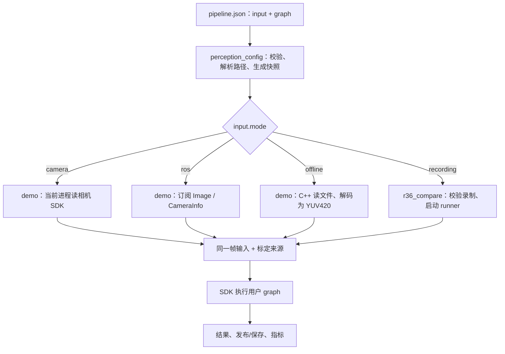
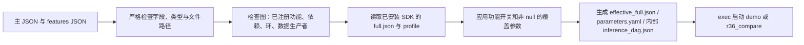
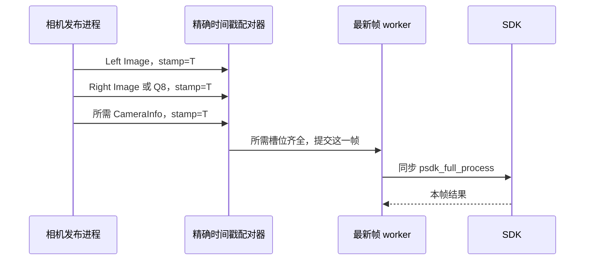
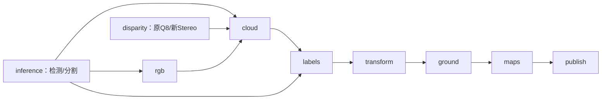

# 1. 输入与配置：先知道数据从哪里来，再选择这一帧做什么

本章依据当前 C++ 配置器、ROS 输入节点、产品图验证器和录制对比器编写。文中的项目路径以项目根目录为起点；命令假设已经完成相应平台的编译安装。项目自己的启动、订阅、推理和报告程序均为 C++，示例不调用 Python。

## 1.1 先认识四个入口

| 入口 | 实际用途 | 会打开相机吗 | 会启动算法吗 |
|---|---|---|---|
| `tools/run_pipeline.sh` | 调用 `perception_config run`，按 `input.mode` 运行 | 仅 `camera` 模式打开 | 是，执行图中启用的工作 |
| `tools/run_camera_x5.sh` | 调用 `perception_config camera`，启动独立 ROS 相机发布节点 | 会 | 不会，负责采集和发布 |
| `tools/capture_stereo.sh` | 调用 `perception_config capture`，保存同次采集左右图、原始视差和标定元数据 | 会 | 不会，负责录制 |
| `tools/run_compare.sh` | 调用 `perception_config run --both`，对同一录制跑原/新视差 A/B | 不会 | 会，分别执行两种方法 |

这些脚本只是准备 ROS 环境并调用原生程序的 Bash 包装器。算法 ROS 节点是 `perception_ros_so_demo`，相机 ROS 节点是 `perception_raw_camera`。`recording` 走原生 `r36_compare`，不会启动一个叫 `recording` 的 ROS 订阅节点。



`camera` 与独立 ROS 相机节点是两种连接方式。使用 `input.mode="camera"` 时，算法进程自己打开 SDK；使用 `input.mode="ros"` 时，相机发布进程打开 SDK，算法进程只订阅。避免同时启动两个程序争用同一台相机。

## 1.2 配置文件到底在哪里

```text
项目根/
├── pipeline.json                    输入选择、功能图、SDK 位置
├── camera.json                      相机 SDK、厂商 cfg、模式和超时
├── visualization.json               发布、保存、PLY、地图显示
├── models/
│   ├── x5/                          检测、分割、Stereo 的 BIN
│   └── cpu/                         检测、分割的 ONNX
├── calibration/                     离线/回放内参文件与说明
└── features/
    ├── ros/config.json              ROS 输入话题、QoS、标定来源
    ├── offline/config.json          左右图列表、格式、速度、内参文件
    ├── stereo/config.json           Stereo 模型及模型输入尺寸
    ├── inference/config.json        bpu/cpu 后端、底层 profile
    ├── detection/config.json        检测开关、模型、阈值
    ├── segmentation/config.json     分割开关、模型、后处理
    ├── pointcloud/config.json       采样、外参、地面参数
    ├── fusion/config.json           语义与地图参数
    ├── recharge/config.json         回充配置文件及降级策略
    ├── temporal/config.json         历史窗口、抽帧、帧差和匹配参数
    └── metrics/config.json          在线指标开关、频率、JSONL
```

这里最容易弄错的是**相对路径的起点**：用户主配置和功能 JSON 内的路径，都相对主 `pipeline.json` 所在目录。它们不相对终端当前目录，也不相对功能 JSON 自己的目录。

例如，`features/detection/config.json` 中写：

```json
{
  "model": "models/x5/mmyolo0828.bin"
}
```

若主配置位于 `/userdata/perception-stereo-cpp-v3/pipeline.json`，实际读取的就是 `/userdata/perception-stereo-cpp-v3/models/x5/mmyolo0828.bin`。模型不需要 `$modelpath`、`DET_MODEL` 等环境变量。

有两处路径规则需要区分：SDK 原有的 `full.json`、模型 profile 内部路径，先相对各自原文件解析；命令行 `--run-dir`、`--output` 的相对路径，则按调用时的工作目录转绝对路径。为了便于复现，示例给输出目录使用绝对路径。

根配置可以覆盖功能配置文件的位置，例如：

```json
{
  "features": {
    "detection": "features/detection/my_test.json",
    "segmentation": "features/segmentation/disabled.test.json"
  }
}
```

未列出的功能仍读取默认 `features/<功能>/config.json`。配置器会读取所有这些功能 JSON，以及根 `camera.json`、`visualization.json`；即便某功能未启用，也应保留合法的配置文件。未使用的检测/分割/Stereo模型以及离线内参文件，则按实际功能选择决定是否要求存在。

## 1.3 配置如何生效

当前用户字段名是 **`graph`**。`pipeline.json` 顶层没有 `dag` 字段，也不能把 `graph` 写成另一个 JSON 的文件路径。运行目录中的 `inference_dag.json` 是内部生成物。



常用根字段如下。`input`、`graph` 是对象；不是所有字段都必须写，但不能用旧版字段混入 v3。

| 字段 | 含义/默认行为 |
|---|---|
| `schema_version` | 必须是 `3` |
| `input.mode` | `camera`、`ros`、`offline`、`recording`；省略该成员时为 `camera` |
| `input.disparity_source` | `original_q8` 或 `raft_stereo`；省略该成员时为 `raft_stereo` |
| `sdk.root` | SDK 安装根；默认根配置使用 `${SDK_ROOT}`，也可明确写 `install/backend_sdk` |
| `sdk.base_config` | `null` 时读取 `<sdk.root>/config/full.json`；显式路径时读取该文件 |
| `graph.worker_threads` | 工作线程数，默认 `2`，范围 `1..32` |
| `graph.nodes` | 必须给出非空节点数组，最多 64 个 |
| `features` | 可省略；按需重定向功能 JSON 文件 |
| `camera_config` | 默认 `camera.json` |
| `visualization_config` | 默认 `visualization.json` |
| `output` | 可选，覆盖可视化文件中相同名称的输出参数 |
| `recording` | 录制回放目录、内参、重复/预热/保存参数 |
| `runtime` | 可选，用 `executable` / `compare_executable` 指定实际程序路径 |

配置优先关系可理解为：**已安装 SDK 的默认参数 → 功能 JSON 的非 `null` 覆盖 → 本次由 `graph` 推导的执行开关**。根 `output` 覆盖可视化文件。`null` 仅用于允许继承的参数；它不是通用关闭开关。修改配置后需要重新启动，目前没有运行时热加载。

主文件所带的完整图是项目提供的默认流程，但解析器不会在省略 `graph` 时替你补上这一整张图。使用自定义图时要明确写 `graph.nodes`。

### 先准备，再启动

```bash
cd /userdata/perception-stereo-cpp-v3
export ROS_SETUP=/app/humble/setup.bash
export SDK_ROOT="$PWD/install/backend_sdk"

bash tools/run_pipeline.sh --config "$PWD/pipeline.json" \
  --run-dir /userdata/stereo_results/prepare_001 --prepare-only
```

`--prepare-only` 会验证配置并生成文件，但不会打开相机、启动订阅、加载模型或测性能。它能发现路径/图/参数问题，不能证明图片能解码、模型输出正确或相机 ABI 兼容。真正运行时换一个**不存在的新目录**，去掉 `--prepare-only`：

```bash
bash tools/run_pipeline.sh --config "$PWD/pipeline.json" \
  --run-dir /userdata/stereo_results/run_001
```

本次运行目录中应优先看：

| 文件 | 能回答的问题 |
|---|---|
| `requested_pipeline.json` | 当时提交的主配置是什么 |
| `resolved_features.json` | 功能设置及每个来源文件在哪里 |
| `resolved.json` | 实际启动 argv、有效输入/视差模式、内参来源 |
| `effective_full.json` | 交给 SDK 的真实 `graph` 与功能设置 |
| `parameters.yaml` | 交给 ROS 节点的真实参数 |
| `inference_dag.json` | 内部实际启用了检测、分割中的哪几条通路 |
| `metrics.jsonl` | 在线指标；是否生成由 metrics 配置决定 |

## 1.4 四种输入：支持范围与所需数据

| 模式 | 检测/分割输入 | 原视差点云 | 新 Stereo 点云 | 标定来源 | 执行程序 |
|---|---|---|---|---|---|
| `camera` | SDK 的左图 | 同次 SDK 左图 + Q8.8 | 同次 SDK 左右图 | SDK 自动读取矫正后内参 | ROS `demo`，当前进程采集 |
| `ros` | 左目 `sensor_msgs/Image` | 左图 + `16UC1` Q8.8 | 左右目 `sensor_msgs/Image` | 默认同帧左右 `CameraInfo`，也支持确认过的内参对象 | ROS `demo`，只订阅 |
| `offline` | 一组图片/原始 YUV 文件 | 不支持从单图生成相机原 Q8.8；用 `recording` | 矫正后 640×544 左右图 | 视差/点云必须显式指定 `intrinsics_file` | ROS `demo`，从文件供帧 |
| `recording` | 从完整录制包回放左图 | 读取录制的原 Q8.8 | 读取录制左右图 | 视差/点云必须显式指定 `recording.intrinsics_file` | 原生 `r36_compare` + runner |

当前在线应用的源图几何是 **640×544**。检测模型的 864×480、分割模型的 832×480、Stereo 模型的 640×352，是各功能内部的模型输入尺寸，不是要求用户把源图或内参改成这些尺寸。

只跑检测/分割时不会要求 Stereo 模型或离线内参文件。只启用 `disparity` 时可以生成/发布视差，不必构建点云；它仍要求对应的左右图/原 Q8 与可靠标定。`recording` 使用的容器格式较严格：即使只测检测/分割，对比器仍校验录制 metadata、左右图、原 Q8.8 与 manifest；普通单图测试应选择 `offline`。

## 1.5 相机直取：SDK 自动给内参

主配置：

```json
{
  "input": {"mode": "camera", "disparity_source": "raft_stereo"}
}
```

根 `camera.json` 配置真实板端 SDK 和厂商配置文件：

```json
{
  "sdk_library": "/app/data/metoak/lib/libMoGeneralSDK.so",
  "vendor_config": "/app/data/metoak/demo/config/x5_camera.cfg",
  "disparity_mode": "auto",
  "acquire_timeout_ms": 3000,
  "retry_interval_ms": 5,
  "frame_id": "camera_optical_frame"
}
```

使用上节 `run_pipeline.sh` 命令即可。`auto` 在原 Q8.8 点云时选择 SDK 模式 `2`，新 Stereo 选择模式 `1`。算法进程采集后直接提交本进程 worker，不必先发布再订阅输入图片。

内参来自 `camera_->parameters()` 的矫正后参数。当前只接受 SDK 明确提供的 640×544 或 1280×1088 参考几何；后一种按 0.5 缩放到算法源图，`fx/fy/cx/cy/bxf` 一起匹配源分辨率。不确定的裁剪关系会拒绝，代码不会凭经验猜内参。离线配置中的内参文件不会覆盖相机 SDK 值。

相机采集运行在采集线程，算法在另一个 worker 同步处理。在线待处理槽保留最新一帧；算得慢时可替换旧的待处理帧，所以输入相机 FPS 与算法处理 FPS 不一定相等。

## 1.6 ROS 模式：必须是同一次采集，不是时间接近就行

主配置改成：

```json
{
  "input": {"mode": "ros", "disparity_source": "raft_stereo"}
}
```

`features/ros/config.json` 的默认话题如下：

| 配置字段 | 默认话题 | 何时需要 |
|---|---|---|
| `left_topic` | `/camera/rgbd_left_nv12` | 始终需要 |
| `right_topic` | `/camera/rgbd_right_nv12` | 新 Stereo 视差/点云 |
| `q8_topic` | `/camera/disparity_q8` | 原视差/点云 |
| `gdc_topic` | `/camera/gdc_left_nv12` | 回充的同次采集高分辨率左图 |
| `left_camera_info_topic` | `/stereo/left/camera_info` | 使用 `intrinsics="camera_info"` 且需要帧内参 |
| `right_camera_info_topic` | `/stereo/right/camera_info` | 同上 |

`reliability` 选 `best_effort` 或 `reliable`，`queue_capacity` 范围为 `1..16`，默认 4。只有检测/分割时，算法只订阅左图；不会为了用不到的点云等待左右 `CameraInfo`。



左图、右图/视差及所需 `CameraInfo` 的 `header.stamp` 必须完全相同且非零。没有 approximate-time 容差。图像编码接受 `nv12`/`NV12`、`i420`/`I420`，不直接接受 `bgr8`、JPEG 字节或 `CompressedImage`。输入左图必须是 640×544；有效步长和足够的存储长度也会检查。

原视差消息为小端 `16UC1`，像素数值是 **Q8.8 视差**，不是深度毫米，也不是 float 视差；其 frame_id 必须与左图一致。右图和左右 `CameraInfo` 的 optical frame_id 应明确对应。默认内参从矫正后投影矩阵 `P` 读取，要求标准水平双目及相同主点/焦距；右目 `P[3]` 给出基线，转换后 `bxf=-P_right[3]×1000`，单位为 px·mm。

使用本项目相机发布器时，可这样开两个终端。新 Stereo 使用 `--mode infer` 已可得到左右图和内参；原 Q8.8 使用 `--mode map`。需要同时发布回充高分辨率图时才使用 `both`。

```bash
# 终端一：相机发布器
cd /userdata/perception-stereo-cpp-v3
export ROS_SETUP=/app/humble/setup.bash
export SDK_ROOT="$PWD/install/backend_sdk"
export ROS_DOMAIN_ID=23
bash tools/run_camera_x5.sh --config "$PWD/pipeline.json" --mode infer
```

```bash
# 终端二：相同 ROS 环境、DDS 域；pipeline.json 的 input.mode=ros
cd /userdata/perception-stereo-cpp-v3
export ROS_SETUP=/app/humble/setup.bash
export SDK_ROOT="$PWD/install/backend_sdk"
export ROS_DOMAIN_ID=23
bash tools/run_pipeline.sh --config "$PWD/pipeline.json" \
  --run-dir /userdata/stereo_results/ros_stereo_001
```

本项目相机发布器会把同一次 SDK 采集的图片和 `CameraInfo` 填相同时间戳。使用外部 ROS 相机时，需由上游完成相同的格式、矫正、几何和时间戳约定，不能仅修改话题名就认为适配完成。

只有回充且回充配置选择 `intrinsics_source="sdk_scaled"` 时，也需要 `CameraInfo` 或经确认的显式内参；回充默认 `dataset` 标定使用回充功能自己的数据集参数。回充高分辨率输入默认 `/camera/gdc_left_nv12`，为同次采集的 1280×1088 NV12；可在 ROS 功能配置中设置 `gdc_topic`。

## 1.7 离线图片：格式转换与标定要求分开看

主配置使用 `input.mode="offline"`。`features/offline/config.json` 接受：

| 字段 | 说明 |
|---|---|
| `left_files` | 非空左图文件数组，按数组顺序回放 |
| `right_files` | Stereo 时与左图一一对应；仅检测/分割可为空 |
| `format` | 送入算法的内存布局：`nv12` 或 `i420`，只能选一个 |
| `fps` | 供帧频率，默认 2；不是承诺达到的算法吞吐量 |
| `loop` | 结束后是否循环 |
| `max_frames` | 0 表示不另设数量上限 |
| `wait_for_subscribers` | 开启后等待配置的输出订阅者；无订阅者可能一直等待 |
| `intrinsics_file` | 视差/点云必填，检测/分割可 `null` |
| `rectified` / `calibration_confirmed` | 是否已矫正、是否确认真实标定；声明不执行矫正 |
| `frame_id` | 输出相机坐标系名称 |

### 单目检测/分割

```json
{
  "left_files": ["data/pics/000001.png", "data/pics/000002.png"],
  "right_files": [],
  "format": "nv12",
  "fps": 2,
  "loop": false,
  "max_frames": 0,
  "wait_for_subscribers": false,
  "intrinsics_file": null,
  "rectified": false,
  "calibration_confirmed": false,
  "frame_id": "camera_optical_frame"
}
```

C++ 解码器支持 JPG/JPEG、PNG、BMP、PPM/PNM/PGM，以及原始 `.nv12`、`.i420`、`.yuv`。普通编码图片会转成 RGB，再准备为 640×544 YUV420。当前 JSON 前端固定使用 `stretch` 缩放，不提供 `offline.resize` 或 `offline_path` 字段；底层节点有这些直接 ROS 参数不代表它们也是主 JSON 的合法字段。

所以，PNG 文件配 `format="nv12"` 是正常用法：PNG 是文件编码，NV12 是解码后内存布局。原始 YUV 则不解码、不转换布局、不猜尺寸，必须紧密排列为 640×544，共 **522240 字节**。`.nv12` 配 `i420` 会报冲突；`"nv12/i420"` 也不是合法值。

### 双目 Stereo 点云

改成成对数据并指定真实内参：

```json
{
  "left_files": ["data/left/000001.png"],
  "right_files": ["data/right/000001.png"],
  "format": "nv12",
  "fps": 2,
  "intrinsics_file": "calibration/intrinsics.json",
  "rectified": true,
  "calibration_confirmed": true,
  "frame_id": "camera_optical_frame"
}
```

主配置同时选择 `raft_stereo` 并启用视差或点云图。**原始左右图片本身必须已经是矫正后的 640×544**。运行时会检查解码前尺寸，拒绝把其他尺寸的双目图自动拉伸后沿用这套内参；单目检测允许缩放，不代表双目几何同样允许。

内参文件包含 `width,height,fx,fy,cx,cy,bxf` 七字段，也可直接引用实际录制 `metadata.json` 的 `intrinsics` 对象。填写模板在 `calibration/intrinsics.example.json`，其中待填值不能直接用于真实点云。尺寸必须匹配源图，`fx/fy/bxf` 为正有限数，主点在图内；`bxf=焦距像素×基线毫米`。当前代码不会根据一对普通图片自动标定或矫正。

`features/stereo/config.json` 当前模型设置为 640×352、`image_transform="resize"`。这一步仅为模型推理准备输入，输出恢复到源图，视差按横向缩放比例修正。源图内参仍是 640×544，不能改成 640×352。

离线供帧采用背压：待处理槽未空时暂缓读取下一文件。文件列表耗尽后节点继续运行，终端提示 finished，直到 Ctrl+C；它不会像批处理工具一样自动退出。离线回充不支持，因为该入口没有同次采集的高分辨率 GDC 图。

## 1.8 recording：用于相同数据的 A/B 和版本回归

先关闭其他相机所有者，录制完整数据：

```bash
bash tools/capture_stereo.sh --config "$PWD/pipeline.json" \
  --output "$PWD/data/capture_001" --frames 100
```

录制包主要结构：

```text
data/capture_001/
├── metadata.json             SDK 标定、来源等元数据
├── manifest.jsonl            每帧身份、时间戳、尺寸、三个文件路径
└── 由 manifest 指向的左右 NV12 和原始 Q8.8 文件
```

录制器保留同次采集的左图、右图、Q8.8；对比器检查帧 ID 唯一、时间戳严格递增、文件不越出录制目录、尺寸及字节数一致。新方法也要求完整原始录制，保证与原方法比较时输入身份可追溯。

主配置相应部分：

```json
{
  "input": {"mode": "recording", "disparity_source": "raft_stereo"},
  "recording": {
    "directory": "data/capture_001",
    "intrinsics_file": "data/capture_001/metadata.json",
    "limit": 100,
    "warmup_frames": 5,
    "repeat": 3,
    "save_every_n": 1,
    "viewer_max_points": 20000,
    "order": "original,stereo"
  }
}
```

单方法运行用 `run_pipeline.sh`；两种方法都跑用：

```bash
bash tools/run_compare.sh --config "$PWD/pipeline.json" \
  --run-dir /userdata/stereo_results/ab_001
```

`--both` 需要 `recording + raft_stereo`，且启用 `cloud` 或独立 `disparity`，否则配置器会拒绝。对比器同目录的默认 `r36_compare_runner` 可以用 `recording.runner` 覆盖。`recording.save_every_n` 独立控制逐帧保存，不靠在线 `visualization.save_root`；0 可关闭逐帧保存以减少性能测试中的磁盘开销。

`recording` 用于检测/分割、原/新视差、点云、地图和时序基准。对比器保留请求的 history 设置和原自动标定开关；启用 history 时，runner 在预热之后、每个正式 repeat 开始前清空历史，避免上次 pass 的末尾污染下次开头；同一个 pass 内按顺序累积。`complete.json` 记录重置次数。回充仍不支持，因为录制包和 runner 没有同次采集的高分辨率 GDC 输入，主配置会明确拒绝此组合。

还需区分“顺序回放”与“原时间轴回放”：录制身份保留在 manifest、inventory 和文件 stem 中；runner 提交 SDK 的帧号是本次递增编号，时间戳来自本次单调时钟。当前不会按原采集时间间隔定时重放，依赖真实时间间隔的扩展应先补这项能力，再进行等价性比较。

结果在 `<run-dir>/comparison/`，包括 `summary.json/csv`、`report_zh.md`、`index.html`、逐帧日志和 PLY。CPU、RSS、FPS 是执行该回放进程的测量，原始相机硬件产生 Q8.8 的耗时不在原方法回放 FPS 中。

## 1.9 自定义 graph：可以单测功能，但必须保留真实前置数据

根 `pipeline.json` 默认启用 inference、disparity、rgb、cloud、labels、transform、ground、maps、publish；默认关闭 calibration、recharge、history、temporal_difference、temporal_match、temporal_extension、record。关闭自动标定和时序不等于这些功能不存在，需明确启用节点并提供参数。



图中省略了默认关闭的节点及部分传递依赖。默认图以地图融合为目标；想知道检测本身有多快，应换为下面的单测图，不能只看完整图的总 FPS。

每个节点只接受 `id`、`feature`、`depends_on`、`enabled` 和说明用 `_help`：

```json
{"id": "my_cloud", "feature": "cloud", "depends_on": ["rgb", "disp"], "enabled": true}
```

`id` 是本图节点名，依赖引用的是 `id`。`feature` 是已注册 C++ 功能名，不能任意起一个新算法名。同一功能每帧最多出现一次，即使一个同名功能被禁用，也不能重复注册。节点 `enabled` 缺省为 true，`depends_on` 缺省为空数组。

常用依赖规则：

| 需要测试的阶段 | 必要前置关系 |
|---|---|
| `inference` | 图内无前置；内部按 detection/segmentation.enabled 运行 |
| `disparity` | 可以独立启用；实际左右图/原Q8由输入适配器提供 |
| `cloud` | 必须有 `rgb` 和 `disparity` 祖先；同时启用 inference 时也要等待它 |
| `calibration` | 必须在 cloud 之后 |
| `labels` | cloud 和 inference 都必须存在并在前面 |
| `transform` | 必须在 cloud 之后 |
| `ground` | 必须在 transform 之后 |
| `maps` | 必须在 ground 之后 |
| `publish` / `record` | 必须通过直接或传递依赖等待所有已启用的生产阶段 |

点云工作区复用同一份帧数据，所选的 `cloud → calibration → labels → transform → ground → maps` 阶段必须按顺序。可选阶段可以省略，但不能把需要同一工作区的阶段随意并行。

可以删除不需要的节点，也可以设置 `enabled=false`。禁用节点会沿原依赖向前展开，保留启用祖先的依赖关系；但不会替你制造缺失的数据。例如关掉 inference 后仍保留 labels，依然会因为缺少语义结果被拒绝。设置 8 个线程也不能修复错误依赖。

### A. 检测或分割单测

使用以下完整最小主配置，放在项目根，例如 `pipeline.det_only.json`：

```json
{
  "schema_version": 3,
  "input": {"mode": "offline", "disparity_source": "original_q8"},
  "sdk": {"root": "install/backend_sdk", "base_config": null},
  "graph": {
    "worker_threads": 2,
    "nodes": [
      {"id": "ai", "feature": "inference"},
      {"id": "out", "feature": "publish", "depends_on": ["ai"]}
    ]
  }
}
```

此图没有点云和视差节点，因此即使把 `disparity_source` 写成 `raft_stereo`，也不会加载或运行 Stereo。为便于理解示例明确使用 `original_q8`，但它不要求离线提供 Q8。

配好离线左图列表，再选择开关：

| 单测目标 | detection.enabled | segmentation.enabled | 预期 |
|---|---|---|---|
| 只检测 | true | false | 有检测框；分割通路耗时为 0，不加载分割模型 |
| 只分割 | false | true | 有 mask；检测通路耗时为 0，不加载检测模型 |
| 检测+分割 | true | true | 运行两条内部通路 |
| 两者都关 | false | false | inference 节点仍启用时，配置器拒绝 |

为避免每次改生产配置，可复制检测/分割 JSON 成独立测试文件，通过主配置的 `features` 重定向。文件路径保持相对主配置；阈值和模型字段仍由原功能配置定义。`detection` 和 `segmentation` 不是可直接填入此产品图的 feature 名，产品图用一个 `inference` 封装两者。

```bash
bash tools/run_pipeline.sh --config "$PWD/pipeline.det_only.json" \
  --run-dir /userdata/stereo_results/det_only_001
ros2 topic echo /perception_ros_so_demo/result --once --full-length
```

订阅命令在另一终端执行。有限离线数据建议先开订阅者，或先明确配置 `wait_for_subscribers`；若启用等待且 `publish_mask=true`，还需要 mask 订阅者，单开 result 订阅未必开始。

### B. x86/WSL 的 ONNX 检测/分割单测

先编译有 ONNX Runtime 的 CPU SDK 和 ROS 节点。在 `features/inference/config.json` 设置：

```json
{
  "backend": "cpu",
  "original_profile": null,
  "cpu_profile": "features/inference/cpu_profile.json"
}
```

检测功能的 model 改为 `models/cpu/case2_20260821_V2.1_epoch_160_dy.onnx`，分割改为 `models/cpu/train_20260924_3class_aug_flagstone.onnx`；再按上表只启用所测通路。只写 `backend=cpu` 不会把 BIN 转成 ONNX，也不会为已有 SDK 补编 ORT。

在 WSL 的项目根使用相同脚本，把 `ROS_SETUP` 设为 `/opt/ros/humble/setup.bash`，并使用实际的 CPU SDK/应用安装路径及新的 Linux 输出目录。当前检测/分割可在 x86 CPU 运行；当前新 Stereo runner 依赖地平线 BPU，未提供 ONNX Stereo CPU 后端，因此不要在 x86 上直接跑默认的完整 `camera + raft_stereo` 图。

### C. 只测原视差转点云

主图改为：

```json
{
  "graph": {
    "worker_threads": 2,
    "nodes": [
      {"id": "disp", "feature": "disparity"},
      {"id": "rgb", "feature": "rgb"},
      {"id": "cloud", "feature": "cloud", "depends_on": ["rgb", "disp"]},
      {"id": "out", "feature": "publish", "depends_on": ["cloud"]}
    ]
  }
}
```

使用 `camera/ros/recording + original_q8`。没有 inference、labels、ground、maps，因此不会跑检测、分割、语义融合、地面分离和地图；当前应看到相机坐标点云，map_count 为 0。原视差录制回放可在 CPU SDK 上测试，这不等于在 CPU 上运行了新的 Stereo 模型。

如果要保存在线点云，在上图末尾加 `record` 节点，依赖 `out`，并在 `visualization.json` 设置非空 `save_root`、`save_every_n>0`、`save_ply=true`。若要得到机器人坐标或地面/障碍物点云，继续加入 transform、ground 等阶段及对应依赖。

同一图改用 `raft_stereo` 可以测试新视差生成的点云，需真实双目输入、对应内参和支持 BPU 的目标；offline 新方法必须满足上节的成对源图要求。

### D. 只测视差，不生成点云

```json
{
  "graph": {
    "worker_threads": 1,
    "nodes": [
      {"id": "disp", "feature": "disparity"},
      {"id": "out", "feature": "publish", "depends_on": ["disp"]}
    ]
  }
}
```

可选择原 Q8 或新 Stereo。此图没有检测/分割、RGB转换、点云、地面、地图；新 Stereo 仍读取同帧左右图并运行真实模型。`visualization.publish_disparity=true` 时，算法话题 `/perception_ros_so_demo/disparity_q8` 发布 `sensor_msgs/Image` 的 `16UC1` Q8.8，除以 256 才是像素视差。result 中应为 `has_disparity=true`、`has_inference=false`、`map_count=0`。

启用 record 并满足保存条件后，可得到 `disparity_q8.u16` 和 `disparity.png`；未生成 cloud，不会有 PLY。这与“新模型生成视差后再做点云”的全链路是两个不同测试范围。

### E. 单测时序分析

下面是检测/分割结果与左图历史上的帧差/检测框关联图，不依赖点云：

```json
{
  "graph": {
    "worker_threads": 2,
    "nodes": [
      {"id": "ai", "feature": "inference"},
      {"id": "history", "feature": "history", "depends_on": ["ai"]},
      {"id": "difference", "feature": "temporal_difference", "depends_on": ["history"]},
      {"id": "match", "feature": "temporal_match", "depends_on": ["history", "difference"]},
      {"id": "out", "feature": "publish", "depends_on": ["match"]}
    ]
  }
}
```

在 `features/temporal/config.json` 设置 `capacity>=2`、`frame_interval=1` 等。帧差基于 Y 亮度；检测匹配需启用 detection，按同类别框的 IoU 做一对一关联，不是视觉里程计、跨相机匹配或深度预测。第一帧没有前一帧，因此不能把第一帧尚无差分/匹配视为故障。若图同时启用 rgb、disparity、maps、recharge 等，history 必须通过依赖等待这些当前帧生产者。

录制时序 benchmark 每次正式 repeat 从空历史开始。比两版正确性时，也应从相同的空状态开始、用相同顺序的完整帧序列，不能只抽出中间一帧作为等价测试。

### F. 单测回充

在线 `camera` 或 `ros` 可以使用 `recharge → publish` 的最小图，并在 `features/recharge/config.json` 指向真实回充参数 JSON。ROS 相机发布器使用 `--mode recharge`；算法仍由主图决定回充执行，不能把发布器的 `--mode` 当算法图开关。回充需要对应高分辨率 GDC 和正确标定，`offline`/`recording` 当前明确拒绝。启用 `allow_source_fallback` 才允许内部退到低分辨率左图，但本项目在线输入仍按回充输入契约采集/等待高分辨率图，不应把该内部开关当作通用缺图适配。

## 1.10 怎样知道真的只运行了这个功能

按三步检查：

1. `--prepare-only` 后看 `effective_full.json.graph` 和 `inference_dag.json`，确认没有意外保留的功能/模型通路。
2. 实际运行查看 result、metrics 或回放逐帧 JSONL：禁用模型通路耗时应为 0，单测点云的 `has_inference=false`、`map_count=0`。
3. 用同一录制数据、模型、阈值、内参、采样和外参，检查新旧版本的检测/分割/地图/PLY。不要把改变功能组合造成的速度差解释成代码优化。

当前可追溯验证包括：[当前功能与配置验证](../../validation/evidence/v3_guide_validation.json)、`v3_final_validation.json` 的检测/分割/点云/RGB 单测，以及 `v3_intrinsics_file_validation.json` 的内参路径与 ROS 输入检查。

[实际 CPU 回放验证](../../validation/evidence/v3_guide_replays_validation.json) 使用 WSL Ubuntu 22.04、真实 ONNX 检测/分割和两帧录制数据，从 `/tmp` 启动：默认链与此前基线的检测一致，26 个 mask/地图/视差等字节产物完全一致，10 个 PLY 的 XYZ 与 RGB 完全一致。启用时序后保留预热 1 帧、正式重复 2 次，窗口长度为 `1/2/1/2`，差分与检测匹配有效标志均为 `false/true/false/true`，正式重复前共清空历史 2 次。第二帧两个 repeat 的平均亮度差相同。这里 `matching_valid=true` 表示已有可比较的两帧检测结果，不保证一定存在匹配框。

独立原 Q8 视差图也实际回放了两帧：`has_disparity=true`、`has_inference=false`、`map_count=0`，没有 PLY；保存的两份 696320 字节 Q8 与录制原文件 SHA256 相同。时序回归曾发现“extension 禁用时保存的分析 JSON 未刷新”，已修复并通过这次实际回放验证，说明除检查任务成功外，还应检查输出内容。

相机 SDK 来源另有确定性 ABI mock 验证，未宣称实物 X5 相机已在本环境测试。上述录制注明 `validation_only`，用于代码一致性；它不是原相机精度基线，不能用来得出 Stereo 精度或 X5 性能排名。

相关源码入口：

| 要读的逻辑 | 文件 |
|---|---|
| 主配置、路径解析、参数生成、运行选择 | `scheduling/config/src/native_pipeline.cpp` |
| 功能配置字段、开关、覆盖规则、相机设置 | `scheduling/config/src/native_features.cpp` |
| 内参文件共享校验 | `scheduling/config/include/intrinsics_file.hpp` |
| 图节点与数据依赖验证 | `scheduling/dag/include/product_graph.hpp` |
| 原生命令行入口 | `scheduling/launch/src/perception_config.cpp` |
| ROS 节点初始化、订阅选择、相机内参 | `features/ros/src/perception_node.cpp` |
| 文件读取、采集、精确时间戳配对 | `features/ros/src/node_input.cpp` |
| YUV 消息检查 | `features/ros/src/image_messages.cpp` |
| 离线解码与 YUV420 转换 | `features/offline/src/offline_image.cpp` |
| 录制包完整性检查与对比启动 | `compare/native/src/orchestrator.cpp` |

## 1.11 常见现象如何定位

| 现象 | 首先检查 |
|---|---|
| 启动报 unknown field: dag | 用户字段应为 graph；旧 DAG 在 archive，不是当前入口 |
| 模型找不到 | resolved 中实际路径、主 JSON 所在目录、模型是否属于当前后端 |
| `received_images=0` | 算法进程是否仍存在；input是否ros；话题发布/订阅、ROS_DOMAIN_ID、RMW、QoS |
| 收到图但 `paired_frames=0` | 所需左右/视差/CameraInfo 是否同一个非零 stamp；是否缺一路 |
| 已配对但没有成功结果 | 编码、640×544几何、Q8语义、标定、模型及错误话题 |
| PNG 配 nv12 是否错误 | 正常；format表示解码后的内存布局 |
| raw input exactly 522240 bytes | 原始YUV必须紧密640×544；不能把其他尺寸/带padding的文件直接作为紧密原始文件 |
| offline 点云找不到内参 | 明确填 intrinsics_file；不能用默认数值或只声明 confirmed=true |
| offline 一直 waiting | 开了 wait_for_subscribers，但配置要求的输出订阅者未齐 |
| offline finished 后进程还在 | 设计如此；数据已结束，节点保留到 Ctrl+C |
| 只有相机节点，没有算法订阅者 | 第二终端算法可能未启动或提前退出；查看配置错误和节点列表 |
| 在线没有 PLY | record节点、save_root、save_every_n、save_ply须同时满足；空根不保存 |

常用检查命令：

```bash
ros2 node list
ros2 topic info /camera/rgbd_left_nv12 --verbose
ros2 topic info /camera/rgbd_right_nv12 --verbose
ros2 topic echo /perception_ros_so_demo/errors --once
ros2 topic echo /perception_ros_so_demo/metrics --once --full-length
```

输入问题应先验证“帧从哪里来、哪些槽位必须齐、身份与几何是否一致”，再看算法参数。把这几个边界确认清楚，单功能测试和完整流程测试才能使用同一套可信数据。
