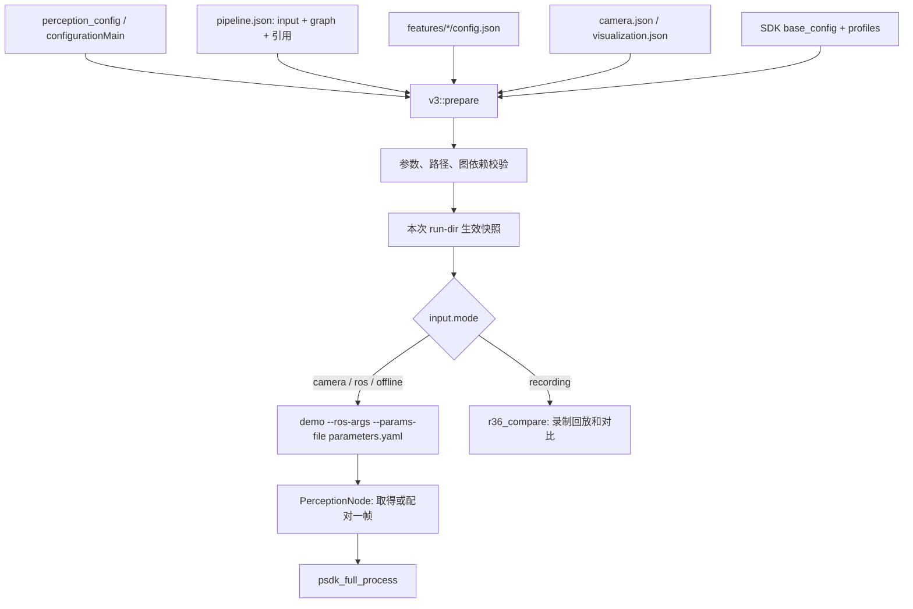
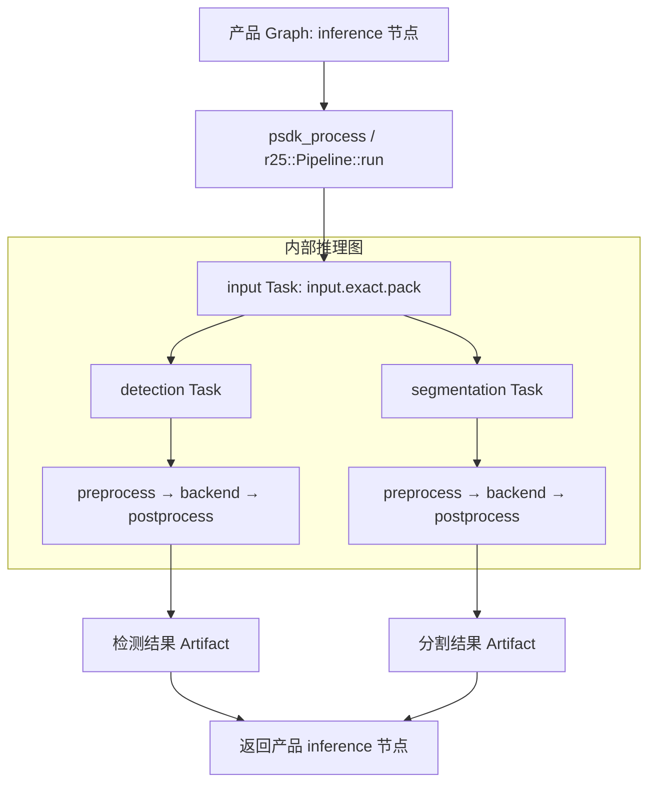
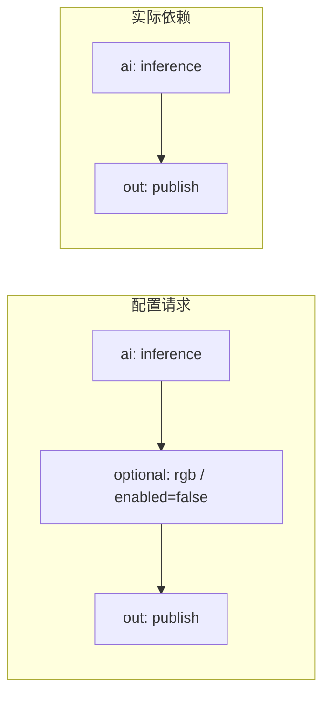
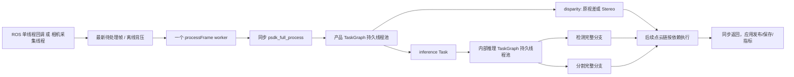
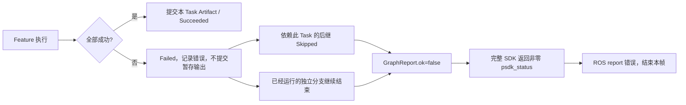

# 调度层：从 JSON 到一帧结果

本章对应当前 `perception-stereo-cpp-v3` 源码。调度层负责把配置转成可执行计划、建立功能依赖、管理每帧执行与错误；具体检测、分割、Stereo、点云算法在 `features/`。理解时先跟随一条实际调用链，再看底层通用调度器，避免被兼容入口和历史命名绕进去。

## 1. 目录按什么职责划分

| 目录 | 当前职责 | 先读的文件与函数 |
|---|---|---|
| `scheduling/launch/` | 命令行入口，选择运行、相机发布、录制，调用配置器及启动器 | [perception_config.cpp](../../scheduling/launch/src/perception_config.cpp)：`configurationMain()` |
| `scheduling/config/` | 读取根配置和功能配置，校验参数，生成本次 SDK、ROS、推理配置 | [native_pipeline.cpp](../../scheduling/config/src/native_pipeline.cpp)：`v3::prepare()`；[native_features.cpp](../../scheduling/config/src/native_features.cpp)：`loadFeatures()`、`applyFeatures()`、`generatedInferenceDag()` |
| `scheduling/dag/` | 产品功能登记、依赖规则、图绑定和通用线程池调度器 | [product_graph.hpp](../../scheduling/dag/include/product_graph.hpp)：`parseProductGraph()`；[full_graph.cpp](../../scheduling/dag/src/full_graph.cpp)：`Graph::runContext()`；[task_graph.cpp](../../scheduling/dag/src/task_graph.cpp)：`TaskGraph::run()` |
| `scheduling/pipeline/` | 完整 SDK 的每帧上下文、算法绑定、生命周期、结果 | [full_pipeline.cpp](../../scheduling/pipeline/src/full_pipeline.cpp)：`impl_psdk_full_create()`、`impl_psdk_full_process()` |
| `scheduling/inference/` | 检测/分割内部预处理、模型执行、后处理的调度适配 | [inference_session.cpp](../../scheduling/inference/src/inference_session.cpp)：`createEngine()`、`impl_psdk_process()`；[dag_pipeline.cpp](../../scheduling/inference/src/dag_pipeline.cpp)：`registerExact()`、`r25::Pipeline::run()` |
| `scheduling/runtime/` | 通用运行接口、模型分阶段执行和资源生命周期 | [runtime_engine.hpp](../../scheduling/runtime/include/perception/runtime_engine.hpp)、[staged_inference.cpp](../../scheduling/runtime/src/staged_inference.cpp)、[native_stages.hpp](../../scheduling/runtime/include/native_stages.hpp) |
| `scheduling/product/` | 保留原产品流程、控制和身份校验的兼容实现 | [product_dag.cpp](../../scheduling/product/src/product_dag.cpp)、[command_contract.hpp](../../scheduling/product/include/product/command_contract.hpp) |

有一处源码位置容易误读：`perception::runtime::Engine` 的实现主要在 [pipeline/builtin/runtime_features.cpp](../../scheduling/pipeline/builtin/runtime_features.cpp)，`runtime/src/engine.cpp` 中则是更外侧的 `perception::PerceptionEngine` 包装及普通检测/分割接口。两者类名相似，阅读时结合命名空间和实际调用者判断。

## 2. 程序启动时做了哪些事

入口 `perception_config run --config pipeline.json --run-dir 新目录` 调用 `v3::prepare()`。配置器不打开相机、不加载权重、不运行模型；它检查文件、参数和依赖，生成本次生效文件，然后启动真正处理数据的程序。



主要生成文件如下。用户通常修改源配置，不应把本次生成文件当作新的长期配置入口。

| 文件 | 用途 |
|---|---|
| `requested_pipeline.json` | 保留用户主配置，说明本次请求是什么 |
| `resolved_features.json` | 合并后的各功能设置和源文件位置 |
| `resolved.json` | 输入模式、生效参数、启动参数、内参来源等说明 |
| `effective_full.json` | SDK 实际加载的完整配置，包含产品 `graph` |
| `parameters.yaml` | `demo` 的 ROS 参数：输入、topic、模型、保存和发布等 |
| `inference_dag.json` | C++ 根据检测/分割开关生成的内部推理计划 |
| `original_start.json` | 原点云/融合实现需要的兼容配置，已应用功能参数覆盖 |
| `inference_original.cfg`、`inference_cpu.json` | 需要覆盖原 profile 时生成，具体出现哪些文件取决于配置 |

`--prepare-only` 只执行这些准备步骤。它能证明配置通过检查，不能证明模型可加载、相机可打开、ROS 已收到数据或算法结果正确。配置器要求新的输出目录，防止不同次运行的生效文件混在一起。

用户 JSON 中的相对文件路径以主 `pipeline.json` 所在目录为基准；SDK 原配置/profile 内的路径先按其原文件所在目录解析。启动器 [native_json.cpp](../../scheduling/config/src/native_json.cpp) 的 `launch()` 在 Linux/WSL 使用参数数组和 `execv()`，没有经过 shell 拼接命令。修改配置后需要重新启动，当前没有配置热加载。

## 3. 一帧数据的真实调用链

在线/普通离线路径从 [node_process.cpp](../../features/ros/src/node_process.cpp) 的 `PerceptionNode::processFrame()` 进入：

```text
PerceptionNode::processFrame(Pending)
  → 构造 psdk_full_frame，检查图像/时间戳/视差/内参
  → Caller::process()                         features/sdk_bridge/src/sdk_caller.cpp
  → psdk_full_process()                      sdk 的公开 C ABI
  → impl_psdk_full_process()                 scheduling/pipeline/src/full_pipeline.cpp
  → 为本帧建立 work/contextual 函数绑定
  → Graph::runContext()                      scheduling/dag/src/full_graph.cpp
  → TaskGraph::run()                         scheduling/dag/src/task_graph.cpp
  → 已选择的产品功能调用 features 中的实现
  → 返回 psdk_full_result
  → result_get_view → ROS 发布/应用保存/指标 → Result 析构释放
```

`full_pipeline.cpp` 为本帧创建的函数绑定，是把“产品图节点”连到“真实算法”上的位置。例如：

| 产品 stage key | 对应的本帧操作 |
|---|---|
| `dnn` | `psdk_process()`，得到检测、分割和各阶段耗时 |
| `disparity` | 校验并复制相机 Q8.8，或调用 `disparity_provider` 获取新 Stereo 视差 |
| `rgb` | 将输入 YUV 转为 RGB，供颜色/显示及点云使用 |
| `cloud` | 组装 `MappingFrame`，`beginFrame()` 后调用 `MappingPipeline::cloud()` |
| `calibration / labels / transform / ground / maps` | 同一个点云/融合对象上的分阶段方法 |
| `recharge` | `runRecharge()`，处理同帧回充图并填入位姿结果 |
| `history` | 完成本帧历史窗口快照，发布时序 Artifact |
| `temporal_difference / temporal_match` | 对已完成窗口执行差异/匹配 |
| `temporal_extension` | 汇总时序结果，必要时调用用户注册的时序回调 |
| `publish / record` | SDK 自身存在对应 hook 或保存条件时执行；应用 ROS 输出另有边界 |

本次选择哪些功能决定 SDK 的初始化：`inference` 关闭就不创建推理引擎，`cloud` 关闭就不创建映射对象，`recharge` 关闭就不创建回充对象。实际能否使用某种后端，还取决于编译时是否启用了 BPU、ONNX Runtime、Mapping、Recharge，JSON 不能补出未编译的能力。

节点的 `mapping_enabled`、`disparity_enabled` 分别来自 `graph.cloud`、`graph.disparity`，不再用 `mode=both` 推断一定要点云/Q8.8。推理与回充同时开启但关闭点云时，配置器选择 `both`/SDK 命令 `3`，并保持两个几何开关为 `false`；此时处理左图和同帧高清回充图，不要求无关的视差输入。

## 4. 一份用户 Graph，内部为何还能看到图

日常入口只有主配置的 `graph.nodes`。其中 `inference` 是完整的检测/分割功能；其内部仍有预处理、推理、后处理等实现步骤。C++ 自动生成内部计划，使这些步骤继续复用同一个通用调度框架。

当前 `generatedInferenceDag()` 生成的是以下结构：**一个 input Task，加一个 detection Task 和/或 segmentation Task**。每个模型 Task 内顺序执行三个 Feature；并不是六个独立模型 Task。



检测和分割是否加入内部图，取决于 `features/detection/config.json`、`features/segmentation/config.json` 的 `enabled`。产品 `inference` 开启但两个模型功能都关闭会被配置器拒绝。内部图不重复安排 `stereo.demand`；当前新 Stereo 属于产品 `disparity` 节点，避免同一帧跑两次视差。

`schema_version=3` 是主 `pipeline.json` 的版本；自动生成内部文件中的 `config_version=3` 是通用推理图的格式版本。名称相近，但不是要求用户维护两份流程。

## 5. `id`、`feature`、`depends_on` 分别是什么

以下图可以执行，自定义名称没有被硬编码成算法类型：

```json
{
  "worker_threads": 2,
  "nodes": [
    {"id": "my_ai", "feature": "inference"},
    {"id": "send_result", "feature": "publish", "depends_on": ["my_ai"]}
  ]
}
```

- `id` 是本图内唯一的节点名字，用在依赖和 trace 中；`depends_on` 中填写这些 ID。
- `feature` 是已经编译注册的功能类型，如 `inference`、`cloud`、`ground`。
- `enabled` 默认为 `true`，决定选择该功能。
- `worker_threads` 是图线程池容量，不是帧队列长度，也不是相机 FPS。

绑定过程是 `my_ai → inference → dnn → product.ai.exact → BoundFeature → work["dnn"]`。因此修改 ID 会改变日志名称和依赖引用，不会换模型，也不会复制一份算法实例。改了 ID 后，要同步修改所有 `depends_on` 引用。

`productStageKey()` 还接受 `pointcloud → cloud`、`fusion → maps` 等别名，以及完整的 `product.*` 功能名。**同一种产品功能每帧只允许在图中出现一次**，包括用了不同别名，或其中一个重复节点标记关闭的情况。不能借两个不同 ID 启动两套检测模型实例。

主图节点字段目前仅有 `id / feature / depends_on / enabled / _help`。功能参数来自对应功能 JSON；主图没有通用 `inputs / outputs / params` 字段，也不支持在节点上自由声明输入输出端口。

## 6. 依赖不是装饰，哪些顺序必须遵守

`parseProductGraph()` 会先检查未知功能、重复 ID/功能、未知父节点、环，再按真实数据契约检查生产者。数组书写顺序本身不构成执行顺序。

| 消费功能 | 当前要求 |
|---|---|
| `cloud` | 有已启用的 `disparity` 和 `rgb` 祖先；若图启用 `inference`，也必须等待它 |
| `calibration` | 等待 `cloud` |
| `labels` | 等待 `cloud` 和 `inference` |
| `transform` | 等待 `cloud` |
| `ground` | 等待 `transform` |
| `maps` | 等待 `ground` |
| 选中的点云阶段 | 按 `cloud → calibration → labels → transform → ground → maps` 的已选阶段顺序串行 |
| `history` | 等待已启用的推理、视差、RGB、回充、地图生产者 |
| 时序分析/扩展 | 有 `history` 祖先；后续阶段等待已启用的前序时序分析；帧差/匹配要求窗口容量至少 2 |
| `publish / record` | 汇合其读取的全部已启用工作，避免读取半成品结果 |

点云阶段的顺序约束来自共享帧工作区。即使关闭语义融合，坐标变换、地面处理、地图之间也不能随便并发。这里的“祖先”可以经中间节点间接建立，不要求所有边都直接相连。

### 6.1 关闭中间节点时怎样绕过

产品图会把已关闭的控制节点替换成它的真实祖先。例如：



绕过保持 `publish` 等待 `inference`，不会因为中间节点关闭就让输出提前执行。但关闭必需数据生产者不能靠绕过修复：例如点云仍要求真实视差、真实 RGB，语义标签仍要求推理结果。

底层 `TaskGraphConfig::validate()` 本身禁止“开启 Task 直接依赖关闭 Task”。产品图先展开被关闭节点的祖先，再把处理后的配置交给底层，所以两条规则并不冲突。即使某节点关闭，原始图中环或未知引用也会被拒绝。

运行时还有一次筛选：`Graph::runContext()` 根据本帧真实提供的绑定建立 active 集合。没有本帧工作函数的功能会临时关闭，再绕过其依赖；构建结果按 active 签名缓存。这用于命令模式、推理间隔、时序抽样及缺少输出 hook 等条件，意味着“配置启用”与“每一帧都执行”需要区分。

时序参数集中在 `features/temporal/config.json`，主图决定 history、difference、match 是否运行。完整 SDK 检查 `history.difference/match` 与图中对应节点一致，并拒绝容量 1 的帧差/匹配配置，避免“节点启用但条件永远不满足”。录制回放保留这些实际选择；[compare/runner/src/main.cpp](../../compare/runner/src/main.cpp) 在每轮正式测量前重置已启用的历史，第一轮的重置也隔离了预热帧。重置次数和策略写入测量元数据，避免不同轮数据混入同一个窗口。

## 7. 线程与并行究竟发生在哪里

ROS 主程序使用 [main.cpp](../../features/ros/src/main.cpp) 的 `SingleThreadedExecutor`；图像回调主要接收、校验、配对和投递，不直接在回调里运行整套模型。应用有一个处理 worker；相机直取另有采集线程。在线待处理队列保留最新帧，处理落后时会替换尚未处理的旧帧，离线回放则施加背压以顺序处理文件。



同一帧中没有依赖关系的就绪 Task 可以占用不同 worker，例如视差与检测/分割路径可重叠。内部检测与分割分支也可以重叠。任务内的多个 Feature 按顺序执行，`preprocess → backend → postprocess` 不会在同一个 Task 内并行。

需要注意以下实际约束：

1. `full_pipeline.cpp` 有全局 `full_gate`，当前进程内完整 SDK 的 create/process/command/destroy 等调用串行。`inference_session.cpp` 还有 `sdk_lifecycle_mutex`，`dag_pipeline.cpp` 有 `exact_frame_mutex`。创建两个 engine 不会自动得到两帧并行。
2. `TaskGraph::run()` 自身有 `run_mutex`；通用 `runtime::Engine::run()` 也保护可复用模型工作区。当前优化方向主要是帧内独立分支，不是跨帧流水线。
3. 根 `worker_threads` 同时用于生成产品图和内部推理图，所以它不是整个进程的总线程上限；相机 SDK、ROS、ONNX Runtime/BPU 还可能有自己的线程。
4. 每个 TaskGraph 使用持久线程池，不是每帧重新创建一组调度线程；不同 active 图变体有各自缓存的 TaskGraph，可能增加线程资源。
5. DAG 允许重叠并不保证硬件同时执行。BPU 的资源竞争、模型自身线程、CPU 后处理都会影响耗时。并行分支耗时不能简单相加当作墙钟耗时，FPS 也不能直接按某个模型耗时倒数估算。

通用调度器支持 `ExclusiveResourceResolver`：功能登记可声明复用模型/工作区身份。两个无依赖的 Task 若共享排他资源，会在建图时被拒绝，要求增加依赖或使用不同资源实例。当前精确推理注册了 `exact.det.model`、`exact.seg.model`、`exact.pack.workspace` 等资源；产品映射层主要通过强制阶段依赖保护共享状态。

## 8. Artifact 管什么，哪些数据仍在帧上下文里

[task_graph.hpp](../../scheduling/dag/include/perception/task_graph.hpp) 中的 `ArtifactStore` 是带 C++ 类型检查的帧内结果表。调度器在一个 Task 的全部 Feature 成功后，才提交 `context.set()` 暂存的输出；失败时不提交。这解释了为何后继任务不会看到半个 Task 的 Artifact。数据类型、键名、历史窗口与生命周期的详细说明见 [ArtifactStore 与时序](04_artifact_store_and_time.md)。

完整产品流水线尚未把所有算法输入输出改成 Artifact。`full_pipeline.cpp` 的工作函数捕获 `frame / out / engine`，点云功能还共享 `MappingPipeline` 的工作区；产品 `BoundFeature` 主要提交 `full.completed.<stage>` 完成标记，时序窗口使用真正的 Artifact 数据。因此不要把当前实现描述为“任意节点都能通过 JSON 连 Artifact 端口”。Artifact 的事务也不能回滚工作函数对共享对象、相机、文件或外部回调已经造成的副作用。

## 9. 失败如何传播，为什么不会发布半帧算法结果

底层 Task 的状态包括 `Pending / Running / Succeeded / Failed / Skipped`。`Running` 包括已进入线程池队列的任务，不代表此刻一定占用 CPU。



调度器不会强行中断已经运行的独立分支，而是等待本轮任务完成。依赖失败的后继标记 `dependency did not succeed`。主动关闭的 `Skipped/disabled` 可被 `GraphReport::ok()` 接受，依赖失败导致的跳过不算成功。

`BoundFeature::execute()` 把异常转成包含 `code / native_code / feature / task / frame / detail` 的状态，`Graph::runContext()` 统一返回。推理的 `Pipeline::tryRun()` 在失败时清空输出并保留完整 `uint32_t` 状态码。完整 SDK 只有图成功才把结果对象交给调用者，历史窗口也是成功后才 `commit()`。

ROS `processFrame()` 看到非零状态会调用 `report()` 并返回，不把失败帧当作成功结果发布。保存发生在应用拿到成功视图之后，保存失败有自己的错误路径；它不会自动回滚已经发布的成功算法消息。对外回调和文件副作用也没有全局事务回滚。

当前没有通用的“Task 超时后强制终止”或图级自动重试。输入采集超时与 ROS 无输入诊断属于输入层控制，不能替代模型/算法任务的执行超时。如果底层调用长时间不返回，图会等待它；定位时应看输入、配对、处理计数及节点 trace，而不是只看最后一条日志。

## 10. 能怎样扩展一个功能

### 10.1 调现有参数和开关

这是最常见的开发方式：在对应 `features/<功能>/config.json` 修改已支持参数，主图决定启用和依赖。参数必须经过 `validateFeatureSettings()` 校验及 `applyFeatures()` 映射，添加一个未经登记的新 JSON 字段会被拒绝，而不会自动影响算法。

只检测、只分割通过 `inference` 产品节点加各自开关实现；它们不是主图中的两个独立产品 feature。只生成几何点云可以关闭推理和语义节点，但保留真实 `disparity / rgb / cloud` 以及所需后续几何处理的依赖。单独 ground/maps 无输入点云不成立。

### 10.2 给产品主图增加全新功能

需要修改并编译代码，当前没有运行时加载任意功能动态库的机制。一个可靠的接入顺序是：

1. 在新的 `features/<name>/` 实现算法、头文件和参数文件，明确输入、坐标系、单位、所有权和输出。
2. 在原生配置器登记文件、参数规则和到 SDK 的映射；目前功能文件清单固定，单放一个目录不会自动发现。
3. 在 `productStages()` 注册产品 feature，并写明必需生产者和阶段顺序。
4. 在 `full_graph.cpp` 的 `steps()` 增加绑定、默认兼容依赖和错误码。
5. 在 `full_pipeline.cpp` 建立本帧工作函数及生命周期，根据结果需要扩展 SDK 结果视图、ROS 输出和保存。
6. 添加成功/失败、禁用、缺依赖、同帧身份、结果所有权测试，再用相同输入比较修改前后。

`productStages()`、`steps()`、本帧 work 绑定目前分散在三个位置，新增功能容易遗漏。后续可考虑用统一描述表生成注册与基础规则，但当前源码没有这项自动化。

### 10.3 使用通用 C++ Feature 扩展接口

底层已提供 `FeatureRegistry::add(name,factory,schema,resource_resolver)` 和 `Engine(TaskGraphConfig,FeatureRegistry)`。可以实现 `Feature::execute(FeatureContext&)`，读写自定义 Artifact，再通过 C++ 构造的任务图选择该功能。参数 schema 用于建图时检查类型和拼写，closer 用于关闭资源。

这条接口适合独立实验与组件测试。它不意味着主 `pipeline.json` 自动接受同名 feature；主图仍受产品白名单和结果 ABI 限制。内置推理 `Pipeline` 也建立自己的注册表，当前没有通过主配置注入自定义工厂的入口。

### 10.4 时序扩展回调

[perception_temporal_sdk.h](../../sdk/include/perception_temporal_sdk.h) 提供 `psdk_full_set_temporal_callback()`。在启用相应历史/扩展节点并抽样到该帧时，回调在时序分析完成后、发布/保存前执行。它是一个已编译回调插槽，不是任意数量的 JSON 插件节点。

回调返回非零会使本轮失败，失败帧不提交历史。完整 SDK 回调中禁止重新进入 process/command/reset/destroy，`CallbackGuard/reentry()` 会阻止重入；应把后续控制动作交给外部线程或下一次调用。通用 `runtime::Engine` 的 publication sink 则是在其内部锁释放后调用，两种回调边界不同，不要混用结论。

## 11. 自由配置的实际范围与当前缺口

当前图确实控制执行顺序、功能选择和线程数，不是给固定流程换一个显示名称。源码测试 [configurable_graph_contract.cpp](../../validation/sdk/full/tests/configurable_graph_contract.cpp) 验证了自定义 ID、改变 RGB/推理顺序、单功能选择、缓存后绑定更新和关闭节点绕过。

仍有以下边界，配置新组合前应检查：

| 组合或诉求 | 当前情况 |
|---|---|
| 只检测 / 只分割 | 支持：产品 `inference` 加模型功能开关 |
| 不带 AI 的几何点云 | 支持，仍需图像、视差、内参及依赖 |
| 只做 RGB 转换 | 支持产品 `rgb`，输出是否发布还要配置应用输出 |
| 任意新 feature 名称 | 拒绝，必须先写 C++、注册并重编 |
| 同一 feature 两个实例、不同模型 | 产品图拒绝重复功能，即使 ID 不同 |
| JSON 任意连接输入输出端口 | 尚未实现，数据键/帧结构由 C++ 约定 |
| 运行时热更新图或自动加载 feature 动态库 | 尚未实现 |
| 独立运行原 Q8.8 / 新 Stereo 视差，不生成点云 | 支持：单独启用 `disparity`；保持真实输入、内参及校正要求 |
| AI + 回充，同时不启用点云 | 支持：选择命令 3，显式 `mapping_enabled=false`、`disparity_enabled=false` |
| offline/recording 回充 | 拒绝：当前输入没有交付同次高清回充图，不能静默代用低清图 |

独立视差的最小图如下，这是替换主配置 `graph` 的片段。它可以与 `input.disparity_source=original_q8` 或 `raft_stereo` 搭配，不要求运行点云、地面或地图：

```json
{
  "worker_threads": 2,
  "nodes": [
    {"id": "depth_only", "feature": "disparity"},
    {"id": "output", "feature": "publish", "depends_on": ["depth_only"]}
  ]
}
```

原视差需要同帧左图和真实 Q8.8；新 Stereo 需要同帧左右图。camera 的内参来自 SDK，ROS 默认来自同帧 `CameraInfo`，offline/recording 几何处理需要显式 `intrinsics_file`。只做视差也保留这些约束，不把缺少的内参或原视差编造出来。普通 offline 文件模式仍不提供原 Q8.8，原方法回放使用 recording。

启用 `visualization.publish_disparity=true` 后，算法节点发布 `~/disparity_q8`，消息为 `sensor_msgs/Image` 的 `16UC1` Q8.8，实际视差像素值为整数值除以 256。结果 JSON 的 `has_disparity` 说明是否取得视差；启用保存时写出 `disparity_q8.u16` 和 `disparity.png`。没有 cloud 就不会凭空生成 PLY。recording 的 `--both` 也可比较独立视差路径。

独立视差是否执行与 Mapping 分离，AI+回充的命令选择也与两个几何开关分离，避免“节点配置开启但本帧没有建立对应工作绑定”。后续增加类似组合，应同时验证配置、输入订阅、SDK 函数绑定和可观测输出，不能仅检查 JSON 能通过解析。

兼容配置仍有一处值得继续拆分：`full_pipeline.cpp::loadHostPolicies()` 在 `mapping.original_config` 非空时读取其中的 `dnn.enabled / run_every_n`，即使点云关闭也会影响推理。主配置器会同步生成这两个字段，所以通过 `perception_config` 运行时保持一致；直接调用完整 SDK 并手写 `effective_full.json` 的开发者，仍需保证兼容文件与主图一致。更清晰的后续结构是把推理跳帧策略归到 inference，解除其对 Mapping 命名配置的依赖。

另外，模型加载几何、后处理契约仍有硬约束。例如检测/分割 SDK 检查原模型输入分别为 `864×480`、`832×480`；把任意 ONNX/BIN 路径填进 JSON 不会自动获得兼容的预处理和输出解码。功能自由组合与任意模型自由替换是两件都需要明确契约的工作。

## 12. 用哪些文件验证自己理解对了

建议按下面顺序定位问题：

1. 看 `resolved.json / parameters.yaml`：实际输入、mode、内参来源、topic 是否符合预期。
2. 看 `effective_full.json.graph`：功能和依赖是否真的选中，SDK 的 enabled 与 graph 是否一致。
3. 看 `inference_dag.json`：只检测时是否只有检测分支，关闭的模型是否仍被引用。
4. 看 `task_trace.json` 或 `final_task_trace.json`：自定义节点 ID、Succeeded/Failed/Skipped 及耗时；注意 active 条件可能令配置开启的节点在某帧不执行。
5. 看 ROS 接收/配对/处理计数：先确定是否有完整输入，再判断算法是否卡住。

核心验证源码为 [native_config_test.cpp](../../validation/native_config_test.cpp)、[task_graph_tests.cpp](../../validation/sdk/framework/tests/task_graph_tests.cpp)、[graph_contract.cpp](../../validation/sdk/full/tests/graph_contract.cpp)、[configurable_graph_contract.cpp](../../validation/sdk/full/tests/configurable_graph_contract.cpp)、[dag_contract_tests.cpp](../../validation/sdk/tests/dag_contract_tests.cpp)。配置/调度测试与真实模型、相机测试覆盖的层级不同；通过建图测试后，仍应回放相同输入，比较检测、分割、点云及性能结果。
