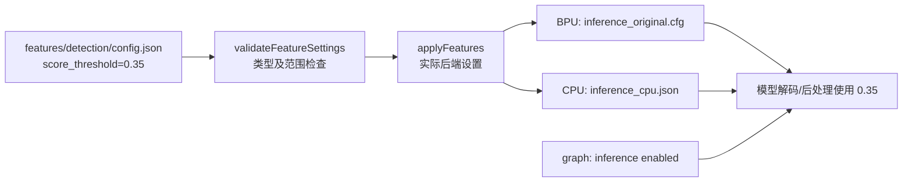
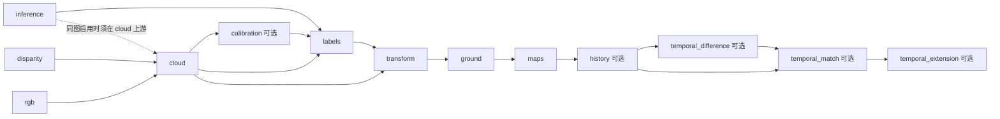

# 3. 功能、参数、单独测试与扩展开发

本章依据本版 `native_features.cpp`、`native_pipeline.cpp`、`product_graph.hpp`、`full_graph.cpp`、`full_pipeline.cpp` 以及各功能真实实现整理。文中的代码位置相对项目根目录；当前版本的日常入口是 C++ `perception_config` 和 schema 3 的 `pipeline.json`。历史讲稿中旧三层 DAG、旧 Python 入口和旧回充 L 标实现不能直接套用。

## 3.1 先分清“算法功能”和“功能目录”

一个功能目录不一定对应一个用户 Graph 节点；一个节点也可能调用多个功能目录。例如 `inference` 同时封装检测和分割，`maps` 使用 fusion 后端，`camera` 是输入适配器而不是当前产品图中的节点。

| 目录 | 职责 | 日常配置 | 主要实现/入口 |
|---|---|---|---|
| `features/camera/` | Mo SDK 动态加载、帧所有权、同步 RGBD/GDC、SDK 内参 | 根 `camera.json` | `src/mo_camera.cpp`、`include/perception_ros_so_demo/raw_capture.hpp` |
| `features/offline/` | 读 PNG/JPEG/紧密 NV12/I420，准备算法源图 | `features/offline/config.json` | `src/offline_image.cpp` |
| `features/ros/` | 接收/配对、最新帧队列、SDK 调用、ROS 发布 | `features/ros/config.json` | `src/perception_node.cpp`、`node_input.cpp`、`node_process.cpp`、`node_output.cpp` |
| `features/sdk_bridge/` | C ABI 调用、结果 RAII，隔离应用和共享库 | 无独立 JSON | `src/sdk_caller.cpp` |
| `features/inference/` | BPU/ORT 后端、公共输入和模型工作区 | `features/inference/config.json`、`cpu_profile.json` | `backend/src/runner.cpp`、`cpu/src/cpu_stages.cpp` |
| `features/detection/` | 检测解码、框变换、按类 NMS | `features/detection/config.json` | `backend/src/detection_post.cpp` |
| `features/segmentation/` | 分割输出、插值/argmax、源图 mask | `features/segmentation/config.json` | `backend/src/segmentation_post.cpp`、`seg_post.cpp` |
| `features/stereo/` | 左右图适配、Horizon 模型、视差恢复及 Q8.8 输出 | `features/stereo/config.json` | `src/stereo_provider.cpp`、`runner/src/horizon_stereo.cpp`、`tensor_codec.cpp` |
| `features/pointcloud/` | Q8.8 反投影、外参、Patchwork 地面、PLY/ROS cloud | `features/pointcloud/config.json` | `backend/src/mapping.cpp`、`ground_segmentation.cpp`、`src/cloud_output.cpp` |
| `features/fusion/` | 检测/分割语义投影、深度/聚类筛选、地图融合 | `features/fusion/config.json` | `backend/src/label_fusion.cpp`、`detection_labels.cpp`、`map_render.cpp` |
| `features/recharge/` | 当前 ArUco 标记识别、PnP/姿态与原算法桥接 | `features/recharge/config.json` → 一份 `recharge_mark.json` | `backend/bridge.hpp`、`backend/vendor/src/mark_aruco_detect.cpp` |
| `features/temporal/` | 有所有权的历史窗口、帧差、同类框关联 | `features/temporal/config.json` | `backend/include/perception_temporal.hpp`、`backend/src/temporal.cpp` |
| `features/metrics/` | 进程 CPU、RSS、处理/输入队列指标 | `features/metrics/config.json` | `src/process_metrics.cpp`、`backend/src/platform_metrics.cpp`；ROS 汇总在 `features/ros/src/node_metrics.cpp` |
| `features/visualization/` | overlay、RGB、PNG 等公共可视化实现 | 根 `visualization.json` | `backend/src/visualization.cpp`、`output_features.cpp` |

`scheduling/` 负责配置解析和执行编排，`core/` 放公共契约，`sdk/` 放对外 C ABI。把一个 `.cpp` 移到功能目录并不会自动注册为可运行节点，CMake、配置映射和产品绑定仍需明确接通。

## 3.2 两类开关与一条参数链

1. `graph.nodes[].enabled` 决定产品阶段是否参加这一帧执行。
2. 检测/分割有各自 `enabled`，决定 `inference` 内哪条模型通路加载和执行；metrics 有独立开关。
3. 功能参数修改算法设置，不自动开启对应产品阶段。

例如只保留 `inference → publish`，把 segmentation 的 `enabled=false`，就只运行检测。若 `inference` 仍启用而检测和分割均关闭，配置器会拒绝；要完全不运行 AI，应关闭或移除 `inference` 节点。



检测阈值不会通过修改 `original_start.json.dnn.detect.score_threshold` 来生效；那是原 mapping 模板中保留的同名副本。查看本次生成的 profile 和 `effective_full.json`，才能确认实际推理使用的值。

用户功能 JSON 中的文件路径统一相对**主 `pipeline.json` 所在目录**。因此写在 `features/detection/config.json` 中的 `models/x5/mmyolo0828.bin` 仍相对项目根；SDK/profile 内部路径则相对其自身文件目录。`_help` 仅供阅读，不是运行参数。可继承字段的 `null` 表示沿用 SDK 参数，不是通用关闭开关；修改文件后需重启，当前未实现运行中热更新。

配置器会读取全部已登记功能配置，再按所选功能验证需要的资源。因此禁用模型或回充可以不加载对应权重/参数文件，但对应功能 JSON 本身仍须存在，未知字段和错误类型仍会被拒绝。当前 `features` 引用名是固定白名单，不是任意目录自动发现机制。

## 3.3 当前各功能 JSON 的真实字段

以下默认值指本包交付的用户配置。标注“继承”的字段最终值取决于选中的 SDK 模板/profile，不能仅看本表推断运行值。

### 检测：`features/detection/config.json`

| 字段 | 默认 | 类型/范围 | 作用 |
|---|---|---|---|
| `enabled` | `true` | bool | `inference` 内检测通路；关闭时不加载检测模型 |
| `model` | `models/x5/mmyolo0828.bin` | 文件路径；可 `null` 继承 | 模型选择；CPU 改为 `models/cpu/` 对应 ONNX |
| `score_threshold` | `null` | 数值，严格 `(0,1)` | 模型输出置信度筛选 |
| `nms_threshold` | `null` | 数值 `[0,1]` | 同类别 NMS 的 IoU 阈值 |
| `nms_top_k` | `null` | 整数 `1..10000` | 保留检测数量上限 |

纯后处理的 NMS 只抑制同类别框，按置信度排序；IoU **严格大于**阈值才抑制，恰好等于阈值时保留。现有 `validation/postprocess_test.cpp` 专门覆盖这个边界。

### 分割：`features/segmentation/config.json`

| 字段 | 默认 | 类型/范围 | 作用 |
|---|---|---|---|
| `enabled` | `true` | bool | `inference` 内分割通路 |
| `model` | `models/x5/pidnet_0825_3classes.bin` | 文件路径；可 `null` 继承 | 分割权重 |
| `align_corners` | `null` | `null` 或 `true` | 当前 SDK 固定几何契约，不接受 `false` |
| `argmax_mode` | `null` | `null` 或 `"bilinear"` | 当前 SDK 固定后处理契约 |

后两个字段并不表示当前可自由切换插值算法。若要实现另一种插值/argmax，需要改后处理 C++ 并重编，同时用边界像素、类别并列及尺寸恢复数据做数值回归。

### 推理公共设置：`features/inference/config.json`

| 字段 | 默认 | 作用与限制 |
|---|---|---|
| `backend` | `null` | 继承；显式可选 `bpu` 或 `cpu` |
| `original_profile` | `null` | BPU 原始推理 CFG；路径相对主配置 |
| `cpu_profile` | `null` | CPU 模型输入/输出和预后处理 JSON；使用本包 ONNX 时填 `features/inference/cpu_profile.json` |

内部 `dag` 由配置器生成。解析器保留对这个旧字段的识别，但显式设置会报错，要求移除覆盖。用户只维护产品 `graph`。

CPU profile 不只是模型路径：它还定义输入名、RGB/归一化、尺寸、检测输出名和 raw DFL 布局、分割输出布局、类别名等。换一个输出契约不同的 ONNX，不能只改 `model`。

### Stereo：`features/stereo/config.json`

| 字段 | 默认 | 类型/范围与含义 |
|---|---|---|
| `model` | `models/x5/r34_tail_pointwise_shuffle2_grouped_grid_352x640_nv12_mixed.bin` | Horizon BIN；启用新 Stereo 视差时检查文件 |
| `image_transform` | `resize` | `resize` 显式适配；`strict` 要求源图尺寸与模型一致 |
| `input_width` | `640` | 偶数 `2..4096`，或 `null` |
| `input_height` | `352` | 偶数 `2..4096`，或 `null`；必须与 width 同时明确/同时 `null` |

默认契约 NCHW `[1,3,352,640]` 的 NV12 双目输入。源图为 640×544，显式缩放后推理，再恢复源图视差；视差值只乘横向缩放比例。当前只有 Horizon Stereo 后端，没有 CPU ONNX Stereo 推理器。新模型还须匹配输入图像类型、输出 dtype/量化、布局和视差定义，不能仅凭 NCHW 形状相同判断兼容。

### 点云/地面：`features/pointcloud/config.json`

| 字段 | 默认 | 类型/范围与含义 |
|---|---|---|
| `sample_step` | `null` | 整数 `1..32`；像素采样步长，越大点越稀疏 |
| `original_config` | `null` | 原 mapping 参数 JSON，可覆盖 SDK 的 `mapping.original_config` |
| `extrinsics` | `null` | 外参 JSON；与输入内参文件不同 |
| `ground.enabled` | `null` | 继承 Patchwork 内部开关；产品 `ground` 节点仍由 graph 决定 |
| `ground.sensor_height` | `null` | 正数，米，相机/传感器安装高度 |
| `ground.min_range`、`ground.max_range` | `null` | 正数，米，最终必须 min < max |
| `ground.th_dist`、`ground.th_seeds` | `null` | 正数，米，地面拟合/种子阈值 |

这些覆盖分别进入 `effective_full.json.mapping` 或本次 `original_start.json.patchwork`。点云还依赖真实 Q8.8、同帧源图、内参和外参，不会从单张图片补造深度。`MappingPipeline` 的一个帧工作区由后续阶段共享，不能把其所有方法任意并行执行。

### 融合：`features/fusion/config.json`

`labels` 覆盖 `original_start.json.label_fusion`，`map` 转成原地图参数名。交付文件只列常用项，解析器还接受下表中的高级项；未列在交付 JSON 中的字段可以按需增加，但不能自行杜撰字段名。

| 字段（均位于 `labels`） | 类型/范围 | 作用 |
|---|---|---|
| `passable_classes` | 字符串 | 可通行类别名列表，沿用原融合配置格式 |
| `det_score_min` | `[0,1]` | 检测点云融合二次筛选；不同于检测输出阈值 |
| `max_range_m` | `[0.1,100]` | 语义融合最大范围，米 |
| `max_height_m`、`keep_below_cam_m` | `[0,20]` | 高度限制，米 |
| `det_depth_span_m`、`det_depth_gap_m`、`seg_depth_gap_m` | `[0,100]` | 深度跨度/间隙筛选，米 |
| `cluster_voxel_m` | `[0.001,10]` | 聚类体素尺寸，米 |
| `det_depth_min_pts`、`cluster_min_component_pts`、`seg_min_component_pts` | 整数 `1..1000000` | 最小支撑点/组件点数 |
| `seg_ray_bin_px` | 整数 `1..4096` | 分割射线分桶，像素 |
| `seg_mask_majority_radius`、`seg_mask_close_radius` | 整数 `0..4` | mask 多数/闭运算半径 |
| `seg_mask_close_iterations` | 整数 `1..3` | 闭运算次数 |
| `seg_mask_erode_px` | 整数 `0..8` | mask 腐蚀范围，像素 |
| `fuse_into_grid`、`nongrass_seg_as_obstacle` | bool | 是否写入网格、非草类别处理 |
| `cluster_filter`、`seg_cluster_filter`、`seg_mask_postprocess` | bool | 检测/分割聚类与 mask 后处理 |

以上字段可 `null` 继承。`map.resolution_m`、`map.width_m`、`map.height_m` 必须为正数，单位米，分别映射到 `MapResolution`、`MapWidth`、`MapHeight`。语义融合需要同帧检测/分割结果，不能把仅几何点云配置和完整语义地图配置当作相同工作量比较耗时。

### 时序：`features/temporal/config.json`

本版补齐了此前缺失的时序功能配置入口。它覆盖 SDK 的 `full.json.history` 数值设置；执行开关仍由 graph 的 `history`、`temporal_difference`、`temporal_match` 决定。

| 字段 | 默认 | 类型/范围与含义 |
|---|---|---|
| `capacity` | `4` | 整数 `1..32`，历史容量；帧差/匹配至少需要 2 |
| `frame_interval` | `1` | 整数 `1..1000000`，每隔多少个唯一采集帧入窗；capacity=1 时实际固定为 1 |
| `max_memory_mb` | `64` | 整数 `1..4096`，窗口载荷预算，按 MiB 计算 |
| `difference_threshold` | `8` | 整数 `0..255`，Y 亮度绝对差大于该值才计为变化 |
| `match_iou_threshold` | `0.5` | `(0,1]`，同类别框关联最小 IoU |
| `match_max_detections` | `256` | 整数 `1..1024`，每帧参与匹配的检测数量上限 |

窗口保存拥有所有权的图像、mask、检测框和视差，不保留 SDK/相机借用指针。预算不足会移除最旧项；单帧已超过预算会报错。第一帧、未采样帧、历史不足两帧时没有有效帧差/匹配结果，这是有明确状态的未就绪，不是补零伪装成功。时间戳回退、几何或内参变化会清空旧窗口，命令切换也会清空历史。

帧差是 Y 平面绝对差及可用 mask 的类别变化；匹配是同类别框按 IoU 排序的一对一贪心关联，不是完整目标跟踪器，也不使用光流或三维跟踪状态。`temporal_extension` 是可选扩展钩子，写一个 JSON 名称不会自动加载外部插件。

### 回充：`features/recharge/config.json`

| 字段 | 默认 | 作用 |
|---|---|---|
| `config` | `null` | 继承 SDK `full.json.recharge.config`；显式路径相对主 pipeline，指向真实回充参数 JSON |
| `allow_source_fallback` | `null` | 继承 SDK（交付模板为 false）；是否明确允许缺少高清源时使用左图 |

图的 `recharge` 决定是否执行，参数文件只维护一份。默认 SDK 文件是 `config/recharge_mark.json`，源模板在 `scheduling/config/sdk_templates/recharge_mark.json`。可以将经过确认的参数文件放入功能目录后用 `config` 指向它，无需把全部参数复制进两份 JSON。

`allow_source_fallback` 是 SDK 处理层选图规则，当前 camera/ROS 应用启用回充时仍要求采集/同步同帧高清 GDC。它不会自动改变上游输入要求，也不会开放 offline/recording 回充模式。

真实 donor 解析器位于 `features/recharge/backend/vendor/src/recharge_mark_config.cpp`：它接受根对象或嵌套 `recharge_mark`，读取以下组。部分旧字段仍被原解析器保留，不意味着当前算法分支一定使用它们。

| 参数组 | 关键字段 | 意义/限制 |
|---|---|---|
| host 调度 | `run_every_n`、`min_interval_ms`、`use_hires` | 抽帧、最小执行间隔、高清 GDC；由 full_pipeline 负责落实 |
| 内参来源 | `intrinsics_source` | `dataset` 保留 donor 仓内参数；`sdk_scaled` 使用同帧内参按识别图尺寸缩放 |
| ROI | `roi.enabled/x_min/x_max/y_min/y_max` | 原算法 ROI，比率坐标 |
| 姿态安装几何 | `pose_refine.enabled/camera_height_mm/mark_height_mm/camera_pitch_deg` | 毫米/度；须匹配真实安装 |
| ArUco 几何 | `dictionary_id/dual_marker/layout/marker_id_*`、`marker_size_m/gap_m/margin_m/card_w_m/card_h_m` | 字典、单双码排列与物理尺寸，米 |
| ArUco 检测/PnP | `max_reproj_px/enable_lm_refine/adaptive_thresh_win_size_*/corner_refinement_*` 等 | 像素误差、阈值窗口、角点细化等原 OpenCV 参数 |
| 原始图保存 | `save_raw.enabled/dir/every_n/max_count` | donor 自身的额外诊断保存；dir 当前应使用绝对输出路径，独立于应用逐帧保存 |
| donor 发布设置 | `publish_enabled/publish_overlay/overlay_max_width` | 原接口设置；当前 SDK 桥不启动 donor 独立 ROS worker，不能据此推断应用话题已启停 |

当前集成是 ArUco，不使用 YOLO 辅助外部裁框。`Engine` 的原上游状态含全局先验/滤波，因此每进程只允许一个初始化实例并串行调用。`processLeftNv12` 返回“已处理但没识别到标记”是正常结果，须看 `mark_ok/pose_ok`，不能只根据调用返回 0 认为姿态有效。

### 输入与 metrics 配置速查

完整输入说明见输入章节，这里列出实际字段方便扩展时定位。

| 文件 | 全部运行字段（不含 `_help`） |
|---|---|
| 根 `camera.json` | `sdk_library/vendor_config/disparity_mode/acquire_timeout_ms/retry_interval_ms/frame_id` |
| `features/offline/config.json` | `left_files/right_files/format/fps/loop/max_frames/wait_for_subscribers/intrinsics_file/rectified/calibration_confirmed/frame_id` |
| `features/ros/config.json` | `left_topic/right_topic/q8_topic/gdc_topic/left_camera_info_topic/right_camera_info_topic/reliability/queue_capacity/intrinsics/rectified/calibration_confirmed/frame_id` |
| `features/metrics/config.json` | `enabled/write_jsonl/every_n` |

offline `format` 只有 `nv12` 或 `i420`，FPS 范围 `0.001..120`；ROS 队列 `1..16`、QoS `best_effort/reliable`。相机超时 `1..60000` ms、重试 `1..1000` ms 且不超过超时。metrics 的 `every_n` 是正整数，控制每多少个已处理帧发布/写入一次；它独立于 graph.publish，录制 benchmark 的报告也独立于 metrics 开关。

CPU 指标是本进程 CPU，100% 表示一个核；RSS 是本进程驻留内存。ROS 分进程采集时，不包含相机进程资源；回放不包含硬件生成原始 Q8.8 的时间。检测和分割并行时各阶段时间会重叠，不能把六段时间简单相加当端到端时延。

## 3.4 “自由配置功能”的实际边界

用户图可以选择已有功能、关闭功能、修改有真实数据依赖依据的顺序、允许独立分支并行。当前产品图不是任意字符串都能运行的插件系统，也没有 JSON 可编辑的输入/输出端口。

### 已注册的产品功能

注册名单以 `scheduling/dag/include/product_graph.hpp::productStages()` 为准：

| graph.feature 简写 | 完整注册名 | 产物/用途 |
|---|---|---|
| `inference` 或 `dnn` | `product.ai.exact` | 检测、分割；两条支路由功能配置开关 |
| `disparity` | `product.stereo.disparity` | 取得原 Q8.8 或调用新 stereo provider；可以独立运行 |
| `rgb` | `product.image.rgb` | 将本帧源图转换为 RGB |
| `cloud` 或 `pointcloud` | `product.pointcloud.from_disparity` | 视差和内参反投影，得到相机坐标点云 |
| `calibration` | `product.calibration.auto` | 原自动地面/安装标定步骤 |
| `labels` | `product.fusion.semantic_labels` | 将本帧检测、分割语义对应到点云 |
| `transform` | `product.pointcloud.transform_color` | 坐标变换与着色 |
| `ground` | `product.pointcloud.patchwork` | 原 Patchwork 地面分离 |
| `maps` 或 `fusion` | `product.fusion.ai_fusion` | 原语义融合栅格 |
| `recharge` | `product.recharge_mark` | ArUco 回充标记及姿态 |
| `history` | `product.temporal.history` | 拥有内存的历史帧窗口 |
| `temporal_difference` | `product.temporal.difference` | 相邻采样帧亮度差 |
| `temporal_match` | `product.temporal.match` | 同类别检测框跨帧关联 |
| `temporal_extension` | `product.temporal.extension` | SDK 已注册扩展回调执行点 |
| `publish` | `product.output.application` | 应用发布阶段/SDK publication hook |
| `record` | `product.output.record` | 应用保存阶段/SDK 保存阶段 |

完整注册名也可以写进 `feature`。`id` 是该图中节点的名字，可以自定义；`depends_on` 必须引用节点 id。例如 `{"id":"stereo_a","feature":"disparity"}` 的下游应写 `"stereo_a"`，不能因为它是视差功能就固定写 `"disparity"`。

### 必须满足的依赖



图中的可选节点可以省略。已选择的 mapping 步骤按 `cloud → calibration → labels → transform → ground → maps` 保持顺序，这是当前实现共享一个可复用 `MappingPipeline` 帧工作区的要求。例如不启用 labels 时，可以让 transform 直接依赖 cloud；启用 labels 时，transform 必须等 labels 完成。

另有以下约束，配置错误会在启动准备阶段拒绝：

- cloud 必须有 disparity 和 rgb 上游；同图启用 inference 时，inference 也必须是 cloud 的上游。
- labels 必须有 cloud 和 inference 上游；calibration 必须有 cloud 上游，ground 必须有 transform 上游，maps 必须有 ground 上游。
- difference、match、extension 必须有 history 上游；同图启用 difference 时，match 还必须等 difference。启用 difference 或 match 时历史容量至少为 2。
- history 必须等同图已启用的 inference、disparity、rgb、recharge、maps；publish/record 必须等待所有启用的产物生产者。若 publish 和 record 同时启用，record 等 publish。
- 每个产品功能一帧只能出现一次，包括 enabled=false 的占位节点；不能在同一图里放两套不同模型的 inference 或两个独立 cloud 实例。
- 节点 id 不得重复，不能循环、不能引用未知依赖；图大小为 1～64 节点、worker_threads 为 1～32。
- 关闭中间节点会展开到它的启用祖先，但不会凭空生成它原来产生的数据。例如关闭 disparity 后保留 cloud 会失败。

`worker_threads` 控制单帧图内的可并行任务。SDK 完整帧处理有进程内串行保护，mapping 和回充也有共享状态；把 worker_threads 改大不等于可以同时处理多帧。在线节点的最新帧队列会舍弃等待中的旧帧，这是控制积压延迟的策略，吞吐和丢帧需一起观察。

### artifact 现在承担什么

`scheduling/dag/include/perception/task_graph.hpp` 中的 `ArtifactStore` 管理按 key 命名的、带 C++ 类型的不可变数据。`FeatureContext::set()` 先写入任务局部事务，整项任务成功后才对下游可见；类型不一致、重复写入、缺少数据会报错。内部精确推理图和历史窗口已经使用这个机制。

产品图还有部分旧集成通过 `full_pipeline.cpp` 闭包中的共享结果与 `MappingPipeline` 工作区传递数据。`full_graph.cpp` 为已完成步骤写入 `full.completed.<步骤>` 作为调度完成记录。因此，“存在 artifact 框架”不代表输入选择、相机句柄、文件路径和所有输出都已统一为 artifact；它也不会替代 input/graph/visualization 配置。

## 3.5 如何单独运行、单独测试一个功能

先区分三种验证：算法单元测试检查函数结果；精简 graph 检查真实运行链路；同数据 A/B 检查整个变更。只做其中一种不能覆盖全部问题。

### 用精简 graph 单独运行

在项目根目录复制主文件为 `pipeline.det.json`、`pipeline.cloud.json` 等，保留 schema、sdk、input 以及所需配置引用，只替换 graph。放在根目录可保持现有相对路径的含义；复制到其他目录时，必须同步调整功能配置引用和模型、数据路径。

**只检测或只分割：** 两者都属于 inference 节点，没有名为 `detection` 或 `segmentation` 的独立产品节点。

```json
{
  "input": {"mode": "offline", "disparity_source": "none"},
  "graph": {
    "worker_threads": 2,
    "nodes": [
      {"id": "ai", "feature": "inference", "depends_on": []},
      {"id": "out", "feature": "publish", "depends_on": ["ai"]}
    ]
  }
}
```

这段是主文件中两个字段的替换片段。只检测时 detection.enabled=true、segmentation.enabled=false；只分割时反过来。只跑 AI 不需要离线内参文件，也不需要右图。模型、输入路径和推理后端仍需配置为真实可用值。检测/分割同时 false 而 inference 启用会被拒绝。

**只获取视差：** 可以启用 disparity 和发布，不必启动 PCL 点云、检测或分割。

```json
{
  "graph": {
    "worker_threads": 1,
    "nodes": [
      {"id": "disp", "feature": "disparity", "depends_on": []},
      {"id": "out", "feature": "publish", "depends_on": ["disp"]}
    ]
  }
}
```

新 stereo 的输入应选择 raft_stereo，并提供同帧、已校正的左右图；原方法选择 original_q8，由 camera/ROS/recording 提供原 Q8.8。当前接口仍要求该源的真实内参与几何声明。需要查看图像时启用 visualization.publish_disparity。单视差图没有 pointcloud、ground、maps 结果，也不会产生 PLY。

**只生成点云：** 省略 inference/labels/transform/ground/maps，保留以下 graph：

```json
{
  "graph": {
    "worker_threads": 2,
    "nodes": [
      {"id": "disp", "feature": "disparity", "depends_on": []},
      {"id": "color", "feature": "rgb", "depends_on": []},
      {"id": "cloud", "feature": "pointcloud", "depends_on": ["disp", "color"]},
      {"id": "out", "feature": "publish", "depends_on": ["cloud"]},
      {"id": "save", "feature": "record", "depends_on": ["out"]}
    ]
  }
}
```

它仍需要内参和视差：camera 自动使用 SDK 同帧标定；ROS 通常使用 CameraInfo；离线/录制明确指定 intrinsics_file。offline 原图模式没有原 Q8.8 输入入口，应使用左右图加 raft_stereo；已录制三元组使用 recording+original_q8。要保存点云，还须设置 visualization.save_root、save_every_n>0、save_ply=true。图的 record 开关与保存频率一起决定是否真正保存。

**只验证 ground/fusion：** 主流程必须保留其真实数据生产者。ground 至少需要 disparity、rgb、cloud、transform；maps 还需要 ground。若想直接给一组人造点云测地面分类，应写 C++ 单元测试调用 MappingPipeline/算法函数，而非在主 JSON 中伪造缺失上游。

**只验证时序：** 在上述 AI 或 rgb 流程后加 history，再加 difference/match。帧差至少送入两帧被采样的图像；检测匹配还需要真实检测结果。第一帧、未采样帧、历史重置后的首帧出现分析无效是正常状态。recording 回放可验证 history/calibration；录制三元组不包含高清 GDC，因此不能验证当前回充输入契约。

**只验证回充：** 图可只用 recharge→publish，无需检测/分割。camera 或 ROS 需提供同次采集的 GDC 图；ROS 还需相应输入内参。当前离线/recording 路径不包含该高清源，启动器会拒绝回充组合。不要为了让程序通过而把低清左图冒充 GDC。

### 先看生成配置，再启动

在已编译安装的 Linux/WSL/X5 环境中，从项目目录运行：

```bash
bash tools/run_pipeline.sh --config pipeline.det.json \
  --run-dir /tmp/perception-det-prepare --prepare-only
```

`--run-dir` 应选新的目录；准备操作会生成最终 SDK 配置、ROS 参数和解析证据。它验证配置/文件/图依赖，不会开相机、订阅图像或执行推理。确认有效配置后，用另一个新目录去掉 prepare-only：

```bash
bash tools/run_pipeline.sh --config pipeline.det.json \
  --run-dir /tmp/perception-det-run
```

启动命令与 input.mode 配合：offline/camera/ros 走在线应用；recording 走离线对比 worker。ROS 输入仍需先启动相机发布端，且图像、视差和 CameraInfo 的配对时间戳符合契约。

### 不依赖模型/相机的 C++ 单元测试

以下命令适用于有 CMake、Ninja 和 C++17 编译器的 Linux/WSL，在项目根执行。它关闭硬件推理、ONNX、PCL 和回充，验证后处理、配置、调度和时序基础契约：

```bash
cmake -S . -B build/unit -G Ninja \
  -DCMAKE_BUILD_TYPE=Release -DBUILD_TESTING=ON \
  -DR20_WITH_BPU=OFF -DR29_WITH_ORT=OFF \
  -DR33_WITH_MAPPING=OFF -DR33_WITH_RECHARGE=OFF \
  -DPERCEPTION_BUILD_COMPARE=OFF \
  -DPERCEPTION_BUILD_COMPARE_RUNNER=OFF \
  -DPERCEPTION_BUILD_CAPTURE=OFF

cmake --build build/unit --parallel 4 --target \
  feature_postprocess_tests native_config_contract_test \
  framework_task_graph_tests r36_temporal_unit

ctest --test-dir build/unit --output-on-failure \
  -R '^(modular_detection_segmentation_postprocess|native_config_contracts|original_framework_task_graph|r36_temporal_sampling_memory_DAG_contract)$'
```

这组纯 C++ 测试不能证明 BIN/ONNX 模型效果或真实相机兼容性。对应的测试文件和入口如下，可在修改功能时选择相关测试，不必反复全量运行无关项目。

| 修改范围 | 测试 target / CTest 名称 | 验证内容与必要条件 |
|---|---|---|
| 检测/分割纯后处理 | `feature_postprocess_tests` / `modular_detection_segmentation_postprocess` | NMS、阈值、argmax 等；不加载模型 |
| 主配置/路径/graph | `native_config_contract_test` / `native_config_contracts` | 严格字段、路径、模式组合、生成配置 |
| 任务调度 | `framework_task_graph_tests` / `original_framework_task_graph` | 依赖、失败传播、事务、并发契约 |
| 时序算法 | `r36_temporal_unit` / `r36_temporal_sampling_memory_DAG_contract` | 抽帧、预算、拥有内存的快照、帧差/匹配 |
| 时序 C ABI | `r36_temporal_contract` / `r36_temporal_public_C_ABI_ownership_contract` | C 头兼容与结果所有权；需构建共享 SDK |
| 点云/原融合 | `r33_mapping_tests` / `r33_mapping_original_oracle` | 原实现 oracle；需启用 mapping 并装好 PCL/Eigen/OpenCV |
| 回充 ArUco | `r35_aruco_fixtures`、`r33_recharge_sequence_parity` / `r35_aruco_fixtures`、`r35_aruco_sequence_parity` | 生成已知标记再比对 donor；需回充后端依赖 |
| ROS 相机关闭/失败恢复 | ROS 构建中的 `camera_lifecycle` | 使用动态 mock SDK，不代表真机验证 |
| ROS 配对/新 stereo provider | ROS 构建中的 `v8_stereo_ros_helpers`、`stereo_provider_inputs` | 输入尺寸、时间戳、视差转换；是否实际执行 BPU 要看夹具和构建开关 |

用 `ctest --test-dir <实际构建目录> -N` 查看该构建确实注册的名称。测试 target 与 CTest 名称不总相同，不要把源码文件名直接当作 ctest 参数。

### 脱离 ROS 验证新 stereo 模型

已启用 Horizon runner 的 X5 构建提供 `stereo_model_runner`：

```bash
stereo_model_runner \
  --model_file models/x5/r34_tail_pointwise_shuffle2_grouped_grid_352x640_nv12_mixed.bin \
  --left data/left.png --right data/right.png \
  --output /tmp/disparity-001.npy
```

也支持 `--left_dir DIR --right_dir DIR --output_dir NEW_OR_EMPTY_DIR` 批处理；`--validate_pairs` 只检查命名与图片解码。左右图尺寸须一致，批处理按同名 stem 配对，已有输出会拒绝覆盖。

该命令在 runner 内将图片调整到模型输入尺寸，输出模型原分辨率的 float32 NPY 和 contract JSON，视差单位是该分辨率的水平像素。它不生成 PLY，也不执行在线 provider 的 640×544 恢复、Q8.8 转换和点云融合。检查模型是否正确与检查整个点云流程，应分别使用 runner 和主 graph。

## 3.6 新增功能的真实开发步骤

### 第一步：先决定是内部算法替换，还是新产品步骤

如果只是替换检测后处理，优先在 `features/detection` 的接口内实现；替换新 stereo 模型的 tensor 解码，优先修改 `features/stereo`。保持输入/输出契约的算法替换通常不需要增加 graph 节点。

如果功能有独立产物、独立执行条件，或者必须由用户决定是否在流程中执行，才增加产品步骤。例如新增点云去噪可以放在 cloud 后、transform 前；要先决定它改变原工作区还是产生一个新点云对象，再决定并发与依赖。

### 第二步：建立目录和稳定接口

推荐最小布局：

```text
features/denoise/
├── include/denoise.hpp      # 数据契约和可调用接口
├── src/denoise.cpp          # 实现；不在内部打开相机或读取全局JSON
├── config.json             # 用户可修改参数
├── CMakeLists.txt          # 独立编译目标和依赖
└── README_zh.md            # 单位、边界、输入所有权和测试方法
```

接口明确写出输入尺寸、坐标系、单位、结果所有权及失败方式。算法接收已经解析好的 Settings，避免在算法函数里拼接项目根路径或读取环境变量。跨任务、跨帧保存图像时必须复制或持有拥有内存的对象，不能保留相机 acquire 后的借用指针。

### 第三步：接入构建

为功能建立库，例如 `add_library(denoise STATIC src/denoise.cpp)`，公开 include 和 C++17 要求，在使用它的目标中链接。真实工程有两条构建入口：

- 根 `CMakeLists.txt` 构建 native 配置工具、SDK、录制和 comparison；SDK 共享库组成在 `sdk/cmake/shared/CMakeLists.txt`。
- ROS 包入口 `src/perception_ros_so_demo/CMakeLists.txt` 构建相机、offline、stereo 和 ROS 应用；`features/ros/CMakeLists.txt` 聚合 perception_node/demo。

新库供 SDK 调用就链接到 perception_sdk 所在链路；只供 ROS 输入适配使用就链接到相应输入库或 perception_node。不要只把源文件放进 features 后假设 CMake 会自动发现。对可选依赖增加明确构建开关，并在未编入却配置启用时给出启动错误。

### 第四步：接入功能配置解析

当前新增 `features/denoise/config.json` 后至少检查以下位置：

1. `scheduling/config/src/native_features.cpp` 的 names 白名单，让配置加载器识别新功能目录及主文件 features 路径覆盖。
2. 同文件 `validateFeatureSettings()`：列出允许字段、类型、单位、范围；拒绝拼写错误，明确 null 是否继承。
3. 同文件 `applyFeatures()`：把用户字段写到最终 SDK 设置，路径通过主 pipeline 的 base 解析；只在功能启用时检查模型/额外数据等运行依赖。
4. 若需要新的启用状态/ROS 参数，在 `native_config_detail.hpp::Context`、`native_pipeline.cpp::prepare()` 和 ROS 参数声明/使用处贯通。
5. 若 SDK 的 full.json 要新增字段，还需更新 `scheduling/config/include/config.hpp`、`src/full_config.cpp` 的字段解析、有效配置输出及相关校验。只在前端 JSON 接受字段但运行端不读取，会形成无效配置。

功能目录 config.json 由安装配置逻辑收集，仍须检查安装结果确实含新目录及必需文件；不能仅验证源码树。模型/资源统一管理时，用相对路径指向模型或资源目录，不把同一个模型复制成多个功能配置入口。

### 第五步：将新功能接入产品图

仅调用底层 FeatureRegistry.add() 不能让 schema_version=3 的主图接受新字符串。产品图是一层显式集成，通常需要同步修改：

| 文件/位置 | 要修改什么 |
|---|---|
| `scheduling/dag/include/product_graph.hpp::productStages()` | 新产品 key 与正式注册名；必要的简写别名 |
| 同文件 `parseProductGraph()` | 输入生产者、共享工作区顺序、sink 等依赖契约 |
| `scheduling/dag/src/full_graph.cpp::steps()` | 对应注册项、旧直接 SDK 默认图依赖、错误归属码 |
| `scheduling/pipeline/src/full_pipeline.cpp` | 引擎生命周期、该帧 `work`/`contextual` 执行函数、结果保存与启用条件 |
| `scheduling/config/src/native_pipeline.cpp` | 前端图状态映射、输入模式限制及必要参数 |
| `features/ros` 与可视化 | 新结果的 ROS 话题/文件输出；需要时修改 SDK结果桥 |

`full_graph.cpp` 当前用 BoundFeature 绑定 full_pipeline 提供的执行函数。开发者要同时接通“图认识该步骤”和“本帧存在真实可执行函数”；只改其中一处会在启动或实际帧运行时失败。

### 第六步：使用 artifact 的小例子

以下是通用调度框架的 C++ 示例，演示拥有内存的数据和类型检查。它不是直接粘到主 pipeline.json 就能启用的产品功能：

```cpp
#include "perception/task_graph.hpp"
#include <numeric>
#include <vector>
namespace rt = perception::runtime;

class MeanFeature final : public rt::Feature {
public:
    void execute(rt::FeatureContext& ctx) override {
        const auto input = ctx.get<std::vector<float>>("demo.values");
        if (input->empty()) throw std::invalid_argument("demo.values is empty");
        const float mean = std::accumulate(input->begin(), input->end(), 0.f)
                         / static_cast<float>(input->size());
        ctx.set("demo.mean", mean);
    }
};

int main() {
    rt::FeatureRegistry registry;
    registry.add("demo.mean", [](const rt::Parameters&) {
        return std::make_unique<MeanFeature>();
    });
    rt::TaskSpec task;
    task.id = "mean";
    task.features = {"demo.mean"};
    rt::TaskGraphConfig cfg;
    cfg.tasks = {task};
    rt::ArtifactStore artifacts;
    artifacts.put("demo.values", std::vector<float>{1.f, 2.f, 3.f});
    rt::TaskGraph graph(cfg, registry);
    const auto report = graph.run(artifacts);
    if (!report.ok()) throw std::runtime_error("mean task failed");
    return *artifacts.get<float>("demo.mean") == 2.f ? 0 : 1;
}
```

示例目标需包含调度头文件目录并链接 `dag_framework`。如果有参数，使用带 FeatureParameterSchema 的注册重载；如果持有不可并发共享的模型或工作区，使用 ExclusiveResourceResolver 声明资源身份，并让共享资源的任务在 DAG 中排序。artifact 的不可变对象不能自动解决外部全局状态的线程安全问题。

### 第七步：贯通输出和 ABI

只有内部诊断的结果可以先放 artifact 或 trace；需要用户看到的结果要进入 JSON/话题/保存路径。新增 SDK C ABI 字段时检查 struct_size、abi_version、拥有内存的 result handle 与释放函数，保持旧调用方兼容。`sdk/src/*` 是薄导出层，业务放在 scheduling/features，避免再把大段算法堆回 SDK 接口文件。

### 第八步：写能发现错误的测试

优先覆盖单位/尺寸/坐标系、空输入、边界阈值、无效配置、所有权和失败传播。新增产品节点需要至少验证合法图能执行、缺少上游会拒绝、disabled 不执行、异常时下游不会拿到半成品、保存/发布在生产者之后发生。

涉及有状态算法，还需测试不同序列、新序列重置、历史预算不足、重复/回退时间戳、关闭后重开。不要用“读回自己刚写的参数”代替算法结果检查，也不要用 mock 的通过结果标记为真实硬件通过。

### 第九步：用同一份录制数据做原/新实现对照

保留一个未改算法的基线 build 和一个新 build，不用实时两次采集替代同数据比较。固定输入三元组、SDK/模型版本、内参、外参、图、阈值、抽样间隔、预热帧和重复次数；保存有效配置、模型清单、trace 和报告。

结构整理或等价重构应比较精确的 frame_id、检测框/类别、分割像素、视差、有效点、坐标及栅格；浮点误差采用预先声明的容差。有意替换 stereo 算法时，两者视差并不应要求逐像素相等，应比较有效率、边界/细物体/远处噪声、深度误差、点云结构，以及端到端耗时、CPU、RSS、FPS。

Patchwork、回充先验和 history 都有状态。每轮比较应从相同初始状态、相同帧顺序开始，不能把同一个实例上一轮留下的状态带入下一轮。本版 recording runner 每个 repeat 只保证重置 History，不保证 Patchwork、自动标定或厂商内部状态全部重置。严格评估有状态算法时，应让基线和新实现分别以独立进程运行同一序列，并固定或禁用可变标定；不能将 repeat 理解为所有内部状态均已恢复。

性能比较要同时报告模型推理、后处理和整帧时间，注明原 Q8.8 是相机硬件已完成的输入，记录回放的时间不含硬件视差成本。

## 3.7 本次梳理后的真实缺口与下一步方向

本次已补上 temporal 六个参数的功能文件、recharge 的单一参数文件入口，以及独立 disparity 产品流程。功能拆分仍有下面这些边界，后续开发应明确处理，而不是把文档中的目录结构当成已经完成的抽象。

| 现状 | 影响 | 建议下一步 |
|---|---|---|
| 产品步骤名单和依赖在 C++ 中显式维护；一个功能一帧只能一次 | 主 JSON 不能任意挂两套同类型模型，也不能仅靠新增目录注册功能 | 先稳定输入/输出类型和实例资源，再考虑多实例/端口 schema；保留构建期校验 |
| mapping 仍共享帧工作区，若干产物通过闭包而非 artifact 传递 | 不能任意并行/重排 mapping 内部步骤 | 分阶段明确不可变产物或独占资源声明，配合同数据回归后再解耦 |
| 检测/分割是 inference 内部支路，内部图由前端生成 | 主图不能独立编排 det_pre/seg_post 等任意节点 | 常用需求优先通过 feature 参数；开放内部编排前统一模型契约和资源所有权 |
| 点云高级参数仍继承原 original_config/extrinsics；CPU 模型另有 tensor contract | “每个参数只看一个 JSON”尚未完全实现 | 逐项区分用户调参、模型契约、设备标定，迁移时保留明确来源证据 |
| 回充 donor 保留部分旧字段且含进程全局先验 | 字段存在不一定生效，多实例/并发存在限制 | 清理无消费者字段，封装实例状态并做 donor 序列回归；现阶段只支持一实例串行 |
| save_raw.dir 是 donor 诊断路径，未经过主配置路径归一化 | 与应用相对路径约定不同，可能受工作目录影响 | 目前使用明确绝对输出路径；未来通过单一输出接口再迁移 |
| 三元组录制不包含高清 GDC | 离线 A/B 不能覆盖回充真输入 | 扩展录制格式版本、同帧 GDC 与标定元数据之后，再开放回充回放 |
| 纯 C++、mock、CPU 与 X5 真机测试覆盖不同层次 | 本地通过不自动证明 BPU 数值、实时帧率或硬件 SDK 兼容 | 每份报告标注数据、后端、模型、构建开关和是否真实硬件 |

定位一个参数是否真的生效时，按“功能 JSON → native_features 校验/覆盖 → 生成的 full/ROS 参数 → SDK parser → 实际算法读取点 → 结果证据”顺序查。新增字段也沿这条链逐项贯通，最容易避免“配置看起来能改，运行值却没变”的问题。
