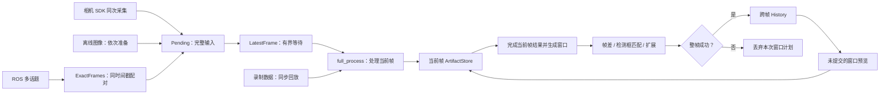
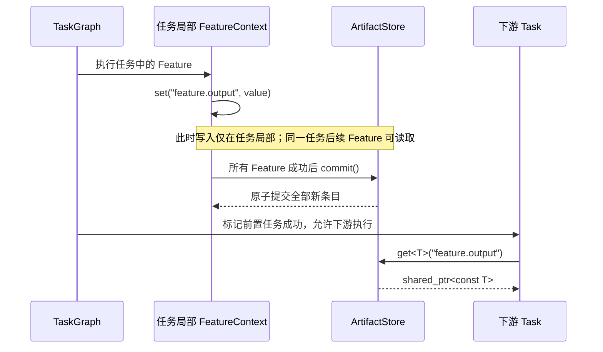

# 4. ArtifactStore 与跨帧时序：数据放在哪里，何时能读

本章对应 `scheduling/dag/include/perception/task_graph.hpp`、`scheduling/dag/src/task_graph.cpp`、`features/temporal/backend/` 和 `scheduling/pipeline/src/full_pipeline.cpp`。以下机制以当前 C++ 实现为准。

## 4.1 先区分五种容易混淆的对象

| 对象 | 保存什么 | 存活多久 | 控制入口 |
|---|---|---|---|
| ROS `ExactFrames` | 同一采集时间戳的左图、右图或 Q8、CameraInfo、可选 GDC | 等待同帧消息配齐；容量有上限 | `features/ros/config.json.queue_capacity` |
| `LatestFrame<Pending>` | 已配对、等待算法处理的一帧输入 | 一帧正在处理，最多一帧等待 | 相机/ROS 实时模式自动使用 |
| `ArtifactStore` | 一次图执行中的具名、带 C++ 类型的数据 | 本次 `TaskGraph::run()`，或调用者保留的只读快照 | C++ `put/get/set`；顺序由 `graph` 决定 |
| `History` | 多个成功采样帧的自有图像、视差、检测、mask、内参 | 跨多次 `full_process()`，受容量和预算限制 | `features/temporal/config.json`，功能开关在 `graph` |
| 磁盘结果/PLY | 保存的结果、调试图、点云、运行配置 | 文件被用户清理之前 | `visualization.json` 或 `recording.save_every_n` |

因此，`ArtifactStore` 不负责选择相机、解析输入文件，也不负责 ROS 精确同步；它也不会仅凭一个时间戳自动保存过去 N 帧。跨帧由 `History` 做，然后把窗口作为一个 artifact 交给下游功能。



## 4.2 ArtifactStore 的 key、类型和所有权

可以把它理解成“线程安全、只允许新增的有类型字典”：

```cpp
perception::runtime::ArtifactStore store;
store.put<int>("demo.count", 12);
auto value = store.get<int>("demo.count"); // shared_ptr<const int>
```

每个条目同时记录字符串 key、`std::type_index`、`shared_ptr<const void>`。读取时必须 key 和类型都一致。

- key 不存在：立即抛错，而不是返回一个假结果。
- key 存在但类型不对：立即抛 `artifact type mismatch`。
- 同一个 key 再次写入：拒绝覆盖，防止两个任务悄悄争抢同一输出。
- 返回只读共享指针：下游不能通过正常接口改写上游的数据。
- `putShared()` 允许已有自有对象共享存储；`snapshot()` 只复制条目及共享引用，按过滤条件留下安全的数据。

共享引用能保证对象的生命周期，但原始裸指针指向的相机缓存、BPU 内存不会因为装进某个结构体就自动获得所有权。因此历史帧会主动复制图像和推理结果，不能把借用指针直接留到下一次相机采集。

### 当前项目中的典型 key

| key | 类型与用途 |
|---|---|
| `full.temporal.input_window` | `r36::temporal::Window`；本帧开始时的窗口预览，包含自有历史引用 |
| `full.temporal.window` | `r36::temporal::Window`；history 功能成功补全当前帧推理/视差后的窗口 |
| `full.completed.<stage>` | `perception::FrameInfo`；产品阶段完成标记 |
| 推理引擎自己的输入、预处理、检测/分割输出 key | 由 `scheduling/inference` 的内置 Feature 建立；与本帧产品图的 Store 分开 |

产品图目前仍有很多功能通过本帧 `out` 结果对象和受约束的共享工作区交换数据，不能把它描述成“所有功能已经完全通过 ArtifactStore 解耦”。新增功能宜使用清楚的 typed artifact 接口；现有大块结果对象的进一步拆分仍是后续方向。

## 4.3 为什么功能写的是 FeatureContext，而不是直接修改 Store

每个 Task 有自己的 `FeatureContext::writes_`，作为一次事务：



任务中若某个 Feature 抛异常，就不会调用 commit。下游依赖任务被跳过，不会看到半份输出。提交时会先检查重复 key，构建完整的新状态，再交换到 Store；读者看不到只提交一部分的状态。

这里的“事务”仅覆盖 artifact 和 History 的提交。已经写出的文件、已经发布的外部消息、某个厂商算法内部状态，不会自动回滚。扩展功能应尽量先计算、后提交，在输出阶段处理外部副作用。

## 4.4 DAG 边决定“什么时候读”，key 决定“读什么”

```json
{
  "worker_threads": 2,
  "nodes": [
    {"id": "keep", "feature": "history", "depends_on": ["infer"], "enabled": true},
    {"id": "diff", "feature": "temporal_difference", "depends_on": ["keep"], "enabled": true}
  ]
}
```

上面只用于说明边的意义：完整图还必须定义 `infer` 以及启用 history 所需的所有生产者。`diff` 通过 `depends_on` 等待 `keep` 成功，再读取固定 key `full.temporal.window`。把 key 写对并不能替代依赖边；锁只保证字典内存安全，不会替你保证生产者已经执行。

JSON 中没有 `artifactstore`、`artifacts`、TTL 或“时间戳自动查历史”的用户字段。`graph` 管顺序，`features/temporal/config.json` 管历史窗口，C++ Feature 管 artifact 的 key/type。

## 4.5 时序参数怎么配置

默认 `pipeline.json` 中 `history`、`temporal_difference`、`temporal_match`、`temporal_extension` 都关闭。只改下面的参数不会自动启动时序功能。

`features/temporal/config.json`：

```json
{
  "capacity": 4,
  "frame_interval": 1,
  "max_memory_mb": 64,
  "difference_threshold": 8,
  "match_iou_threshold": 0.5,
  "match_max_detections": 256
}
```

| 参数 | 意义 | 范围与注意事项 |
|---|---|---|
| `capacity` | 最多保留几个采样帧，包括当前采样帧 | 1～32；帧差或匹配要求至少 2 |
| `frame_interval` | 每多少个成功处理的唯一采集帧采样一次 | 1～1,000,000；按帧计数，不是毫秒 |
| `max_memory_mb` | 窗口内有效载荷预算 | 1～4096 MiB；不能理解为进程 RSS 上限 |
| `difference_threshold` | Y 亮度绝对差超过该值才计为变化像素 | 0～255，使用 `>` 判断 |
| `match_iou_threshold` | 同类别框成为候选匹配的最小 IoU | 大于 0、至多 1 |
| `match_max_detections` | 每个参与帧最多检查多少个检测框 | 1～1024，超过时标记 `matching_truncated` |

数值设为 `null` 可继承 SDK 对应设置；不应通过复制第二份 `difference`、`match` 开关与图打架，是否执行由图中两个节点决定。修改配置后重新启动，当前不支持运行中热修改窗口。

### 开启历史但不做分析

启用 `history`，让它依赖所有启用的数据生产者。默认全流程图通过 `maps`、`recharge` 等依赖可以到达此前的推理、RGB、视差阶段；若精简了图，需按当前图显式补上相应生产者路径。

### 开启帧差与匹配

启用 `history`、`temporal_difference`、`temporal_match`，容量至少为 2。`temporal_match` 必须在帧差之后执行（两者同时开启时）；输出的 publish/record 还须等待所有启用的时序阶段。需要扩展回调时再启用 `temporal_extension`。

检测框匹配需要两帧真实检测结果。没有检测的图可以分析亮度帧差，但不会生成有意义的检测框关联。

## 4.6 抽帧的精确含义

`capacity=4, frame_interval=3` 时，假设输入都成功且身份唯一：

| 成功处理次序 | 1 | 2 | 3 | 4 | 5 | 6 | 7 | 8 | 9 | 10 | 11 | 12 | 13 |
|---|---|---|---|---|---|---|---|---|---|---|---|---|---|
| 加入窗口 | 是 | 否 | 否 | 是 | 否 | 否 | 是 | 否 | 否 | 是 | 否 | 否 | 是 |
| 窗口 | [1] | [1] | [1] | [1,4] | … | … | [1,4,7] | … | … | [1,4,7,10] | … | … | [4,7,10,13] |

第一帧立即采样。`ready` 仅表示当前保留帧数等于 capacity；两帧就能做差，并不需要等四帧。未采样帧继续跑本帧算法，但时序分析本次无效，不会重复比较上一对历史帧。

当 `capacity=1`，实现将实际间隔固定为 1，含义是“只保留最新帧”。这时不能做跨帧差和匹配，因此配置层会拒绝开启这两种分析。

实时输入若丢帧，采样计数针对进入算法并成功提交的唯一采集帧，不是相机驱动产生过的所有帧。只有稳定地处理每个采集帧，`frame_interval=3` 才等价于相机每三帧取一帧。假设实际处理 30 FPS，每三帧采样约 100 ms；处理只有 10 FPS 时约 300 ms。当前不提供固定毫秒间隔采样参数。

## 4.7 History 的准备、补全、提交

1. `prepare(full_frame)` 建立 Plan，引用旧窗口；如本帧应采样，复制左图和可选高清图。此时不改变已提交历史。
2. 产品图执行检测/分割、视差和其他已启用功能。
3. history Feature 调用 `complete()`，补上本帧自有视差、检测框和 mask。
4. 通过 `context.set("full.temporal.window", window)` 提交只读窗口，帧差/匹配/扩展读取它。
5. 整张图成功、必需保存工作成功后才调用 `History::commit(plan)`。失败保留旧窗口，同一帧重试不会重复抽样或增加一次序号。

当前 `full_gate` 会串行保护同步引擎调用。同一帧里的独立任务可以在 worker 线程并行，当前实现没有把多帧算法同时放进同一个引擎执行。

## 4.8 什么会清空历史

| 情况 | 行为/`reset_reason` |
|---|---|
| 相同 ID、相同时间戳、相同几何/标定 | `duplicate_ignored`；不作为新采样 |
| 时间戳倒退或非重复的时间戳不递增 | `timestamp_discontinuity`；清空旧窗口，从当前帧重新开始 |
| 图像尺寸、stride、格式或高清图是否存在变化 | `geometry_changed` |
| 内参任一数值变化 | `calibration_changed` |
| `psdk_full_reset_history()` | 显式清空，不影响已经持有的旧结果快照 |
| `psdk_full_command()` 切换/重设模式 | 清空当前引擎历史 |
| 录制基准每次测量 repeat 开始，包括预热后的首轮 | 重置历史，防止预热帧和上一轮测量污染窗口 |

相机帧号回绕本身不导致清空：时间戳仍递增就可以继续。ROS `ExactFrames` 位于 History 之前，会丢弃过时消息；这种消息可能根本进不到 `History::prepare()`，不能指望下游历史重置替代上游重连与同步策略。

当前录制 runner 保留文件顺序及 inventory 中的原始身份，但传给 SDK 的 frame_id 和 timestamp_ns 是本次回放生成的序号及 steady_clock 时间。它适合验证按帧计数的窗口、帧差、IoU；依赖真实采集时间间隔的后续时序算法，需要先补充原时间轴回放。每轮 reset 计入测量范围，complete.json 会记录 reset 次数与策略。

## 4.9 内存和所有权怎么算

一帧 640×544 的紧密 NV12/I420 为 522240 字节；一份 Q8 为 696320 字节，一份全尺寸 mono8 mask 为 348160 字节。三项约 1.49 MiB，再加检测框、可选高清图以及容器开销。

预算只统计窗口持有的图像、Q8、mask、检测数组等载荷。不统计模型权重、ORT/BPU 工作区、全部容器开销、ROS 队列以及调用者仍持有的旧结果，因此 `max_memory_mb=64` 不能保证 RSS 不超过 64 MiB。

超过容量或总载荷预算时，移除最旧采样帧，直到满足要求；`memory_limited=true` 表示本次因预算发生裁剪。若单帧本身超过预算，则报错，不能为了凑预算返回半张图。结果通过共享引用保留旧帧时，旧对象要到最后一个引用释放才真正回收；持续保存所有结果句柄仍会增长内存。

当前 History 保存左图、可选高清图、Q8、检测、mask 和内参；不保存右图、所有点云或地图。以后若做双目时序融合或跨帧点云融合，需要显式扩展历史契约和预算，不能假定这些数据已经在窗口里。

## 4.10 当前帧差和匹配实际做了什么

**帧差**比较最后两个采样帧的 Y 平面：算平均绝对亮度差、超过阈值的像素数；两帧都有同尺寸分割结果时，还统计 mask 标签变化数。它没有补偿相机运动、曝光变化或物体运动，不等同于场景变化检测模型。

**匹配**仅比较最后两个采样帧的同类别检测框：计算 IoU，按分数从高到低贪心选择一对一匹配。输出 previous/current 索引、class_id、IoU。它没有长期 track_id、卡尔曼预测、特征向量或丢失目标恢复，不能称作完整多目标跟踪。

**扩展**提供采样窗口与分析结果给可选 C 回调。回调不能重入会修改同一 SDK 的 API；回调返回失败会让本帧失败，历史不推进。

## 4.11 如何观察与验证

- ROS：`ros2 topic echo /perception_ros_so_demo/history`，查看 `count`、`sampled`、`ready`、`reset_reason`、`frames`、`difference_valid`、`matches`。
- 保存结果：查看每帧 `temporal.json`、`task_trace.json`，确认 history 和分析节点实际 succeeded。
- C API：`psdk_full_result_get_temporal_view()`；里面借用的指针在对应 result release 之前有效，不能释放后继续使用。
- 单元验证：SDK CTest 的 `r36_temporal_sampling_memory_DAG_contract` 和 `r36_temporal_public_C_ABI_ownership_contract` 涵盖抽帧、失败重试、所有权、差分、IoU、预算与结果跨引擎生命周期。

改变一个时序参数时，建议先用固定两帧或短录制验证窗口内容和分析数值，再查看耗时、RSS。这样可以区分“采样没有发生”“窗口尚无前一帧”“算法计算结果为零”和“分析功能根本没有执行”。
