# 当前代码全解：输入、调度、功能、配置与时序

本文对应 `perception-stereo-cpp-v3` 当前源码，更新于 2026-10-11。面向第一次阅读项目、修改参数以及开发新功能的同事。这里把“单侧某个功能”按“单独测试某个功能”解释；如果指双目单侧图像，只有检测/分割可以只用左图，新 Stereo 必须有同步左右图。

先记住六点：

1. `input` 选择本次的数据来源：`camera`、`ros`、`offline`、`recording`。同一个处理实例选择一路；多相机同时融合需要另外设计多实例和跨源同步。
2. `graph` 是唯一用户流程图：选择功能、依赖和 worker 数量；检测/分割内部阶段图由配置器生成。
3. `features/<功能>/config.json` 放该功能参数，根 `camera.json` 与 `visualization.json` 放公共设置。用户相对路径以主 `pipeline.json` 的目录为基准。
4. 相机内参从 SDK 获取；ROS 默认订阅相机节点发布的同帧 CameraInfo；离线/录制几何处理必须明确给出内参文件。
5. `ArtifactStore` 交换本次图执行的有类型数据，跨帧历史由 `History` 保存；时序窗口参数在 `features/temporal/config.json`。
6. 可单独运行某个功能，但必须保留它依赖的真实输入和前置功能。不能开启点云却不给视差，也不能仅修改参数文件就自动注册一个全新算法。

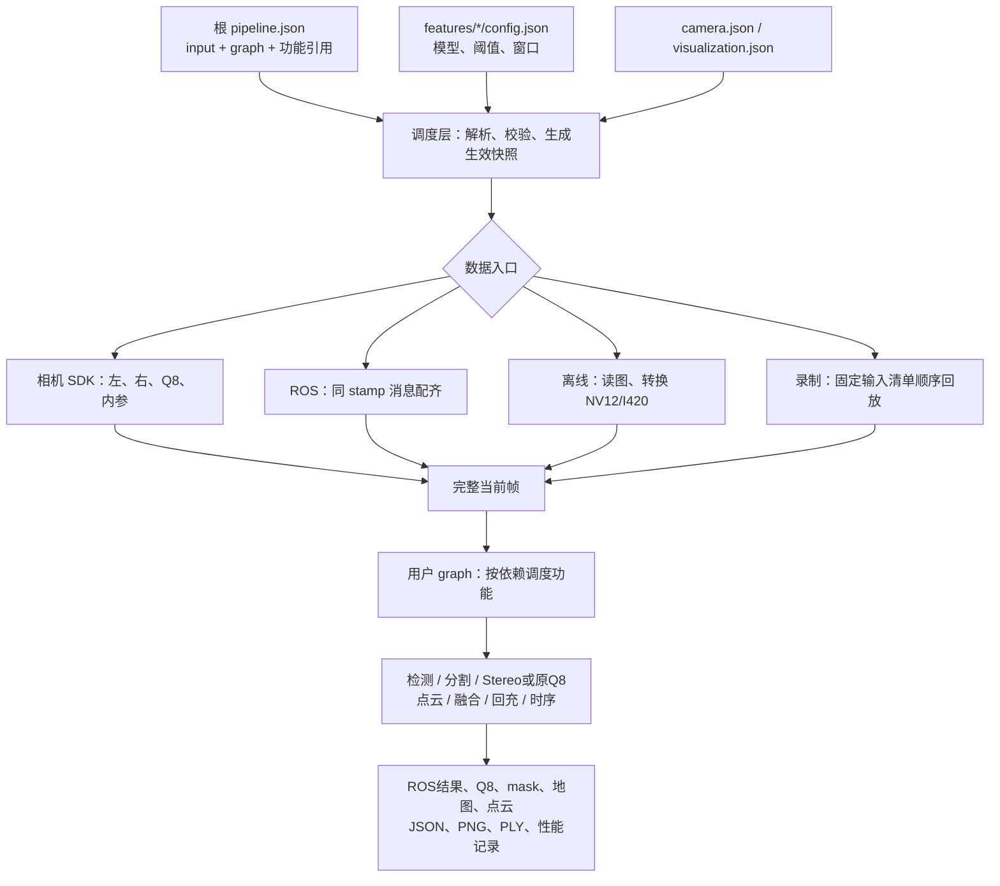

建议阅读顺序：先看输入矩阵和配置例子，再看“一帧如何调度”，随后查功能参数表；开发跨帧功能时重点阅读最后的 ArtifactStore 与 History 章节。项目中保留的旧文档/讲稿是历史资料，旧 Python 入口、三层用户 DAG 和旧标记算法不能直接套用。

分章阅读：

- [输入与配置](10_parts/01_inputs_and_config.md)：四类输入、默认图、自定义图、命令、输出与常见问题。
- [调度层](10_parts/02_scheduling.md)：启动、建图、绑定、线程、事务和执行约束。
- [功能与扩展](10_parts/03_features_and_extension.md)：参数逐项、单功能测试、新 C++ 功能接入。
- [ArtifactStore 与时序](10_parts/04_artifact_store_and_time.md)：键、类型、所有权、窗口、抽帧、重置与预算。

下面是四章的完整内容，便于离线阅读和分享。

---

## 1. 输入与配置：先知道数据从哪里来，再选择这一帧做什么

本章依据当前 C++ 配置器、ROS 输入节点、产品图验证器和录制对比器编写。文中的项目路径以项目根目录为起点；命令假设已经完成相应平台的编译安装。项目自己的启动、订阅、推理和报告程序均为 C++，示例不调用 Python。

### 1.1 先认识四个入口

| 入口 | 实际用途 | 会打开相机吗 | 会启动算法吗 |
|---|---|---|---|
| `tools/run_pipeline.sh` | 调用 `perception_config run`，按 `input.mode` 运行 | 仅 `camera` 模式打开 | 是，执行图中启用的工作 |
| `tools/run_camera_x5.sh` | 调用 `perception_config camera`，启动独立 ROS 相机发布节点 | 会 | 不会，负责采集和发布 |
| `tools/capture_stereo.sh` | 调用 `perception_config capture`，保存同次采集左右图、原始视差和标定元数据 | 会 | 不会，负责录制 |
| `tools/run_compare.sh` | 调用 `perception_config run --both`，对同一录制跑原/新视差 A/B | 不会 | 会，分别执行两种方法 |

这些脚本只是准备 ROS 环境并调用原生程序的 Bash 包装器。算法 ROS 节点是 `perception_ros_so_demo`，相机 ROS 节点是 `perception_raw_camera`。`recording` 走原生 `r36_compare`，不会启动一个叫 `recording` 的 ROS 订阅节点。

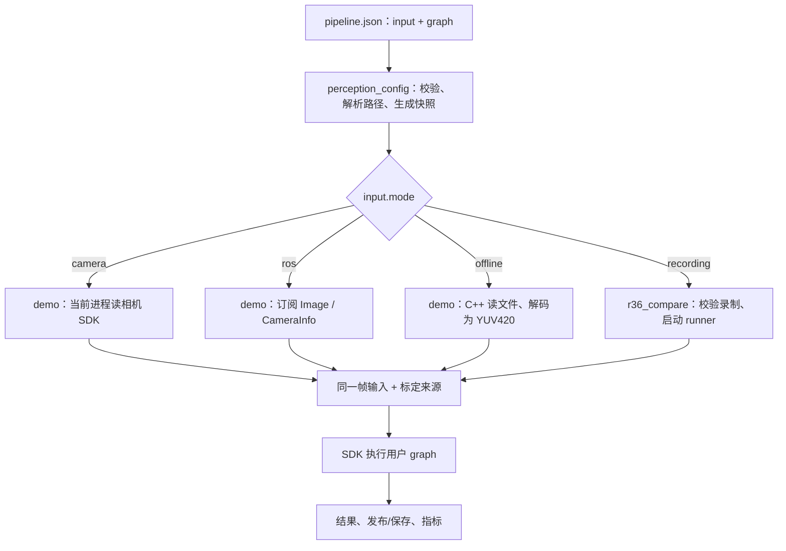

`camera` 与独立 ROS 相机节点是两种连接方式。使用 `input.mode="camera"` 时，算法进程自己打开 SDK；使用 `input.mode="ros"` 时，相机发布进程打开 SDK，算法进程只订阅。避免同时启动两个程序争用同一台相机。

### 1.2 配置文件到底在哪里

```text
项目根/
├── pipeline.json                    输入选择、功能图、SDK 位置
├── camera.json                      相机 SDK、厂商 cfg、模式和超时
├── visualization.json               发布、保存、PLY、地图显示
├── models/
│   ├── x5/                          检测、分割、Stereo 的 BIN
│   └── cpu/                         检测、分割的 ONNX
├── calibration/                     离线/回放内参文件与说明
└── features/
    ├── ros/config.json              ROS 输入话题、QoS、标定来源
    ├── offline/config.json          左右图列表、格式、速度、内参文件
    ├── stereo/config.json           Stereo 模型及模型输入尺寸
    ├── inference/config.json        bpu/cpu 后端、底层 profile
    ├── detection/config.json        检测开关、模型、阈值
    ├── segmentation/config.json     分割开关、模型、后处理
    ├── pointcloud/config.json       采样、外参、地面参数
    ├── fusion/config.json           语义与地图参数
    ├── recharge/config.json         回充配置文件及降级策略
    ├── temporal/config.json         历史窗口、抽帧、帧差和匹配参数
    └── metrics/config.json          在线指标开关、频率、JSONL
```

这里最容易弄错的是**相对路径的起点**：用户主配置和功能 JSON 内的路径，都相对主 `pipeline.json` 所在目录。它们不相对终端当前目录，也不相对功能 JSON 自己的目录。

例如，`features/detection/config.json` 中写：

```json
{
  "model": "models/x5/mmyolo0828.bin"
}
```

若主配置位于 `/userdata/perception-stereo-cpp-v3/pipeline.json`，实际读取的就是 `/userdata/perception-stereo-cpp-v3/models/x5/mmyolo0828.bin`。模型不需要 `$modelpath`、`DET_MODEL` 等环境变量。

有两处路径规则需要区分：SDK 原有的 `full.json`、模型 profile 内部路径，先相对各自原文件解析；命令行 `--run-dir`、`--output` 的相对路径，则按调用时的工作目录转绝对路径。为了便于复现，示例给输出目录使用绝对路径。

根配置可以覆盖功能配置文件的位置，例如：

```json
{
  "features": {
    "detection": "features/detection/my_test.json",
    "segmentation": "features/segmentation/disabled.test.json"
  }
}
```

未列出的功能仍读取默认 `features/<功能>/config.json`。配置器会读取所有这些功能 JSON，以及根 `camera.json`、`visualization.json`；即便某功能未启用，也应保留合法的配置文件。未使用的检测/分割/Stereo模型以及离线内参文件，则按实际功能选择决定是否要求存在。

### 1.3 配置如何生效

当前用户字段名是 **`graph`**。`pipeline.json` 顶层没有 `dag` 字段，也不能把 `graph` 写成另一个 JSON 的文件路径。运行目录中的 `inference_dag.json` 是内部生成物。

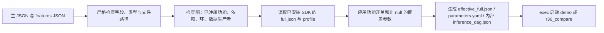

常用根字段如下。`input`、`graph` 是对象；不是所有字段都必须写，但不能用旧版字段混入 v3。

| 字段 | 含义/默认行为 |
|---|---|
| `schema_version` | 必须是 `3` |
| `input.mode` | `camera`、`ros`、`offline`、`recording`；省略该成员时为 `camera` |
| `input.disparity_source` | `original_q8` 或 `raft_stereo`；省略该成员时为 `raft_stereo` |
| `sdk.root` | SDK 安装根；默认根配置使用 `${SDK_ROOT}`，也可明确写 `install/backend_sdk` |
| `sdk.base_config` | `null` 时读取 `<sdk.root>/config/full.json`；显式路径时读取该文件 |
| `graph.worker_threads` | 工作线程数，默认 `2`，范围 `1..32` |
| `graph.nodes` | 必须给出非空节点数组，最多 64 个 |
| `features` | 可省略；按需重定向功能 JSON 文件 |
| `camera_config` | 默认 `camera.json` |
| `visualization_config` | 默认 `visualization.json` |
| `output` | 可选，覆盖可视化文件中相同名称的输出参数 |
| `recording` | 录制回放目录、内参、重复/预热/保存参数 |
| `runtime` | 可选，用 `executable` / `compare_executable` 指定实际程序路径 |

配置优先关系可理解为：**已安装 SDK 的默认参数 → 功能 JSON 的非 `null` 覆盖 → 本次由 `graph` 推导的执行开关**。根 `output` 覆盖可视化文件。`null` 仅用于允许继承的参数；它不是通用关闭开关。修改配置后需要重新启动，目前没有运行时热加载。

主文件所带的完整图是项目提供的默认流程，但解析器不会在省略 `graph` 时替你补上这一整张图。使用自定义图时要明确写 `graph.nodes`。

#### 先准备，再启动

```bash
cd /userdata/perception-stereo-cpp-v3
export ROS_SETUP=/app/humble/setup.bash
export SDK_ROOT="$PWD/install/backend_sdk"

bash tools/run_pipeline.sh --config "$PWD/pipeline.json" \
  --run-dir /userdata/stereo_results/prepare_001 --prepare-only
```

`--prepare-only` 会验证配置并生成文件，但不会打开相机、启动订阅、加载模型或测性能。它能发现路径/图/参数问题，不能证明图片能解码、模型输出正确或相机 ABI 兼容。真正运行时换一个**不存在的新目录**，去掉 `--prepare-only`：

```bash
bash tools/run_pipeline.sh --config "$PWD/pipeline.json" \
  --run-dir /userdata/stereo_results/run_001
```

本次运行目录中应优先看：

| 文件 | 能回答的问题 |
|---|---|
| `requested_pipeline.json` | 当时提交的主配置是什么 |
| `resolved_features.json` | 功能设置及每个来源文件在哪里 |
| `resolved.json` | 实际启动 argv、有效输入/视差模式、内参来源 |
| `effective_full.json` | 交给 SDK 的真实 `graph` 与功能设置 |
| `parameters.yaml` | 交给 ROS 节点的真实参数 |
| `inference_dag.json` | 内部实际启用了检测、分割中的哪几条通路 |
| `metrics.jsonl` | 在线指标；是否生成由 metrics 配置决定 |

### 1.4 四种输入：支持范围与所需数据

| 模式 | 检测/分割输入 | 原视差点云 | 新 Stereo 点云 | 标定来源 | 执行程序 |
|---|---|---|---|---|---|
| `camera` | SDK 的左图 | 同次 SDK 左图 + Q8.8 | 同次 SDK 左右图 | SDK 自动读取矫正后内参 | ROS `demo`，当前进程采集 |
| `ros` | 左目 `sensor_msgs/Image` | 左图 + `16UC1` Q8.8 | 左右目 `sensor_msgs/Image` | 默认同帧左右 `CameraInfo`，也支持确认过的内参对象 | ROS `demo`，只订阅 |
| `offline` | 一组图片/原始 YUV 文件 | 不支持从单图生成相机原 Q8.8；用 `recording` | 矫正后 640×544 左右图 | 视差/点云必须显式指定 `intrinsics_file` | ROS `demo`，从文件供帧 |
| `recording` | 从完整录制包回放左图 | 读取录制的原 Q8.8 | 读取录制左右图 | 视差/点云必须显式指定 `recording.intrinsics_file` | 原生 `r36_compare` + runner |

当前在线应用的源图几何是 **640×544**。检测模型的 864×480、分割模型的 832×480、Stereo 模型的 640×352，是各功能内部的模型输入尺寸，不是要求用户把源图或内参改成这些尺寸。

只跑检测/分割时不会要求 Stereo 模型或离线内参文件。只启用 `disparity` 时可以生成/发布视差，不必构建点云；它仍要求对应的左右图/原 Q8 与可靠标定。`recording` 使用的容器格式较严格：即使只测检测/分割，对比器仍校验录制 metadata、左右图、原 Q8.8 与 manifest；普通单图测试应选择 `offline`。

### 1.5 相机直取：SDK 自动给内参

主配置：

```json
{
  "input": {"mode": "camera", "disparity_source": "raft_stereo"}
}
```

根 `camera.json` 配置真实板端 SDK 和厂商配置文件：

```json
{
  "sdk_library": "/app/data/metoak/lib/libMoGeneralSDK.so",
  "vendor_config": "/app/data/metoak/demo/config/x5_camera.cfg",
  "disparity_mode": "auto",
  "acquire_timeout_ms": 3000,
  "retry_interval_ms": 5,
  "frame_id": "camera_optical_frame"
}
```

使用上节 `run_pipeline.sh` 命令即可。`auto` 在原 Q8.8 点云时选择 SDK 模式 `2`，新 Stereo 选择模式 `1`。算法进程采集后直接提交本进程 worker，不必先发布再订阅输入图片。

内参来自 `camera_->parameters()` 的矫正后参数。当前只接受 SDK 明确提供的 640×544 或 1280×1088 参考几何；后一种按 0.5 缩放到算法源图，`fx/fy/cx/cy/bxf` 一起匹配源分辨率。不确定的裁剪关系会拒绝，代码不会凭经验猜内参。离线配置中的内参文件不会覆盖相机 SDK 值。

相机采集运行在采集线程，算法在另一个 worker 同步处理。在线待处理槽保留最新一帧；算得慢时可替换旧的待处理帧，所以输入相机 FPS 与算法处理 FPS 不一定相等。

### 1.6 ROS 模式：必须是同一次采集，不是时间接近就行

主配置改成：

```json
{
  "input": {"mode": "ros", "disparity_source": "raft_stereo"}
}
```

`features/ros/config.json` 的默认话题如下：

| 配置字段 | 默认话题 | 何时需要 |
|---|---|---|
| `left_topic` | `/camera/rgbd_left_nv12` | 始终需要 |
| `right_topic` | `/camera/rgbd_right_nv12` | 新 Stereo 视差/点云 |
| `q8_topic` | `/camera/disparity_q8` | 原视差/点云 |
| `gdc_topic` | `/camera/gdc_left_nv12` | 回充的同次采集高分辨率左图 |
| `left_camera_info_topic` | `/stereo/left/camera_info` | 使用 `intrinsics="camera_info"` 且需要帧内参 |
| `right_camera_info_topic` | `/stereo/right/camera_info` | 同上 |

`reliability` 选 `best_effort` 或 `reliable`，`queue_capacity` 范围为 `1..16`，默认 4。只有检测/分割时，算法只订阅左图；不会为了用不到的点云等待左右 `CameraInfo`。

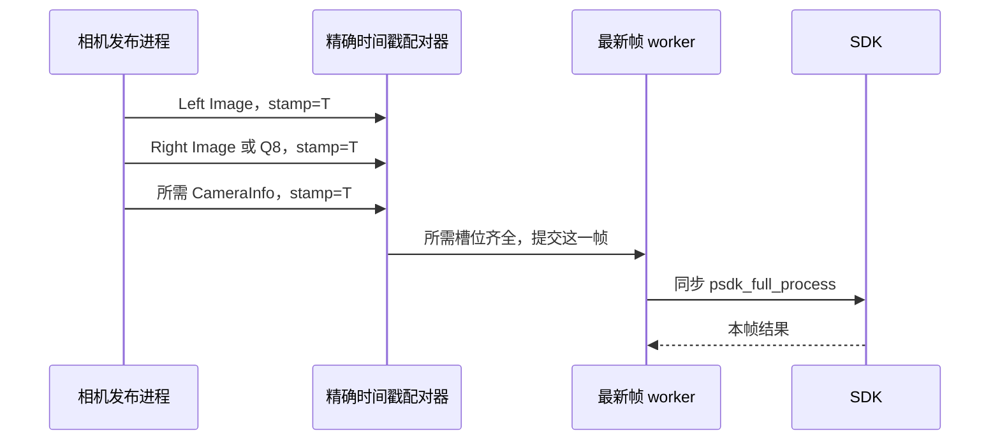

左图、右图/视差及所需 `CameraInfo` 的 `header.stamp` 必须完全相同且非零。没有 approximate-time 容差。图像编码接受 `nv12`/`NV12`、`i420`/`I420`，不直接接受 `bgr8`、JPEG 字节或 `CompressedImage`。输入左图必须是 640×544；有效步长和足够的存储长度也会检查。

原视差消息为小端 `16UC1`，像素数值是 **Q8.8 视差**，不是深度毫米，也不是 float 视差；其 frame_id 必须与左图一致。右图和左右 `CameraInfo` 的 optical frame_id 应明确对应。默认内参从矫正后投影矩阵 `P` 读取，要求标准水平双目及相同主点/焦距；右目 `P[3]` 给出基线，转换后 `bxf=-P_right[3]×1000`，单位为 px·mm。

使用本项目相机发布器时，可这样开两个终端。新 Stereo 使用 `--mode infer` 已可得到左右图和内参；原 Q8.8 使用 `--mode map`。需要同时发布回充高分辨率图时才使用 `both`。

```bash
## 终端一：相机发布器
cd /userdata/perception-stereo-cpp-v3
export ROS_SETUP=/app/humble/setup.bash
export SDK_ROOT="$PWD/install/backend_sdk"
export ROS_DOMAIN_ID=23
bash tools/run_camera_x5.sh --config "$PWD/pipeline.json" --mode infer
```

```bash
## 终端二：相同 ROS 环境、DDS 域；pipeline.json 的 input.mode=ros
cd /userdata/perception-stereo-cpp-v3
export ROS_SETUP=/app/humble/setup.bash
export SDK_ROOT="$PWD/install/backend_sdk"
export ROS_DOMAIN_ID=23
bash tools/run_pipeline.sh --config "$PWD/pipeline.json" \
  --run-dir /userdata/stereo_results/ros_stereo_001
```

本项目相机发布器会把同一次 SDK 采集的图片和 `CameraInfo` 填相同时间戳。使用外部 ROS 相机时，需由上游完成相同的格式、矫正、几何和时间戳约定，不能仅修改话题名就认为适配完成。

只有回充且回充配置选择 `intrinsics_source="sdk_scaled"` 时，也需要 `CameraInfo` 或经确认的显式内参；回充默认 `dataset` 标定使用回充功能自己的数据集参数。回充高分辨率输入默认 `/camera/gdc_left_nv12`，为同次采集的 1280×1088 NV12；可在 ROS 功能配置中设置 `gdc_topic`。

### 1.7 离线图片：格式转换与标定要求分开看

主配置使用 `input.mode="offline"`。`features/offline/config.json` 接受：

| 字段 | 说明 |
|---|---|
| `left_files` | 非空左图文件数组，按数组顺序回放 |
| `right_files` | Stereo 时与左图一一对应；仅检测/分割可为空 |
| `format` | 送入算法的内存布局：`nv12` 或 `i420`，只能选一个 |
| `fps` | 供帧频率，默认 2；不是承诺达到的算法吞吐量 |
| `loop` | 结束后是否循环 |
| `max_frames` | 0 表示不另设数量上限 |
| `wait_for_subscribers` | 开启后等待配置的输出订阅者；无订阅者可能一直等待 |
| `intrinsics_file` | 视差/点云必填，检测/分割可 `null` |
| `rectified` / `calibration_confirmed` | 是否已矫正、是否确认真实标定；声明不执行矫正 |
| `frame_id` | 输出相机坐标系名称 |

#### 单目检测/分割

```json
{
  "left_files": ["data/pics/000001.png", "data/pics/000002.png"],
  "right_files": [],
  "format": "nv12",
  "fps": 2,
  "loop": false,
  "max_frames": 0,
  "wait_for_subscribers": false,
  "intrinsics_file": null,
  "rectified": false,
  "calibration_confirmed": false,
  "frame_id": "camera_optical_frame"
}
```

C++ 解码器支持 JPG/JPEG、PNG、BMP、PPM/PNM/PGM，以及原始 `.nv12`、`.i420`、`.yuv`。普通编码图片会转成 RGB，再准备为 640×544 YUV420。当前 JSON 前端固定使用 `stretch` 缩放，不提供 `offline.resize` 或 `offline_path` 字段；底层节点有这些直接 ROS 参数不代表它们也是主 JSON 的合法字段。

所以，PNG 文件配 `format="nv12"` 是正常用法：PNG 是文件编码，NV12 是解码后内存布局。原始 YUV 则不解码、不转换布局、不猜尺寸，必须紧密排列为 640×544，共 **522240 字节**。`.nv12` 配 `i420` 会报冲突；`"nv12/i420"` 也不是合法值。

#### 双目 Stereo 点云

改成成对数据并指定真实内参：

```json
{
  "left_files": ["data/left/000001.png"],
  "right_files": ["data/right/000001.png"],
  "format": "nv12",
  "fps": 2,
  "intrinsics_file": "calibration/intrinsics.json",
  "rectified": true,
  "calibration_confirmed": true,
  "frame_id": "camera_optical_frame"
}
```

主配置同时选择 `raft_stereo` 并启用视差或点云图。**原始左右图片本身必须已经是矫正后的 640×544**。运行时会检查解码前尺寸，拒绝把其他尺寸的双目图自动拉伸后沿用这套内参；单目检测允许缩放，不代表双目几何同样允许。

内参文件包含 `width,height,fx,fy,cx,cy,bxf` 七字段，也可直接引用实际录制 `metadata.json` 的 `intrinsics` 对象。填写模板在 `calibration/intrinsics.example.json`，其中待填值不能直接用于真实点云。尺寸必须匹配源图，`fx/fy/bxf` 为正有限数，主点在图内；`bxf=焦距像素×基线毫米`。当前代码不会根据一对普通图片自动标定或矫正。

`features/stereo/config.json` 当前模型设置为 640×352、`image_transform="resize"`。这一步仅为模型推理准备输入，输出恢复到源图，视差按横向缩放比例修正。源图内参仍是 640×544，不能改成 640×352。

离线供帧采用背压：待处理槽未空时暂缓读取下一文件。文件列表耗尽后节点继续运行，终端提示 finished，直到 Ctrl+C；它不会像批处理工具一样自动退出。离线回充不支持，因为该入口没有同次采集的高分辨率 GDC 图。

### 1.8 recording：用于相同数据的 A/B 和版本回归

先关闭其他相机所有者，录制完整数据：

```bash
bash tools/capture_stereo.sh --config "$PWD/pipeline.json" \
  --output "$PWD/data/capture_001" --frames 100
```

录制包主要结构：

```text
data/capture_001/
├── metadata.json             SDK 标定、来源等元数据
├── manifest.jsonl            每帧身份、时间戳、尺寸、三个文件路径
└── 由 manifest 指向的左右 NV12 和原始 Q8.8 文件
```

录制器保留同次采集的左图、右图、Q8.8；对比器检查帧 ID 唯一、时间戳严格递增、文件不越出录制目录、尺寸及字节数一致。新方法也要求完整原始录制，保证与原方法比较时输入身份可追溯。

主配置相应部分：

```json
{
  "input": {"mode": "recording", "disparity_source": "raft_stereo"},
  "recording": {
    "directory": "data/capture_001",
    "intrinsics_file": "data/capture_001/metadata.json",
    "limit": 100,
    "warmup_frames": 5,
    "repeat": 3,
    "save_every_n": 1,
    "viewer_max_points": 20000,
    "order": "original,stereo"
  }
}
```

单方法运行用 `run_pipeline.sh`；两种方法都跑用：

```bash
bash tools/run_compare.sh --config "$PWD/pipeline.json" \
  --run-dir /userdata/stereo_results/ab_001
```

`--both` 需要 `recording + raft_stereo`，且启用 `cloud` 或独立 `disparity`，否则配置器会拒绝。对比器同目录的默认 `r36_compare_runner` 可以用 `recording.runner` 覆盖。`recording.save_every_n` 独立控制逐帧保存，不靠在线 `visualization.save_root`；0 可关闭逐帧保存以减少性能测试中的磁盘开销。

`recording` 用于检测/分割、原/新视差、点云、地图和时序基准。对比器保留请求的 history 设置和原自动标定开关；启用 history 时，runner 在预热之后、每个正式 repeat 开始前清空历史，避免上次 pass 的末尾污染下次开头；同一个 pass 内按顺序累积。`complete.json` 记录重置次数。回充仍不支持，因为录制包和 runner 没有同次采集的高分辨率 GDC 输入，主配置会明确拒绝此组合。

还需区分“顺序回放”与“原时间轴回放”：录制身份保留在 manifest、inventory 和文件 stem 中；runner 提交 SDK 的帧号是本次递增编号，时间戳来自本次单调时钟。当前不会按原采集时间间隔定时重放，依赖真实时间间隔的扩展应先补这项能力，再进行等价性比较。

结果在 `<run-dir>/comparison/`，包括 `summary.json/csv`、`report_zh.md`、`index.html`、逐帧日志和 PLY。CPU、RSS、FPS 是执行该回放进程的测量，原始相机硬件产生 Q8.8 的耗时不在原方法回放 FPS 中。

### 1.9 自定义 graph：可以单测功能，但必须保留真实前置数据

根 `pipeline.json` 默认启用 inference、disparity、rgb、cloud、labels、transform、ground、maps、publish；默认关闭 calibration、recharge、history、temporal_difference、temporal_match、temporal_extension、record。关闭自动标定和时序不等于这些功能不存在，需明确启用节点并提供参数。

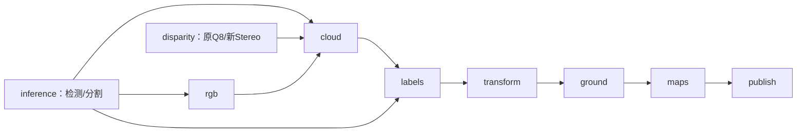

图中省略了默认关闭的节点及部分传递依赖。默认图以地图融合为目标；想知道检测本身有多快，应换为下面的单测图，不能只看完整图的总 FPS。

每个节点只接受 `id`、`feature`、`depends_on`、`enabled` 和说明用 `_help`：

```json
{"id": "my_cloud", "feature": "cloud", "depends_on": ["rgb", "disp"], "enabled": true}
```

`id` 是本图节点名，依赖引用的是 `id`。`feature` 是已注册 C++ 功能名，不能任意起一个新算法名。同一功能每帧最多出现一次，即使一个同名功能被禁用，也不能重复注册。节点 `enabled` 缺省为 true，`depends_on` 缺省为空数组。

常用依赖规则：

| 需要测试的阶段 | 必要前置关系 |
|---|---|
| `inference` | 图内无前置；内部按 detection/segmentation.enabled 运行 |
| `disparity` | 可以独立启用；实际左右图/原Q8由输入适配器提供 |
| `cloud` | 必须有 `rgb` 和 `disparity` 祖先；同时启用 inference 时也要等待它 |
| `calibration` | 必须在 cloud 之后 |
| `labels` | cloud 和 inference 都必须存在并在前面 |
| `transform` | 必须在 cloud 之后 |
| `ground` | 必须在 transform 之后 |
| `maps` | 必须在 ground 之后 |
| `publish` / `record` | 必须通过直接或传递依赖等待所有已启用的生产阶段 |

点云工作区复用同一份帧数据，所选的 `cloud → calibration → labels → transform → ground → maps` 阶段必须按顺序。可选阶段可以省略，但不能把需要同一工作区的阶段随意并行。

可以删除不需要的节点，也可以设置 `enabled=false`。禁用节点会沿原依赖向前展开，保留启用祖先的依赖关系；但不会替你制造缺失的数据。例如关掉 inference 后仍保留 labels，依然会因为缺少语义结果被拒绝。设置 8 个线程也不能修复错误依赖。

#### A. 检测或分割单测

使用以下完整最小主配置，放在项目根，例如 `pipeline.det_only.json`：

```json
{
  "schema_version": 3,
  "input": {"mode": "offline", "disparity_source": "original_q8"},
  "sdk": {"root": "install/backend_sdk", "base_config": null},
  "graph": {
    "worker_threads": 2,
    "nodes": [
      {"id": "ai", "feature": "inference"},
      {"id": "out", "feature": "publish", "depends_on": ["ai"]}
    ]
  }
}
```

此图没有点云和视差节点，因此即使把 `disparity_source` 写成 `raft_stereo`，也不会加载或运行 Stereo。为便于理解示例明确使用 `original_q8`，但它不要求离线提供 Q8。

配好离线左图列表，再选择开关：

| 单测目标 | detection.enabled | segmentation.enabled | 预期 |
|---|---|---|---|
| 只检测 | true | false | 有检测框；分割通路耗时为 0，不加载分割模型 |
| 只分割 | false | true | 有 mask；检测通路耗时为 0，不加载检测模型 |
| 检测+分割 | true | true | 运行两条内部通路 |
| 两者都关 | false | false | inference 节点仍启用时，配置器拒绝 |

为避免每次改生产配置，可复制检测/分割 JSON 成独立测试文件，通过主配置的 `features` 重定向。文件路径保持相对主配置；阈值和模型字段仍由原功能配置定义。`detection` 和 `segmentation` 不是可直接填入此产品图的 feature 名，产品图用一个 `inference` 封装两者。

```bash
bash tools/run_pipeline.sh --config "$PWD/pipeline.det_only.json" \
  --run-dir /userdata/stereo_results/det_only_001
ros2 topic echo /perception_ros_so_demo/result --once --full-length
```

订阅命令在另一终端执行。有限离线数据建议先开订阅者，或先明确配置 `wait_for_subscribers`；若启用等待且 `publish_mask=true`，还需要 mask 订阅者，单开 result 订阅未必开始。

#### B. x86/WSL 的 ONNX 检测/分割单测

先编译有 ONNX Runtime 的 CPU SDK 和 ROS 节点。在 `features/inference/config.json` 设置：

```json
{
  "backend": "cpu",
  "original_profile": null,
  "cpu_profile": "features/inference/cpu_profile.json"
}
```

检测功能的 model 改为 `models/cpu/case2_20260821_V2.1_epoch_160_dy.onnx`，分割改为 `models/cpu/train_20260924_3class_aug_flagstone.onnx`；再按上表只启用所测通路。只写 `backend=cpu` 不会把 BIN 转成 ONNX，也不会为已有 SDK 补编 ORT。

在 WSL 的项目根使用相同脚本，把 `ROS_SETUP` 设为 `/opt/ros/humble/setup.bash`，并使用实际的 CPU SDK/应用安装路径及新的 Linux 输出目录。当前检测/分割可在 x86 CPU 运行；当前新 Stereo runner 依赖地平线 BPU，未提供 ONNX Stereo CPU 后端，因此不要在 x86 上直接跑默认的完整 `camera + raft_stereo` 图。

#### C. 只测原视差转点云

主图改为：

```json
{
  "graph": {
    "worker_threads": 2,
    "nodes": [
      {"id": "disp", "feature": "disparity"},
      {"id": "rgb", "feature": "rgb"},
      {"id": "cloud", "feature": "cloud", "depends_on": ["rgb", "disp"]},
      {"id": "out", "feature": "publish", "depends_on": ["cloud"]}
    ]
  }
}
```

使用 `camera/ros/recording + original_q8`。没有 inference、labels、ground、maps，因此不会跑检测、分割、语义融合、地面分离和地图；当前应看到相机坐标点云，map_count 为 0。原视差录制回放可在 CPU SDK 上测试，这不等于在 CPU 上运行了新的 Stereo 模型。

如果要保存在线点云，在上图末尾加 `record` 节点，依赖 `out`，并在 `visualization.json` 设置非空 `save_root`、`save_every_n>0`、`save_ply=true`。若要得到机器人坐标或地面/障碍物点云，继续加入 transform、ground 等阶段及对应依赖。

同一图改用 `raft_stereo` 可以测试新视差生成的点云，需真实双目输入、对应内参和支持 BPU 的目标；offline 新方法必须满足上节的成对源图要求。

#### D. 只测视差，不生成点云

```json
{
  "graph": {
    "worker_threads": 1,
    "nodes": [
      {"id": "disp", "feature": "disparity"},
      {"id": "out", "feature": "publish", "depends_on": ["disp"]}
    ]
  }
}
```

可选择原 Q8 或新 Stereo。此图没有检测/分割、RGB转换、点云、地面、地图；新 Stereo 仍读取同帧左右图并运行真实模型。`visualization.publish_disparity=true` 时，算法话题 `/perception_ros_so_demo/disparity_q8` 发布 `sensor_msgs/Image` 的 `16UC1` Q8.8，除以 256 才是像素视差。result 中应为 `has_disparity=true`、`has_inference=false`、`map_count=0`。

启用 record 并满足保存条件后，可得到 `disparity_q8.u16` 和 `disparity.png`；未生成 cloud，不会有 PLY。这与“新模型生成视差后再做点云”的全链路是两个不同测试范围。

#### E. 单测时序分析

下面是检测/分割结果与左图历史上的帧差/检测框关联图，不依赖点云：

```json
{
  "graph": {
    "worker_threads": 2,
    "nodes": [
      {"id": "ai", "feature": "inference"},
      {"id": "history", "feature": "history", "depends_on": ["ai"]},
      {"id": "difference", "feature": "temporal_difference", "depends_on": ["history"]},
      {"id": "match", "feature": "temporal_match", "depends_on": ["history", "difference"]},
      {"id": "out", "feature": "publish", "depends_on": ["match"]}
    ]
  }
}
```

在 `features/temporal/config.json` 设置 `capacity>=2`、`frame_interval=1` 等。帧差基于 Y 亮度；检测匹配需启用 detection，按同类别框的 IoU 做一对一关联，不是视觉里程计、跨相机匹配或深度预测。第一帧没有前一帧，因此不能把第一帧尚无差分/匹配视为故障。若图同时启用 rgb、disparity、maps、recharge 等，history 必须通过依赖等待这些当前帧生产者。

录制时序 benchmark 每次正式 repeat 从空历史开始。比两版正确性时，也应从相同的空状态开始、用相同顺序的完整帧序列，不能只抽出中间一帧作为等价测试。

#### F. 单测回充

在线 `camera` 或 `ros` 可以使用 `recharge → publish` 的最小图，并在 `features/recharge/config.json` 指向真实回充参数 JSON。ROS 相机发布器使用 `--mode recharge`；算法仍由主图决定回充执行，不能把发布器的 `--mode` 当算法图开关。回充需要对应高分辨率 GDC 和正确标定，`offline`/`recording` 当前明确拒绝。启用 `allow_source_fallback` 才允许内部退到低分辨率左图，但本项目在线输入仍按回充输入契约采集/等待高分辨率图，不应把该内部开关当作通用缺图适配。

### 1.10 怎样知道真的只运行了这个功能

按三步检查：

1. `--prepare-only` 后看 `effective_full.json.graph` 和 `inference_dag.json`，确认没有意外保留的功能/模型通路。
2. 实际运行查看 result、metrics 或回放逐帧 JSONL：禁用模型通路耗时应为 0，单测点云的 `has_inference=false`、`map_count=0`。
3. 用同一录制数据、模型、阈值、内参、采样和外参，检查新旧版本的检测/分割/地图/PLY。不要把改变功能组合造成的速度差解释成代码优化。

当前可追溯验证包括：[当前功能与配置验证](../validation/evidence/v3_guide_validation.json)、`v3_final_validation.json` 的检测/分割/点云/RGB 单测，以及 `v3_intrinsics_file_validation.json` 的内参路径与 ROS 输入检查。

[实际 CPU 回放验证](../validation/evidence/v3_guide_replays_validation.json) 使用 WSL Ubuntu 22.04、真实 ONNX 检测/分割和两帧录制数据，从 `/tmp` 启动：默认链与此前基线的检测一致，26 个 mask/地图/视差等字节产物完全一致，10 个 PLY 的 XYZ 与 RGB 完全一致。启用时序后保留预热 1 帧、正式重复 2 次，窗口长度为 `1/2/1/2`，差分与检测匹配有效标志均为 `false/true/false/true`，正式重复前共清空历史 2 次。第二帧两个 repeat 的平均亮度差相同。这里 `matching_valid=true` 表示已有可比较的两帧检测结果，不保证一定存在匹配框。

独立原 Q8 视差图也实际回放了两帧：`has_disparity=true`、`has_inference=false`、`map_count=0`，没有 PLY；保存的两份 696320 字节 Q8 与录制原文件 SHA256 相同。时序回归曾发现“extension 禁用时保存的分析 JSON 未刷新”，已修复并通过这次实际回放验证，说明除检查任务成功外，还应检查输出内容。

相机 SDK 来源另有确定性 ABI mock 验证，未宣称实物 X5 相机已在本环境测试。上述录制注明 `validation_only`，用于代码一致性；它不是原相机精度基线，不能用来得出 Stereo 精度或 X5 性能排名。

相关源码入口：

| 要读的逻辑 | 文件 |
|---|---|
| 主配置、路径解析、参数生成、运行选择 | `scheduling/config/src/native_pipeline.cpp` |
| 功能配置字段、开关、覆盖规则、相机设置 | `scheduling/config/src/native_features.cpp` |
| 内参文件共享校验 | `scheduling/config/include/intrinsics_file.hpp` |
| 图节点与数据依赖验证 | `scheduling/dag/include/product_graph.hpp` |
| 原生命令行入口 | `scheduling/launch/src/perception_config.cpp` |
| ROS 节点初始化、订阅选择、相机内参 | `features/ros/src/perception_node.cpp` |
| 文件读取、采集、精确时间戳配对 | `features/ros/src/node_input.cpp` |
| YUV 消息检查 | `features/ros/src/image_messages.cpp` |
| 离线解码与 YUV420 转换 | `features/offline/src/offline_image.cpp` |
| 录制包完整性检查与对比启动 | `compare/native/src/orchestrator.cpp` |

### 1.11 常见现象如何定位

| 现象 | 首先检查 |
|---|---|
| 启动报 unknown field: dag | 用户字段应为 graph；旧 DAG 在 archive，不是当前入口 |
| 模型找不到 | resolved 中实际路径、主 JSON 所在目录、模型是否属于当前后端 |
| `received_images=0` | 算法进程是否仍存在；input是否ros；话题发布/订阅、ROS_DOMAIN_ID、RMW、QoS |
| 收到图但 `paired_frames=0` | 所需左右/视差/CameraInfo 是否同一个非零 stamp；是否缺一路 |
| 已配对但没有成功结果 | 编码、640×544几何、Q8语义、标定、模型及错误话题 |
| PNG 配 nv12 是否错误 | 正常；format表示解码后的内存布局 |
| raw input exactly 522240 bytes | 原始YUV必须紧密640×544；不能把其他尺寸/带padding的文件直接作为紧密原始文件 |
| offline 点云找不到内参 | 明确填 intrinsics_file；不能用默认数值或只声明 confirmed=true |
| offline 一直 waiting | 开了 wait_for_subscribers，但配置要求的输出订阅者未齐 |
| offline finished 后进程还在 | 设计如此；数据已结束，节点保留到 Ctrl+C |
| 只有相机节点，没有算法订阅者 | 第二终端算法可能未启动或提前退出；查看配置错误和节点列表 |
| 在线没有 PLY | record节点、save_root、save_every_n、save_ply须同时满足；空根不保存 |

常用检查命令：

```bash
ros2 node list
ros2 topic info /camera/rgbd_left_nv12 --verbose
ros2 topic info /camera/rgbd_right_nv12 --verbose
ros2 topic echo /perception_ros_so_demo/errors --once
ros2 topic echo /perception_ros_so_demo/metrics --once --full-length
```

输入问题应先验证“帧从哪里来、哪些槽位必须齐、身份与几何是否一致”，再看算法参数。把这几个边界确认清楚，单功能测试和完整流程测试才能使用同一套可信数据。

---

## 调度层：从 JSON 到一帧结果

本章对应当前 `perception-stereo-cpp-v3` 源码。调度层负责把配置转成可执行计划、建立功能依赖、管理每帧执行与错误；具体检测、分割、Stereo、点云算法在 `features/`。理解时先跟随一条实际调用链，再看底层通用调度器，避免被兼容入口和历史命名绕进去。

### 1. 目录按什么职责划分

| 目录 | 当前职责 | 先读的文件与函数 |
|---|---|---|
| `scheduling/launch/` | 命令行入口，选择运行、相机发布、录制，调用配置器及启动器 | [perception_config.cpp](../scheduling/launch/src/perception_config.cpp)：`configurationMain()` |
| `scheduling/config/` | 读取根配置和功能配置，校验参数，生成本次 SDK、ROS、推理配置 | [native_pipeline.cpp](../scheduling/config/src/native_pipeline.cpp)：`v3::prepare()`；[native_features.cpp](../scheduling/config/src/native_features.cpp)：`loadFeatures()`、`applyFeatures()`、`generatedInferenceDag()` |
| `scheduling/dag/` | 产品功能登记、依赖规则、图绑定和通用线程池调度器 | [product_graph.hpp](../scheduling/dag/include/product_graph.hpp)：`parseProductGraph()`；[full_graph.cpp](../scheduling/dag/src/full_graph.cpp)：`Graph::runContext()`；[task_graph.cpp](../scheduling/dag/src/task_graph.cpp)：`TaskGraph::run()` |
| `scheduling/pipeline/` | 完整 SDK 的每帧上下文、算法绑定、生命周期、结果 | [full_pipeline.cpp](../scheduling/pipeline/src/full_pipeline.cpp)：`impl_psdk_full_create()`、`impl_psdk_full_process()` |
| `scheduling/inference/` | 检测/分割内部预处理、模型执行、后处理的调度适配 | [inference_session.cpp](../scheduling/inference/src/inference_session.cpp)：`createEngine()`、`impl_psdk_process()`；[dag_pipeline.cpp](../scheduling/inference/src/dag_pipeline.cpp)：`registerExact()`、`r25::Pipeline::run()` |
| `scheduling/runtime/` | 通用运行接口、模型分阶段执行和资源生命周期 | [runtime_engine.hpp](../scheduling/runtime/include/perception/runtime_engine.hpp)、[staged_inference.cpp](../scheduling/runtime/src/staged_inference.cpp)、[native_stages.hpp](../scheduling/runtime/include/native_stages.hpp) |
| `scheduling/product/` | 保留原产品流程、控制和身份校验的兼容实现 | [product_dag.cpp](../scheduling/product/src/product_dag.cpp)、[command_contract.hpp](../scheduling/product/include/product/command_contract.hpp) |

有一处源码位置容易误读：`perception::runtime::Engine` 的实现主要在 [pipeline/builtin/runtime_features.cpp](../scheduling/pipeline/builtin/runtime_features.cpp)，`runtime/src/engine.cpp` 中则是更外侧的 `perception::PerceptionEngine` 包装及普通检测/分割接口。两者类名相似，阅读时结合命名空间和实际调用者判断。

### 2. 程序启动时做了哪些事

入口 `perception_config run --config pipeline.json --run-dir 新目录` 调用 `v3::prepare()`。配置器不打开相机、不加载权重、不运行模型；它检查文件、参数和依赖，生成本次生效文件，然后启动真正处理数据的程序。

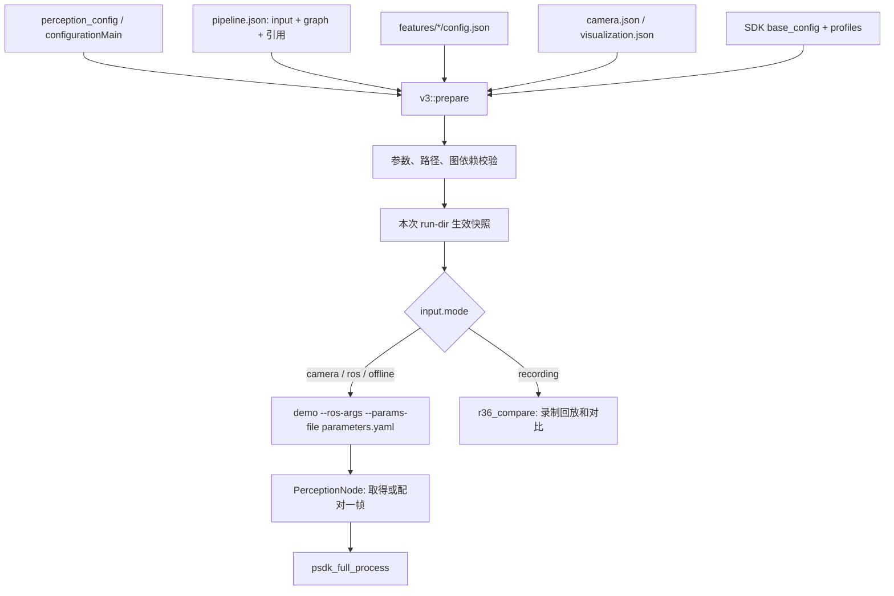

主要生成文件如下。用户通常修改源配置，不应把本次生成文件当作新的长期配置入口。

| 文件 | 用途 |
|---|---|
| `requested_pipeline.json` | 保留用户主配置，说明本次请求是什么 |
| `resolved_features.json` | 合并后的各功能设置和源文件位置 |
| `resolved.json` | 输入模式、生效参数、启动参数、内参来源等说明 |
| `effective_full.json` | SDK 实际加载的完整配置，包含产品 `graph` |
| `parameters.yaml` | `demo` 的 ROS 参数：输入、topic、模型、保存和发布等 |
| `inference_dag.json` | C++ 根据检测/分割开关生成的内部推理计划 |
| `original_start.json` | 原点云/融合实现需要的兼容配置，已应用功能参数覆盖 |
| `inference_original.cfg`、`inference_cpu.json` | 需要覆盖原 profile 时生成，具体出现哪些文件取决于配置 |

`--prepare-only` 只执行这些准备步骤。它能证明配置通过检查，不能证明模型可加载、相机可打开、ROS 已收到数据或算法结果正确。配置器要求新的输出目录，防止不同次运行的生效文件混在一起。

用户 JSON 中的相对文件路径以主 `pipeline.json` 所在目录为基准；SDK 原配置/profile 内的路径先按其原文件所在目录解析。启动器 [native_json.cpp](../scheduling/config/src/native_json.cpp) 的 `launch()` 在 Linux/WSL 使用参数数组和 `execv()`，没有经过 shell 拼接命令。修改配置后需要重新启动，当前没有配置热加载。

### 3. 一帧数据的真实调用链

在线/普通离线路径从 [node_process.cpp](../features/ros/src/node_process.cpp) 的 `PerceptionNode::processFrame()` 进入：

```text
PerceptionNode::processFrame(Pending)
  → 构造 psdk_full_frame，检查图像/时间戳/视差/内参
  → Caller::process()                         features/sdk_bridge/src/sdk_caller.cpp
  → psdk_full_process()                      sdk 的公开 C ABI
  → impl_psdk_full_process()                 scheduling/pipeline/src/full_pipeline.cpp
  → 为本帧建立 work/contextual 函数绑定
  → Graph::runContext()                      scheduling/dag/src/full_graph.cpp
  → TaskGraph::run()                         scheduling/dag/src/task_graph.cpp
  → 已选择的产品功能调用 features 中的实现
  → 返回 psdk_full_result
  → result_get_view → ROS 发布/应用保存/指标 → Result 析构释放
```

`full_pipeline.cpp` 为本帧创建的函数绑定，是把“产品图节点”连到“真实算法”上的位置。例如：

| 产品 stage key | 对应的本帧操作 |
|---|---|
| `dnn` | `psdk_process()`，得到检测、分割和各阶段耗时 |
| `disparity` | 校验并复制相机 Q8.8，或调用 `disparity_provider` 获取新 Stereo 视差 |
| `rgb` | 将输入 YUV 转为 RGB，供颜色/显示及点云使用 |
| `cloud` | 组装 `MappingFrame`，`beginFrame()` 后调用 `MappingPipeline::cloud()` |
| `calibration / labels / transform / ground / maps` | 同一个点云/融合对象上的分阶段方法 |
| `recharge` | `runRecharge()`，处理同帧回充图并填入位姿结果 |
| `history` | 完成本帧历史窗口快照，发布时序 Artifact |
| `temporal_difference / temporal_match` | 对已完成窗口执行差异/匹配 |
| `temporal_extension` | 汇总时序结果，必要时调用用户注册的时序回调 |
| `publish / record` | SDK 自身存在对应 hook 或保存条件时执行；应用 ROS 输出另有边界 |

本次选择哪些功能决定 SDK 的初始化：`inference` 关闭就不创建推理引擎，`cloud` 关闭就不创建映射对象，`recharge` 关闭就不创建回充对象。实际能否使用某种后端，还取决于编译时是否启用了 BPU、ONNX Runtime、Mapping、Recharge，JSON 不能补出未编译的能力。

节点的 `mapping_enabled`、`disparity_enabled` 分别来自 `graph.cloud`、`graph.disparity`，不再用 `mode=both` 推断一定要点云/Q8.8。推理与回充同时开启但关闭点云时，配置器选择 `both`/SDK 命令 `3`，并保持两个几何开关为 `false`；此时处理左图和同帧高清回充图，不要求无关的视差输入。

### 4. 一份用户 Graph，内部为何还能看到图

日常入口只有主配置的 `graph.nodes`。其中 `inference` 是完整的检测/分割功能；其内部仍有预处理、推理、后处理等实现步骤。C++ 自动生成内部计划，使这些步骤继续复用同一个通用调度框架。

当前 `generatedInferenceDag()` 生成的是以下结构：**一个 input Task，加一个 detection Task 和/或 segmentation Task**。每个模型 Task 内顺序执行三个 Feature；并不是六个独立模型 Task。

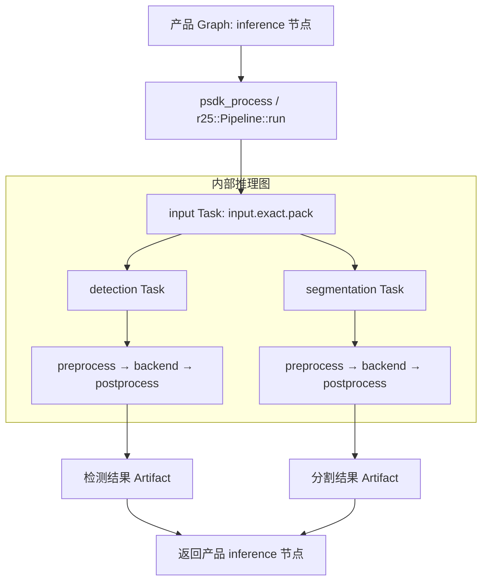

检测和分割是否加入内部图，取决于 `features/detection/config.json`、`features/segmentation/config.json` 的 `enabled`。产品 `inference` 开启但两个模型功能都关闭会被配置器拒绝。内部图不重复安排 `stereo.demand`；当前新 Stereo 属于产品 `disparity` 节点，避免同一帧跑两次视差。

`schema_version=3` 是主 `pipeline.json` 的版本；自动生成内部文件中的 `config_version=3` 是通用推理图的格式版本。名称相近，但不是要求用户维护两份流程。

### 5. `id`、`feature`、`depends_on` 分别是什么

以下图可以执行，自定义名称没有被硬编码成算法类型：

```json
{
  "worker_threads": 2,
  "nodes": [
    {"id": "my_ai", "feature": "inference"},
    {"id": "send_result", "feature": "publish", "depends_on": ["my_ai"]}
  ]
}
```

- `id` 是本图内唯一的节点名字，用在依赖和 trace 中；`depends_on` 中填写这些 ID。
- `feature` 是已经编译注册的功能类型，如 `inference`、`cloud`、`ground`。
- `enabled` 默认为 `true`，决定选择该功能。
- `worker_threads` 是图线程池容量，不是帧队列长度，也不是相机 FPS。

绑定过程是 `my_ai → inference → dnn → product.ai.exact → BoundFeature → work["dnn"]`。因此修改 ID 会改变日志名称和依赖引用，不会换模型，也不会复制一份算法实例。改了 ID 后，要同步修改所有 `depends_on` 引用。

`productStageKey()` 还接受 `pointcloud → cloud`、`fusion → maps` 等别名，以及完整的 `product.*` 功能名。**同一种产品功能每帧只允许在图中出现一次**，包括用了不同别名，或其中一个重复节点标记关闭的情况。不能借两个不同 ID 启动两套检测模型实例。

主图节点字段目前仅有 `id / feature / depends_on / enabled / _help`。功能参数来自对应功能 JSON；主图没有通用 `inputs / outputs / params` 字段，也不支持在节点上自由声明输入输出端口。

### 6. 依赖不是装饰，哪些顺序必须遵守

`parseProductGraph()` 会先检查未知功能、重复 ID/功能、未知父节点、环，再按真实数据契约检查生产者。数组书写顺序本身不构成执行顺序。

| 消费功能 | 当前要求 |
|---|---|
| `cloud` | 有已启用的 `disparity` 和 `rgb` 祖先；若图启用 `inference`，也必须等待它 |
| `calibration` | 等待 `cloud` |
| `labels` | 等待 `cloud` 和 `inference` |
| `transform` | 等待 `cloud` |
| `ground` | 等待 `transform` |
| `maps` | 等待 `ground` |
| 选中的点云阶段 | 按 `cloud → calibration → labels → transform → ground → maps` 的已选阶段顺序串行 |
| `history` | 等待已启用的推理、视差、RGB、回充、地图生产者 |
| 时序分析/扩展 | 有 `history` 祖先；后续阶段等待已启用的前序时序分析；帧差/匹配要求窗口容量至少 2 |
| `publish / record` | 汇合其读取的全部已启用工作，避免读取半成品结果 |

点云阶段的顺序约束来自共享帧工作区。即使关闭语义融合，坐标变换、地面处理、地图之间也不能随便并发。这里的“祖先”可以经中间节点间接建立，不要求所有边都直接相连。

#### 6.1 关闭中间节点时怎样绕过

产品图会把已关闭的控制节点替换成它的真实祖先。例如：

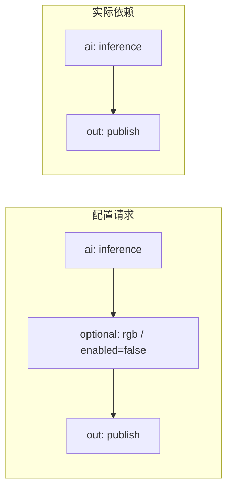

绕过保持 `publish` 等待 `inference`，不会因为中间节点关闭就让输出提前执行。但关闭必需数据生产者不能靠绕过修复：例如点云仍要求真实视差、真实 RGB，语义标签仍要求推理结果。

底层 `TaskGraphConfig::validate()` 本身禁止“开启 Task 直接依赖关闭 Task”。产品图先展开被关闭节点的祖先，再把处理后的配置交给底层，所以两条规则并不冲突。即使某节点关闭，原始图中环或未知引用也会被拒绝。

运行时还有一次筛选：`Graph::runContext()` 根据本帧真实提供的绑定建立 active 集合。没有本帧工作函数的功能会临时关闭，再绕过其依赖；构建结果按 active 签名缓存。这用于命令模式、推理间隔、时序抽样及缺少输出 hook 等条件，意味着“配置启用”与“每一帧都执行”需要区分。

时序参数集中在 `features/temporal/config.json`，主图决定 history、difference、match 是否运行。完整 SDK 检查 `history.difference/match` 与图中对应节点一致，并拒绝容量 1 的帧差/匹配配置，避免“节点启用但条件永远不满足”。录制回放保留这些实际选择；[compare/runner/src/main.cpp](../compare/runner/src/main.cpp) 在每轮正式测量前重置已启用的历史，第一轮的重置也隔离了预热帧。重置次数和策略写入测量元数据，避免不同轮数据混入同一个窗口。

### 7. 线程与并行究竟发生在哪里

ROS 主程序使用 [main.cpp](../features/ros/src/main.cpp) 的 `SingleThreadedExecutor`；图像回调主要接收、校验、配对和投递，不直接在回调里运行整套模型。应用有一个处理 worker；相机直取另有采集线程。在线待处理队列保留最新帧，处理落后时会替换尚未处理的旧帧，离线回放则施加背压以顺序处理文件。

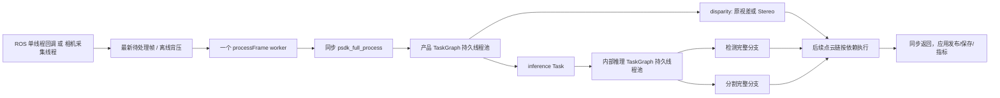

同一帧中没有依赖关系的就绪 Task 可以占用不同 worker，例如视差与检测/分割路径可重叠。内部检测与分割分支也可以重叠。任务内的多个 Feature 按顺序执行，`preprocess → backend → postprocess` 不会在同一个 Task 内并行。

需要注意以下实际约束：

1. `full_pipeline.cpp` 有全局 `full_gate`，当前进程内完整 SDK 的 create/process/command/destroy 等调用串行。`inference_session.cpp` 还有 `sdk_lifecycle_mutex`，`dag_pipeline.cpp` 有 `exact_frame_mutex`。创建两个 engine 不会自动得到两帧并行。
2. `TaskGraph::run()` 自身有 `run_mutex`；通用 `runtime::Engine::run()` 也保护可复用模型工作区。当前优化方向主要是帧内独立分支，不是跨帧流水线。
3. 根 `worker_threads` 同时用于生成产品图和内部推理图，所以它不是整个进程的总线程上限；相机 SDK、ROS、ONNX Runtime/BPU 还可能有自己的线程。
4. 每个 TaskGraph 使用持久线程池，不是每帧重新创建一组调度线程；不同 active 图变体有各自缓存的 TaskGraph，可能增加线程资源。
5. DAG 允许重叠并不保证硬件同时执行。BPU 的资源竞争、模型自身线程、CPU 后处理都会影响耗时。并行分支耗时不能简单相加当作墙钟耗时，FPS 也不能直接按某个模型耗时倒数估算。

通用调度器支持 `ExclusiveResourceResolver`：功能登记可声明复用模型/工作区身份。两个无依赖的 Task 若共享排他资源，会在建图时被拒绝，要求增加依赖或使用不同资源实例。当前精确推理注册了 `exact.det.model`、`exact.seg.model`、`exact.pack.workspace` 等资源；产品映射层主要通过强制阶段依赖保护共享状态。

### 8. Artifact 管什么，哪些数据仍在帧上下文里

[task_graph.hpp](../scheduling/dag/include/perception/task_graph.hpp) 中的 `ArtifactStore` 是带 C++ 类型检查的帧内结果表。调度器在一个 Task 的全部 Feature 成功后，才提交 `context.set()` 暂存的输出；失败时不提交。这解释了为何后继任务不会看到半个 Task 的 Artifact。数据类型、键名、历史窗口与生命周期的详细说明见 [ArtifactStore 与时序](10_parts/04_artifact_store_and_time.md)。

完整产品流水线尚未把所有算法输入输出改成 Artifact。`full_pipeline.cpp` 的工作函数捕获 `frame / out / engine`，点云功能还共享 `MappingPipeline` 的工作区；产品 `BoundFeature` 主要提交 `full.completed.<stage>` 完成标记，时序窗口使用真正的 Artifact 数据。因此不要把当前实现描述为“任意节点都能通过 JSON 连 Artifact 端口”。Artifact 的事务也不能回滚工作函数对共享对象、相机、文件或外部回调已经造成的副作用。

### 9. 失败如何传播，为什么不会发布半帧算法结果

底层 Task 的状态包括 `Pending / Running / Succeeded / Failed / Skipped`。`Running` 包括已进入线程池队列的任务，不代表此刻一定占用 CPU。

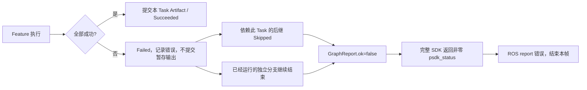

调度器不会强行中断已经运行的独立分支，而是等待本轮任务完成。依赖失败的后继标记 `dependency did not succeed`。主动关闭的 `Skipped/disabled` 可被 `GraphReport::ok()` 接受，依赖失败导致的跳过不算成功。

`BoundFeature::execute()` 把异常转成包含 `code / native_code / feature / task / frame / detail` 的状态，`Graph::runContext()` 统一返回。推理的 `Pipeline::tryRun()` 在失败时清空输出并保留完整 `uint32_t` 状态码。完整 SDK 只有图成功才把结果对象交给调用者，历史窗口也是成功后才 `commit()`。

ROS `processFrame()` 看到非零状态会调用 `report()` 并返回，不把失败帧当作成功结果发布。保存发生在应用拿到成功视图之后，保存失败有自己的错误路径；它不会自动回滚已经发布的成功算法消息。对外回调和文件副作用也没有全局事务回滚。

当前没有通用的“Task 超时后强制终止”或图级自动重试。输入采集超时与 ROS 无输入诊断属于输入层控制，不能替代模型/算法任务的执行超时。如果底层调用长时间不返回，图会等待它；定位时应看输入、配对、处理计数及节点 trace，而不是只看最后一条日志。

### 10. 能怎样扩展一个功能

#### 10.1 调现有参数和开关

这是最常见的开发方式：在对应 `features/<功能>/config.json` 修改已支持参数，主图决定启用和依赖。参数必须经过 `validateFeatureSettings()` 校验及 `applyFeatures()` 映射，添加一个未经登记的新 JSON 字段会被拒绝，而不会自动影响算法。

只检测、只分割通过 `inference` 产品节点加各自开关实现；它们不是主图中的两个独立产品 feature。只生成几何点云可以关闭推理和语义节点，但保留真实 `disparity / rgb / cloud` 以及所需后续几何处理的依赖。单独 ground/maps 无输入点云不成立。

#### 10.2 给产品主图增加全新功能

需要修改并编译代码，当前没有运行时加载任意功能动态库的机制。一个可靠的接入顺序是：

1. 在新的 `features/<name>/` 实现算法、头文件和参数文件，明确输入、坐标系、单位、所有权和输出。
2. 在原生配置器登记文件、参数规则和到 SDK 的映射；目前功能文件清单固定，单放一个目录不会自动发现。
3. 在 `productStages()` 注册产品 feature，并写明必需生产者和阶段顺序。
4. 在 `full_graph.cpp` 的 `steps()` 增加绑定、默认兼容依赖和错误码。
5. 在 `full_pipeline.cpp` 建立本帧工作函数及生命周期，根据结果需要扩展 SDK 结果视图、ROS 输出和保存。
6. 添加成功/失败、禁用、缺依赖、同帧身份、结果所有权测试，再用相同输入比较修改前后。

`productStages()`、`steps()`、本帧 work 绑定目前分散在三个位置，新增功能容易遗漏。后续可考虑用统一描述表生成注册与基础规则，但当前源码没有这项自动化。

#### 10.3 使用通用 C++ Feature 扩展接口

底层已提供 `FeatureRegistry::add(name,factory,schema,resource_resolver)` 和 `Engine(TaskGraphConfig,FeatureRegistry)`。可以实现 `Feature::execute(FeatureContext&)`，读写自定义 Artifact，再通过 C++ 构造的任务图选择该功能。参数 schema 用于建图时检查类型和拼写，closer 用于关闭资源。

这条接口适合独立实验与组件测试。它不意味着主 `pipeline.json` 自动接受同名 feature；主图仍受产品白名单和结果 ABI 限制。内置推理 `Pipeline` 也建立自己的注册表，当前没有通过主配置注入自定义工厂的入口。

#### 10.4 时序扩展回调

[perception_temporal_sdk.h](../sdk/include/perception_temporal_sdk.h) 提供 `psdk_full_set_temporal_callback()`。在启用相应历史/扩展节点并抽样到该帧时，回调在时序分析完成后、发布/保存前执行。它是一个已编译回调插槽，不是任意数量的 JSON 插件节点。

回调返回非零会使本轮失败，失败帧不提交历史。完整 SDK 回调中禁止重新进入 process/command/reset/destroy，`CallbackGuard/reentry()` 会阻止重入；应把后续控制动作交给外部线程或下一次调用。通用 `runtime::Engine` 的 publication sink 则是在其内部锁释放后调用，两种回调边界不同，不要混用结论。

### 11. 自由配置的实际范围与当前缺口

当前图确实控制执行顺序、功能选择和线程数，不是给固定流程换一个显示名称。源码测试 [configurable_graph_contract.cpp](../validation/sdk/full/tests/configurable_graph_contract.cpp) 验证了自定义 ID、改变 RGB/推理顺序、单功能选择、缓存后绑定更新和关闭节点绕过。

仍有以下边界，配置新组合前应检查：

| 组合或诉求 | 当前情况 |
|---|---|
| 只检测 / 只分割 | 支持：产品 `inference` 加模型功能开关 |
| 不带 AI 的几何点云 | 支持，仍需图像、视差、内参及依赖 |
| 只做 RGB 转换 | 支持产品 `rgb`，输出是否发布还要配置应用输出 |
| 任意新 feature 名称 | 拒绝，必须先写 C++、注册并重编 |
| 同一 feature 两个实例、不同模型 | 产品图拒绝重复功能，即使 ID 不同 |
| JSON 任意连接输入输出端口 | 尚未实现，数据键/帧结构由 C++ 约定 |
| 运行时热更新图或自动加载 feature 动态库 | 尚未实现 |
| 独立运行原 Q8.8 / 新 Stereo 视差，不生成点云 | 支持：单独启用 `disparity`；保持真实输入、内参及校正要求 |
| AI + 回充，同时不启用点云 | 支持：选择命令 3，显式 `mapping_enabled=false`、`disparity_enabled=false` |
| offline/recording 回充 | 拒绝：当前输入没有交付同次高清回充图，不能静默代用低清图 |

独立视差的最小图如下，这是替换主配置 `graph` 的片段。它可以与 `input.disparity_source=original_q8` 或 `raft_stereo` 搭配，不要求运行点云、地面或地图：

```json
{
  "worker_threads": 2,
  "nodes": [
    {"id": "depth_only", "feature": "disparity"},
    {"id": "output", "feature": "publish", "depends_on": ["depth_only"]}
  ]
}
```

原视差需要同帧左图和真实 Q8.8；新 Stereo 需要同帧左右图。camera 的内参来自 SDK，ROS 默认来自同帧 `CameraInfo`，offline/recording 几何处理需要显式 `intrinsics_file`。只做视差也保留这些约束，不把缺少的内参或原视差编造出来。普通 offline 文件模式仍不提供原 Q8.8，原方法回放使用 recording。

启用 `visualization.publish_disparity=true` 后，算法节点发布 `~/disparity_q8`，消息为 `sensor_msgs/Image` 的 `16UC1` Q8.8，实际视差像素值为整数值除以 256。结果 JSON 的 `has_disparity` 说明是否取得视差；启用保存时写出 `disparity_q8.u16` 和 `disparity.png`。没有 cloud 就不会凭空生成 PLY。recording 的 `--both` 也可比较独立视差路径。

独立视差是否执行与 Mapping 分离，AI+回充的命令选择也与两个几何开关分离，避免“节点配置开启但本帧没有建立对应工作绑定”。后续增加类似组合，应同时验证配置、输入订阅、SDK 函数绑定和可观测输出，不能仅检查 JSON 能通过解析。

兼容配置仍有一处值得继续拆分：`full_pipeline.cpp::loadHostPolicies()` 在 `mapping.original_config` 非空时读取其中的 `dnn.enabled / run_every_n`，即使点云关闭也会影响推理。主配置器会同步生成这两个字段，所以通过 `perception_config` 运行时保持一致；直接调用完整 SDK 并手写 `effective_full.json` 的开发者，仍需保证兼容文件与主图一致。更清晰的后续结构是把推理跳帧策略归到 inference，解除其对 Mapping 命名配置的依赖。

另外，模型加载几何、后处理契约仍有硬约束。例如检测/分割 SDK 检查原模型输入分别为 `864×480`、`832×480`；把任意 ONNX/BIN 路径填进 JSON 不会自动获得兼容的预处理和输出解码。功能自由组合与任意模型自由替换是两件都需要明确契约的工作。

### 12. 用哪些文件验证自己理解对了

建议按下面顺序定位问题：

1. 看 `resolved.json / parameters.yaml`：实际输入、mode、内参来源、topic 是否符合预期。
2. 看 `effective_full.json.graph`：功能和依赖是否真的选中，SDK 的 enabled 与 graph 是否一致。
3. 看 `inference_dag.json`：只检测时是否只有检测分支，关闭的模型是否仍被引用。
4. 看 `task_trace.json` 或 `final_task_trace.json`：自定义节点 ID、Succeeded/Failed/Skipped 及耗时；注意 active 条件可能令配置开启的节点在某帧不执行。
5. 看 ROS 接收/配对/处理计数：先确定是否有完整输入，再判断算法是否卡住。

核心验证源码为 [native_config_test.cpp](../validation/native_config_test.cpp)、[task_graph_tests.cpp](../validation/sdk/framework/tests/task_graph_tests.cpp)、[graph_contract.cpp](../validation/sdk/full/tests/graph_contract.cpp)、[configurable_graph_contract.cpp](../validation/sdk/full/tests/configurable_graph_contract.cpp)、[dag_contract_tests.cpp](../validation/sdk/tests/dag_contract_tests.cpp)。配置/调度测试与真实模型、相机测试覆盖的层级不同；通过建图测试后，仍应回放相同输入，比较检测、分割、点云及性能结果。

---

## 3. 功能、参数、单独测试与扩展开发

本章依据本版 `native_features.cpp`、`native_pipeline.cpp`、`product_graph.hpp`、`full_graph.cpp`、`full_pipeline.cpp` 以及各功能真实实现整理。文中的代码位置相对项目根目录；当前版本的日常入口是 C++ `perception_config` 和 schema 3 的 `pipeline.json`。历史讲稿中旧三层 DAG、旧 Python 入口和旧回充 L 标实现不能直接套用。

### 3.1 先分清“算法功能”和“功能目录”

一个功能目录不一定对应一个用户 Graph 节点；一个节点也可能调用多个功能目录。例如 `inference` 同时封装检测和分割，`maps` 使用 fusion 后端，`camera` 是输入适配器而不是当前产品图中的节点。

| 目录 | 职责 | 日常配置 | 主要实现/入口 |
|---|---|---|---|
| `features/camera/` | Mo SDK 动态加载、帧所有权、同步 RGBD/GDC、SDK 内参 | 根 `camera.json` | `src/mo_camera.cpp`、`include/perception_ros_so_demo/raw_capture.hpp` |
| `features/offline/` | 读 PNG/JPEG/紧密 NV12/I420，准备算法源图 | `features/offline/config.json` | `src/offline_image.cpp` |
| `features/ros/` | 接收/配对、最新帧队列、SDK 调用、ROS 发布 | `features/ros/config.json` | `src/perception_node.cpp`、`node_input.cpp`、`node_process.cpp`、`node_output.cpp` |
| `features/sdk_bridge/` | C ABI 调用、结果 RAII，隔离应用和共享库 | 无独立 JSON | `src/sdk_caller.cpp` |
| `features/inference/` | BPU/ORT 后端、公共输入和模型工作区 | `features/inference/config.json`、`cpu_profile.json` | `backend/src/runner.cpp`、`cpu/src/cpu_stages.cpp` |
| `features/detection/` | 检测解码、框变换、按类 NMS | `features/detection/config.json` | `backend/src/detection_post.cpp` |
| `features/segmentation/` | 分割输出、插值/argmax、源图 mask | `features/segmentation/config.json` | `backend/src/segmentation_post.cpp`、`seg_post.cpp` |
| `features/stereo/` | 左右图适配、Horizon 模型、视差恢复及 Q8.8 输出 | `features/stereo/config.json` | `src/stereo_provider.cpp`、`runner/src/horizon_stereo.cpp`、`tensor_codec.cpp` |
| `features/pointcloud/` | Q8.8 反投影、外参、Patchwork 地面、PLY/ROS cloud | `features/pointcloud/config.json` | `backend/src/mapping.cpp`、`ground_segmentation.cpp`、`src/cloud_output.cpp` |
| `features/fusion/` | 检测/分割语义投影、深度/聚类筛选、地图融合 | `features/fusion/config.json` | `backend/src/label_fusion.cpp`、`detection_labels.cpp`、`map_render.cpp` |
| `features/recharge/` | 当前 ArUco 标记识别、PnP/姿态与原算法桥接 | `features/recharge/config.json` → 一份 `recharge_mark.json` | `backend/bridge.hpp`、`backend/vendor/src/mark_aruco_detect.cpp` |
| `features/temporal/` | 有所有权的历史窗口、帧差、同类框关联 | `features/temporal/config.json` | `backend/include/perception_temporal.hpp`、`backend/src/temporal.cpp` |
| `features/metrics/` | 进程 CPU、RSS、处理/输入队列指标 | `features/metrics/config.json` | `src/process_metrics.cpp`、`backend/src/platform_metrics.cpp`；ROS 汇总在 `features/ros/src/node_metrics.cpp` |
| `features/visualization/` | overlay、RGB、PNG 等公共可视化实现 | 根 `visualization.json` | `backend/src/visualization.cpp`、`output_features.cpp` |

`scheduling/` 负责配置解析和执行编排，`core/` 放公共契约，`sdk/` 放对外 C ABI。把一个 `.cpp` 移到功能目录并不会自动注册为可运行节点，CMake、配置映射和产品绑定仍需明确接通。

### 3.2 两类开关与一条参数链

1. `graph.nodes[].enabled` 决定产品阶段是否参加这一帧执行。
2. 检测/分割有各自 `enabled`，决定 `inference` 内哪条模型通路加载和执行；metrics 有独立开关。
3. 功能参数修改算法设置，不自动开启对应产品阶段。

例如只保留 `inference → publish`，把 segmentation 的 `enabled=false`，就只运行检测。若 `inference` 仍启用而检测和分割均关闭，配置器会拒绝；要完全不运行 AI，应关闭或移除 `inference` 节点。

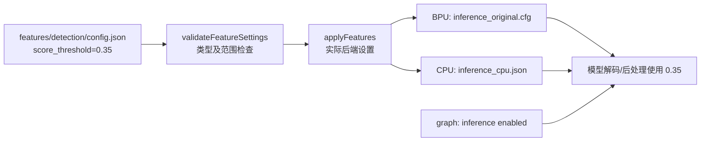

检测阈值不会通过修改 `original_start.json.dnn.detect.score_threshold` 来生效；那是原 mapping 模板中保留的同名副本。查看本次生成的 profile 和 `effective_full.json`，才能确认实际推理使用的值。

用户功能 JSON 中的文件路径统一相对**主 `pipeline.json` 所在目录**。因此写在 `features/detection/config.json` 中的 `models/x5/mmyolo0828.bin` 仍相对项目根；SDK/profile 内部路径则相对其自身文件目录。`_help` 仅供阅读，不是运行参数。可继承字段的 `null` 表示沿用 SDK 参数，不是通用关闭开关；修改文件后需重启，当前未实现运行中热更新。

配置器会读取全部已登记功能配置，再按所选功能验证需要的资源。因此禁用模型或回充可以不加载对应权重/参数文件，但对应功能 JSON 本身仍须存在，未知字段和错误类型仍会被拒绝。当前 `features` 引用名是固定白名单，不是任意目录自动发现机制。

### 3.3 当前各功能 JSON 的真实字段

以下默认值指本包交付的用户配置。标注“继承”的字段最终值取决于选中的 SDK 模板/profile，不能仅看本表推断运行值。

#### 检测：`features/detection/config.json`

| 字段 | 默认 | 类型/范围 | 作用 |
|---|---|---|---|
| `enabled` | `true` | bool | `inference` 内检测通路；关闭时不加载检测模型 |
| `model` | `models/x5/mmyolo0828.bin` | 文件路径；可 `null` 继承 | 模型选择；CPU 改为 `models/cpu/` 对应 ONNX |
| `score_threshold` | `null` | 数值，严格 `(0,1)` | 模型输出置信度筛选 |
| `nms_threshold` | `null` | 数值 `[0,1]` | 同类别 NMS 的 IoU 阈值 |
| `nms_top_k` | `null` | 整数 `1..10000` | 保留检测数量上限 |

纯后处理的 NMS 只抑制同类别框，按置信度排序；IoU **严格大于**阈值才抑制，恰好等于阈值时保留。现有 `validation/postprocess_test.cpp` 专门覆盖这个边界。

#### 分割：`features/segmentation/config.json`

| 字段 | 默认 | 类型/范围 | 作用 |
|---|---|---|---|
| `enabled` | `true` | bool | `inference` 内分割通路 |
| `model` | `models/x5/pidnet_0825_3classes.bin` | 文件路径；可 `null` 继承 | 分割权重 |
| `align_corners` | `null` | `null` 或 `true` | 当前 SDK 固定几何契约，不接受 `false` |
| `argmax_mode` | `null` | `null` 或 `"bilinear"` | 当前 SDK 固定后处理契约 |

后两个字段并不表示当前可自由切换插值算法。若要实现另一种插值/argmax，需要改后处理 C++ 并重编，同时用边界像素、类别并列及尺寸恢复数据做数值回归。

#### 推理公共设置：`features/inference/config.json`

| 字段 | 默认 | 作用与限制 |
|---|---|---|
| `backend` | `null` | 继承；显式可选 `bpu` 或 `cpu` |
| `original_profile` | `null` | BPU 原始推理 CFG；路径相对主配置 |
| `cpu_profile` | `null` | CPU 模型输入/输出和预后处理 JSON；使用本包 ONNX 时填 `features/inference/cpu_profile.json` |

内部 `dag` 由配置器生成。解析器保留对这个旧字段的识别，但显式设置会报错，要求移除覆盖。用户只维护产品 `graph`。

CPU profile 不只是模型路径：它还定义输入名、RGB/归一化、尺寸、检测输出名和 raw DFL 布局、分割输出布局、类别名等。换一个输出契约不同的 ONNX，不能只改 `model`。

#### Stereo：`features/stereo/config.json`

| 字段 | 默认 | 类型/范围与含义 |
|---|---|---|
| `model` | `models/x5/r34_tail_pointwise_shuffle2_grouped_grid_352x640_nv12_mixed.bin` | Horizon BIN；启用新 Stereo 视差时检查文件 |
| `image_transform` | `resize` | `resize` 显式适配；`strict` 要求源图尺寸与模型一致 |
| `input_width` | `640` | 偶数 `2..4096`，或 `null` |
| `input_height` | `352` | 偶数 `2..4096`，或 `null`；必须与 width 同时明确/同时 `null` |

默认契约 NCHW `[1,3,352,640]` 的 NV12 双目输入。源图为 640×544，显式缩放后推理，再恢复源图视差；视差值只乘横向缩放比例。当前只有 Horizon Stereo 后端，没有 CPU ONNX Stereo 推理器。新模型还须匹配输入图像类型、输出 dtype/量化、布局和视差定义，不能仅凭 NCHW 形状相同判断兼容。

#### 点云/地面：`features/pointcloud/config.json`

| 字段 | 默认 | 类型/范围与含义 |
|---|---|---|
| `sample_step` | `null` | 整数 `1..32`；像素采样步长，越大点越稀疏 |
| `original_config` | `null` | 原 mapping 参数 JSON，可覆盖 SDK 的 `mapping.original_config` |
| `extrinsics` | `null` | 外参 JSON；与输入内参文件不同 |
| `ground.enabled` | `null` | 继承 Patchwork 内部开关；产品 `ground` 节点仍由 graph 决定 |
| `ground.sensor_height` | `null` | 正数，米，相机/传感器安装高度 |
| `ground.min_range`、`ground.max_range` | `null` | 正数，米，最终必须 min < max |
| `ground.th_dist`、`ground.th_seeds` | `null` | 正数，米，地面拟合/种子阈值 |

这些覆盖分别进入 `effective_full.json.mapping` 或本次 `original_start.json.patchwork`。点云还依赖真实 Q8.8、同帧源图、内参和外参，不会从单张图片补造深度。`MappingPipeline` 的一个帧工作区由后续阶段共享，不能把其所有方法任意并行执行。

#### 融合：`features/fusion/config.json`

`labels` 覆盖 `original_start.json.label_fusion`，`map` 转成原地图参数名。交付文件只列常用项，解析器还接受下表中的高级项；未列在交付 JSON 中的字段可以按需增加，但不能自行杜撰字段名。

| 字段（均位于 `labels`） | 类型/范围 | 作用 |
|---|---|---|
| `passable_classes` | 字符串 | 可通行类别名列表，沿用原融合配置格式 |
| `det_score_min` | `[0,1]` | 检测点云融合二次筛选；不同于检测输出阈值 |
| `max_range_m` | `[0.1,100]` | 语义融合最大范围，米 |
| `max_height_m`、`keep_below_cam_m` | `[0,20]` | 高度限制，米 |
| `det_depth_span_m`、`det_depth_gap_m`、`seg_depth_gap_m` | `[0,100]` | 深度跨度/间隙筛选，米 |
| `cluster_voxel_m` | `[0.001,10]` | 聚类体素尺寸，米 |
| `det_depth_min_pts`、`cluster_min_component_pts`、`seg_min_component_pts` | 整数 `1..1000000` | 最小支撑点/组件点数 |
| `seg_ray_bin_px` | 整数 `1..4096` | 分割射线分桶，像素 |
| `seg_mask_majority_radius`、`seg_mask_close_radius` | 整数 `0..4` | mask 多数/闭运算半径 |
| `seg_mask_close_iterations` | 整数 `1..3` | 闭运算次数 |
| `seg_mask_erode_px` | 整数 `0..8` | mask 腐蚀范围，像素 |
| `fuse_into_grid`、`nongrass_seg_as_obstacle` | bool | 是否写入网格、非草类别处理 |
| `cluster_filter`、`seg_cluster_filter`、`seg_mask_postprocess` | bool | 检测/分割聚类与 mask 后处理 |

以上字段可 `null` 继承。`map.resolution_m`、`map.width_m`、`map.height_m` 必须为正数，单位米，分别映射到 `MapResolution`、`MapWidth`、`MapHeight`。语义融合需要同帧检测/分割结果，不能把仅几何点云配置和完整语义地图配置当作相同工作量比较耗时。

#### 时序：`features/temporal/config.json`

本版补齐了此前缺失的时序功能配置入口。它覆盖 SDK 的 `full.json.history` 数值设置；执行开关仍由 graph 的 `history`、`temporal_difference`、`temporal_match` 决定。

| 字段 | 默认 | 类型/范围与含义 |
|---|---|---|
| `capacity` | `4` | 整数 `1..32`，历史容量；帧差/匹配至少需要 2 |
| `frame_interval` | `1` | 整数 `1..1000000`，每隔多少个唯一采集帧入窗；capacity=1 时实际固定为 1 |
| `max_memory_mb` | `64` | 整数 `1..4096`，窗口载荷预算，按 MiB 计算 |
| `difference_threshold` | `8` | 整数 `0..255`，Y 亮度绝对差大于该值才计为变化 |
| `match_iou_threshold` | `0.5` | `(0,1]`，同类别框关联最小 IoU |
| `match_max_detections` | `256` | 整数 `1..1024`，每帧参与匹配的检测数量上限 |

窗口保存拥有所有权的图像、mask、检测框和视差，不保留 SDK/相机借用指针。预算不足会移除最旧项；单帧已超过预算会报错。第一帧、未采样帧、历史不足两帧时没有有效帧差/匹配结果，这是有明确状态的未就绪，不是补零伪装成功。时间戳回退、几何或内参变化会清空旧窗口，命令切换也会清空历史。

帧差是 Y 平面绝对差及可用 mask 的类别变化；匹配是同类别框按 IoU 排序的一对一贪心关联，不是完整目标跟踪器，也不使用光流或三维跟踪状态。`temporal_extension` 是可选扩展钩子，写一个 JSON 名称不会自动加载外部插件。

#### 回充：`features/recharge/config.json`

| 字段 | 默认 | 作用 |
|---|---|---|
| `config` | `null` | 继承 SDK `full.json.recharge.config`；显式路径相对主 pipeline，指向真实回充参数 JSON |
| `allow_source_fallback` | `null` | 继承 SDK（交付模板为 false）；是否明确允许缺少高清源时使用左图 |

图的 `recharge` 决定是否执行，参数文件只维护一份。默认 SDK 文件是 `config/recharge_mark.json`，源模板在 `scheduling/config/sdk_templates/recharge_mark.json`。可以将经过确认的参数文件放入功能目录后用 `config` 指向它，无需把全部参数复制进两份 JSON。

`allow_source_fallback` 是 SDK 处理层选图规则，当前 camera/ROS 应用启用回充时仍要求采集/同步同帧高清 GDC。它不会自动改变上游输入要求，也不会开放 offline/recording 回充模式。

真实 donor 解析器位于 `features/recharge/backend/vendor/src/recharge_mark_config.cpp`：它接受根对象或嵌套 `recharge_mark`，读取以下组。部分旧字段仍被原解析器保留，不意味着当前算法分支一定使用它们。

| 参数组 | 关键字段 | 意义/限制 |
|---|---|---|
| host 调度 | `run_every_n`、`min_interval_ms`、`use_hires` | 抽帧、最小执行间隔、高清 GDC；由 full_pipeline 负责落实 |
| 内参来源 | `intrinsics_source` | `dataset` 保留 donor 仓内参数；`sdk_scaled` 使用同帧内参按识别图尺寸缩放 |
| ROI | `roi.enabled/x_min/x_max/y_min/y_max` | 原算法 ROI，比率坐标 |
| 姿态安装几何 | `pose_refine.enabled/camera_height_mm/mark_height_mm/camera_pitch_deg` | 毫米/度；须匹配真实安装 |
| ArUco 几何 | `dictionary_id/dual_marker/layout/marker_id_*`、`marker_size_m/gap_m/margin_m/card_w_m/card_h_m` | 字典、单双码排列与物理尺寸，米 |
| ArUco 检测/PnP | `max_reproj_px/enable_lm_refine/adaptive_thresh_win_size_*/corner_refinement_*` 等 | 像素误差、阈值窗口、角点细化等原 OpenCV 参数 |
| 原始图保存 | `save_raw.enabled/dir/every_n/max_count` | donor 自身的额外诊断保存；dir 当前应使用绝对输出路径，独立于应用逐帧保存 |
| donor 发布设置 | `publish_enabled/publish_overlay/overlay_max_width` | 原接口设置；当前 SDK 桥不启动 donor 独立 ROS worker，不能据此推断应用话题已启停 |

当前集成是 ArUco，不使用 YOLO 辅助外部裁框。`Engine` 的原上游状态含全局先验/滤波，因此每进程只允许一个初始化实例并串行调用。`processLeftNv12` 返回“已处理但没识别到标记”是正常结果，须看 `mark_ok/pose_ok`，不能只根据调用返回 0 认为姿态有效。

#### 输入与 metrics 配置速查

完整输入说明见输入章节，这里列出实际字段方便扩展时定位。

| 文件 | 全部运行字段（不含 `_help`） |
|---|---|
| 根 `camera.json` | `sdk_library/vendor_config/disparity_mode/acquire_timeout_ms/retry_interval_ms/frame_id` |
| `features/offline/config.json` | `left_files/right_files/format/fps/loop/max_frames/wait_for_subscribers/intrinsics_file/rectified/calibration_confirmed/frame_id` |
| `features/ros/config.json` | `left_topic/right_topic/q8_topic/gdc_topic/left_camera_info_topic/right_camera_info_topic/reliability/queue_capacity/intrinsics/rectified/calibration_confirmed/frame_id` |
| `features/metrics/config.json` | `enabled/write_jsonl/every_n` |

offline `format` 只有 `nv12` 或 `i420`，FPS 范围 `0.001..120`；ROS 队列 `1..16`、QoS `best_effort/reliable`。相机超时 `1..60000` ms、重试 `1..1000` ms 且不超过超时。metrics 的 `every_n` 是正整数，控制每多少个已处理帧发布/写入一次；它独立于 graph.publish，录制 benchmark 的报告也独立于 metrics 开关。

CPU 指标是本进程 CPU，100% 表示一个核；RSS 是本进程驻留内存。ROS 分进程采集时，不包含相机进程资源；回放不包含硬件生成原始 Q8.8 的时间。检测和分割并行时各阶段时间会重叠，不能把六段时间简单相加当端到端时延。

### 3.4 “自由配置功能”的实际边界

用户图可以选择已有功能、关闭功能、修改有真实数据依赖依据的顺序、允许独立分支并行。当前产品图不是任意字符串都能运行的插件系统，也没有 JSON 可编辑的输入/输出端口。

#### 已注册的产品功能

注册名单以 `scheduling/dag/include/product_graph.hpp::productStages()` 为准：

| graph.feature 简写 | 完整注册名 | 产物/用途 |
|---|---|---|
| `inference` 或 `dnn` | `product.ai.exact` | 检测、分割；两条支路由功能配置开关 |
| `disparity` | `product.stereo.disparity` | 取得原 Q8.8 或调用新 stereo provider；可以独立运行 |
| `rgb` | `product.image.rgb` | 将本帧源图转换为 RGB |
| `cloud` 或 `pointcloud` | `product.pointcloud.from_disparity` | 视差和内参反投影，得到相机坐标点云 |
| `calibration` | `product.calibration.auto` | 原自动地面/安装标定步骤 |
| `labels` | `product.fusion.semantic_labels` | 将本帧检测、分割语义对应到点云 |
| `transform` | `product.pointcloud.transform_color` | 坐标变换与着色 |
| `ground` | `product.pointcloud.patchwork` | 原 Patchwork 地面分离 |
| `maps` 或 `fusion` | `product.fusion.ai_fusion` | 原语义融合栅格 |
| `recharge` | `product.recharge_mark` | ArUco 回充标记及姿态 |
| `history` | `product.temporal.history` | 拥有内存的历史帧窗口 |
| `temporal_difference` | `product.temporal.difference` | 相邻采样帧亮度差 |
| `temporal_match` | `product.temporal.match` | 同类别检测框跨帧关联 |
| `temporal_extension` | `product.temporal.extension` | SDK 已注册扩展回调执行点 |
| `publish` | `product.output.application` | 应用发布阶段/SDK publication hook |
| `record` | `product.output.record` | 应用保存阶段/SDK 保存阶段 |

完整注册名也可以写进 `feature`。`id` 是该图中节点的名字，可以自定义；`depends_on` 必须引用节点 id。例如 `{"id":"stereo_a","feature":"disparity"}` 的下游应写 `"stereo_a"`，不能因为它是视差功能就固定写 `"disparity"`。

#### 必须满足的依赖

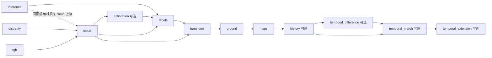

图中的可选节点可以省略。已选择的 mapping 步骤按 `cloud → calibration → labels → transform → ground → maps` 保持顺序，这是当前实现共享一个可复用 `MappingPipeline` 帧工作区的要求。例如不启用 labels 时，可以让 transform 直接依赖 cloud；启用 labels 时，transform 必须等 labels 完成。

另有以下约束，配置错误会在启动准备阶段拒绝：

- cloud 必须有 disparity 和 rgb 上游；同图启用 inference 时，inference 也必须是 cloud 的上游。
- labels 必须有 cloud 和 inference 上游；calibration 必须有 cloud 上游，ground 必须有 transform 上游，maps 必须有 ground 上游。
- difference、match、extension 必须有 history 上游；同图启用 difference 时，match 还必须等 difference。启用 difference 或 match 时历史容量至少为 2。
- history 必须等同图已启用的 inference、disparity、rgb、recharge、maps；publish/record 必须等待所有启用的产物生产者。若 publish 和 record 同时启用，record 等 publish。
- 每个产品功能一帧只能出现一次，包括 enabled=false 的占位节点；不能在同一图里放两套不同模型的 inference 或两个独立 cloud 实例。
- 节点 id 不得重复，不能循环、不能引用未知依赖；图大小为 1～64 节点、worker_threads 为 1～32。
- 关闭中间节点会展开到它的启用祖先，但不会凭空生成它原来产生的数据。例如关闭 disparity 后保留 cloud 会失败。

`worker_threads` 控制单帧图内的可并行任务。SDK 完整帧处理有进程内串行保护，mapping 和回充也有共享状态；把 worker_threads 改大不等于可以同时处理多帧。在线节点的最新帧队列会舍弃等待中的旧帧，这是控制积压延迟的策略，吞吐和丢帧需一起观察。

#### artifact 现在承担什么

`scheduling/dag/include/perception/task_graph.hpp` 中的 `ArtifactStore` 管理按 key 命名的、带 C++ 类型的不可变数据。`FeatureContext::set()` 先写入任务局部事务，整项任务成功后才对下游可见；类型不一致、重复写入、缺少数据会报错。内部精确推理图和历史窗口已经使用这个机制。

产品图还有部分旧集成通过 `full_pipeline.cpp` 闭包中的共享结果与 `MappingPipeline` 工作区传递数据。`full_graph.cpp` 为已完成步骤写入 `full.completed.<步骤>` 作为调度完成记录。因此，“存在 artifact 框架”不代表输入选择、相机句柄、文件路径和所有输出都已统一为 artifact；它也不会替代 input/graph/visualization 配置。

### 3.5 如何单独运行、单独测试一个功能

先区分三种验证：算法单元测试检查函数结果；精简 graph 检查真实运行链路；同数据 A/B 检查整个变更。只做其中一种不能覆盖全部问题。

#### 用精简 graph 单独运行

在项目根目录复制主文件为 `pipeline.det.json`、`pipeline.cloud.json` 等，保留 schema、sdk、input 以及所需配置引用，只替换 graph。放在根目录可保持现有相对路径的含义；复制到其他目录时，必须同步调整功能配置引用和模型、数据路径。

**只检测或只分割：** 两者都属于 inference 节点，没有名为 `detection` 或 `segmentation` 的独立产品节点。

```json
{
  "input": {"mode": "offline", "disparity_source": "none"},
  "graph": {
    "worker_threads": 2,
    "nodes": [
      {"id": "ai", "feature": "inference", "depends_on": []},
      {"id": "out", "feature": "publish", "depends_on": ["ai"]}
    ]
  }
}
```

这段是主文件中两个字段的替换片段。只检测时 detection.enabled=true、segmentation.enabled=false；只分割时反过来。只跑 AI 不需要离线内参文件，也不需要右图。模型、输入路径和推理后端仍需配置为真实可用值。检测/分割同时 false 而 inference 启用会被拒绝。

**只获取视差：** 可以启用 disparity 和发布，不必启动 PCL 点云、检测或分割。

```json
{
  "graph": {
    "worker_threads": 1,
    "nodes": [
      {"id": "disp", "feature": "disparity", "depends_on": []},
      {"id": "out", "feature": "publish", "depends_on": ["disp"]}
    ]
  }
}
```

新 stereo 的输入应选择 raft_stereo，并提供同帧、已校正的左右图；原方法选择 original_q8，由 camera/ROS/recording 提供原 Q8.8。当前接口仍要求该源的真实内参与几何声明。需要查看图像时启用 visualization.publish_disparity。单视差图没有 pointcloud、ground、maps 结果，也不会产生 PLY。

**只生成点云：** 省略 inference/labels/transform/ground/maps，保留以下 graph：

```json
{
  "graph": {
    "worker_threads": 2,
    "nodes": [
      {"id": "disp", "feature": "disparity", "depends_on": []},
      {"id": "color", "feature": "rgb", "depends_on": []},
      {"id": "cloud", "feature": "pointcloud", "depends_on": ["disp", "color"]},
      {"id": "out", "feature": "publish", "depends_on": ["cloud"]},
      {"id": "save", "feature": "record", "depends_on": ["out"]}
    ]
  }
}
```

它仍需要内参和视差：camera 自动使用 SDK 同帧标定；ROS 通常使用 CameraInfo；离线/录制明确指定 intrinsics_file。offline 原图模式没有原 Q8.8 输入入口，应使用左右图加 raft_stereo；已录制三元组使用 recording+original_q8。要保存点云，还须设置 visualization.save_root、save_every_n>0、save_ply=true。图的 record 开关与保存频率一起决定是否真正保存。

**只验证 ground/fusion：** 主流程必须保留其真实数据生产者。ground 至少需要 disparity、rgb、cloud、transform；maps 还需要 ground。若想直接给一组人造点云测地面分类，应写 C++ 单元测试调用 MappingPipeline/算法函数，而非在主 JSON 中伪造缺失上游。

**只验证时序：** 在上述 AI 或 rgb 流程后加 history，再加 difference/match。帧差至少送入两帧被采样的图像；检测匹配还需要真实检测结果。第一帧、未采样帧、历史重置后的首帧出现分析无效是正常状态。recording 回放可验证 history/calibration；录制三元组不包含高清 GDC，因此不能验证当前回充输入契约。

**只验证回充：** 图可只用 recharge→publish，无需检测/分割。camera 或 ROS 需提供同次采集的 GDC 图；ROS 还需相应输入内参。当前离线/recording 路径不包含该高清源，启动器会拒绝回充组合。不要为了让程序通过而把低清左图冒充 GDC。

#### 先看生成配置，再启动

在已编译安装的 Linux/WSL/X5 环境中，从项目目录运行：

```bash
bash tools/run_pipeline.sh --config pipeline.det.json \
  --run-dir /tmp/perception-det-prepare --prepare-only
```

`--run-dir` 应选新的目录；准备操作会生成最终 SDK 配置、ROS 参数和解析证据。它验证配置/文件/图依赖，不会开相机、订阅图像或执行推理。确认有效配置后，用另一个新目录去掉 prepare-only：

```bash
bash tools/run_pipeline.sh --config pipeline.det.json \
  --run-dir /tmp/perception-det-run
```

启动命令与 input.mode 配合：offline/camera/ros 走在线应用；recording 走离线对比 worker。ROS 输入仍需先启动相机发布端，且图像、视差和 CameraInfo 的配对时间戳符合契约。

#### 不依赖模型/相机的 C++ 单元测试

以下命令适用于有 CMake、Ninja 和 C++17 编译器的 Linux/WSL，在项目根执行。它关闭硬件推理、ONNX、PCL 和回充，验证后处理、配置、调度和时序基础契约：

```bash
cmake -S . -B build/unit -G Ninja \
  -DCMAKE_BUILD_TYPE=Release -DBUILD_TESTING=ON \
  -DR20_WITH_BPU=OFF -DR29_WITH_ORT=OFF \
  -DR33_WITH_MAPPING=OFF -DR33_WITH_RECHARGE=OFF \
  -DPERCEPTION_BUILD_COMPARE=OFF \
  -DPERCEPTION_BUILD_COMPARE_RUNNER=OFF \
  -DPERCEPTION_BUILD_CAPTURE=OFF

cmake --build build/unit --parallel 4 --target \
  feature_postprocess_tests native_config_contract_test \
  framework_task_graph_tests r36_temporal_unit

ctest --test-dir build/unit --output-on-failure \
  -R '^(modular_detection_segmentation_postprocess|native_config_contracts|original_framework_task_graph|r36_temporal_sampling_memory_DAG_contract)$'
```

这组纯 C++ 测试不能证明 BIN/ONNX 模型效果或真实相机兼容性。对应的测试文件和入口如下，可在修改功能时选择相关测试，不必反复全量运行无关项目。

| 修改范围 | 测试 target / CTest 名称 | 验证内容与必要条件 |
|---|---|---|
| 检测/分割纯后处理 | `feature_postprocess_tests` / `modular_detection_segmentation_postprocess` | NMS、阈值、argmax 等；不加载模型 |
| 主配置/路径/graph | `native_config_contract_test` / `native_config_contracts` | 严格字段、路径、模式组合、生成配置 |
| 任务调度 | `framework_task_graph_tests` / `original_framework_task_graph` | 依赖、失败传播、事务、并发契约 |
| 时序算法 | `r36_temporal_unit` / `r36_temporal_sampling_memory_DAG_contract` | 抽帧、预算、拥有内存的快照、帧差/匹配 |
| 时序 C ABI | `r36_temporal_contract` / `r36_temporal_public_C_ABI_ownership_contract` | C 头兼容与结果所有权；需构建共享 SDK |
| 点云/原融合 | `r33_mapping_tests` / `r33_mapping_original_oracle` | 原实现 oracle；需启用 mapping 并装好 PCL/Eigen/OpenCV |
| 回充 ArUco | `r35_aruco_fixtures`、`r33_recharge_sequence_parity` / `r35_aruco_fixtures`、`r35_aruco_sequence_parity` | 生成已知标记再比对 donor；需回充后端依赖 |
| ROS 相机关闭/失败恢复 | ROS 构建中的 `camera_lifecycle` | 使用动态 mock SDK，不代表真机验证 |
| ROS 配对/新 stereo provider | ROS 构建中的 `v8_stereo_ros_helpers`、`stereo_provider_inputs` | 输入尺寸、时间戳、视差转换；是否实际执行 BPU 要看夹具和构建开关 |

用 `ctest --test-dir <实际构建目录> -N` 查看该构建确实注册的名称。测试 target 与 CTest 名称不总相同，不要把源码文件名直接当作 ctest 参数。

#### 脱离 ROS 验证新 stereo 模型

已启用 Horizon runner 的 X5 构建提供 `stereo_model_runner`：

```bash
stereo_model_runner \
  --model_file models/x5/r34_tail_pointwise_shuffle2_grouped_grid_352x640_nv12_mixed.bin \
  --left data/left.png --right data/right.png \
  --output /tmp/disparity-001.npy
```

也支持 `--left_dir DIR --right_dir DIR --output_dir NEW_OR_EMPTY_DIR` 批处理；`--validate_pairs` 只检查命名与图片解码。左右图尺寸须一致，批处理按同名 stem 配对，已有输出会拒绝覆盖。

该命令在 runner 内将图片调整到模型输入尺寸，输出模型原分辨率的 float32 NPY 和 contract JSON，视差单位是该分辨率的水平像素。它不生成 PLY，也不执行在线 provider 的 640×544 恢复、Q8.8 转换和点云融合。检查模型是否正确与检查整个点云流程，应分别使用 runner 和主 graph。

### 3.6 新增功能的真实开发步骤

#### 第一步：先决定是内部算法替换，还是新产品步骤

如果只是替换检测后处理，优先在 `features/detection` 的接口内实现；替换新 stereo 模型的 tensor 解码，优先修改 `features/stereo`。保持输入/输出契约的算法替换通常不需要增加 graph 节点。

如果功能有独立产物、独立执行条件，或者必须由用户决定是否在流程中执行，才增加产品步骤。例如新增点云去噪可以放在 cloud 后、transform 前；要先决定它改变原工作区还是产生一个新点云对象，再决定并发与依赖。

#### 第二步：建立目录和稳定接口

推荐最小布局：

```text
features/denoise/
├── include/denoise.hpp      # 数据契约和可调用接口
├── src/denoise.cpp          # 实现；不在内部打开相机或读取全局JSON
├── config.json             # 用户可修改参数
├── CMakeLists.txt          # 独立编译目标和依赖
└── README_zh.md            # 单位、边界、输入所有权和测试方法
```

接口明确写出输入尺寸、坐标系、单位、结果所有权及失败方式。算法接收已经解析好的 Settings，避免在算法函数里拼接项目根路径或读取环境变量。跨任务、跨帧保存图像时必须复制或持有拥有内存的对象，不能保留相机 acquire 后的借用指针。

#### 第三步：接入构建

为功能建立库，例如 `add_library(denoise STATIC src/denoise.cpp)`，公开 include 和 C++17 要求，在使用它的目标中链接。真实工程有两条构建入口：

- 根 `CMakeLists.txt` 构建 native 配置工具、SDK、录制和 comparison；SDK 共享库组成在 `sdk/cmake/shared/CMakeLists.txt`。
- ROS 包入口 `src/perception_ros_so_demo/CMakeLists.txt` 构建相机、offline、stereo 和 ROS 应用；`features/ros/CMakeLists.txt` 聚合 perception_node/demo。

新库供 SDK 调用就链接到 perception_sdk 所在链路；只供 ROS 输入适配使用就链接到相应输入库或 perception_node。不要只把源文件放进 features 后假设 CMake 会自动发现。对可选依赖增加明确构建开关，并在未编入却配置启用时给出启动错误。

#### 第四步：接入功能配置解析

当前新增 `features/denoise/config.json` 后至少检查以下位置：

1. `scheduling/config/src/native_features.cpp` 的 names 白名单，让配置加载器识别新功能目录及主文件 features 路径覆盖。
2. 同文件 `validateFeatureSettings()`：列出允许字段、类型、单位、范围；拒绝拼写错误，明确 null 是否继承。
3. 同文件 `applyFeatures()`：把用户字段写到最终 SDK 设置，路径通过主 pipeline 的 base 解析；只在功能启用时检查模型/额外数据等运行依赖。
4. 若需要新的启用状态/ROS 参数，在 `native_config_detail.hpp::Context`、`native_pipeline.cpp::prepare()` 和 ROS 参数声明/使用处贯通。
5. 若 SDK 的 full.json 要新增字段，还需更新 `scheduling/config/include/config.hpp`、`src/full_config.cpp` 的字段解析、有效配置输出及相关校验。只在前端 JSON 接受字段但运行端不读取，会形成无效配置。

功能目录 config.json 由安装配置逻辑收集，仍须检查安装结果确实含新目录及必需文件；不能仅验证源码树。模型/资源统一管理时，用相对路径指向模型或资源目录，不把同一个模型复制成多个功能配置入口。

#### 第五步：将新功能接入产品图

仅调用底层 FeatureRegistry.add() 不能让 schema_version=3 的主图接受新字符串。产品图是一层显式集成，通常需要同步修改：

| 文件/位置 | 要修改什么 |
|---|---|
| `scheduling/dag/include/product_graph.hpp::productStages()` | 新产品 key 与正式注册名；必要的简写别名 |
| 同文件 `parseProductGraph()` | 输入生产者、共享工作区顺序、sink 等依赖契约 |
| `scheduling/dag/src/full_graph.cpp::steps()` | 对应注册项、旧直接 SDK 默认图依赖、错误归属码 |
| `scheduling/pipeline/src/full_pipeline.cpp` | 引擎生命周期、该帧 `work`/`contextual` 执行函数、结果保存与启用条件 |
| `scheduling/config/src/native_pipeline.cpp` | 前端图状态映射、输入模式限制及必要参数 |
| `features/ros` 与可视化 | 新结果的 ROS 话题/文件输出；需要时修改 SDK结果桥 |

`full_graph.cpp` 当前用 BoundFeature 绑定 full_pipeline 提供的执行函数。开发者要同时接通“图认识该步骤”和“本帧存在真实可执行函数”；只改其中一处会在启动或实际帧运行时失败。

#### 第六步：使用 artifact 的小例子

以下是通用调度框架的 C++ 示例，演示拥有内存的数据和类型检查。它不是直接粘到主 pipeline.json 就能启用的产品功能：

```cpp
#include "perception/task_graph.hpp"
#include <numeric>
#include <vector>
namespace rt = perception::runtime;

class MeanFeature final : public rt::Feature {
public:
    void execute(rt::FeatureContext& ctx) override {
        const auto input = ctx.get<std::vector<float>>("demo.values");
        if (input->empty()) throw std::invalid_argument("demo.values is empty");
        const float mean = std::accumulate(input->begin(), input->end(), 0.f)
                         / static_cast<float>(input->size());
        ctx.set("demo.mean", mean);
    }
};

int main() {
    rt::FeatureRegistry registry;
    registry.add("demo.mean", [](const rt::Parameters&) {
        return std::make_unique<MeanFeature>();
    });
    rt::TaskSpec task;
    task.id = "mean";
    task.features = {"demo.mean"};
    rt::TaskGraphConfig cfg;
    cfg.tasks = {task};
    rt::ArtifactStore artifacts;
    artifacts.put("demo.values", std::vector<float>{1.f, 2.f, 3.f});
    rt::TaskGraph graph(cfg, registry);
    const auto report = graph.run(artifacts);
    if (!report.ok()) throw std::runtime_error("mean task failed");
    return *artifacts.get<float>("demo.mean") == 2.f ? 0 : 1;
}
```

示例目标需包含调度头文件目录并链接 `dag_framework`。如果有参数，使用带 FeatureParameterSchema 的注册重载；如果持有不可并发共享的模型或工作区，使用 ExclusiveResourceResolver 声明资源身份，并让共享资源的任务在 DAG 中排序。artifact 的不可变对象不能自动解决外部全局状态的线程安全问题。

#### 第七步：贯通输出和 ABI

只有内部诊断的结果可以先放 artifact 或 trace；需要用户看到的结果要进入 JSON/话题/保存路径。新增 SDK C ABI 字段时检查 struct_size、abi_version、拥有内存的 result handle 与释放函数，保持旧调用方兼容。`sdk/src/*` 是薄导出层，业务放在 scheduling/features，避免再把大段算法堆回 SDK 接口文件。

#### 第八步：写能发现错误的测试

优先覆盖单位/尺寸/坐标系、空输入、边界阈值、无效配置、所有权和失败传播。新增产品节点需要至少验证合法图能执行、缺少上游会拒绝、disabled 不执行、异常时下游不会拿到半成品、保存/发布在生产者之后发生。

涉及有状态算法，还需测试不同序列、新序列重置、历史预算不足、重复/回退时间戳、关闭后重开。不要用“读回自己刚写的参数”代替算法结果检查，也不要用 mock 的通过结果标记为真实硬件通过。

#### 第九步：用同一份录制数据做原/新实现对照

保留一个未改算法的基线 build 和一个新 build，不用实时两次采集替代同数据比较。固定输入三元组、SDK/模型版本、内参、外参、图、阈值、抽样间隔、预热帧和重复次数；保存有效配置、模型清单、trace 和报告。

结构整理或等价重构应比较精确的 frame_id、检测框/类别、分割像素、视差、有效点、坐标及栅格；浮点误差采用预先声明的容差。有意替换 stereo 算法时，两者视差并不应要求逐像素相等，应比较有效率、边界/细物体/远处噪声、深度误差、点云结构，以及端到端耗时、CPU、RSS、FPS。

Patchwork、回充先验和 history 都有状态。每轮比较应从相同初始状态、相同帧顺序开始，不能把同一个实例上一轮留下的状态带入下一轮。本版 recording runner 每个 repeat 只保证重置 History，不保证 Patchwork、自动标定或厂商内部状态全部重置。严格评估有状态算法时，应让基线和新实现分别以独立进程运行同一序列，并固定或禁用可变标定；不能将 repeat 理解为所有内部状态均已恢复。

性能比较要同时报告模型推理、后处理和整帧时间，注明原 Q8.8 是相机硬件已完成的输入，记录回放的时间不含硬件视差成本。

### 3.7 本次梳理后的真实缺口与下一步方向

本次已补上 temporal 六个参数的功能文件、recharge 的单一参数文件入口，以及独立 disparity 产品流程。功能拆分仍有下面这些边界，后续开发应明确处理，而不是把文档中的目录结构当成已经完成的抽象。

| 现状 | 影响 | 建议下一步 |
|---|---|---|
| 产品步骤名单和依赖在 C++ 中显式维护；一个功能一帧只能一次 | 主 JSON 不能任意挂两套同类型模型，也不能仅靠新增目录注册功能 | 先稳定输入/输出类型和实例资源，再考虑多实例/端口 schema；保留构建期校验 |
| mapping 仍共享帧工作区，若干产物通过闭包而非 artifact 传递 | 不能任意并行/重排 mapping 内部步骤 | 分阶段明确不可变产物或独占资源声明，配合同数据回归后再解耦 |
| 检测/分割是 inference 内部支路，内部图由前端生成 | 主图不能独立编排 det_pre/seg_post 等任意节点 | 常用需求优先通过 feature 参数；开放内部编排前统一模型契约和资源所有权 |
| 点云高级参数仍继承原 original_config/extrinsics；CPU 模型另有 tensor contract | “每个参数只看一个 JSON”尚未完全实现 | 逐项区分用户调参、模型契约、设备标定，迁移时保留明确来源证据 |
| 回充 donor 保留部分旧字段且含进程全局先验 | 字段存在不一定生效，多实例/并发存在限制 | 清理无消费者字段，封装实例状态并做 donor 序列回归；现阶段只支持一实例串行 |
| save_raw.dir 是 donor 诊断路径，未经过主配置路径归一化 | 与应用相对路径约定不同，可能受工作目录影响 | 目前使用明确绝对输出路径；未来通过单一输出接口再迁移 |
| 三元组录制不包含高清 GDC | 离线 A/B 不能覆盖回充真输入 | 扩展录制格式版本、同帧 GDC 与标定元数据之后，再开放回充回放 |
| 纯 C++、mock、CPU 与 X5 真机测试覆盖不同层次 | 本地通过不自动证明 BPU 数值、实时帧率或硬件 SDK 兼容 | 每份报告标注数据、后端、模型、构建开关和是否真实硬件 |

定位一个参数是否真的生效时，按“功能 JSON → native_features 校验/覆盖 → 生成的 full/ROS 参数 → SDK parser → 实际算法读取点 → 结果证据”顺序查。新增字段也沿这条链逐项贯通，最容易避免“配置看起来能改，运行值却没变”的问题。

---

## 4. ArtifactStore 与跨帧时序：数据放在哪里，何时能读

本章对应 `scheduling/dag/include/perception/task_graph.hpp`、`scheduling/dag/src/task_graph.cpp`、`features/temporal/backend/` 和 `scheduling/pipeline/src/full_pipeline.cpp`。以下机制以当前 C++ 实现为准。

### 4.1 先区分五种容易混淆的对象

| 对象 | 保存什么 | 存活多久 | 控制入口 |
|---|---|---|---|
| ROS `ExactFrames` | 同一采集时间戳的左图、右图或 Q8、CameraInfo、可选 GDC | 等待同帧消息配齐；容量有上限 | `features/ros/config.json.queue_capacity` |
| `LatestFrame<Pending>` | 已配对、等待算法处理的一帧输入 | 一帧正在处理，最多一帧等待 | 相机/ROS 实时模式自动使用 |
| `ArtifactStore` | 一次图执行中的具名、带 C++ 类型的数据 | 本次 `TaskGraph::run()`，或调用者保留的只读快照 | C++ `put/get/set`；顺序由 `graph` 决定 |
| `History` | 多个成功采样帧的自有图像、视差、检测、mask、内参 | 跨多次 `full_process()`，受容量和预算限制 | `features/temporal/config.json`，功能开关在 `graph` |
| 磁盘结果/PLY | 保存的结果、调试图、点云、运行配置 | 文件被用户清理之前 | `visualization.json` 或 `recording.save_every_n` |

因此，`ArtifactStore` 不负责选择相机、解析输入文件，也不负责 ROS 精确同步；它也不会仅凭一个时间戳自动保存过去 N 帧。跨帧由 `History` 做，然后把窗口作为一个 artifact 交给下游功能。

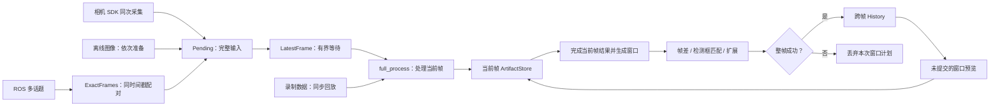

### 4.2 ArtifactStore 的 key、类型和所有权

可以把它理解成“线程安全、只允许新增的有类型字典”：

```cpp
perception::runtime::ArtifactStore store;
store.put<int>("demo.count", 12);
auto value = store.get<int>("demo.count"); // shared_ptr<const int>
```

每个条目同时记录字符串 key、`std::type_index`、`shared_ptr<const void>`。读取时必须 key 和类型都一致。

- key 不存在：立即抛错，而不是返回一个假结果。
- key 存在但类型不对：立即抛 `artifact type mismatch`。
- 同一个 key 再次写入：拒绝覆盖，防止两个任务悄悄争抢同一输出。
- 返回只读共享指针：下游不能通过正常接口改写上游的数据。
- `putShared()` 允许已有自有对象共享存储；`snapshot()` 只复制条目及共享引用，按过滤条件留下安全的数据。

共享引用能保证对象的生命周期，但原始裸指针指向的相机缓存、BPU 内存不会因为装进某个结构体就自动获得所有权。因此历史帧会主动复制图像和推理结果，不能把借用指针直接留到下一次相机采集。

#### 当前项目中的典型 key

| key | 类型与用途 |
|---|---|
| `full.temporal.input_window` | `r36::temporal::Window`；本帧开始时的窗口预览，包含自有历史引用 |
| `full.temporal.window` | `r36::temporal::Window`；history 功能成功补全当前帧推理/视差后的窗口 |
| `full.completed.<stage>` | `perception::FrameInfo`；产品阶段完成标记 |
| 推理引擎自己的输入、预处理、检测/分割输出 key | 由 `scheduling/inference` 的内置 Feature 建立；与本帧产品图的 Store 分开 |

产品图目前仍有很多功能通过本帧 `out` 结果对象和受约束的共享工作区交换数据，不能把它描述成“所有功能已经完全通过 ArtifactStore 解耦”。新增功能宜使用清楚的 typed artifact 接口；现有大块结果对象的进一步拆分仍是后续方向。

### 4.3 为什么功能写的是 FeatureContext，而不是直接修改 Store

每个 Task 有自己的 `FeatureContext::writes_`，作为一次事务：

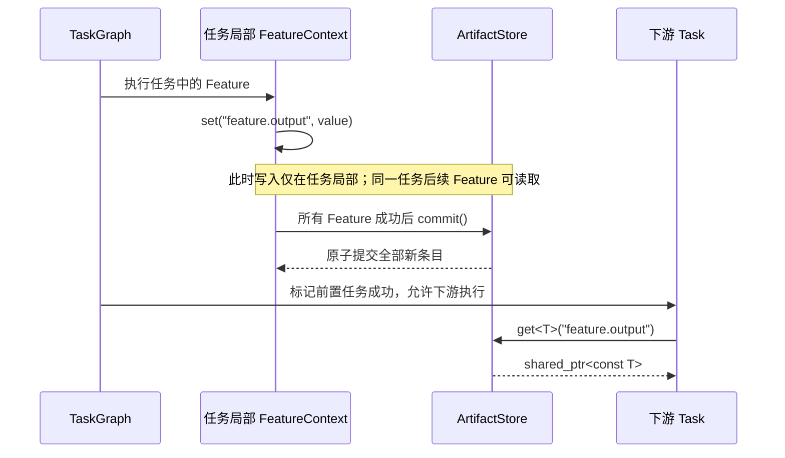

任务中若某个 Feature 抛异常，就不会调用 commit。下游依赖任务被跳过，不会看到半份输出。提交时会先检查重复 key，构建完整的新状态，再交换到 Store；读者看不到只提交一部分的状态。

这里的“事务”仅覆盖 artifact 和 History 的提交。已经写出的文件、已经发布的外部消息、某个厂商算法内部状态，不会自动回滚。扩展功能应尽量先计算、后提交，在输出阶段处理外部副作用。

### 4.4 DAG 边决定“什么时候读”，key 决定“读什么”

```json
{
  "worker_threads": 2,
  "nodes": [
    {"id": "keep", "feature": "history", "depends_on": ["infer"], "enabled": true},
    {"id": "diff", "feature": "temporal_difference", "depends_on": ["keep"], "enabled": true}
  ]
}
```

上面只用于说明边的意义：完整图还必须定义 `infer` 以及启用 history 所需的所有生产者。`diff` 通过 `depends_on` 等待 `keep` 成功，再读取固定 key `full.temporal.window`。把 key 写对并不能替代依赖边；锁只保证字典内存安全，不会替你保证生产者已经执行。

JSON 中没有 `artifactstore`、`artifacts`、TTL 或“时间戳自动查历史”的用户字段。`graph` 管顺序，`features/temporal/config.json` 管历史窗口，C++ Feature 管 artifact 的 key/type。

### 4.5 时序参数怎么配置

默认 `pipeline.json` 中 `history`、`temporal_difference`、`temporal_match`、`temporal_extension` 都关闭。只改下面的参数不会自动启动时序功能。

`features/temporal/config.json`：

```json
{
  "capacity": 4,
  "frame_interval": 1,
  "max_memory_mb": 64,
  "difference_threshold": 8,
  "match_iou_threshold": 0.5,
  "match_max_detections": 256
}
```

| 参数 | 意义 | 范围与注意事项 |
|---|---|---|
| `capacity` | 最多保留几个采样帧，包括当前采样帧 | 1～32；帧差或匹配要求至少 2 |
| `frame_interval` | 每多少个成功处理的唯一采集帧采样一次 | 1～1,000,000；按帧计数，不是毫秒 |
| `max_memory_mb` | 窗口内有效载荷预算 | 1～4096 MiB；不能理解为进程 RSS 上限 |
| `difference_threshold` | Y 亮度绝对差超过该值才计为变化像素 | 0～255，使用 `>` 判断 |
| `match_iou_threshold` | 同类别框成为候选匹配的最小 IoU | 大于 0、至多 1 |
| `match_max_detections` | 每个参与帧最多检查多少个检测框 | 1～1024，超过时标记 `matching_truncated` |

数值设为 `null` 可继承 SDK 对应设置；不应通过复制第二份 `difference`、`match` 开关与图打架，是否执行由图中两个节点决定。修改配置后重新启动，当前不支持运行中热修改窗口。

#### 开启历史但不做分析

启用 `history`，让它依赖所有启用的数据生产者。默认全流程图通过 `maps`、`recharge` 等依赖可以到达此前的推理、RGB、视差阶段；若精简了图，需按当前图显式补上相应生产者路径。

#### 开启帧差与匹配

启用 `history`、`temporal_difference`、`temporal_match`，容量至少为 2。`temporal_match` 必须在帧差之后执行（两者同时开启时）；输出的 publish/record 还须等待所有启用的时序阶段。需要扩展回调时再启用 `temporal_extension`。

检测框匹配需要两帧真实检测结果。没有检测的图可以分析亮度帧差，但不会生成有意义的检测框关联。

### 4.6 抽帧的精确含义

`capacity=4, frame_interval=3` 时，假设输入都成功且身份唯一：

| 成功处理次序 | 1 | 2 | 3 | 4 | 5 | 6 | 7 | 8 | 9 | 10 | 11 | 12 | 13 |
|---|---|---|---|---|---|---|---|---|---|---|---|---|---|
| 加入窗口 | 是 | 否 | 否 | 是 | 否 | 否 | 是 | 否 | 否 | 是 | 否 | 否 | 是 |
| 窗口 | [1] | [1] | [1] | [1,4] | … | … | [1,4,7] | … | … | [1,4,7,10] | … | … | [4,7,10,13] |

第一帧立即采样。`ready` 仅表示当前保留帧数等于 capacity；两帧就能做差，并不需要等四帧。未采样帧继续跑本帧算法，但时序分析本次无效，不会重复比较上一对历史帧。

当 `capacity=1`，实现将实际间隔固定为 1，含义是“只保留最新帧”。这时不能做跨帧差和匹配，因此配置层会拒绝开启这两种分析。

实时输入若丢帧，采样计数针对进入算法并成功提交的唯一采集帧，不是相机驱动产生过的所有帧。只有稳定地处理每个采集帧，`frame_interval=3` 才等价于相机每三帧取一帧。假设实际处理 30 FPS，每三帧采样约 100 ms；处理只有 10 FPS 时约 300 ms。当前不提供固定毫秒间隔采样参数。

### 4.7 History 的准备、补全、提交

1. `prepare(full_frame)` 建立 Plan，引用旧窗口；如本帧应采样，复制左图和可选高清图。此时不改变已提交历史。
2. 产品图执行检测/分割、视差和其他已启用功能。
3. history Feature 调用 `complete()`，补上本帧自有视差、检测框和 mask。
4. 通过 `context.set("full.temporal.window", window)` 提交只读窗口，帧差/匹配/扩展读取它。
5. 整张图成功、必需保存工作成功后才调用 `History::commit(plan)`。失败保留旧窗口，同一帧重试不会重复抽样或增加一次序号。

当前 `full_gate` 会串行保护同步引擎调用。同一帧里的独立任务可以在 worker 线程并行，当前实现没有把多帧算法同时放进同一个引擎执行。

### 4.8 什么会清空历史

| 情况 | 行为/`reset_reason` |
|---|---|
| 相同 ID、相同时间戳、相同几何/标定 | `duplicate_ignored`；不作为新采样 |
| 时间戳倒退或非重复的时间戳不递增 | `timestamp_discontinuity`；清空旧窗口，从当前帧重新开始 |
| 图像尺寸、stride、格式或高清图是否存在变化 | `geometry_changed` |
| 内参任一数值变化 | `calibration_changed` |
| `psdk_full_reset_history()` | 显式清空，不影响已经持有的旧结果快照 |
| `psdk_full_command()` 切换/重设模式 | 清空当前引擎历史 |
| 录制基准每次测量 repeat 开始，包括预热后的首轮 | 重置历史，防止预热帧和上一轮测量污染窗口 |

相机帧号回绕本身不导致清空：时间戳仍递增就可以继续。ROS `ExactFrames` 位于 History 之前，会丢弃过时消息；这种消息可能根本进不到 `History::prepare()`，不能指望下游历史重置替代上游重连与同步策略。

当前录制 runner 保留文件顺序及 inventory 中的原始身份，但传给 SDK 的 frame_id 和 timestamp_ns 是本次回放生成的序号及 steady_clock 时间。它适合验证按帧计数的窗口、帧差、IoU；依赖真实采集时间间隔的后续时序算法，需要先补充原时间轴回放。每轮 reset 计入测量范围，complete.json 会记录 reset 次数与策略。

### 4.9 内存和所有权怎么算

一帧 640×544 的紧密 NV12/I420 为 522240 字节；一份 Q8 为 696320 字节，一份全尺寸 mono8 mask 为 348160 字节。三项约 1.49 MiB，再加检测框、可选高清图以及容器开销。

预算只统计窗口持有的图像、Q8、mask、检测数组等载荷。不统计模型权重、ORT/BPU 工作区、全部容器开销、ROS 队列以及调用者仍持有的旧结果，因此 `max_memory_mb=64` 不能保证 RSS 不超过 64 MiB。

超过容量或总载荷预算时，移除最旧采样帧，直到满足要求；`memory_limited=true` 表示本次因预算发生裁剪。若单帧本身超过预算，则报错，不能为了凑预算返回半张图。结果通过共享引用保留旧帧时，旧对象要到最后一个引用释放才真正回收；持续保存所有结果句柄仍会增长内存。

当前 History 保存左图、可选高清图、Q8、检测、mask 和内参；不保存右图、所有点云或地图。以后若做双目时序融合或跨帧点云融合，需要显式扩展历史契约和预算，不能假定这些数据已经在窗口里。

### 4.10 当前帧差和匹配实际做了什么

**帧差**比较最后两个采样帧的 Y 平面：算平均绝对亮度差、超过阈值的像素数；两帧都有同尺寸分割结果时，还统计 mask 标签变化数。它没有补偿相机运动、曝光变化或物体运动，不等同于场景变化检测模型。

**匹配**仅比较最后两个采样帧的同类别检测框：计算 IoU，按分数从高到低贪心选择一对一匹配。输出 previous/current 索引、class_id、IoU。它没有长期 track_id、卡尔曼预测、特征向量或丢失目标恢复，不能称作完整多目标跟踪。

**扩展**提供采样窗口与分析结果给可选 C 回调。回调不能重入会修改同一 SDK 的 API；回调返回失败会让本帧失败，历史不推进。

### 4.11 如何观察与验证

- ROS：`ros2 topic echo /perception_ros_so_demo/history`，查看 `count`、`sampled`、`ready`、`reset_reason`、`frames`、`difference_valid`、`matches`。
- 保存结果：查看每帧 `temporal.json`、`task_trace.json`，确认 history 和分析节点实际 succeeded。
- C API：`psdk_full_result_get_temporal_view()`；里面借用的指针在对应 result release 之前有效，不能释放后继续使用。
- 单元验证：SDK CTest 的 `r36_temporal_sampling_memory_DAG_contract` 和 `r36_temporal_public_C_ABI_ownership_contract` 涵盖抽帧、失败重试、所有权、差分、IoU、预算与结果跨引擎生命周期。

改变一个时序参数时，建议先用固定两帧或短录制验证窗口内容和分析数值，再查看耗时、RSS。这样可以区分“采样没有发生”“窗口尚无前一帧”“算法计算结果为零”和“分析功能根本没有执行”。

---

## 5. 本次检查发现的问题、修复与验证

本次按输入、调度、功能、配置与时序逐项核对，直接修复了以下实际问题：

| 问题 | 当前行为 | 主要代码 |
|---|---|---|
| 关闭 cloud 时，独立 disparity 配置可能通过却没有真正执行 | 视差与 mapping 开关分离，原 Q8 与新 Stereo 都可独立执行；SDK 返回自有 Q8，ROS 可发布 disparity_q8 | native_pipeline.cpp、full_pipeline.cpp、features/ros |
| AI 与回充组合会被 mapping 模式连带要求 Q8 | AI+回充使用 both 命令，但 mapping_enabled=false，不订阅不需要的 Q8 | native_pipeline.cpp、perception_node.cpp |
| 时序参数只能在 SDK 模板里找，回充缺少清楚的功能入口 | 新增 temporal/config.json 六项参数与 recharge/config.json 单一参数文件引用 | native_features.cpp |
| 启用帧差/匹配但容量为 1，功能永远无法得到前帧 | 配置阶段拒绝；SDK 还检查分析开关与 graph 一致 | native_pipeline.cpp、full_config.cpp |
| recording controller 强制关闭 history/自动标定 | 保留用户配置；只有旧字段缺失时才使用兼容默认值 | compare/native/src/orchestrator.cpp |
| 预热和上轮 repeat 的历史可能污染本轮结果 | 每轮测量开始重置 History，complete.json 记录次数与策略 | compare/runner/include/replay_passes.hpp |
| 禁用 temporal_extension 时，分析已执行但保存 JSON 仍是旧值 | 输出阶段及最终返回前刷新时序序列化；不依赖扩展回调开关 | full_pipeline.cpp |
| 回充 GDC 输入话题无法从日常功能文件修改 | features/ros/config.json.gdc_topic 贯通到 ROS 参数 | native_features.cpp、native_pipeline.cpp |
| 未使用相机的 ROS/recording 输入可能被固定相机模式误拦 | 相机 Q8 模式的语义限制只检查实际相机/录制采集入口 | native_features.cpp |
| Stereo 命令帮助仍引用已移除的 Python 程序 | 更正为实际 C++ provider/pointcloud 流程 | features/stereo/runner/src/main.cpp |

其中时序 JSON 问题来自实际两帧回放：原先窗口数已正确、任务 trace 也 succeeded，但第二帧 difference_valid 仍为 false。修复后检查公开 C ABI、显式保存、图中 record 保存及真实 CPU 录制回放，确保输出对应已计算的分析。

验证证据集中在 [本轮验证记录](../validation/evidence/v3_guide_validation.json)。固定两帧回归只证明代码一致性；模拟 SDK 只验证通信、格式和所有权。当前环境没有完成本轮 ARM 交叉构建、真实 X5 相机/BPU 模型效果和性能验证。

### 尚需继续改进的地方

- 产品图已可配置功能与依赖，但功能名单在 C++ 显式注册，暂不支持仅靠 JSON 加载任意插件，也不支持同一产品功能在一帧内出现多个实例。
- mapping 的共享工作区、兼容 start_config 中的部分推理策略与原算法全局状态尚未完全解耦，不能任意并行或重排。
- History reset 只隔离历史窗口；严格评估其他有状态算法，应使用独立进程和相同序列、固定标定策略。不能把 repeat 解释为所有厂商内部状态都已经重置。
- recording 目前不忠实复现原采集时间轴，也没有高清 GDC；新增依赖真实时间间隔的时序算法或回充回放，需要先扩展录制契约。
- 新 Stereo 仍依赖 Horizon 后端，当前未新增 ONNX Stereo CPU 推理器。
- 内参尺寸应按整数填写，例如 640/544；部分底层入口接受 640.0，而主配置二次整数检查更严格，后续应统一整数归一化规则。

下一步重构建议每次只移动一个数据边界：先定义明确输入/输出类型及所有权，再接通配置、依赖和发布，最后对同一录制做逐帧差异与性能比较。这样能把结构调整造成的差异和算法本身的差异分开验证。
