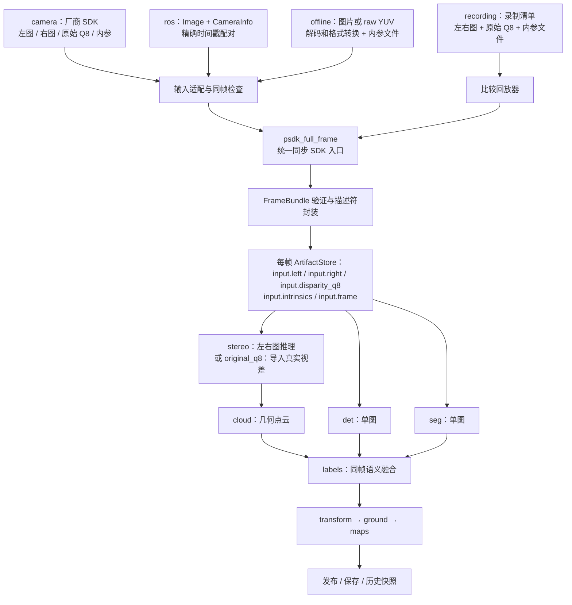
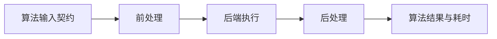

# v4：统一推理框架与四种输入接入 DAG

## 1. 本次改动

v4 保留 v3 作为比较基线，新的源码位于 `perception-stereo-cpp-v4/`。默认用户配置升级为 `schema_version: 4`，仍然只有一张需要手动维护的 `graph`。

1. 删除默认流程中的显式 `rgb` 节点。图像颜色转换成为每帧公共资源，需要 RGB 的点云、叠图等消费者按需获取，同一帧只转换一次。
2. 检测、分割、Stereo 使用共同的推理阶段契约，但分别配置为 `algorithm: det / seg / stereo`。检测和分割分别持有真实的模型会话、输入输出和结果，不是重复调用一遍包含两个模型的旧引擎。
3. 几何点云只等待视差。`labels` 阶段才等待检测、分割，将同帧语义注入已有几何点云，避免点云计算无谓地等待 AI。
4. 四种输入先形成统一帧输入包，再在根任务执行前注入 ArtifactStore。左右图及原始视差都检查帧号、时间戳、尺寸和内存布局。

**性能边界：**当前检测、分割后端还存在进程级共享工作区，保留必要的互斥锁。因此 det、seg 是独立任务，但它们的原推理执行仍串行。Stereo 和几何点云可以按 DAG 依赖调度；不能仅凭结构改变断言 FPS 提升。结果 JSON 的 `inference_execution` 会标明 `independent_lanes_serialized_legacy_exact_workspace`。

## 2. 四种输入如何进入同一张 DAG



这里有两类入口：camera、ros、offline 使用 C++ ROS 应用的 `Pending → processFrame()`；recording 使用独立 C++ 比较回放器。它们最终都调用 `psdk_full_process()`，共用产品 DAG 和功能实现。camera 直取时算法节点自身从 SDK 取帧；ROS 模式由另一个相机节点发布，算法节点只订阅。两种相机方式应避免同时独占打开同一设备。

输入适配器负责打开设备、订阅、读取文件和配对。DAG 处理已经准备好的一帧，根节点可以直接读取输入，不需要依赖一个常驻采集节点。采集线程不会作为一项无限运行的 DAG 任务占住整张图。

四种是可切换的数据来源，一次运行通过 input.mode 选择一种；不是同时打开四个独立输入流。一个 Stereo 输入包中的左右图属于同次采集。多路相机并行还需要进一步拆分会话和全局资源锁。

| 模式 | 数据提供者 | 新 Stereo 需要什么 | 内参来源 | 背压策略 |
|---|---|---|---|---|
| camera | 相机 SDK | 同次采集的左右图 | SDK 自动读取并匹配图像尺寸 | 处理中保留最新待处理帧，可能丢旧帧 |
| ros | 外部发布节点 | 相同采集时间戳的左右 Image、CameraInfo | 默认订阅 CameraInfo，也可显式提供已标定 ros.intrinsics | 缓存配对后保留最新待处理帧 |
| offline | 图片文件列表 | 一一对应的左右图片 | 需要几何计算时显式 `intrinsics_file` | 等待处理，按配置 fps 提交 |
| recording | 录制目录及清单 | 当前录制容器统一要求左右图和真实 Q8；Stereo 方法使用左右图，Q8 留作基线比较 | 显式 `recording.intrinsics_file` | 同步逐帧回放，支持预热/重复 |

`original_q8` 不运行 Stereo 模型，也不要求右图；它需要真实同帧 Q8.8。普通离线图片不会凭空生成相机原始 Q8。新模型也不能只输入左图。完整效果比较应先同步录制左右图和原始 Q8，然后分别运行两种来源。

这里“不要求右图”指 SDK 算法契约以及 camera/ros 输入；recording 文件容器当前始终校验完整左右图和 Q8，即使只回放一种方法也不能省略。离线适配器当前主要支持图片对输入，不提供独立 Q8 文件字段。

当前 ROS 适配器的左右图使用 `sensor_msgs/Image`，encoding 为 `nv12` 或 `i420`、有效图像尺寸为 640×544；原始 Q8 使用小端 `16UC1`，数值除 256 才是像素视差，不能用毫米深度图代替。配对使用精确采集时间戳，CameraInfo 必须与对应图像匹配。左右光学坐标系名字可以不同，但必须明确填写。

### 2.1 ArtifactStore 中放了什么

| 键 | C++ 类型 | 存在条件 |
|---|---|---|
| `input.left` | `psdk_frame` | 每帧必需，NV12/I420 |
| `input.right` | `psdk_frame` | 提供了右图时；支持 NV12/I420/BGR/RGB |
| `input.disparity_q8` | `psdk_disparity_q8` | 提供了真实原始 Q8 时 |
| `input.intrinsics` | `psdk_camera_intrinsics` | 描述符始终存在；几何任务另验证有效值 |
| `input.frame` | `perception::FrameInfo` | 每帧帧号和纳秒时间戳 |

这些输入描述符是只读的，像素内存仍由调用者持有。`psdk_full_process()` 同步等待 DAG 完成，调用返回前不能释放或修改图像。不会为方便调度复制两份大图，也不会跨帧缓存这些借用指针。右图和 Q8 的帧号、时间戳、尺寸必须与左图一致。

实现入口是 `core/runtime/include/perception/frame_input.hpp` 的 `FrameBundle::borrowed()`、`seed()`。`scheduling/pipeline/src/full_pipeline.cpp` 调用 `Graph::runContext(..., seed)`；种子回调先写入输入 ArtifactStore，再启动根任务。det、seg 使用 `context.get<psdk_frame>("input.left")`，Stereo 检查 `input.right`。

ROS/在线 Stereo 仍通过现有 `disparity_provider` C 回调取得模型输出。回调 ABI 只传左图，因此应用在调用 SDK 前注册同帧左右图，返回后清除；DAG 同时拥有并验证左右输入描述符。这是兼容既有 C 接口的适配，后续可以升级为直接接受整个输入包的推理插件接口。

## 3. 统一推理框架是什么意思



共同实现位于 `core/runtime/include/perception/inference_task.hpp` 的 `StagedInvocation`：检查输入数量和同帧身份，保证前处理、后端、后处理按顺序各执行一次，记录阶段耗时，任一阶段失败后禁止继续执行。det/seg 与在线、录制回放 Stereo 都使用它。

算法适配器仍保留各自数值实现和模型资源：

| 算法 | 输入 | 前处理 | 后端 | 后处理 |
|---|---|---|---|---|
| det | 左图 | 原检测缩放、YUV/张量准备 | X5 BPU 或 x86 ONNX Runtime | 解码、阈值、NMS、框坐标恢复 |
| seg | 左图 | 原分割缩放、张量准备 | X5 BPU 或 x86 ONNX Runtime | 双线性插值及类别 mask |
| stereo | 左右图 | 双图格式转换、显式尺寸适配 | Horizon Stereo | 视差恢复、Q8.8 归一化 |

**共享的是执行契约，不是强迫三个模型使用相同输入或相同后处理。** 当前 det/seg 的内部阶段图由配置器自动生成，用户无需编辑。Stereo 后端内部的 NV12 打包、infer/wait、张量解码仍在 Horizon 模型调用中，其 backend 阶段耗时不能当成纯 BPU 时间，与检测的细分统计须按口径解释。

当前支持每种算法一个实例，不支持在同图配置两个不同 det 模型。算法专属参数仍来自 `features/detection|segmentation|stereo/config.json`；尚未增加每个节点任意 `params` 或独立采样周期。不是任意字符串就能成为新算法，需注册并实现适配器。

## 4. 怎么配置 DAG

主配置 `pipeline.json` 决定来源和流程。下面是默认核心部分，省略后续地图、发布等节点：

```json
{
  "schema_version": 4,
  "input": {"mode": "camera", "disparity_source": "raft_stereo"},
  "sdk": {"root": "${SDK_ROOT}", "base_config": null},
  "graph": {
    "worker_threads": 3,
    "nodes": [
      {"id": "det", "feature": "inference", "algorithm": "det",
       "inputs": {"image": "input.left"}, "depends_on": [], "enabled": true},
      {"id": "seg", "feature": "inference", "algorithm": "seg",
       "inputs": {"image": "input.left"}, "depends_on": [], "enabled": true},
      {"id": "stereo", "feature": "inference", "algorithm": "stereo",
       "inputs": {"left": "input.left", "right": "input.right"}, "depends_on": [], "enabled": true},
      {"id": "cloud", "feature": "cloud", "depends_on": ["stereo"], "enabled": true},
      {"id": "labels", "feature": "labels", "depends_on": ["cloud", "det", "seg"], "enabled": true}
    ]
  }
}
```

- `id` 是本图节点名，用于 `depends_on`。
- `feature` 选择已注册功能；`inference` 由 `algorithm` 区分检测、分割、Stereo。
- `inputs` 声明数据角色。目前支持表中的固定绑定，会校验错误拼写；尚未实现任意端口重连。绑定可省略并采用相同默认值。
- `depends_on` 控制执行顺序，不负责传图。根任务的空依赖表示它可以在输入注入后就绪。
- `enabled` 关闭任务。禁用节点本身不执行；需要真实数据的下游若缺失生产者，配置检查会拒绝。
- `worker_threads` 是外层任务图的线程数；线程数不解除后端共享资源的互斥要求。

`input.disparity_source` 决定 `stereo` 位置做模型推理还是导入原始视差。配置器把这个选择固化到生成的 SDK `effective_full.json`，SDK 同样检查来源，避免模型推理被偶然传入的 Q8 绕过。旧 schema 3 及没有 `algorithm` 的合并 inference 节点保留兼容路径；新版本应使用独立节点。

### 4.1 切换输入

主文件只需修改 `input.mode`，并填写对应来源配置：

| 切换到 | 主配置 | 来源配置 |
|---|---|---|
| 相机直取 | `"mode": "camera"` | 根 `camera.json`：SDK 动态库、厂商配置、采集超时 |
| ROS | `"mode": "ros"` | `features/ros/config.json`：左右/Q8/CameraInfo 话题、QoS、配对缓存 |
| 离线 | `"mode": "offline"` | `features/offline/config.json`：左右文件列表、format、fps、内参文件 |
| 录制回放 | `"mode": "recording"` | 主文件 `recording` 对象：directory、intrinsics_file、limit、warmup_frames、repeat 等 |

离线示意（放在项目的 `features/offline/config.json`，路径均相对主 pipeline 文件）：

```json
{
  "left_files": ["data/left/000001.png", "data/left/000002.png"],
  "right_files": ["data/right/000001.png", "data/right/000002.png"],
  "format": "nv12",
  "fps": 2.0,
  "loop": false,
  "max_frames": 0,
  "wait_for_subscribers": false,
  "intrinsics_file": "calibration/my_camera.json",
  "rectified": true,
  "calibration_confirmed": true,
  "frame_id": "camera_optical_frame"
}
```

普通 PNG/JPEG 先解码，再按离线输入契约转换到 640×544 NV12/I420；`format` 指最终输入格式，不要求 PNG 内容本身是 NV12。仅检测/分割可使用离线缩放；**当前离线 Stereo 要求源左右图已经是校正好的 640×544，并对应指定内参，拒绝先 letterbox 或拉伸其他尺寸来冒充校正图。** raw 文件必须满足严格尺寸和布局。Stereo 再按模型配置显式变换左右图到 640×352 等模型尺寸，输出恢复到原输入网格；视差幅值只按横向缩放比例恢复。`rectified=true` 是对已有校正数据的确认，不能自动把未经校正的双目图变成合格数据。

### 4.2 单功能测试

仓库包含准备检查通过的示例：`config/examples/det_only_ros.json`、`stereo_cloud_ros.json`、`full_ros.json`。这些文件的模型相对路径按它们各自所在目录计算，不能直接复制到别处而不调整路径。

仅检测的最小图为 det → publish；关闭 seg、stereo、cloud、labels、后续地图和历史等节点。仅 Stereo 可使用 stereo → publish；相机坐标 PLY 只需要 stereo → cloud，再正确配置输出保存。要地面分类则继续 transform → ground；也可在 labels 关闭时继续 maps，生成纯几何地图。原始 Q8 点云则把来源改为 original_q8，提供真实 Q8，勿仅改模型文件名。

检测/分割还各有 feature 文件的 `enabled`；图开关与功能开关共同决定是否运行。关闭功能后，必要的下游约束仍会检查。修改图后先执行 prepare-only，看 `resolved.json` 和生成的 `effective_full.json`，再运行。录制比较目录还会保存自己的 `full.json` 配置快照。

### 4.3 配置位置与模型

```text
pipeline.json                  输入模式、视差来源、流程、recording、配置文件引用
camera.json                    相机 SDK 与采集设置
visualization.json             发布、保存路径、PLY、显示设置
features/detection/config.json 检测权重与阈值
features/segmentation/config.json 分割权重与参数
features/stereo/config.json    Stereo 权重、image_transform、input_width/height
features/pointcloud/、fusion/ 等 各功能设置
models/x5/*.bin                X5 权重
models/cpu/*.onnx              CPU 检测与分割权重
```

模型字段使用相对路径，例如 `models/x5/r34_tail_pointwise_shuffle2_grouped_grid_352x640_nv12_mixed.bin`。不需要模型环境变量。示例中的 `${SDK_ROOT}` 只用于平台 SDK 安装目录，也可改成实际目录的相对路径；它不是模型路径变量。

## 5. RGB 现在在哪里

`FrameResources::leftRgb()` 位于 `core/runtime/include/perception/frame_resources.hpp`，使用 `std::call_once` 延迟生成、缓存同帧 RGB。转换失败不发布缓存，后续调用可以重试。结果通过共享所有权保留 RGB，释放原输入后保存结果仍安全。

点云需要颜色时获取 RGB；可视化需要叠图时获取 RGB。只有检测/分割且关闭叠图时，不为这个公共资源额外生成 RGB。模型自己要求的缩放、NV12/张量准备仍属于各算法前处理，不能等同于这份可视化 RGB 缓存。旧配置的 rgb 节点还可以执行，但默认新图不用它。

## 6. 时序、错误与资源所有权

每次同步处理创建新的输入包和 ArtifactStore。FeatureContext 写入任务局部事务，任务成功才提交，依赖任务随后可读。输入种子是在所有任务之前写入的，缺失键或类型错误会明确报错。

History 是另一套显式拥有内存的历史快照，按容量、采样间隔和内存上限保留数据。不能依靠 ArtifactStore 的输入指针跨帧。history 节点要等待所有启用的数据生产者；labels 等待所有启用的语义生产者；publish、record 等输出节点同样检查汇合关系。失败任务的依赖链不会继续，独立分支可完成自己的任务，SDK 整帧返回失败状态。

det 和 seg 的结果各自保留自己的底层 owner；对外统一视图只引用这些不可变结果，不复制 mask，也不会销毁一个会话就让另一个结果失效。公共 C 输入结构在末尾增加可选 `right`，新 SDK 仍识别旧结构大小；使用 v4 应用应重新构建 v4 SDK，不能把新版结构直接交给未更新的旧库。

## 7. 如何增加新模型算法

1. 在 `features/<新算法>/` 放头文件、实现和 `config.json`，定义输入数量、格式和输出类型。
2. 实现前处理、后端、后处理，使用 `StagedInvocation` 统一检查同帧身份、顺序、错误和耗时。模型和工作区归会话所有，避免新建全局可变状态。
3. 在配置层增加允许的字段和默认值，加载相对模型路径，先验证缺输入/错误尺寸/缺模型。
4. 在 `product_graph.hpp` 注册算法到阶段的映射及输入绑定，定义真实生产者依赖，再在 `full_pipeline.cpp` 绑定实际执行。
5. 定义类型化 Artifact 输出。现有产品点云阶段还有共享 MappingPipeline 工作区，须保持验证过的顺序；不能只删除依赖就认为它们可以并行。
6. 用固定录制数据与基线比较输入 SHA、检测、mask、地图、PLY 坐标/颜色；再上 X5 测量计算、保存、排队耗时、CPU、RSS 和 FPS。

如果只是替换现有 Stereo 模型，优先修改 `features/stereo/config.json` 的 model 与明确的输入尺寸/变换方式，保持左右图校正和内参一致，不需要新增 DAG 节点。

## 8. 构建与运行

必须重建 SDK 和应用。详细依赖、交叉编译参数沿用 `docs/09_纯CPP输入与Graph迁移.md`，其中旧目录名 v3 替换为 v4。核心构建入口没有变化：

```bash
# Ubuntu 上交叉编译 SDK；依赖都必须是与 X5 匹配的 AArch64 版本。
cd /path/to/perception-stereo-cpp-v4
export X5_SYSROOT=/absolute/path/to/x5/sysroot
export STEREO_HORIZON_ROOT=/absolute/path/to/x5/horizon
bash tools/build_backend_sdk.sh --backend bpu \
  --horizon-root "$STEREO_HORIZON_ROOT" \
  --toolchain "$PWD/cmake/x5-toolchain.cmake" \
  --build-dir "$PWD/build/backend_x5" \
  --install-dir "$PWD/install/backend_sdk" -- \
  -DX5_SYSROOT="$X5_SYSROOT" \
  -DOpenCV_DIR="$X5_SYSROOT/usr/lib/aarch64-linux-gnu/cmake/opencv4"

# ROS/原生应用；目标 ROS/PCL/OpenCV 查找细节见旧指南和 tools/target_ros_env.sh。
export SDK_ROOT="$PWD/install/backend_sdk"
bash tools/cross_build.sh

# X5 上：在部署的完整 v4 项目目录执行。
cd /userdata/perception-stereo-cpp-v4
export SDK_ROOT="$PWD/install/backend_sdk"
export INSTALL_ROOT="$PWD/install/perception_ros_so_demo"
bash tools/run_pipeline.sh --config "$PWD/pipeline.json" \
  --prepare-only --run-dir /userdata/stereo_results/v4_prepare_001
bash tools/run_pipeline.sh --config "$PWD/pipeline.json" \
  --run-dir /userdata/stereo_results/v4_camera_001
```

路径是示例，按实际部署改；prepare 与正式运行须用两个不同的新目录。prepare-only 只检查并生成配置，不打开相机、不运行推理。当前 x86 可测试 det/seg ONNX、原始 Q8 点云、ROS 通信与模拟输入；没有新增 CPU Stereo ONNX 后端，不能在 x86 把 X5 BIN 当 ONNX 执行。

在线保存仍需同时满足 `graph.record.enabled=true`、`visualization.save_root` 非空、`save_every_n>0`；PLY 还要 `save_ply=true`。保存位置为 save_root 下对应运行目录，再分 frame 目录。save_root 为空时不会保存在线结果。录制回放结果在 run-dir/comparison，抽样由 recording.save_every_n 控制。

直接使用比较器的 `--method original`、`--method stereo` 或 `--both` 时，CLI 明确选择的方法优先于传入 SDK 配置的来源；比较器分别生成 `full_original.json`、`full_stereo.json`，写入对应的严格来源并记录 SHA256。主 pipeline 入口仍根据 input.disparity_source 生成单方法命令。这样 same-data A/B 可以共享模型、标定和功能设置，同时让每条链路明确检查自己的输入。

## 9. 如何判断此次改造正确

验证分三层：输入/顺序/所有权契约测试；实际 CPU 与 ROS 构建和集成测试；同录制数据的 v3/v4 数值回归。详细完成项和限制记录在 `validation/evidence/v4_validation.json`。

本次在 WSL Ubuntu 22.04 / x86_64 / ROS Humble 实际完成：SDK 37/37、原生工具 4/4、ROS 应用 9/9 测试通过。离线和 ROS 订阅各处理两帧，真实 ONNX 检测执行、分割关闭且 mask 为零字节；模拟厂商相机 SDK 自动提供并缩放内参，收到两帧结果和两条点云，末帧 21,760 点。录制模式用相同两帧验证数据回放 v3/v4：检测一致，26 个图像/二进制产物一致，10 个 PLY 的坐标最大差值为 0、颜色一致。它们验证改造前后行为，不代表新 Stereo 的精度或 X5 性能；真实相机和 X5 BPU 尚未执行。

需要保留的风险与下一步：

- det/seg 尚未消除旧后端的全局状态，分开会话可能增加线程、内存或串行开销；本版不承诺性能提升。
- Stereo C 回调依赖应用预注册的右图，是兼容桥梁，尚非完全通用的多输入插件 ABI。
- 产品部分输出仍由会话的结果对象和 MappingPipeline 管理，并非所有节点都已经改为纯 Artifact 输入输出。
- FrameBundle 当前使用 SDK 的 C 输入结构，是兼容桥梁；要让核心层完全独立于公开 ABI，应另提取内部图像对和视差类型，再由 SDK 桥转换。
- 完整 SDK 会话入口还保留进程级 full_gate，多实例调用被串行保护；本版的并行主要发生在同一帧内部。
- 当前每种推理算法一个实例、固定绑定和共享采样周期；任意多实例、端口重连及独立 cadence 需要后续扩展。
- X5 实际模型数值、BPU SDK 版本兼容、相机采集和板端性能必须在真机验证，CPU 回归不能替代这些测试。
- `docs/10_*`、旧 PPT 及 v1/v2/v3 验证记录是改造前资料，本版流程以本文、pipeline.json 和 v4 验证记录为准。
