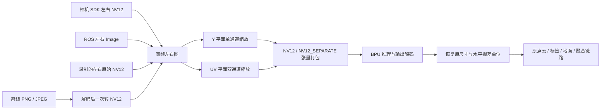

# v5：新双目模型、直接 NV12 与三组对比

## 1. 这次修改了什么

以 `perception-stereo-cpp-v4` 为基线复制为独立 v5，原 v4 保留。运行程序全部为 C++；编译和启动脚本使用 Bash，不需要 Python 环境。

默认双目模型为：

```text
models/x5/r34_crop_stage2_i12_cheb5_max1_tail_int16_352x640_20261012.bin
SHA256: 6d58f210776e6ca2981806f45eec16ca53ee822c58d241c96d8624b59b6afc39
```

BIN 和供应商 YAML 已复制进 `models/x5/`。检测与分割模型继续使用 `mmyolo0828.bin`、`pidnet_0825_3classes.bin`，三组完全一致。

模型 YAML 指定两路输入为运行时 NV12，逻辑维度为 NCHW `[1,3,352,640]`，训练输入为 RGB，归一化比例为 `1/255`。**逻辑 C=3 不表示主机需要传三通道 RGB。** 每路紧密 NV12 是 `640×352×3/2 = 337920` 字节；640×544 的原相机 NV12 则是 522240 字节。

主机不再重复归一化。启动时查询实际 BIN 的 `tensorType`、layout、valid/aligned shape、量化与输出属性，要求两路为 `NV12` 或 `NV12_SEPARATE`；不满足契约会明确失败，不偷偷换模型。`tail_int16` 不能作为输出数据类型或 Q8 单位的依据：输出从运行时属性解码成 float32 像素视差，再按应用契约转换为 Q8.8。

## 2. NV12 如何送进新模型



有原始 NV12 的路径不经 BGR。I420 只交错 U/V 后进入同一路径。Y、UV 分开缩放，UV 的 U/V 两个通道不会互相混插；支持源行填充，张量 padding 按模型元信息处理。需要 BGR 的点云着色等功能仍按需转换，直接 NV12 指的是 Stereo 推理输入路径。

张量约束参考 [X5 官方模型推理接口说明](https://developer.d-robotics.cc/x5_sdk_doc/toolchain_development/intermediate/dnn_api.html)：该接口的 NV12 输入具有特殊的零 stride 元数据和宽度 16 字节对齐要求。当前 codec 按此契约处理，遇到非标准布局明确拒绝；实际 BIN 属性须以检查器输出为准。这个 stride 是模型张量描述，与相机原始图像每行的 source stride 分开处理。

默认 `image_transform=resize`：把左右 640×544 显式伸缩到 640×352；视差恢复到 640×544，视差值只乘横向比例 `640/640=1`，不会乘高度比例。原左图、内参和 bxf 保持原坐标系。文件名含 crop 不能确定裁剪 ROI，因此没有擅自实施裁剪；若模型训练要求特定 ROI，需要提供 ROI 和标定变换，再单独增加 crop 模式。

如果原图已经是 640×352，可用 `strict` 禁止缩放。两幅图必须已矫正、来自同一帧、具有相同尺寸；模型不能代替双目标定。

主要代码：

| 责任 | 文件 |
|---|---|
| NV12 / I420 拷贝、Y/UV 缩放 | `features/stereo/runner/src/nv12.cpp` |
| Horizon 输入打包、输出反量化 | `features/stereo/runner/src/tensor_codec.cpp` |
| 模型加载、infer_nv12、推理资源管理 | `features/stereo/runner/src/horizon_stereo.cpp` |
| 在线 camera / ROS 的双目 provider | `features/stereo/src/stereo_provider.cpp` |
| 录制同帧左右图与真实 Q8 | `compare/capture/main.cpp` |
| 三组独立进程与配置生成 | `compare/native/src/orchestrator.cpp` |
| 逐帧算法与资源指标 | `compare/runner/src/main.cpp` |
| BPU 驱动采样 | `features/metrics/backend/src/bpu_metrics.cpp` |
| 汇总、CSV、HTML 点云查看器 | `compare/native/src/report.cpp`、`assets/compare_viewer.html` |

## 3. 三组比较的范围

| 方法名 | 输入 | 本次执行 | 输出 |
|---|---|---|---|
| `detseg_only` | 同一左 NV12 | 检测 + 分割 + 必要的应用输出 | 检测、分割、指标，无点云 |
| `original` | 同一左 NV12 + 录制 Q8 | 检测分割 + 原 Q8 点云及配置的融合 | 指标、可选 PLY / mask / result |
| `stereo` | 同一左、右原始 NV12 | 检测分割 + 新双目推理 + 相同点云融合 | 指标、可选 PLY / mask / result |

三组由同一次相机录制生成同一份六列 `pairs.tsv`，第六列直接引用原始右 NV12，不从 PNG 重新编码。原始左右图、Q8、模型和配置记录 SHA256；组间重新校验输入与模型。每组启动独立进程，独立初始化、预热和测量，避免把新模型常驻内存算进其它组。`detseg_only` 自动关闭几何、回充、时序节点，并同步配置开关；不会创建 Stereo 模型或读取右图/Q8。

公平性边界：`original` 使用已经录好的 Q8，**不包含相机产生 Q8 的时间、CPU 或硬件开销**。该项明确为 null，不能把两组回放差值宣称为完整在线相机链路的差值。报告另保留录制阶段 acquisition CPU / FPS 等证据，但 acquisition 也不等于精确的内部视差生成时长。点云效果通过同帧、同视角的 PLY 比较；没有真值时不自动判定哪个算法精度更高。

三组共用基础 graph 的几何/融合设置；默认不启用回充和时序。若需要纯视差、单功能等自定义测试，可以使用普通 `pipeline.json` 或底层 `r36_compare --method`。三组融合套件要求基础图启用检测、分割、Stereo 和 cloud。

## 4. 配置入口

```text
项目根/
├── pipeline.json                在线相机默认全流程，也可改 ros / offline / recording
├── benchmark.json               同批录制数据的三组性能对比
├── camera.json                  SDK .so、厂家 cfg、超时；相机内参自动读 SDK
├── visualization.json           在线结果路径、发布、PLY 等
├── features/
│   ├── stereo/config.json       新 BIN 相对路径、resize / strict、模型尺寸断言
│   ├── detection/config.json    检测模型与阈值
│   ├── segmentation/config.json 分割模型、类别等
│   ├── ros/config.json          左右图、CameraInfo 话题和配对
│   └── offline/config.json      左右图文件、格式、内参文件
└── models/x5/                   统一权重目录
```

所有功能模型相对路径以**主配置文件所在目录**为基准，不以终端工作目录或功能文件目录为基准，不使用模型路径环境变量。

`features/stereo/config.json` 已设置新模型：

```json
{
  "model": "models/x5/r34_crop_stage2_i12_cheb5_max1_tail_int16_352x640_20261012.bin",
  "image_transform": "resize",
  "input_width": 640,
  "input_height": 352
}
```

`benchmark.json` 是完整主配置，包含默认全流程 graph。重点修改以下对象：

```json
{
  "input": {"mode": "recording", "disparity_source": "raft_stereo"},
  "recording": {
    "directory": "${CAPTURE_ROOT}",
    "intrinsics_file": "${CAPTURE_ROOT}/metadata.json",
    "suite": "three_way",
    "order": "detseg_only,original,stereo",
    "limit": 100,
    "warmup_frames": 10,
    "repeat": 10,
    "save_every_n": 0,
    "viewer_max_points": 20000,
    "bpu": {"enabled": true, "sample_interval_ms": 100, "paths": []}
  }
}
```

这是字段摘录，不是可以替代完整 benchmark.json 的文件。`CAPTURE_ROOT` 只指定录制数据目录，可直接改成绝对或相对数据路径。内参必须显式指定文件，录制的 metadata.json 已包含 SDK 获取的内参。

`suite=three_way` 自动生成三份有效 SDK 图；不用 `--both`。`order` 可调整三组顺序，但三种方法必须各出现一次；反向再跑一轮可以观察温度、频率和顺序影响。`save_every_n=0` 用于性能测试；点云效果另外跑一次，把它改为 10 或 1。每次使用新输出目录，已有结果不会覆盖。

`bpu.paths=[]` 使用 X5 默认 `/sys/devices/system/bpu/bpu0/ratio`。板端路径不同时，填真实 ratio 路径数组；第一个路径作为主表统计，其余分别记录，不把总线和 core 的占用率相加。这里不把本机不存在的板端路径当成配置错误。

## 5. Ubuntu / WSL 交叉编译

当前 Windows 使用 **Ubuntu-22.04** WSL；PowerShell 可先执行 `wsl.exe -d Ubuntu-22.04`。下面使用已核对的现有路径：

```bash
WORKSPACE=/mnt/d/projects/python_pro/gpt_pro/reconstract_code
cd "$WORKSPACE/perception-stereo-cpp-v5"

export X5_SYSROOT="$WORKSPACE/local_env/x86_ros_v8p1/build/runner_x5/sysroot"
export X5_CXX_COMPILER=/usr/bin/aarch64-linux-gnu-g++
export STEREO_HORIZON_ROOT="$X5_SYSROOT/usr"
export TARGET_OPENCV_DIR="$X5_SYSROOT/usr/lib/aarch64-linux-gnu/cmake/opencv4"
export PSDK_ROOT="$PWD/install/backend_sdk_x5"
export INSTALL_ROOT="$PWD/install/perception_ros_so_demo_x5"
export BUILD_JOBS=2

bash tools/build_x5_v5.sh
```

独立 Ubuntu 上，把 WORKSPACE 和 X5_SYSROOT 改为实际目录。规范 sysroot 修复了原 `gecao/sysroot_docker/usr_x5` 中部分展开成文本的 `.so` 别名；不要直接把那些文本当作真实库。脚本依次构建 BPU SDK、纯 C++ 配置器、录制器、比较 runner、模型检查器和报告工具。三组录制回放测试不依赖 ROS。

本轮实际交叉编译已经完成，六个主产物均为 AArch64。直接产物最高符号版本要求为 `GLIBC_2.34`、`GLIBCXX_3.4.30`、`CXXABI_1.3.13`；本次 sysroot 解析的完整动态库依赖闭包最高需要 `GLIBC_2.35`。152 个依赖 ELF 均为 AArch64，固定依赖搜索前缀中没有未解析项。这证明的是当前交叉环境的链接完整性，板端仍需匹配；板端库更旧时，使用对应镜像的 sysroot 和工具链重新编译。详细 SHA256、DT_NEEDED、版本要求和日志见 `validation/evidence/v5_x5_cross_build.json`。

需要在线 camera / ROS 算法节点时，再构建 ROS 包：

```bash
# 必须是完整真实 AArch64 ROS2 Humble underlay。
export TARGET_ROS_PREFIX=/实际的ARM_ROS安装前缀
export TARGET_SYSTEM_PREFIX="$X5_SYSROOT/usr"
bash tools/cross_build.sh
# 也可从头使用 bash tools/build_x5_v5.sh --with-ros
```

当前本机 `/opt/ros/humble` 是 x86 库，不能作为 TARGET_ROS_PREFIX；当前目录没有可用的真实 ARM ROS underlay。构建脚本会校验该前缀，需要从匹配 X5 的 ROS 环境取得。不要使用历史 validation 下的测试 fixture。SDK 和原生比较工具可独立交叉编译。

## 6. X5 运行：检查模型 → 录制 → 三组回放

把整个 v5 源码/配置/模型和编译生成的两个 install 目录放到 `/userdata/perception-stereo-cpp-v5`。以下路径全部在 X5：

```bash
cd /userdata/perception-stereo-cpp-v5
export SDK_ROOT="$PWD/install/backend_sdk_x5"
export INSTALL_ROOT="$PWD/install/perception_ros_so_demo_x5"
export LD_LIBRARY_PATH="$SDK_ROOT/lib:$INSTALL_ROOT/lib:/usr/lib:/usr/lib/aarch64-linux-gnu:/usr/hobot/lib${LD_LIBRARY_PATH:+:$LD_LIBRARY_PATH}"

ldd --version | head -n 1
strings /usr/lib/aarch64-linux-gnu/libstdc++.so.6 | grep -E '^GLIBCXX_[0-9]' | sort -V | tail -n 1
ldd "$INSTALL_ROOT/lib/perception_ros_so_demo/r36_compare_runner"
"$INSTALL_ROOT/bin/stereo_model_runner" \
  --model_file "$PWD/models/x5/r34_crop_stage2_i12_cheb5_max1_tail_int16_352x640_20261012.bin" \
  --model_info
```

先确认 `ldd` 无 `not found`，模型实际 input/output 契约通过。若 HBRT/模型构建版本不匹配，应使用模型供应商匹配的 OpenExplorer/BPU runtime，不能用 CPU 测试证明数值正确；本项目不会自动替换系统 runtime。

按板端实际路径修改 `camera.json` 中的 `.so` 和 `.cfg`，默认是 `/app/data/metoak/lib/libMoGeneralSDK.so` 与 `/app/data/metoak/demo/config/x5_camera.cfg`。先停止占用相机的进程，再录制同帧左右 NV12 + 原始 Q8；内参自动从相机 SDK 读取：

```bash
export CAPTURE_ROOT="/userdata/stereo_capture/v5_$(date +%Y%m%d_%H%M%S)"
bash tools/capture_stereo.sh --config "$PWD/pipeline.json" \
  --output "$CAPTURE_ROOT" --frames 100

export TEST_ROOT="/userdata/stereo_results/v5_$(date +%Y%m%d_%H%M%S)"
bash tools/run_benchmark.sh --run-dir "$TEST_ROOT"
```

已经有符合本项目格式的录制数据时，直接把 CAPTURE_ROOT 设置为它的目录再执行 run_benchmark.sh。无需同时启动 ROS 相机节点，也不会因缺少 ROS 订阅而等待。

X5 模型单独试一对原始 NV12，可使用：

```bash
"$INSTALL_ROOT/bin/stereo_model_runner" \
  --model_file "$PWD/models/x5/r34_crop_stage2_i12_cheb5_max1_tail_int16_352x640_20261012.bin" \
  --left /实际路径/left.nv12 --right /实际路径/right.nv12 \
  --input_format nv12 --input_width 640 --input_height 544 \
  --output /userdata/stereo_results/新文件名_disparity.npy
```

它输出模型尺寸的 float32 NPY；完整应用通过 provider 恢复 Q8、内参和点云。输出路径须不存在。

## 7. 指标与结果位置

```text
$TEST_ROOT/
├── resolved.json / effective_full.json    主配置解析快照
└── comparison/
    ├── run.json / input_inventory.json    模型、配置、输入hash与平台
    ├── full_detseg_only.json              仅语义的有效图
    ├── full_original.json / full_stereo.json
    ├── detseg_only/frames.jsonl           独立语义进程逐帧数据
    ├── original/frames.jsonl              原Q8融合逐帧数据
    ├── stereo/frames.jsonl                新模型融合逐帧数据
    ├── 各方法/bpu_samples.jsonl           带时间的真实驱动观测
    ├── 各方法/bpu_summary.json            状态、有效样本、均值/p95/max
    ├── summary.json / summary.csv         全部及共同帧统计
    ├── bpu_summary.csv                    占用率及可用性单独表
    ├── report_zh.md                       三组性能说明
    └── index.html                         同视角原Q8 / Stereo PLY比较 + 三组指标
```

启用保存时，各方法下 `repeat-...-frame-.../` 保存 SDK 结果和 `camera.ply`、`robot.ply`、`ground.ply`、`obstacle.ply`、`semantic.ply` 等实际启用的云。`detseg_only` 不会制造空点云冒充输出。保存频率为 0 时，只有指标，没有 PLY；这是默认性能测试设置。

| 指标 | 口径 |
|---|---|
| det/seg pre、infer、post | SDK 返回的六个阶段实际耗时，关闭功能为 null |
| Stereo pre/backend/post | NV12 缩放 / 张量打包+推理等待+解码 / 视差恢复及Q8量化 |
| graph/process/compute | 分别保留 SDK 图、处理与 runner 同步调用范围，不能相加 |
| compute FPS | 帧数×1000 / compute 总墙钟，排除文件加载和显式保存 |
| 实际回放 FPS | 整轮实测，包含加载、日志、释放及配置的保存，排除初始化和预热 |
| CPU | 累计进程 CPU / 同范围墙钟；100% 是一个核心，可超过100% |
| RSS / peak RSS | 每帧实际 VmRSS / 进程生命周期高水位；peak 含初始化和预热 |
| BPU占用 | 驱动 device_shared ratio；整组回放窗口的设备快照，不归因到单模型 |

BPU 在预热后开始观测，但驱动内部统计窗口不重置，首批读数可能仍含此前工作。其窗口包含回放的加载/保存/日志，不能当成 compute 专属占用；配对表里的 BPU 仍是整组观测。采样线程的少量 CPU 开销计入进程 CPU。缺失、不可读或不能完整解析为 0–100 整数时保留 null 和状态，真实 0% 则保留 0。阶段存在并行/排队/共享工作区，不能把阶段耗时和 BPU 百分比相加推算吞吐。

## 8. 在线 camera / ROS

使用已交叉编译的 ROS 包，设置 SDK_ROOT / INSTALL_ROOT 和板端 ROS_SETUP。`pipeline.json` 默认 `input.mode=camera`、`disparity_source=raft_stereo`，直接从 SDK 取得同帧左右图与内参：

```bash
export ROS_SETUP=/app/humble/setup.bash  # 改为板端实际 setup.bash
bash tools/run_pipeline.sh --config "$PWD/pipeline.json" \
  --run-dir "/userdata/stereo_results/live_v5_$(date +%Y%m%d_%H%M%S)"
```

ROS 输入把主配置 `input.mode` 改为 `ros`；`features/ros/config.json` 中设置左右 NV12 话题和 CameraInfo 配对。必须同帧，不能把最新右图随意配给当前左图。本项目 ROS 相机发布器也从 SDK 获得真实左右图及内参。离线模式在 offline/config.json 填左右图与内参文件；PNG/JPEG会进行一次NV12编码，原始NV12文件则必须满足尺寸/字节数契约。

## 9. 本机验证与板端验证的区别

本轮本机验证的具体结果保存于 `validation/evidence/` 和工作区 `local_env/cpp_v5/`。CPU 契约测试可以验证 NV12、量化解码、配置和报告；CPU ONNX 集成可以验证检测/分割及原点云链路。交叉编译和 ELF 检查能验证目标架构、头文件与链接关系。

这些验证都不能代替 **X5 上新 BIN 的实际推理、图像质量、HBRT 兼容性和 BPU 性能测量**。未连接板端时，不提供杜撰的三组耗时/占用数字。运行上述板端命令后，comparison 目录就是进一步分析的完整证据。

CPU SDK 回归 38/38、原生工具契约 4/4、NV12/张量 codec 2/2 通过；统一 DAG 别名识别修复后，受影响的 native_compare_contract 再次通过。实际 ONNX 集成验证了纯检测分割、合成 Q8 点云以及单检测三条路径；其中合成 Q8 仅用于验证接口和输出，不作为旧算法的效果样本。具体数据和限制见 `validation/evidence/v5_cpu_validation.json`。

实际 AArch64 SDK 和五个原生工具已完成编译、安装和 ELF 审计，日志与产物 hash 见 `validation/evidence/v5_x5_cross_build.json`。本轮没有真实 ARM ROS underlay，因此没有构建或实测在线 ROS 节点；在线 Stereo provider 通过真实 X5 头文件的 C++ 语法检查。

另外尝试了现有 x86 Horizon simulator 的模型元信息查询。该库为真实 x86 ELF，但版本为 1.12.3 / HBRT 3.14.25，仅支持旧平台，不能初始化本模型的 bayes-e；查询在推理前终止。记录见 `validation/evidence/v5_x86_model_metadata_attempt.json`。这说明现有 x86 runtime 不匹配，不能据此认定新模型或 X5 不支持；实际张量契约仍须在匹配的 X5 runtime 上运行 `--model_info` 验证。

## 10. 交付包和校验

源码包为 `perception-stereo-cpp-v5-source.zip`，包含 C++、配置、文档、模型和验证证据；不含 build/install。部署包 `perception-stereo-cpp-v5.tar.gz` 另外包含本轮生成的 `install/backend_sdk_x5` 和 `install/perception_ros_so_demo_x5`。各包旁边有 `.sha256` 文件。

部署包保持 Linux 共享库软链接，适合在 X5 解压：

```bash
cd /userdata
sha256sum -c perception-stereo-cpp-v5.tar.gz.sha256
tar -xzf perception-stereo-cpp-v5.tar.gz
cd perception-stereo-cpp-v5
bash tools/verify_files.sh
```

项目 `SHA256SUMS` 校验源码/配置/模型/证据，不包含 build/install。交叉编译生成物的架构、SHA256、动态依赖及符号版本要求单独见本轮 AArch64 证据。部署包没有构建 ROS 节点；三组录制回放工具可独立使用。板端仍需要与交叉 sysroot 匹配的 OpenCV/PCL/BPU 等动态库，以及真实相机 SDK，先执行前文的 `ldd` 检查。
