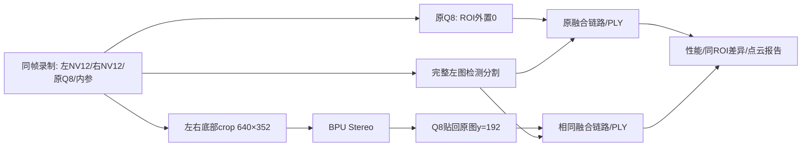

# v6 底部 crop、同区域比较与 X5 使用

## 1. 几何规则

按附件 `FillTensorFromNv12File` 的 crop 分支实现：源图与模型同宽，从底部保留模型高度，Y/UV 平面直接复制，不插值。640×544 输入、640×352 模型对应 ROI `(0,192,640,352)`。Y 取第192～543行，UV取第96～271行。



SDK 仍接收 640×544 左图、Q8 和原内参；两组 Q8 前192行置0无效。**不把裁剪后的视差拉伸回544行**，crop没有横向视差缩放。点云公式保持 `Z=bxf/d`、`X=(u-cx)Z/fx`、`Y=(v-cy)Z/fy`，其中 u/v 是原图坐标。

独立裁剪图才使用 `cy_crop=cy-192`，fx/fy/cx/bxf不变。报告记录两套内参，主SDK使用原图那套。参考原文保留于 `features/stereo/runner/upstream/run_raft_stereo_crop_reference.cc`，不参与构建；不采用其NV21枚举推断，也不在crop条件不合时静默resize。

## 2. 配置入口

`features/stereo/config.json`：

```json
{
  "model": "models/x5/r34_crop_stage2_i12_cheb5_max1_tail_int16_352x640_20261012.bin",
  "image_transform": "crop",
  "input_width": 640,
  "input_height": 352
}
```

模型路径相对主配置目录，统一放在models。两个尺寸是实际模型属性断言，不是强制改变模型输入。crop要求同宽、源高度≥模型高度、尺寸和偏移为偶数。更换同尺寸NV12模型只改model；尺寸不同还要修改断言和检查源图。当前模型板端实际输入为NV12、NCHW 1×3×352×640，输出为float32视差；代码读取实际张量属性，不根据文件名中的int16推断输出类型。

| image_transform | 输入处理 | Q8恢复 |
|---|---|---|
| crop（默认） | 同宽底部裁剪 | 原位贴回，ROI外0 |
| resize | v5全图Y/UV分平面缩放 | 有效性加权恢复，按横向比例换算视差 |
| strict | 输入必须等于模型尺寸 | 原尺寸 |

两份全局配置使用同一功能参数：

| 配置 | 用途 | limit / repeat / warmup | 保存 |
|---|---|---|---|
| crop_compare.json | 质量、视差、PLY | 100 / 1 / 10 | 每10计量帧，网页最多8000点 |
| benchmark.json | 性能回放 | 100 / 10 / 10 | save_every_n=0 |

要逐帧看质量，改 `crop_compare.json` 的 `recording.save_every_n=1`。暖机不纳入统计、不保存。`viewer_max_points`只控制网页抽样，PLY保留SDK导出的点。保存100帧会增加磁盘和HTML体积。

`recording.directory=${CAPTURE_ROOT}`、`intrinsics_file=${CAPTURE_ROOT}/metadata.json`；`suite=three_way`自动生成三组有效图，不需手写三份DAG。顺序由`recording.order`配置。三组分别为完整左图检测分割、检测分割＋原Q8同ROI、检测分割＋新模型crop同ROI。原组和检测分割组不加载新模型。

## 3. Docker 与 Ubuntu 交叉编译（此前路径）

Ubuntu工程放 `/home/st/ini_code/perception-stereo-cpp-v6`，在**Ubuntu主机终端**：

```bash
cd /home/st/ini_code
docker start obs-v004-x5-build
docker cp perception-stereo-cpp-v6 obs-v004-x5-build:/tmp/
docker exec -it obs-v004-x5-build bash
```

在**容器内**：

```bash
cd /tmp/perception-stereo-cpp-v6
export X5_SYSROOT=/work/obs_v004_x5/sysroot_docker
export X5_CXX_COMPILER=/usr/bin/aarch64-linux-gnu-g++
export STEREO_HORIZON_ROOT=$X5_SYSROOT/usr_x5
export TARGET_OPENCV_DIR=$STEREO_HORIZON_ROOT/lib/aarch64-linux-gnu/cmake/opencv4
export TARGET_PCL_DIR=$STEREO_HORIZON_ROOT/lib/aarch64-linux-gnu/cmake/pcl
export TARGET_EIGEN_DIR=$STEREO_HORIZON_ROOT/share/eigen3/cmake
export TARGET_BOOST_DIR=$STEREO_HORIZON_ROOT/lib/aarch64-linux-gnu/cmake/Boost-1.74.0
export BUILD_JOBS=2

# 仅修复之前sysroot解包造成的失效usr软链接。
if [[ -d "$X5_SYSROOT/usr_x5" && -L "$X5_SYSROOT/usr" && ! -e "$X5_SYSROOT/usr" ]]; then
  ln -sfnT usr_x5 "$X5_SYSROOT/usr"
fi
if [[ ! -e "$X5_SYSROOT/usr" && ! -L "$X5_SYSROOT/usr" && -d "$X5_SYSROOT/usr_x5" ]]; then
  ln -s usr_x5 "$X5_SYSROOT/usr"
fi
if [[ ! -e "$X5_SYSROOT/lib" && ! -L "$X5_SYSROOT/lib" ]]; then
  ln -s usr/lib "$X5_SYSROOT/lib"
fi
test -f "$X5_SYSROOT/usr/include/stdio.h"
test -f "$STEREO_HORIZON_ROOT/include/dnn/hb_dnn.h"
bash tools/build_x5_v6.sh
```

从源码构建SDK和全部比较工具，不需要Python/ROS。输出`install/backend_sdk_x5`和`install/perception_ros_so_demo_x5`。在线ROS/相机demo需要容器真实ARM ROS前缀（此前容器的 `/opt/ros/humble`）：

```bash
export TARGET_ROS_PREFIX=/opt/ros/humble
export TARGET_SYSTEM_PREFIX=$X5_SYSROOT/usr_x5
bash tools/build_x5_v6.sh --with-ros
```

x86 ROS前缀不可用于ARM交叉编译。本次本机验证未链接ARM ROS demo。完成后exit回Ubuntu主机：

```bash
cd /home/st/ini_code
docker cp obs-v004-x5-build:/tmp/perception-stereo-cpp-v6/install ./perception-stereo-cpp-v6/
```

把整个工程传到X5 `/userdata/`。也可用本次含AArch64安装目录的运行包；它依赖板上的匹配OpenCV/PCL/Horizon动态库，并非静态程序。源码ZIP不包含install。

## 4. X5录制同帧数据

在线camera和ROS provider也已复用crop helper。公平对比优先一次录制后回放，避免两次开相机造成场景差异。在X5：

这里的同ROI双算法对比由recording回放控制器完成；在线原Q8链路保持原功能，单独在线运行两种算法并不会自动组成配对质量报告。

```bash
cd /userdata/perception-stereo-cpp-v6
export SDK_ROOT=$PWD/install/backend_sdk_x5
export INSTALL_ROOT=$PWD/install/perception_ros_so_demo_x5
export LD_LIBRARY_PATH=$SDK_ROOT/lib:/app/data/metoak/lib${LD_LIBRARY_PATH:+:$LD_LIBRARY_PATH}
export CAPTURE_ROOT=/userdata/stereo_capture/crop_v6_$(date +%Y%m%d_%H%M%S)
# camera.json的sdk_library/vendor_config按板上的实际路径修改。
bash tools/capture_stereo.sh --config pipeline.json --output "$CAPTURE_ROOT" --frames 100
```

已有完整录制时可以直接：

```bash
export CAPTURE_ROOT=/userdata/stereo_capture/v5_20250829_032211
test -f "$CAPTURE_ROOT/manifest.jsonl"
test -f "$CAPTURE_ROOT/metadata.json"
```

录制目录必须有原始NV12、Q8，不仅是旧结果中的prepared PNG。相机内参来自SDK；录制回放从显式metadata.json读取。先关闭占用相机的程序。

## 5. X5质量与性能运行

接上一节环境，输出目录必须全新：

```bash
RUN_TAG=$(date +%Y%m%d_%H%M%S)
# 第1轮：相同ROI视差/PLY/可视化，同时记录资源。
bash tools/run_crop_compare.sh --run-dir /userdata/stereo_results/v6_crop_quality_$RUN_TAG
# 第2轮：不保存逐帧结果，100×10计量帧，比较计算性能。
bash tools/run_benchmark.sh --run-dir /userdata/stereo_results/v6_crop_perf_$RUN_TAG
```

默认自动发现BPU利用率节点。若 unavailable，查看各组run.json中的采样路径和错误，将板端可读利用率文件填入 `recording.bpu.paths`。缺失保持null，不伪造0%。BPU是设备采样，其他进程也会占用，尽量停止无关BPU程序。

日志可通过shell保留退出码并输出：

```bash
set -o pipefail
bash tools/run_benchmark.sh --run-dir /userdata/stereo_results/v6_crop_perf_${RUN_TAG}_logged \
  2>&1 | tee /userdata/stereo_results/v6_crop_perf_${RUN_TAG}.log
```

仅调试一对原始NV12的模型输出时，单模型CLI可直接运行（左右为矫正后同帧图，源尺寸640×544）：

```bash
"$INSTALL_ROOT/bin/stereo_model_runner" \
  --model_file models/x5/r34_crop_stage2_i12_cheb5_max1_tail_int16_352x640_20261012.bin \
  --left /userdata/pair/left.nv12 --right /userdata/pair/right.nv12 \
  --input_format nv12 --input_width 640 --input_height 544 --pre_mode crop \
  --output /userdata/stereo_results/single_crop.npy
```

此处input_width/height描述原始文件，不是功能配置中的模型尺寸断言。输出native 352×640 float32 NPY和同名`.roi.json`，不会独立运行检测分割或生成完整比较报告。

## 6. 输出目录和可视化

```text
v6_crop_quality_日期时间/
├── effective_full.json / resolved.json / parameters.yaml
└── comparison/
    ├── index.html                      性能与点云总入口
    ├── report_zh.md / summary.json/csv  性能汇总
    ├── disparity_compare.html          同ROI视差交互预览
    ├── disparity_comparison.json/csv    质量汇总/逐帧差异/覆盖率
    ├── disparity_roi/pair-N/
    │   ├── left_roi.png
    │   ├── original_disparity.png / stereo_disparity.png
    │   ├── abs_difference.png / both_valid.png
    │   ├── original_valid.png / stereo_valid.png
    │   ├── original_q8.u16 / stereo_q8.u16
    │   └── original_px.npy / stereo_px.npy / abs_difference_px.npy
    ├── original、stereo、detseg_only/
    │   └── frames.jsonl / run.json / summary.json / runner.log
    └── original或stereo/逐帧目录/*.ply、disparity_q8.u16、图片
```

整个运行目录复制回Windows，打开comparison/index.html，再点击视差对比；不能只复制HTML。点云可旋转缩放，PLY可独立查看。视差两组共用0～128px固定色标，绝对差异0～10px；显示饱和不截断原始数值。mask白色表示有效。Q8为小端uint16，除以256得pixel；NPY为float32、无效NaN。逐帧 `disparity_q8.u16` 为原图尺寸，`disparity_roi/` 下是裁剪尺寸。

质量指标包括双方各自/交集覆盖率、MAE、RMSE、绝对差异中位数/p95、stereo-original偏差、差异>1/2/3px比例。只在双方Q8>0的交集上计算；无交集为null。要一起看覆盖率，不能靠丢失大量视差获得小差异。原Q8是参考不是Ground Truth，差异小不等于更准确，还需看边缘/地面连续性/点云飞点，必要时用实测距离。

## 7. 性能口径

| 指标 | 内容 |
|---|---|
| compute_wall_ms | 原Q8遮罩或新Stereo全流程，以及SDK检测/分割/融合计算窗口 |
| graph_ms | SDK DAG墙钟，不能把并行节点耗时简单相加 |
| stereo_pre_ms | 左右NV12准备和crop |
| stereo_backend_ms | pack/infer/wait/decode，含BPU排队，不是独占硬件时间 |
| stereo_post_ms | Q8量化、全图补零和原位恢复 |
| original_roi_mask_ms | 计入CPU/compute窗口的原Q8 ROI外置0开销 |
| cpu_ms / cpu_percent | 进程CPU时间及相对墙钟比例，多核可超过100% |
| rss_kib | 当前进程驻留内存KiB，区别于峰值字段 |
| BPU | 设备周期采样，默认100ms，字段含义取决于板端接口 |
| FPS | 累计计算帧数/计算墙钟；另记录含IO的整体回放FPS |

原Q8已由相机录制，本轮无法测量相机生成视差的CPU/BPU/耗时，该项保留null。视差统计、热图和HTML在三个runner全部结束后生成，不进入它们测量窗口。质量轮写盘仍会影响整体回放与缓存；性能判断以save=0那轮为主。

v5全图resize与v6 crop可见区域不同，不能把所有性能改善归因于crop预处理。v6两组点云虽同ROI，但有效点数不同也影响融合成本。版本身份加入ROI，拒绝把不同FOV当成相同负载。三组顺序执行还受温度频率影响，正式测量可交换recording.order再跑一轮。

## 8. 代码位置

| 文件 | 职责 |
|---|---|
| features/stereo/runner/src/nv12.cpp | NV12检查、平面裁剪/拷贝/resize |
| compare/runner/include/compare_util.hpp | crop几何、pair准备、Q8恢复、元数据 |
| features/stereo/src/stereo_provider.cpp | 在线camera/ROS provider和阶段计时 |
| features/stereo/runner/src/main.cpp | 单模型CLI，默认crop，native NPY及ROI JSON |
| compare/runner/include/comparison_roi.hpp | 原始Q8遮罩、ROI协议验证 |
| compare/runner/src/main.cpp | SDK回放、计量、PLY/视差保存 |
| compare/native/src/orchestrator.cpp | 三组进程、同一ROI、配置与输入身份 |
| compare/native/src/disparity_compare.cpp | 测量后视差指标、NPY/PNG/HTML |
| compare/native/src/version_check.cpp | 加入ROI的版本身份检查 |
| scheduling/config/src/native_features.cpp | 输入变换配置检查 |

要扩展任意ROI，应一起修改输入适配、原Q8遮罩、原图坐标恢复、版本身份和测试，不能只改一边的y_off。当前crop限制为参考代码的同宽底部裁剪。

## 9. 验证边界

已验证裁剪字节、Q8边界/位值、原图与crop内参点云公式等价、三组同ROI、差异指标及保存/未保存路径；主机使用真实ONNX检测分割和synthetic Q8做集成。synthetic Q8只用于几何验证，不作为精度数据。

已交叉生成AArch64工具。未改动的SDK后端复用v5已验证ARM库，记录源码差异和库SHA256；用户build_x5_v6.sh会完整构建。没有连接本次X5，因此未预填真实crop模型效果或资源数值。
