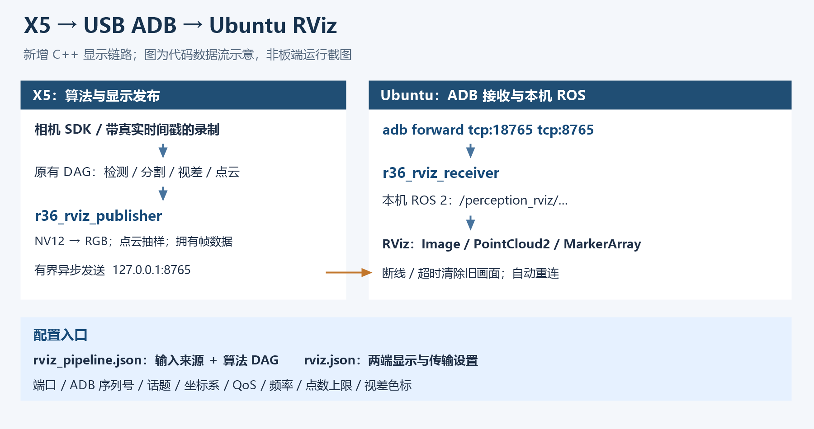

# v8：X5 发布，经 ADB 在 Ubuntu 的 RViz 中显示

本次新增独立的显示链路：**X5 运行原有 SDK 算法 → C++ 显示发布器 → ADB TCP 转发 → Ubuntu C++ 接收器 → Ubuntu 本地 ROS 2 话题 → RViz**。两端共用根目录的 `rviz.json`。`rviz_pipeline.json` 负责算法与输入选择，`rviz.json` 负责显示流、USB 传输、话题、坐标系、点大小、QoS 与 RViz 界面设置。



本次编译、自动测试和完整 SDK 回环验证见 [验证记录](V8_ADB_RViz验证记录.md)。

```text
X5                                           Ubuntu（USB ADB 连接 X5）
相机 / 带时间戳录制
       ↓
原有 SDK DAG
       ↓
r36_rviz_publisher
127.0.0.1:8765  ←──── adb forward ────  127.0.0.1:18765
                                              ↓
                                       r36_rviz_receiver
                                              ↓ 本地 ROS 2
                                       /perception_rviz/...
                                              ↓
                                           RViz 2
```

USB 连接承担 TCP 数据传输，X5 无需运行 ROS 2。ADB 的普通端口转发不能承载 DDS 的 UDP 发现机制，因此接收器在 Ubuntu 本地重新发布 ROS 消息；两端不用配置同一 DDS 域，也不依赖 X5 与 Ubuntu 之间的局域网组播。

## 1. 文件和入口

| 文件 / 可执行程序 | 用途 |
|---|---|
| `rviz_pipeline.json` | X5 相机直接输入示例：检测、分割、原 Q8 视差、相机点云与发布 |
| `rviz.json` | 两端共用的显示和传输配置，严格校验字段与类型 |
| `tools/run_rviz_x5.sh` | 启动 X5 原生发布程序 |
| `tools/run_rviz_ubuntu.sh` | 启动 Ubuntu ADB 转发、接收器与 RViz |
| `r36_rviz_publisher` | X5/Linux C++ 程序，使用真实 SDK 结果生成显示数据，无 ROS 依赖 |
| `r36_rviz_launcher` | Ubuntu/Linux C++ 程序，读取 JSON、生成 RViz 配置、管理转发和子进程 |
| `r36_rviz_receiver` | Ubuntu ROS 2 C++ 程序，校验显示帧并发布本地 ROS 话题 |

新入口使用独立运行目录。原来的 benchmark、slip、pipeline 启动命令不会因为增加 `rviz.json` 自动打开 RViz 或抢占相机；需要显示时使用本页的新入口。

## 2. Ubuntu 编译和安装

以下命令适用于 Ubuntu 22.04 / ROS 2 Humble，执行目录为本项目根目录。Ubuntu 只需要显示接收模块，不需要 X5 相机 SDK、Horizon BPU 或算法模型。

```bash
sudo apt update
sudo apt install adb cmake g++ ros-humble-rviz2 \
  ros-humble-rclcpp ros-humble-sensor-msgs \
  ros-humble-std-msgs ros-humble-visualization-msgs

source /opt/ros/humble/setup.bash

cmake -S features/rviz -B build/rviz_ubuntu \
  -DR36_RVIZ_BUILD_RECEIVER=ON \
  -DR36_RVIZ_BUILD_PUBLISHER=OFF \
  -DR36_RVIZ_BUILD_SDK_OUTPUT=OFF \
  -DCMAKE_INSTALL_PREFIX="$PWD/install/rviz_ubuntu"

cmake --build build/rviz_ubuntu --parallel 4
ctest --test-dir build/rviz_ubuntu --output-on-failure
cmake --install build/rviz_ubuntu

export RVIZ_INSTALL_ROOT="$PWD/install/rviz_ubuntu"
```

`r36_rviz_launcher` 和 `r36_rviz_receiver` 安装在同一个 `bin` 目录；launcher 从自身所在目录查找 receiver。Ubuntu 显示入口使用专属 `RVIZ_INSTALL_ROOT`，默认 `install/rviz_ubuntu`，与 X5 的 `INSTALL_ROOT` 分开，避免选到另一架构的程序。RViz 界面需要真实图形桌面；在 WSL 使用时需启用 WSLg 或可用的 X server，并确保 Ubuntu 内的 `adb devices -l` 能发现 USB 设备。`--no-gui` 的接收器可以在无图形桌面的 Ubuntu 中运行。

使用其他 ROS 2 安装目录时，设置 `ROS_SETUP`，例如 `export ROS_SETUP=/your/ros/setup.bash`。脚本为普通运行加载该文件，`--prepare-only` 不加载 ROS。

## 3. X5 开始发布

X5 侧需安装本次新增的 `r36_rviz_publisher`、原有完整 SDK、相机库、模型与配置。根工程提供 `PERCEPTION_BUILD_RVIZ` 开关，显示子工程提供 `R36_RVIZ_BUILD_PUBLISHER` 开关；交叉编译仍使用项目原有的 `cmake/x5-toolchain.cmake` 和匹配 X5 的 sysroot。`R36_RVIZ_BUILD_RECEIVER` 在 X5 关闭。原 Q8 示例由 X5 发布程序直接采集，不需要另外启动相机 ROS 节点。

### 在 Ubuntu 交叉编译 X5 程序

沿用已有工作目录 `/home/st/ini_code/perception-stereo-cpp-v8` 与工作区中的 ARM sysroot。下列命令在 Ubuntu 构建主机执行：

```bash
cd /home/st/ini_code/perception-stereo-cpp-v8

export WORKSPACE="$(dirname -- "$PWD")"
export X5_SYSROOT="$WORKSPACE/local_env/x86_ros_v8p1/build/runner_x5/sysroot"
export X5_CXX_COMPILER=/usr/bin/aarch64-linux-gnu-g++
export STEREO_HORIZON_ROOT="$X5_SYSROOT/usr"
export PSDK_ROOT="$PWD/install/backend_sdk_x5"
export INSTALL_ROOT="$PWD/install/perception_ros_so_demo_x5"

# 完整编译：原有 BPU SDK + 相机/比较/打滑等 native 入口 + 新 RViz 发布入口。
bash tools/build_x5_v8.sh
```

`X5_SYSROOT` 必须来自匹配目标板的 AArch64 环境；其中应含原有 Horizon、OpenCV、PCL 等开发依赖。这个纯原生显示入口不需要 `--with-ros`，Ubuntu 接收器也不会加入 ARM 安装树。

**已经有匹配 v8 的 ARM SDK 时，可只增量构建 native 程序**。沿用上面的环境变量执行：

```bash
bash tools/cross_build_compare.sh \
  -DPERCEPTION_BUILD_RVIZ=ON \
  -DR36_RVIZ_BUILD_PUBLISHER=ON \
  -DR36_RVIZ_BUILD_RECEIVER=OFF
```

这个入口复用 `PSDK_ROOT` 中的完整 SDK，不重编 SDK；本次增量已将 `r36_rviz_publisher` 纳入 native 构建与安装。可执行文件安装到 `$INSTALL_ROOT/lib/perception_ros_so_demo/r36_rviz_publisher`，配置和启动脚本随现有安装流程安装。将更新后的 SDK/runtime 安装树、相机依赖、模型与配置部署到 X5，再按下一步运行。Ubuntu x86 显示端单独使用前一节的 `RVIZ_INSTALL_ROOT`。

### 在 X5 启动

在 X5 项目目录的终端运行：

```bash
cd /userdata/perception-stereo-cpp-v8

export SDK_ROOT="$PWD/install/backend_sdk_x5"
export INSTALL_ROOT="$PWD/install/perception_ros_so_demo_x5"

# 只验证和准备，不打开相机、模型或 TCP 服务。
bash tools/run_rviz_x5.sh \
  --config "$PWD/rviz_pipeline.json" \
  --rviz "$PWD/rviz.json" \
  --output /userdata/rviz_results/check_001 \
  --check

# 正式运行。每次使用新的输出目录。
bash tools/run_rviz_x5.sh \
  --config "$PWD/rviz_pipeline.json" \
  --rviz "$PWD/rviz.json" \
  --output /userdata/rviz_results/run_001
```

`--config` 指向算法流水线配置；`--rviz` 指向显示配置。省略 `--rviz` 时，从算法配置的 `rviz_config` 字段解析，缺省为算法配置同目录的 `rviz.json`。`--output` 是新运行目录，程序拒绝覆盖已有目录。

相机示例直接打开相机，因此不要同时启动另一份相机采集程序。原 Q8 来自相机输出；选择 `raft_stereo` 时需要使用包含原有 Horizon stereo provider 的 X5 构建。显示过程只对已经产生的结果做格式转换与抽样，算法输入与 DAG 计算语义保持原样。

也可使用项目现有的带时间戳 `recording` 配置启动该发布入口。录制播放会等待接收器连接，先启动 Ubuntu launcher 再开始 X5 播放；需要等待更久时增大 `transport.connect_timeout_ms`。

## 4. Ubuntu 通过 ADB 打开 RViz

把与 X5 同一份 `rviz.json` 放到 Ubuntu 项目目录，在 Ubuntu 项目根目录执行：

```bash
adb devices -l

export RVIZ_INSTALL_ROOT="$PWD/install/rviz_ubuntu"

bash tools/run_rviz_ubuntu.sh \
  --config "$PWD/rviz.json" \
  --run-dir "$PWD/rviz_runs/run_001"
```

launcher 按顺序执行以下操作：

1. 校验 JSON，创建新的 `--run-dir`，写入 `rviz.resolved.json` 和 `view.rviz`。
2. 从 `adb devices -l` 选取设备；`serial` 为空时必须恰好存在一个在线且已授权的设备。有多个设备时，在 JSON 中填写设备序列号。
3. 检查已有转发，使用 `adb -s SERIAL forward --no-rebind tcp:18765 tcp:8765` 创建映射。
4. 启动同目录 `r36_rviz_receiver --config RESOLVED_JSON --host 127.0.0.1 --port 18765`。
5. 通过参数数组启动 `rviz2 --display-config VIEW_RVIZ`。

程序不会通过 ADB 自动打开 X5 相机或启动远端算法。X5 端由前一步的独立命令启动。

端口号取自配置。若 `local_port` 已被其他 ADB 转发使用，launcher 明确报错，不覆盖已有映射；更换一个未使用的 `local_port` 后重新运行即可，X5 的 `remote_port` 可保持不变。

### 只生成配置

```bash
bash tools/run_rviz_ubuntu.sh \
  --config "$PWD/rviz.json" \
  --run-dir "$PWD/rviz_runs/prepare_001" \
  --prepare-only
```

这个模式不调用 ADB，不启动 receiver/RViz，也不需要相机、ROS 安装或图形桌面。Windows 版 launcher 同样支持 `--prepare-only`。

### 只启动接收器

```bash
bash tools/run_rviz_ubuntu.sh \
  --config "$PWD/rviz.json" \
  --run-dir "$PWD/rviz_runs/no_gui_001" \
  --no-gui
```

`--no-gui` 创建 ADB 转发并启动接收器，保持运行，供终端检查 ROS 话题；按 Ctrl+C 退出。

### 退出与清理

关闭 RViz 窗口、receiver 退出，或向 launcher 发送 SIGINT/SIGTERM 时，launcher 结束它启动的两个本地子进程，并回收本次创建的 ADB 转发。清理前再次核对序列号、本地端口与远端端口，不移除其他会话的映射，不关闭整个 ADB server，不停止 X5 发布程序。

用 `adb forward --list` 可检查当前映射。强制 SIGKILL、主机掉电等情况无法执行进程清理，残留映射会使下次启动报端口占用；确认属于该次显示会话后，手动执行 `adb -s SERIAL forward --remove tcp:18765`，或为下一次会话设置另一个本地端口。

## 5. JSON 配置详解

JSON 不接受注释、未知字段、重复字段、错误类型或越界参数。顶层为 `schema_version: 1`、`enabled`、`transport`、`publish`、`rviz`。`enabled: false` 关闭整个显示功能。

### 传输与发布参数

| 字段 | 默认值 | 作用与范围 |
|---|---|---|
| `transport.bind_address` | `127.0.0.1` | X5 TCP 监听 IPv4 地址，ADB 默认通过设备回环地址连接 |
| `transport.local_port` | `18765` | Ubuntu ADB 转发端口，1024–65535 |
| `transport.remote_port` | `8765` | X5 显示发布端口，1024–65535；两端必须一致 |
| `transport.serial` | 空字符串 | ADB 设备序列号；为空时自动选择唯一在线设备 |
| `transport.adb_executable` | `adb` | Ubuntu ADB 程序名或路径 |
| `transport.connect_timeout_ms` | `3000` | TCP 连接等待时间，100–60000 ms |
| `transport.reconnect_ms` | `1000` | 接收器断线重连间隔，100–60000 ms |
| `transport.send_timeout_ms` | `500` | X5 发送超时，10–60000 ms |
| `transport.max_frame_bytes` | `16777216` | 完整显示帧总字节上限，1024–67108864；含协议头 |
| `publish.max_fps` | `10` | 显示发送帧率上限，0.1–120 FPS |
| `publish.every_n` | `2` | 每 N 帧选择一次显示，1–1000 |
| `publish.max_points` | `60000` | 每路点云的点数上限，1–1000000；总帧仍受字节上限约束 |
| `publish.point_stride` | `2` | 点云采样步长，1–10000；点数过多时继续降低显示密度 |
| `publish.disparity_min_px` | `0` | 视差伪彩色标尺下界，单位像素 |
| `publish.disparity_max_px` | `144` | 视差伪彩色标尺上界，须大于下界，最大 65535/256 |
| `publish.overlay_alpha` | `0.35` | 分割掩码叠加透明度，0–1 |

裸程序名 `adb`、`rviz2` 从 Ubuntu `PATH` 查找。带路径分隔符的相对可执行路径，相对于 **`rviz.json` 所在目录**解析，例如 `"adb_executable": "tools/adb"`。CLI 的 `--config`、`--run-dir`、`--output` 相对路径则相对于当前工作目录。路径以一个 argv 参数传递，可包含空格或引号，不会作为 shell 命令执行。配置不执行环境变量或 shell 替换；`"$HOME/bin/adb"` 不会展开，需填实际路径。

### RViz 全局设置

```json
"rviz": {
  "fixed_frame": "camera_optical_frame",
  "body_frame": "base_link",
  "frame_rate": 15,
  "rviz_executable": "rviz2",
  "marker_lifetime_ms": 1500,
  "motion_arrow": false,
  "displays": {}
}
```

`fixed_frame` 决定 RViz 的参考坐标系，`frame_rate` 为界面刷新帧率（1–120）；它不改变 X5 算法运行帧率。`marker_lifetime_ms` 为状态标记有效时间（100–60000 ms），断线和数据过期时会清理显示。

`motion_arrow` 默认关闭。当 slip 输出有真实有效的区间位移与参考量，并且 `fixed_frame == body_frame` 时，可开启局部运动箭头。箭头表示当前区间位移，不是世界坐标累计轨迹。滑移状态文字放在 `fixed_frame` 下，便于默认相机点云视图直接查看。

### 每一层的设置

显示某一路需要 **`publish.streams[键] == true` 且 `rviz.displays[键].enabled == true`**。算法 DAG 还必须实际产生该产品；配置开关不会补造点云、分割或打滑结果。

例如开启相机点云并设置显示样式：

```json
"publish": {
  "streams": {"clouds/camera": true}
},
"rviz": {
  "displays": {
    "clouds/camera": {
      "enabled": true,
      "topic": "/perception_rviz/clouds/camera",
      "frame_id": "camera_optical_frame",
      "style": "Points",
      "color_transformer": "RGB8",
      "point_size": 2,
      "qos": {
        "reliability": "best_effort",
        "durability": "volatile",
        "depth": 1
      }
    }
  }
}
```

上面是字段片段，需合并到已有 `rviz.json`，不要另建重复的 `publish` 或 `rviz` 字段。省略的字段采用默认值。

`point_size` 范围 0.1–100，`Points` 样式下为像素大小；三维形状样式使用对应毫米大小。`style` 支持 `Points`、`Squares`、`Flat Squares`、`Spheres`、`Boxes`；`color_transformer` 支持 `RGB8`、`AxisColor`、`FlatColor`、`Intensity`。接收器点云含实际 XYZ、RGB、confidence、label 字段；选择 `Intensity` 时生成配置使用真实的 `confidence` 字段着色。

QoS 同时用于 Ubuntu 发布器和生成的 RViz 配置：`reliability` 支持 `best_effort` / `reliable`，`durability` 支持 `volatile` / `transient_local`，`depth` 范围 1–1000。默认 Best Effort、Volatile、队列深度 1，适合实时看最新帧。

`topic` 是 Ubuntu 本地的绝对 ROS 话题。远端只能发送固定的逻辑流键，不能自行创建任意 ROS 话题。`frame_id` 为期望的源坐标系校验值，接收器保留真实数据的坐标系与时间戳；修改它不能替代 TF，也不能把相机点云重标为机体点云。相机点云和图像的缺省期望源坐标系是 `camera_optical_frame`，独立于 RViz 的 `fixed_frame`；机体点云缺省继承 `body_frame`。使用其他真实相机坐标系名称时，显式设置对应流的 `frame_id`。所有本地话题必须互不冲突，`/perception_rviz/status`、`/perception_rviz/meta` 和 marker 的 `/json` 附属话题由接收器保留。

## 6. 支持的显示内容

| 逻辑键 | 默认本地话题 | ROS 消息 / RViz 显示项 | 默认开启 |
|---|---|---|---|
| `input_rgb` | `/perception_rviz/input_rgb` | Image / Image，NV12/I420 等转换为 RGB8 | 是 |
| `overlay` | `/perception_rviz/overlay` | Image / Image，真实检测框和分割掩码叠加 | 是 |
| `mask_rgb` | `/perception_rviz/mask_rgb` | Image / Image，类别调色板 | 是 |
| `disparity_rgb` | `/perception_rviz/disparity_rgb` | Image / Image，Q8÷256 后按像素视差伪彩色显示 | 是 |
| `disparity_q8` | `/perception_rviz/disparity_q8` | Image / Image，原始 mono16 Q8 | 否 |
| `clouds/camera` | `/perception_rviz/clouds/camera` | PointCloud2 / PointCloud2，相机光学坐标系 | 是 |
| `clouds/robot` | `/perception_rviz/clouds/robot` | PointCloud2 / PointCloud2，机体坐标系 | 否 |
| `clouds/ground` | `/perception_rviz/clouds/ground` | PointCloud2 / PointCloud2 | 否 |
| `clouds/obstacle` | `/perception_rviz/clouds/obstacle` | PointCloud2 / PointCloud2 | 否 |
| `clouds/semantic` | `/perception_rviz/clouds/semantic` | PointCloud2 / PointCloud2 | 否 |
| `maps/pcl` | `/perception_rviz/maps/pcl` | Image / Image，点云二维 RGB 图 | 否 |
| `maps/ai` | `/perception_rviz/maps/ai` | Image / Image，AI 二维 RGB 图 | 否 |
| `maps/fusion` | `/perception_rviz/maps/fusion` | Image / Image，融合二维 RGB 图 | 否 |
| `result` | `/perception_rviz/result` | MarkerArray / MarkerArray，真实结果状态文字 | 否 |
| `slip` | `/perception_rviz/slip` | MarkerArray / MarkerArray，打滑状态文字和可选局部箭头 | 是 |

类别颜色沿用项目已有显示含义：0 珊瑚红、1 绿色、2 蓝色。视差是像素单位，不能将 Q8 原始数值解释为毫米深度。二维地图当前为 RGB 图像，不是 `nav_msgs/OccupancyGrid`。

`result`、`slip` 同时在 `TOPIC/json` 发布原始 JSON 字符串，例如 `/perception_rviz/slip/json`。未执行 slip DAG 时，默认开启 slip 显示也不会出现虚构的打滑结果。

默认只启用相机坐标点云。查看 `clouds/robot` 等机体坐标系点云时，把 `fixed_frame` 改为 `base_link`，启用对应 DAG、发布开关和显示开关；同时查看两种坐标系点云时，需要真实的 TF。系统不会生成伪造的单位变换来消除 RViz 报错。

## 7. 排查和调节

```bash
# USB 设备在线且已授权
adb devices -l

# 映射存在，端口对应两端 JSON
adb forward --list

# Ubuntu 本地桥接状态、帧元数据和显示话题
ros2 topic echo /perception_rviz/status std_msgs/msg/String \
  --once --qos-reliability reliable --qos-durability transient_local --full-length
ros2 topic echo /perception_rviz/meta std_msgs/msg/String \
  --once --qos-reliability reliable --qos-durability transient_local --full-length
ros2 topic list -t

# 检查点云源坐标系与 QoS
ros2 topic info /perception_rviz/clouds/camera --verbose
ros2 topic echo /perception_rviz/clouds/camera \
  --field header --once --qos-reliability best_effort --full-length

# 需要运行 slip DAG 才有该结果
ros2 topic echo /perception_rviz/slip/json std_msgs/msg/String \
  --qos-reliability best_effort --full-length
```

原始 `slip/json` 和图像、点云默认使用 Best Effort；`status`、`meta` 使用 Reliable + Transient Local。排查时显式指定 QoS，避免订阅先于发布器启动时依赖自动发现选择策略；`--full-length` 防止长 JSON 被截断。收到 `meta` 只说明桥接已收到某个帧，还应检查完整元数据的 `streams` 是否包含 `slip`，以及 `rejections` 是否有拒绝原因。若没有 `slip`，再检查源端 slip DAG、SDK slip 视图的 `enabled` 和两个显示开关。

有话题但 RViz 空白时，依次检查：源端是否运行、桥接状态是否 connected、DAG 是否实际产生该数据、两个显示开关是否同时开启、源坐标系是否匹配、RViz QoS 是否一致。Frame 元数据保留 X5 的采集时间和帧号；状态标记的生命周期使用 Ubuntu 时间，避免把 X5 单调时钟误当作 Ubuntu 系统时间。

默认发送 RGB 原始图像与抽样点云。USB 带宽不足时，可降低 `publish.max_fps` 到 5，增大 `every_n` 或 `point_stride`，降低 `max_points`，或关闭不需要的重复图像流（例如只保留 `overlay` 和 `disparity_rgb`）。`max_frame_bytes` 限制所有显示产品合计的大小，避免无界缓存；接收器只保留最新待显示帧，断开重连后清理上一会话的旧画面。

## 8. 验证范围

配置测试覆盖严格字段与参数校验、规范 JSON 往返、RViz YAML 生成、路径解析与双重显示开关。Linux 启动集成测试使用独立 fake ADB / receiver / RViz 程序，覆盖多设备、离线、未授权、转发端口冲突、并发 no-rebind 失败、带空格与引号的 argv、已有运行目录不覆盖、只清理自有子进程与转发，以及 `--prepare-only` / `--no-gui`。

本次已实际执行 Ubuntu Humble 下的 fake ADB / receiver / RViz 生命周期测试，并执行真实 TCP 回环 → 接收器 → 本地 ROS 2/DDS 的消息、超时清理与重连测试。Windows 侧配置与渲染合同也已实际运行。

**真实 X5 板子、USB ADB 链路和 RViz GUI 画面尚未实测。** fake 程序验证进程管理，回环测试验证真实 TCP 与本地 ROS 消息；实际设备连通性、相机输出、算法产品与 RViz GUI 画面仍需按上述双端命令验收。
