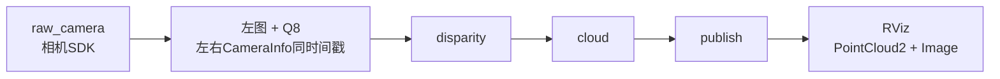
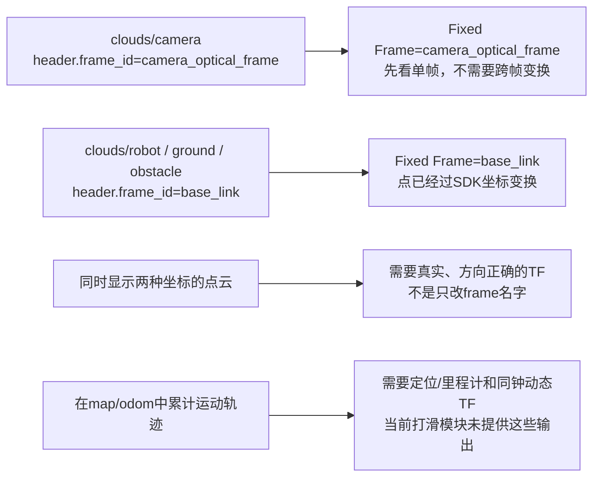
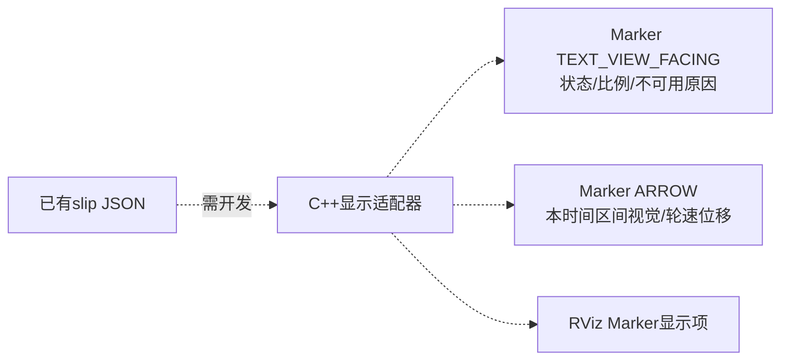

# V8 项目的 RViz 可视化图解

**新增 USB ADB 显示入口：** 现在可由 X5 的原生 C++ 发布器发送，Ubuntu 本地接收并发布 ROS 消息。根目录 `rviz.json` 配置图像、点云、打滑 Marker 和显示参数。完整操作见 [X5 → ADB → Ubuntu RViz 配置与运行](V8_ADB_RViz配置与运行.md)。下文描述原有直接 ROS 发布入口及其话题；新接收器使用 `/perception_rviz/` 话题，已提供 RGB 格式转换与打滑 Marker。

适用对象：本项目 ROS 2 Humble 应用。先看相机坐标点云和视差，再看车体坐标点云、分割与融合图。RViz 订阅 ROS 消息；它不会自动读取原生 runner 的结果目录，也不会自动将打滑 JSON 变成三维图形。

## 1. 先理解数据流


图中的话题简称属于节点 `/perception_ros_so_demo`；下面表格给出完整名称。图是按实际源码整理的示意，不是相机实测截图。

一次显示要经过三步：对应 DAG 节点计算出结果；`graph.publish` 开启且等待结果生产者；可视化配置中的对应 `publish_*` 开启。RViz 再订阅该类型的消息。**只开 `publish_clouds:true` 不会生成点云，图中还必须存在 `cloud` 节点。**

当前入口的差别：

| 入口 | ROS 发布 | RViz 的使用方式 |
|---|---|---|
| 普通 `run_pipeline.sh` + camera/ros 配置 | ROS `demo` 发布结果 | 可以订阅图像和点云 |
| `run_camera_benchmark.sh` / `r36_camera_compare` | 无 | 原生性能实验输出文件，不能直接订阅 |
| `run_slip.sh` / `r36_slip_runner` | 无 | 原生多帧实验输出 JSONL，不能直接订阅 |
| `run_pipeline.sh` + `slip_ros.json` | 有 | 当前主要是打滑/历史/指标 JSON；默认无点云 |

`slip_ros.json` 的 DAG 没有 `cloud/transform/ground/maps`，引用的 `camera_benchmark_visualization.json` 又关闭了图像和点云发布。因此这个默认配置在 RViz 中没有点云，不代表算法没有收到数据。

## 2. 哪些结果可以看

默认节点名没有被重命名或加 namespace 时：

| ROS 话题 | 类型/编码 | RViz 显示项 | 需要的功能 |
|---|---|---|---|
| `/perception_ros_so_demo/clouds/camera` | PointCloud2 | PointCloud2 | disparity、cloud |
| `/perception_ros_so_demo/clouds/robot` | PointCloud2 | PointCloud2 | cloud、transform |
| `/perception_ros_so_demo/clouds/ground` | PointCloud2 | PointCloud2 | transform、ground，并有有效地面结果 |
| `/perception_ros_so_demo/clouds/obstacle` | PointCloud2 | PointCloud2 | transform、ground，并有有效障碍结果 |
| `/perception_ros_so_demo/clouds/semantic` | PointCloud2 | PointCloud2 | 检测/分割及对应语义融合阶段 |
| `/perception_ros_so_demo/disparity_q8` | Image，16UC1 | Image | disparity |
| `/perception_ros_so_demo/mask` | Image，mono8 | Image | seg；当前是类别ID图 |
| `/perception_ros_so_demo/pcl_map` | Image，rgb8 | Image | maps 和 render_maps |
| `/perception_ros_so_demo/ai_map` | Image，rgb8 | Image | maps、语义结果和 render_maps |
| `/perception_ros_so_demo/fusion_map` | Image，rgb8 | Image | maps、融合结果和 render_maps |
| `/perception_ros_so_demo/input_image` | 输入原编码，通常 nv12 | 需显示格式转换 | publish_input；当前原样转发 |
| `/perception_ros_so_demo/slip` | String，内容JSON | 标准RViz不能直接显示 | 三个运动/打滑节点 |

注意两个容易混淆的地方：

- `pcl_map/ai_map/fusion_map` 是**二维 RGB 图像**，添加 **Image**，不是添加读取 OccupancyGrid 的 Map 插件。
- 当前检测框在 `~/result` 的 JSON 中，没有在线检测框 overlay 图像话题；打滑也还没有 Marker/Path/Pose/TF 发布。不能只在 RViz 中添加显示项就得到这些图形。

Image、PointCloud2、Map、Marker 等显示项各有确定的消息类型，见 [ROS 官方 RViz 指南](https://github.com/ros2/ros2_documentation/blob/humble/source/Tutorials/Intermediate/RViz/RViz-User-Guide/RViz-User-Guide.rst)。

## 3. 最快跑通：原 Q8 → 相机坐标点云

本次增加了四份显示相关配置：

```text
项目根/
  rviz_cloud.json                     最小ROS点云流程，不运行检测/分割/打滑
  rviz_visualization.json             开点云与Q8发布，关闭保存和地图渲染
  config/rviz/camera_cloud.rviz        相机坐标点云 + Q8灰度
  config/rviz/robot_cloud.rviz         已转换到车体坐标的点云，供完整流程使用
```

`rviz_cloud.json` 默认 `input.mode:"ros"`、`disparity_source:"original_q8"`：



下面 X5 指令要求已经安装 **ROS 应用版**的 `raw_camera` 和 `demo`，以及启用点云后端的 SDK。仅包含原生 benchmark/slip 工具的安装包不包含这两个 ROS 程序。可先检查：

```bash
cd /userdata/perception-stereo-cpp-v8
export SDK_ROOT=$PWD/install/backend_sdk_x5
export INSTALL_ROOT=$PWD/install/perception_ros_so_demo_x5
export ROS_SETUP=/app/humble/setup.bash
export LD_LIBRARY_PATH=$SDK_ROOT/lib:/app/data/metoak/lib${LD_LIBRARY_PATH:+:$LD_LIBRARY_PATH}

test -x "$INSTALL_ROOT/lib/perception_ros_so_demo/raw_camera"
test -x "$INSTALL_ROOT/lib/perception_ros_so_demo/demo"
```

若缺失，需在具备实际 ARM ROS 依赖的交叉编译环境设置 `TARGET_ROS_PREFIX`，执行 `bash tools/build_x5_v8.sh --with-ros`。当前本地完成了原生 X5 工具交叉编译、x86 ROS 应用编译；不把主机 ROS 二进制当作 X5 程序。编译说明见 [V8 编译与运行](V8_编译与运行.md)。

**X5 终端一：启动相机发布节点。** 先停止其他占用相机的进程；各终端设置相同环境变量。

```bash
bash tools/run_camera_x5.sh --config "$PWD/rviz_cloud.json" --mode map
```

这里 `mode map` 指相机发布左/右图和原 Q8，并不表示 RViz 已经获得地图。相机使用模式2，内参自动从 SDK 读取。

**X5 终端二：启动点云算法节点。**

```bash
bash tools/run_pipeline.sh --config "$PWD/rviz_cloud.json" \
  --run-dir /userdata/rviz_results/cloud_$(date +%Y%m%d_%H%M%S)
```

`--run-dir` 必须是新目录。也可以加 `--prepare-only` 只生成有效配置和启动指令，不打开算法节点。

**图形 Ubuntu/WSL 终端三：打开 RViz。** 将本项目或 `config/rviz/` 复制到显示机，并切到显示机自己的项目目录：

当前检查到本机 Ubuntu 22.04 已有 ROS Humble，但尚未安装 `ros-humble-rviz2`。已配置 ROS apt 软件源的 Ubuntu 可先安装：

```bash
sudo apt update
sudo apt install ros-humble-rviz2
```

WSL 还需具备可用的图形环境，例如 WSLg 或已配置的 X server；仅装 RViz 软件包不会自动提供显示服务。也可在有桌面的 Ubuntu 电脑中查看板端话题。

```bash
source /opt/ros/humble/setup.bash
ros2 run rviz2 rviz2 -d "$PWD/config/rviz/camera_cloud.rviz"
```

若 RViz 就在带桌面的 X5 上运行，source 该板实际 ROS setup。若在 Windows 上查看，建议在具有图形支持的 Ubuntu/WSL 中运行 RViz；必须先确保它能发现 X5 的 ROS 话题。WSL 网络发现不会因同处一台 Windows 电脑而自动成立。

另一个选择是将 `rviz_cloud.json` 的 `input.mode` 改为 `camera`，只启动终端二。此时 ROS 算法进程直接打开相机并发布结果，**不要再启动终端一的 raw_camera**。这仍是 ROS 应用入口，与原生 `run_slip.sh` 不同。

## 4. RViz 界面怎样设置


上图是操作布局示意，点云为绘制示意点，不是当前板端效果。

手动配置与直接加载 `.rviz` 文件效果相同：

1. 左侧展开 **Global Options**，将 **Fixed Frame** 设为 `camera_optical_frame`。实际 frame 以点云消息 header 为准。
2. 点击左下 **Add → By display type → PointCloud2**。
3. 将 **Topic** 设为 `/perception_ros_so_demo/clouds/camera`。
4. Topic 的 QoS：**Reliability Policy = Best Effort**、**Durability Policy = Volatile**、**Depth = 1**。
5. **Position Transformer = XYZ**；**Color Transformer = RGB8**；**Style = Points**；**Size (Pixels) = 2**；**Decay Time = 0**。
6. 添加 **Image**，Topic 选择 `/perception_ros_so_demo/disparity_q8`，使用相同 QoS。
7. 左键拖动旋转，中键拖动平移，滚轮缩放。选中可见点后可按 F 聚焦。确认看清一帧后再增加其他图层。

输出点云携带 `x/y/z`、packed `rgb`、`confidence`、`label` 字段，因此 RGB8 可以读出颜色。`Decay Time=0` 用于当前帧观察；盲目累积多帧并不等于运动补偿或三维建图。

本项目点云/视差/地图图像采用 SensorDataQoS。Best Effort 发布者不能满足 Reliable 订阅者，Volatile 发布者也不能满足 Transient Local 订阅者；因此仅看到 topic 名称仍可能收不到消息。[ROS 官方 QoS 兼容规则](https://github.com/ros2/ros2_documentation/blob/humble/source/Concepts/Intermediate/About-Quality-of-Service-Settings.rst)

## 5. Fixed Frame：最容易导致空白的设置



相机光学坐标通常 `x右/y下/z前`，车体坐标采用 `x前/y左/z上`。相机坐标点云看起来方向与“地面朝上”不一致，可能只是坐标约定；不能靠伪造零旋转 TF 纠正。

查看 camera 点云时使用 `camera_cloud.rviz`；完整流程已经生成 robot 点云时使用 `robot_cloud.rviz`，其 Fixed Frame 为 `base_link`。后者不能让最小 cloud-only DAG 自动产生 robot/ground 结果。

如果切到 `map`，必须存在连接消息 frame 到 map 的真实 TF 链。当前代码不广播这条 TF，也不自动把 `features/visual_motion` 的外参变成 `/tf_static`。同时，视觉运动外参与原点云变换外参是不同配置入口，应测量并保持一致，不能认为修改其中一个会自动修改另一个。

相机原始时间戳有时属于设备单调时钟。显示在自身 frame 下不需要把它改成接收时间；若使用带时间的动态 TF，必须对齐采集时间和 TF 时钟，否则可能出现 extrapolation 错误。改写原采集时间会破坏多帧运动计算。

## 6. Q8 视差、分割与融合图的正确看法

### Q8 视差

```text
16UC1中的数值q → disparity_px=q/256
q=8192         → 32像素视差
深度Z_m        = bxf_px_mm / (disparity_px × 1000)
q=0            → 无效视差
```

在相同标定下，大视差通常对应更近的点。RViz Image 只显示强度映射，不会把这些整数自动理解为距离；不要把 Q8 送给按毫米深度解释 16UC1 的 DepthCloud 插件。

Humble Image 支持16位图像的归一化显示。提供的 `.rviz` 关闭自动范围，固定 **Min Value=0 / Max Value=36864**，对应0～144像素视差，方便两种算法使用同一灰度标尺。该值只是显示范围，不是模型有效范围断言；超出时会饱和，应按实际数据调整。打开 **Normalize Range** 可以查看对比度，但自动缩放后的两幅图亮度不能直接用于算法质量对比。[Humble Image 插件实现](https://github.com/ros2/rviz/blob/humble/rviz_default_plugins/src/rviz_default_plugins/displays/image/image_display.cpp)

新 Stereo 默认只在 `(0,192,640,352)` 区域推理，恢复完整 Q8 后顶部192行为无效0。因此看到上部黑色不一定是模型失败，需要先核对裁剪范围。

### 分割 mask

当前 `/mask` 是 `mono8` 类别ID，例如0/1/2。这些值相对于0～255很小，所以直接显示可能接近全黑；**不能由此判断分割失败**。MONO8也不能靠16位图像的Normalize Range设置解决。彩色类别图需要额外显示适配器把ID映射到RGB；当前这条话题没有做调色板转换。已生成的语义点云、AI地图可作为另外的可视化结果，需确认其阶段真的启用。

### 原始左图与二维地图

`/input_image` 目前原样转发NV12/I420。Humble标准Image转换器未处理这两种编码，需在显示分支转换为RGB8/BGR8再发布；修改编码字符串而不转换像素会得到错误图像。较新的RViz分支支持范围可能不同，不能套用到Humble。[Humble图像编码转换实现](https://github.com/ros2/rviz/blob/humble/rviz_default_plugins/src/rviz_default_plugins/displays/image/ros_image_texture.cpp)

完整流程如要看二维地图，在对应主配置中保留 maps 及其依赖，并在使用的可视化JSON中设置 `publish_maps:true,render_maps:true`，然后添加Image选择 `pcl_map/ai_map/fusion_map`。最小 `rviz_cloud.json` 不运行这些阶段。

## 7. 打滑结果目前怎样看

ROS打滑配置输出的 `/perception_ros_so_demo/slip` 是 JSON：

```bash
ros2 topic echo /perception_ros_so_demo/slip --full-length
```

先检查 `state`、`reason`、`visual_valid`、`reference_valid`、`slip_ratio`，再看两路位移与速度。外参未确认、轮速缺失、时钟未确认或质量不足会不可用，不能解释成没有打滑。

若要一边看打滑一边看点云，可复制 `slip_ros.json` 使用独立配置：将 `visualization_config` 指到 `rviz_visualization.json`；在图中增加 `cloud`（依赖 disparity）；将 publish 的依赖改为 `["cloud","slip_detection"]`。必须同时等待两个分支。这样可以显示点云并在终端查看打滑文本，但**仍没有图形状态灯或运动轨迹**。

未来可增加独立可视化桥接节点：



状态颜色可设计为正常绿、待确认黄、打滑红、不可用灰；局部相邻帧位移可画箭头。全局Path需要另外的位姿累计、坐标系和漂移处理，不能把“有多帧视差”直接称为已经获得可靠全局轨迹。上述桥接为设计方向，本次没有加入业务程序。

## 8. 空白、卡顿和远程查看的排查顺序

在RViz所在机器检查，避免只在板端确认话题：

```bash
ros2 node list
ros2 topic list -t
ros2 topic info /perception_ros_so_demo/clouds/camera --verbose
ros2 topic echo /perception_ros_so_demo/clouds/camera --field header --once --qos-reliability best_effort
ros2 topic hz /perception_ros_so_demo/clouds/camera
ros2 topic echo /perception_ros_so_demo/errors --full-length
```

| 现象 | 优先检查 |
|---|---|
| 完全没有结果话题 | 是否启动ROS demo；原生runner没有DDS发布 |
| 有topic却没有点 | DAG中cloud、publish；发布开关；point_count；QoS；RViz Display Status |
| Fixed Frame不存在/No transform | 先用消息自身frame；跨坐标系需要真实TF |
| 只有camera云，没有robot云 | cloud-only流程没有执行transform |
| Q8图顶部黑 | 新模型crop外置0；再检查有效区域 |
| mask近黑 | mono8类别ID只有0/1/2；需要调色板显示转换 |
| 原始图Unsupported encoding | Humble对NV12/I420缺转换；不能只改encoding字段 |
| 点云持续拖影 | Decay Time设0；确认没有无位姿补偿的多帧叠加 |
| 延迟大、FPS下降 | 增大publish_every_n以降低发布频率，降低显示帧率，减少图层；不要把这轮当纯性能基准 |
| WSL/PC看不到X5话题 | 两边ROS_DOMAIN_ID一致、ROS_LOCALHOST_ONLY=0，DDS网络/防火墙/组播与RMW可互通 |

跨设备示例，两边都在启动节点前设置：

```bash
export ROS_DOMAIN_ID=0
export ROS_LOCALHOST_ONLY=0
```

这两项是排查起点，不是远程连接的充分条件；WSL的网络模式、子网、防火墙和DDS发现机制仍需实际确认。不要把主机/板端都设置变量后仍收不到图归因于模型。

如果只有保存的 `.ply`，RViz标准PointCloud2显示项不能直接打开文件，需要读取PLY并发布PointCloud2的程序；当前原生结果目录也不会自动进入RViz。进行原Q8/新Stereo比较时先使用同一份录制、同ROI、同标定、同观察角度和同灰度范围；显示顺滑或点更密并不自动代表几何更准确。

## 9. 对应源码与验证范围

```text
features/ros/src/perception_node.cpp        创建发布器、设置QoS
features/ros/src/node_output.cpp            发布Q8/mask/地图图像与点云
features/ros/src/node_process.cpp           发布打滑JSON
features/pointcloud/src/cloud_output.cpp    XYZ/RGB字段、坐标frame、PLY保存
features/ros/src/raw_camera_node.cpp        SDK相机消息、Q8与CameraInfo
scheduling/config/src/native_pipeline.cpp  将JSON转成ROS参数和启动命令
```

本说明通过源码核对话题/类型/坐标系/QoS，并提供配置准备检查。两张图是教学示意；本环境没有可运行的RViz GUI，未将它们称为界面截图或板端实测结果。已有x86 ROS编译验证不等于X5 ROS依赖已经安装。
