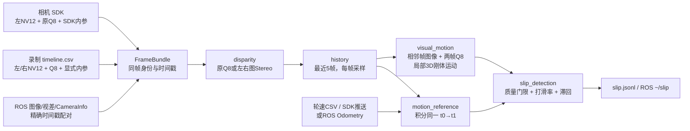

# V8：多帧视差、视觉运动与打滑检测

V8 在 V7 的相机、ROS、录制回放和 DAG 代码上增加三个可独立配置的功能：`visual_motion`、`motion_reference`、`slip_detection`。已有检测、分割、Stereo、点云和地图功能仍可按图开关。新增的默认打滑配置不运行检测、分割、点云和地图，先用真实相机 Q8 视差验证运动链路。

**默认配置可以观察视觉运动和不可用原因；完成相机到车体外参确认，并接入同一时钟的真实轮速/里程计后，才具备打滑判定条件。缺参考、低质量和初始化都返回 `unavailable`，不会当作正常行驶。**

## 1. 数据怎样流动



`history` 等待本帧实际启用的 `dnn/det/seg/disparity` 生产者。它不因采集图像和视差而额外等待点云、地图或回充。若你手动在 `depends_on` 中加入这些节点，仍会按你写的图等待。`publish/record` 若开启，必须汇合全部启用的生产者，防止读取尚未完成的结果。

五帧容量表示保留最近五个唯一采集帧，便于扩展分析和查看历史；当前 `VisualMotion::estimate` 使用窗口内**最近两个采样帧**进行一次运动估计，并不是一次联合优化五帧。

## 2. 三个功能做什么

### 2.1 visual_motion：把像素移动转换成局部车体移动

实现在 `features/visual_motion/src/visual_motion.cpp`，参数在同目录功能文件夹的 `config.json`。

1. 检查窗口确实采到了当前帧，且存在两帧；读取原采集 `timestamp_ns`，检查间隔、图像、视差和内参一致。
2. 在 ROI 内按网格选择有纹理、且有有效视差的候选点。只读 Y 亮度，不进行检测或分割推理。
3. 用亮度块差异搜索对应点，做最佳/次佳比值和双向匹配检查。
4. 分别使用两帧自己的 Q8 视差和同一矫正内参回投到 3D。Q8 的像素视差为 `q/256`；`bxf` 的单位为像素·毫米，所以 `Z_m = bxf / (disparity_px * 1000)`。双线性采样的四个邻居只要有无效 Q8，就拒绝该点。
5. 用 RANSAC 和刚体拟合去除不符合静态场景运动的对应点；检查内点数、内点比例、残差和运动幅度。
6. 先得到静态场景从上一帧到本帧的变换，再取逆得到相机实际位移；通过相机→车体外参及杆臂换算为车体前进、横移和偏航。

这是相邻帧的局部视觉运动估计，不是全局 SLAM。大面积动态物体、重复纹理、弱纹理、错误视差或超出搜索半径的运动可能令结果不可用，也可能造成错误估计；应结合 `features/matches/inliers/quality/residual_m/reason` 判断。

### 2.2 motion_reference：把真实参考积分到同一时间区间

实现在 `features/motion_reference/src/motion_reference.cpp`。

参考样本是车体前向速度 `m/s` 和车体偏航角速度 `rad/s`，按原始 `timestamp_ns` 入有界缓冲区。视觉区间是 `[t0,t1]`，参考必须覆盖这两个边界；边界速度插值后，在这一个区间内积分。缺边界、内部样本间隙过大、非有限值、超过速度上限都返回不可用。

没有轮速源时，可以先测试视觉运动；参考和打滑状态保持不可用。当前没有接入 IMU 融合，不能把加速度或未经换算的编码器脉冲直接填成速度。

### 2.3 slip_detection：比较同区间车体前向位移

实现在 `features/slip_detection/src/slip_detection.cpp`。

当视觉与参考都有效、车体外参已确认、两个时间区间完全一致且质量/速度/转弯门限通过时：

```text
slip_ratio = 1 - visual_forward_m / reference_forward_m
```

例如轮速积分为 0.10 m，视觉前进 0.06 m，则打滑率为 0.40。反向行驶也按参考方向计算；视觉反向时可能大于 1，视觉比轮速走得远时可能为负值，代码不会把这些情况强行裁到 `[0,1]`。

默认进入阈值 `0.35`、持续 `300 ms`；退出阈值 `0.20`、持续 `500 ms`。持续时间累加的是有效相邻采集区间的真实毫秒数，不能用程序播放速度或帧数替代。状态为 `unavailable/normal/suspected/slipping/recovering`。不可用输入会清除滞回累计；时间区间不连续也会重置累计。

## 3. 从哪些配置开始

| 根配置 | 输入与用途 | 内参来源 | 启动入口 |
|---|---|---|---|
| `slip_camera.json` | 相机直取，默认原 Q8 | 自动读取相机 SDK 的矫正内参 | `r36_slip_runner` |
| `slip_recording.json` | 有原始时间戳的录制回放 | 必须设置 `recording.intrinsics_file` | `r36_slip_runner` |
| `slip_ros.json` | ROS 图像、Q8、CameraInfo + 可选 Odometry | 精确时间戳对应的 CameraInfo | ROS `demo` 节点 |

公共配置为 `camera.json`，窗口覆盖为 `config/slip/temporal.json`，三个新功能参数分别在 `features/visual_motion/config.json`、`features/motion_reference/config.json`、`features/slip_detection/config.json`。模型仍统一放在 `models/`，Stereo 读取 `features/stereo/config.json`，相对路径均以所选根配置所在目录解析。

根配置的核心图如下，`id` 可以更名，但 `feature` 必须使用已注册名称：

```json
{
  "worker_threads": 3,
  "nodes": [
    {"id":"disparity", "feature":"disparity", "depends_on":[], "enabled":true},
    {"id":"history", "feature":"history", "depends_on":["disparity"], "enabled":true},
    {"id":"visual", "feature":"visual_motion", "depends_on":["history"], "enabled":true},
    {"id":"reference", "feature":"motion_reference", "depends_on":["history"], "enabled":true},
    {"id":"slip", "feature":"slip_detection", "depends_on":["visual","reference"], "enabled":true}
  ]
}
```

每个 feature 在同一产品图中最多出现一次。关闭 `slip_detection` 可单独观察视觉/参考；关闭参考节点时也必须关闭依赖它的打滑节点。启用视觉节点必须保留 `disparity → history` 祖先关系，并且窗口 `capacity >= 2`。开启检测/分割后，`history.depends_on` 还应加上对应检测/分割节点。依赖缺失、环和未知字段在启动前拒绝；修改 JSON 后重启，不做运行中热加载。

### 3.1 切换新 Stereo 视差

将根配置的 `input.disparity_source` 改为 `raft_stereo`。`disparity` 功能节点仍可使用上述写法；SDK 通过真实 Stereo provider 获取视差。也可使用已有 `feature:inference, algorithm:stereo` 的节点写法，两个写法不能同时选为两个视差节点。

相机自动选择模式由原 Q8 的模式 2 改为左右图模式 1；回放必须提供同帧左右 NV12。Stereo 参数仍从 `features/stereo/config.json` 读取。默认模型裁剪源图底部 `(0,192,640,352)`；输出 Q8 恢复到 `640×544`，上部 192 行为无效 0，内参仍是原图内参。视觉默认 ROI 是相同底部区域，不拉伸视差，不修改原图主点。

原 Q8 与新 Stereo 可复用同一份录制左右图、Q8、时间戳和内参，分别运行到两个新目录后比较。若要公平比较视觉效果，保持 ROI、视觉阈值、外参、轮速 CSV 和有效帧集合相同；相机在线先后采集的两次行驶不能视为同一输入。

### 3.2 相机到车体外参

`features/visual_motion/config.json` 中：

```json
"extrinsics": {
  "rotation": [0,0,1,-1,0,0,0,-1,0],
  "translation_m": [0,0,0],
  "confirmed": false
}
```

`rotation` 按行排列，把相机 `x右/y下/z前` 转到车体 `x前/y左/z上`；示例仅是常见轴向变换。`translation_m` 是相机原点在车体坐标系中的位置，即杆臂。必须换成实测外参并确认方向与车体原点，再设 `confirmed:true`。旋转矩阵会检查有限数、正交性和行列式为 +1。

### 3.3 轮速 CSV 与 ROS Odometry

轮速 CSV 示例：

```csv
timestamp_ns,linear_speed_mps,yaw_rate_radps
1000000000,0.20,0.01
1020000000,0.21,0.01
1040000000,0.20,0.01
```

对应 `features/motion_reference/config.json`：

```json
{
  "input_csv": "data/slip/wheel.csv",
  "odom_topic": "",
  "clock_domain": "camera_monotonic_ns",
  "same_clock_confirmed": true,
  "max_samples": 4096,
  "max_age_ms": 10000,
  "max_sample_gap_ms": 100,
  "max_abs_speed_mps": 30,
  "max_abs_yaw_rate_rps": 10
}
```

`input_csv:null` 表示不读文件。`same_clock_confirmed:true` 只表示你已经在采集系统完成同钟确认，不会自动校准时钟或推算偏移。`clock_domain` 是来源说明，不能把两个不同的时间钟写成同名就认为同步。

ROS 路径可将 `odom_topic` 设为 `/wheel/odom` 等绝对话题，消息类型为 `nav_msgs/msg/Odometry`，使用 `twist.twist.linear.x` 和 `twist.twist.angular.z`。消息 `header.stamp` 必须与图像时间钟一致，`child_frame_id` 必须与配置中的车体坐标系一致。SDK 本体不订阅 ROS、不读取 CSV；这些由原生 runner 或 ROS 应用读入后，通过 `perception_slip_sdk.h` 的 `psdk_full_push_motion_samples` 推送。

`wait_timeout_ms` 默认50、允许0～2000，仅用于ROS参考输入。worker有界等待轮速样本覆盖本帧采集时间，回调继续接收；超时仍处理图像，但严格积分若缺端点便返回不可用，不外推。源时钟epoch重置后应重启整个会话，不能拼接重启前后的单调时间。

参考来源必须与入口对应：camera/recording 的原生 runner 只读 `input_csv`，ROS 节点只订阅 `odom_topic`。同时填写 CSV 和 Odometry、ROS 配置填写非空 CSV、非 ROS 配置填写非空 `odom_topic`，都会在准备阶段报错，防止设置后被静默忽略。直接嵌入 SDK 的应用可自行推送参考样本，不需要这两个适配器源字段。

## 4. 有时间戳的录制回放

`slip_recording.json` 要求 `input.timeline_csv` 和 `recording.intrinsics_file`。默认用 `${CAPTURE_ROOT}/timeline.csv` 和 `${CAPTURE_ROOT}/metadata.json`；也可写相对根配置的实际文件路径。

```csv
timestamp_ns,left_nv12,q8_u16,right_nv12,frame_id
1000000000,left/000001.nv12,q8/000001.u16,right/000001.nv12,123
1033333333,left/000002.nv12,q8/000002.u16,right/000002.nv12,124
```

路径相对 timeline 文件所在目录。左/右图为紧密 `640×544 NV12`，每张 `522240` 字节；原视差为对应同帧 `640×544 uint16 Q8`，紧密存储 `696320` 字节。原 Q8 路径必须提供 `q8_u16`；新 Stereo 必须提供 `right_nv12`，可以省略 Q8 列或留空。CSV 列顺序可变，但名称必须精确，未知/重复列会拒绝；支持 UTF-8 BOM、CRLF 和带引号的路径，不接受分号/TAB 分隔。

`timestamp_ns` 必须是原采集时间，严格递增且非零。`frame_id` 可省略，此时用原 `timestamp_ns` 作稳定帧身份，结果写明 `frame_id_source:source_timestamp_ns`；不会用回放序号编造身份或时间。旧的只有文件清单、没有原时间戳的录制不能据此估计真实速度，需要重新录制或从可靠原始日志补齐时间。

同一次运行约定一个单调采集 epoch、一套模型/ROI/内参。遇到时间回退直接拒绝。换数据源 epoch、模型、ROI 或内参时分开运行，重建 engine 会同时重置历史和状态；SDK 内的时序检查也会拒绝跨不连续几何的视觉对。不要把不同机器重启前后的单调时间拼进一个 timeline。

## 5. X5 运行与结果

在项目根目录使用已有构建好的 v8 安装产物；`SDK_ROOT` 指向本次构建的 SDK，`INSTALL_ROOT` 指向包含原生工具的安装前缀。相机 SDK 路径仍配置于 `camera.json`，也可由已有环境覆盖机制提供。

```bash
export SDK_ROOT="$PWD/install/backend_sdk_x5"
export INSTALL_ROOT="$PWD/install/perception_ros_so_demo_x5"

# 只校验；output必须是尚不存在的新目录，不打开相机/模型、不创建结果目录
bash tools/run_slip.sh --config "$PWD/slip_camera.json" --output /userdata/slip_check_new --check

# 相机直取；runtime.max_frames默认100，设0时一直运行直到Ctrl+C
bash tools/run_slip.sh --config "$PWD/slip_camera.json" --output /userdata/slip_camera_001

# 有原始时间戳的录制回放
export CAPTURE_ROOT=/userdata/recorded_motion
bash tools/run_slip.sh --config "$PWD/slip_recording.json" --output /userdata/slip_replay_001
```

原生 runner 不需要 ROS 进程。相机二进制需链接本机兼容的厂商依赖，Stereo 需 Horizon 构建；CPU/Windows 的原视差录制回放可以验证纯 C++ 运动和打滑逻辑，不能代替 X5 BPU 或真实相机试验。ROS 输入使用现有 `perception_config`/ROS demo 启动方式和 `slip_ros.json`，不要把 ROS 配置交给只接受 camera/recording 的 `r36_slip_runner`：

```bash
# 已安装对应 ROS 应用和其运行依赖时
bash tools/run_pipeline.sh --config "$PWD/slip_ros.json" --run-dir /userdata/slip_ros_001
```

每次 `--output` 都使用新目录，避免覆盖与跨 session 状态混淆：

```text
output/
  effective_full.json / parameters.yaml / resolved.json  # 实际生效配置
  run.json                    # 时间/身份/内参/指标口径
  slip.jsonl                  # 逐帧视觉、参考、状态、原因
  metrics.jsonl               # 逐帧采集/计算/CPU/RSS/任务信息
  bpu_samples.jsonl           # 设备共享BPU采样，不作单模型归因
  complete.json               # 完整运行汇总
  partial.json                # Ctrl+C等正常中断的部分汇总
```

`complete.json` 和 `partial.json` 二者按结束情况写一个。第一帧初始化也计入运行指标，当前 runner 不丢掉 warmup 后重新启动时序状态。`pipeline_fps` 包含采集/加载、参考推送、处理和结果输出；`compute_fps` 基于处理时间；CPU 是同进程所有线程，`100%` 表示占用一个逻辑核。相机原 Q8 的生成耗时未在本进程测得，报告为 `null`，不能解释成 0 ms。

## 6. 调参和验证顺序

1. 先用原 Q8，相机静止，确认两帧视觉位移接近零、匹配/内点充足，且没有时间或标定错误。
2. 测量并确认车体外参，低速直线运动，核对视觉前进方向和轮速符号。先记录 CSV 或使用已同钟的 ROS Odometry。
3. 在无打滑的实测数据上比较视觉/参考区间和位移，核对尺度与偏差。若质量不足，先排查图像、视差、外参和动态物体，不宜只降低所有质量门限。
4. 在已知打滑场景检查进入/恢复的真实持续时间。默认阈值是起始实验参数，需要按相机安装和车辆状态评估。
5. 固定同一录制数据切换新 Stereo，比较有效帧比例、位移误差、残差、打滑结果和耗时。云图更平滑并不自动代表运动或打滑估计更准确。

配置契约在 `validation/motion_config_test.cpp`，算法合成数据验证在 `validation/motion_algorithms_test.cpp`，CSV 时序/身份验证在 `validation/slip_timeline_test.cpp`。这些验证覆盖软件行为，不构成真实车辆准确率或打滑检测安全性评价。
