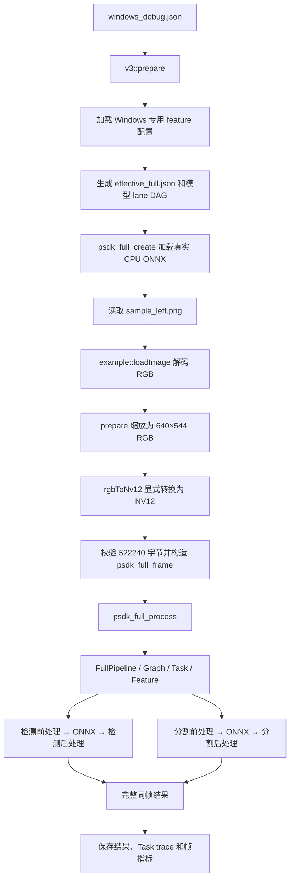

# 在 Visual Studio 2022 中调试当前项目

v8 已保留以下单帧调试入口；本次解决方案名称为 `perception_stereo_cpp_v8.sln`。新增多帧视差、轮速与打滑的调试方法见 [V8 编译与运行](V8_编译与运行.md)。以下 v7 名称描述的是原调试入口的引入版本，当前生成脚本会构建所在 v8 目录源码。

本入口编译、执行当前 `perception-stereo-cpp-v7` 的源码。它使用真实 ONNX Runtime CPU 推理，读取离线图片，在同一进程中执行配置解析、完整 SDK、DAG、Task、Feature 和检测/分割。可以在这些源码中设置断点，再按 F5 进入实际调用。

默认只运行一张 `640×544` 的样本，方便阅读调用栈和检查结果。Debug 模式和断点下的耗时用于排查流程，不能作为 X5 性能指标。

## 1. 生成并打开解决方案

要求安装 Visual Studio 2022 的“使用 C++ 的桌面开发”工作负载、Windows SDK 和 CMake，建议使用 CMake 3.24 或更新版本。依赖为 Windows x64 ONNX Runtime C/C++ SDK，需要同一包中的 `include/`、`lib/onnxruntime.lib` 和 `lib/onnxruntime.dll`。

在项目根目录打开 PowerShell：

```powershell
Set-ExecutionPolicy -Scope Process Bypass
.\tools\generate_vs2022.ps1 -Build
```

需要指定 ONNX Runtime 时：

```powershell
.\tools\generate_vs2022.ps1 `
  -OrtRoot "D:\path\to\onnxruntime-win-x64-1.16.3" `
  -Build
```

默认 preset 使用项目内附带的 Windows x64 依赖：

```text
windows/
└─ deps/
   └─ onnxruntime-win-x64-1.16.3/
      ├─ include/
      └─ lib/
         ├─ onnxruntime.lib
         └─ onnxruntime.dll
```

脚本生成的解决方案为：

```text
build/vs2022/perception_stereo_cpp_v7.sln
```

打开该文件，选择 **Debug / x64**，确认启动项目为 **perception_windows_debug**，在 `windows/src/main.cpp` 的 `psdk_full_process` 调用处设置断点，然后按 F5。依赖 DLL 会在构建后复制到程序目录，不需要先安装整个 SDK。

生成脚本还支持 `-Configuration Release` 和 `-Test`。只生成工程、不立即编译时省略 `-Build`。例如执行 Debug 构建和测试：

仅构建调试程序及其依赖可以使用 `-Build -Target perception_windows_debug`。迁移目录或需要重置 CMake 缓存时使用 `-Fresh`（该选项要求 CMake 3.24 或更新版本）。Debug 自动测试中的完整像素校准回归较慢，可持续数分钟。

```powershell
.\tools\generate_vs2022.ps1 -Build -Test
```

启动参数由 CMake 设置：

```text
--config <项目根目录>/windows_debug.json
```

工作目录为项目根目录。默认每次生成新的时间戳输出目录，可以反复按 F5。不要把启动项目选为 `ALL_BUILD` 或 `ZERO_CHECK`。

## 2. 首次 F5 实际执行什么



默认处理的样本为 `windows/data/sample_left.png`。程序先把编码图片解码，通过 `perception::prepare(...).rgb` 得到 `640×544` RGB，再调用 `perception::rgbToNv12` 真正转换为 NV12；随后强制校验 YUV420 总大小为 **522240 字节**。编码图片尺寸不同时按本离线 profile 拉伸到 `640×544`。SDK 的 C ABI 接口接收 NV12/I420；模型的归一化、模型尺寸转换和后处理继续由原 `CpuStages` 完成。

不能把 RGB 字节直接标记成 NV12。当前通用 `prepareNv12` helper 对 RGB 输入的返回路径不能作为格式转换保证，本入口明确调用 RGB→NV12 转换并校验大小。I420 选项在真实 NV12 基础上拆分 U/V，保持相同的 522240 字节总长度。

主程序直接调用 `v3::prepare` 和 `psdk_full_*`，没有启动另一个推理进程。`perception_config` 的 Windows 版本能够准备配置，但其 `v3::launch` 会拒绝启动 Linux/ROS 程序；本调试入口直接进入 SDK，因此可以连续查看完整调用栈。

## 3. 配置文件和相对路径

```text
项目根目录/
├─ windows_debug.json                  主配置：离线输入、det/seg DAG
├─ camera_benchmark_visualization.json  复用输出开关配置
├─ windows/
│  ├─ CMakeLists.txt                    VS 启动属性、链接和 DLL 复制
│  ├─ src/main.cpp                     同进程调试入口
│  ├─ data/sample_left.png             默认样本
│  ├─ deps/onnxruntime-win-x64-1.16.3/   Windows C/C++ Runtime SDK
│  └─ config/
│     ├─ offline.json                  图片列表、输入内存格式、处理帧数
│     ├─ inference.json                选择 CPU backend 和 CPU tensor 契约
│     ├─ detection.json                检测 ONNX 模型与功能开关
│     └─ segmentation.json             分割 ONNX 模型与功能开关
├─ features/inference/cpu_profile.json  ONNX 输入/输出、归一化、类别等契约
├─ models/cpu/                         真实 ONNX 模型
└─ scheduling/config/sdk_templates/    用于生成配置的 SDK 模板
```

用户配置中的图片、feature 文件和模型相对路径，都按**主配置 `windows_debug.json` 所在目录**解析。例如 `windows/config/offline.json` 中的：

```json
{
  "left_files": ["windows/data/sample_left.png"],
  "format": "nv12",
  "loop": false,
  "max_frames": 1
}
```

这里的图片路径相对项目根目录，不能按 `windows/config/` 再追加一层。

`format` 表示提交给 SDK 的 YUV 内存格式。PNG/JPEG/PPM 由扩展名和内容识别、解码，再转换为 `nv12` 或 `i420`。读取原始 `.nv12/.i420/.yuv` 时，它表示文件实际的存储布局。

SDK 模板和 CPU tensor 契约内部的相对引用，继续遵循它们原有的配置文件规则。生成器会把最终使用的路径写进输出目录中的配置，排查时查看生成结果即可。

主配置中的：

```json
"sdk": {
  "root": ".",
  "base_config": "scheduling/config/sdk_templates/full.json"
}
```

允许直接使用源码树中的模板准备配置，无须先执行 install。Windows 专用 feature 配置明确选择 CPU 和 `models/cpu/`，不会把 X5 `.bin` 当作 ONNX 加载。

### 换图片、处理多张图片

编辑 `windows/config/offline.json` 的 `left_files`：

```json
"left_files": [
  "windows/data/sample_left.png",
  "D:/datasets/example/another.png"
],
"loop": false,
"max_frames": 0
```

`loop=false, max_frames=0` 按列表顺序处理全部文件。默认 `max_frames=1` 只处理第一张。若设置 `loop=true`，必须设置一个正的 `max_frames`，避免调试入口无限运行。

Windows JSON 路径建议使用 `/`。使用 `\` 时需要按 JSON 规则写为 `\\`。

### 原始 NV12/I420

原始数据必须是紧密排列的 `640×544` YUV420，步长 640，总大小 **522240 字节**：

```json
"left_files": ["D:/datasets/frame.nv12"],
"format": "nv12"
```

I420 文件应设置 `format=i420`。扩展名 `.nv12/.i420` 与配置冲突时立即报错，不会静默改解释方式。

### 更换 ONNX 或只运行一个功能

检测、分割模型路径分别在 `windows/config/detection.json` 和 `windows/config/segmentation.json`。默认模型使用以下契约：

| 项目 | 默认检测 | 默认分割 |
|---|---|---|
| 模型输入 | 864×480，float32 NCHW | 832×480，float32 NCHW |
| 类别 | 24 | 3：no_grass / grass / flagstone |
| 输出处理 | raw DFL 检测头、阈值和 NMS | logits、双线性分割后处理、恢复到源图尺寸 |

换模型时需要同步核对 `features/inference/cpu_profile.json` 的输入名、输出名、尺寸、布局、归一化和类别。模型不符合声明契约会报错；单纯改路径不能适配所有 ONNX。

若只调检测，在 `windows_debug.json` 把 `seg` 节点的 `enabled` 改为 `false`；只调分割则关闭 `det`。至少保留一个模型 lane。内部模型 DAG 在每次准备配置时生成，不建议手工编辑输出目录中的生成文件。

## 4. 建议断点顺序

| 目的 | 文件 | 函数或位置 |
|---|---|---|
| 看启动参数、输入和结果生命周期 | `windows/src/main.cpp` | `run`、`load`、`psdk_full_process` 调用 |
| 看主配置与 feature 如何合并 | `scheduling/config/src/native_pipeline.cpp` | `v3::prepare` |
| 看 SDK 完整配置解析 | `scheduling/config/src/full_config.cpp` | `r33::full::loadConfig` |
| 看一帧如何进入产品流程 | `scheduling/pipeline/src/full_pipeline.cpp` | `impl_psdk_full_process` |
| 看产品节点如何绑定到调度器 | `scheduling/dag/src/full_graph.cpp` | `Graph::runContext`、`BoundFeature::execute` |
| 看依赖、可执行任务、线程池 | `scheduling/dag/src/task_graph.cpp` | `TaskGraph::run`、任务执行代码 |
| 看模型 lane 的内部流水线 | `scheduling/inference/src/dag_pipeline.cpp` | `r25::Pipeline::run` |
| 看 CPU 输入、模型调用和输出 | `features/inference/cpu/src/cpu_stages.cpp` | `CpuStages::preprocess/infer/detection/segmentation` |

在 Visual Studio 的“线程”“调用堆栈”“局部变量”“监视”窗口中查看任务与数据。DAG 有工作线程，断点可能在另一个线程触发。可以先在主程序的 SDK 调用处停住，再进入 SDK 和任务函数。

重点观察：

- 输入 `frame_id/timestamp_ns`，结果必须保留同一身份。
- `frame.left.format/width/height/stride/bytes`，默认是 NV12、640×544、步长 640。
- `view.inference.detections` 与 `detection_count`。
- `view.inference.segmentation_mask` 与 `segmentation_bytes`；默认每个源图像素一个类别 ID，共 348160 字节。
- `view.task_trace_json`，用于检查实际执行和跳过的任务。

这些结果指针由当前 `Result` 持有。每轮结束后结果释放，不能把释放后的借用指针继续用于调试代码或新功能。

`worker_threads=3` 表示产品图最多提供三个工作线程，并不保证所有模型后端实际并行。原 SDK 的进程级锁和后端调度仍然保留；本入口没有替换这些运行逻辑。

## 5. 结果保存位置

默认目录为：

```text
output/windows-debug-<时间戳>/
├─ requested_pipeline.json
├─ resolved_features.json
├─ effective_full.json
├─ inference_detection_dag.json
├─ inference_segmentation_dag.json
├─ parameters.yaml
├─ frames.jsonl
├─ complete.json
└─ frame-1/
   ├─ result.json
   ├─ task_trace.json
   ├─ effective_config.json
   ├─ temporal.json
   ├─ mask.bin
   ├─ source.yuv
   ├─ rgb.png
   └─ overlay.png
```

目录内还可能包含其他由配置生成的中间文件。`result.json` 包含检测结果；`mask.bin` 是原始类别 ID，不是 RGB 图片。`source.yuv` 保留实际提交给 SDK 的输入，默认 NV12 应为 **522240 字节**；`rgb.png` 是该输入的 RGB 显示结果；`overlay.png` 叠加检测框和分割颜色。`frames.jsonl` 记录图像解码/转换、SDK 调用、模型阶段与保存耗时；`complete.json` 仅在正常完成后写出。

调试程序在本次 `effective_full.json` 中开启 `save_overlay` 和 `save_inputs`，并每帧显式调用 `psdk_full_save_result`，因此即使产品图中的自动录制节点关闭，仍会保存这组调试结果。这个输出策略属于 Windows 调试入口，原 X5 和 benchmark 配置不受影响。

需要固定输出目录时，在项目属性的“调试 / 命令参数”中追加：

```text
--output D:/debug_runs/case001
```

该目录必须尚不存在。默认时间戳目录适合反复 F5，程序拒绝覆盖已有目录。

## 6. 当前 Windows profile 的边界

| 功能 | 本入口 |
|---|---|
| v7 配置解析、DAG/Task/Feature | 使用原源码，可设置断点 |
| 检测、分割 CPU ONNX | 支持真实模型推理 |
| PNG/JPEG/PPM、紧密 NV12/I420 | 支持离线输入 |
| X5 BPU `.bin` | 未编译 BPU backend，不能在此运行 |
| 相机厂商 X5 SDK `.so` | Linux 加载路径，当前 Windows profile 不运行 |
| ROS 相机订阅和发布 | 当前 profile 未构建 ROS 节点 |
| PCL/Patchwork/点云融合 | 当前 profile 关闭 mapping，未编译这条链路 |
| 新 Stereo 模型与视差推理 | 当前 Windows profile 关闭 Stereo |
| X5 camera 三组在线 benchmark | 使用 X5/Linux 入口，不能用本 Debug 耗时替代 |

如果后续要调点云，需要接入匹配的 Windows PCL/Eigen/OpenCV 等依赖并启用 mapping，同时提供真实视差和标定。当前检测/分割配置不需要内参，因为没有执行依赖几何的功能。

## 7. 常见问题

**F5 提示找不到 DLL：** 先确认 `-OrtRoot` 指向 Windows x64 包，重新生成并构建 Debug。调试程序目录应同时有 `perception_sdk.dll` 和 `onnxruntime.dll`。不要使用 Linux `.so` 或 X5 AArch64 库。

**模型输入/输出不匹配：** 查看 `features/inference/cpu_profile.json` 与模型真实 tensor 契约。默认 profile 对应随项目管理的两份 CPU ONNX。

**配置找到但图片不存在：** 用户路径相对主 `windows_debug.json`，检查 `windows/config/offline.json` 的 `left_files`。默认样本是 `windows/data/sample_left.png`。

**只准备了配置，没有进入推理：** 确认启动项目是 `perception_windows_debug`。`perception_config --prepare-only` 只做配置准备。

**断点不命中或变量被优化：** 确认选择 Debug/x64，打开的是当前 v7 的解决方案和源码；查看模块窗口确认加载的 DLL/PDB 来自本次构建。

**Debug 时间很长：** 第一次初始化会加载两个真实 ONNX 模型；断点、Debug 编译和初始化校准都会影响耗时。先用一张图片检查正确性。
